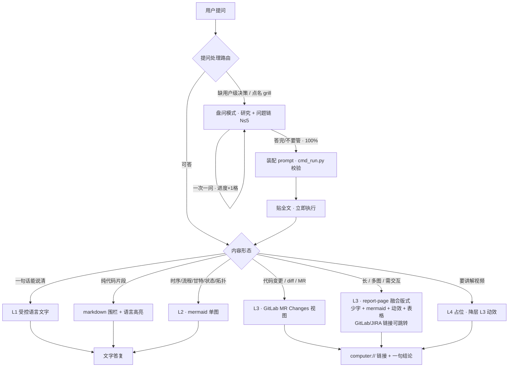

# answer-hub · 统一应答调度器

一句话：一个 skill 管全流程——**该问就问（进度条盘问），作答按 Karpathy 四层输出阶梯取最低够用层：L1 受控语言文字 → L2 图 → L3 交互 HTML（report-page 融合版式）→ L4 讲解视频（占位）**。

方法论：grill-me v3.0.0（github.com/tkersey/dotfiles）+ grill-with-docs（github.com/cboyd10/claude-config，Matt Pocock）+ JuliusBrussee/caveman（Apache-2.0）+ 原 optimize-prompts 的 ROLE 模板与结构校验（已内置本 skill）+ Karpathy 2026-10-02 四层输出阶梯推文（x.com/karpathy/status/2105819303471976479）。L3 版式融合 report-page（源依据型静态文档页），细则见 references/html-guide.md；html-anything 引擎 2026-10-25 删除。

## 内部资源

| 路径 | 用途 |
|---|---|
| `references/prompt-templates.md` | 5 套 ROLE 模板 + 逐节填写指南（盘问模式装配用） |
| `references/grill-rules.md` | 盘问规则 |
| `references/checklist.md` | 终稿自检清单（脚本查不出的项） |
| `references/html-guide.md` | L3 版式细则：report-page 融合 + 体裁判定/块模型映射 + GitLab MR Changes 模板（控制条不可省）+ mermaid/动效写法 + 交付前实测 |
| `scripts/cmd/cmd_run.py` | 结构校验入口（cmd → core → common 单向依赖） |
| `scripts/common/conf.py` | `get_output_dir()`：产物目录解析（env → git 根 → skill 回退） |
| `output/` | **仅仓库外回退用**；正常产物落在当前工程 `.answer-hub/output/` |

## 输出路径规则（对齐 jira-commit）

产物（L3 的 `output.html`+`assets/` / `optimized-prompt.md` / `validate-report.txt`）**写进当前工程，不写本 skill 目录**：

- 优先级：`ANSWER_HUB_OUTPUT_DIR` env > git 仓库根 `.answer-hub/output` > 本 skill `output/`（脚本实现为 `scripts/common/conf.py:get_output_dir()`）。
- L3 产物落 `$ANSWER_HUB_OUTPUT/<主题名>/output.html`（主题名英文短横线），引用的本地媒体放同目录 `assets/`。
- 工程内首次产出时，若 `.gitignore` 还没有 `.answer-hub/`，补一行（.gitignore 为 DLP 密文读不到时跳过并在回复里声明）。
- 聊天里给 `computer://` 链接时，用解析后的**绝对路径**。

## 模式路由（每条用户消息先过这张表）

两个维度：提问处理（盘问）× 回答形态（四层阶梯，取最低够用层）。

| 判定 | 层/模式 | 出口 |
|---|---|---|
| 提问缺用户级决策（物质性测试），或用户点名 grill me / 盘问我 / 问我吧 | 盘问模式 | 进度条 → 100% → 装配 prompt → 贴全文立即执行 |
| 纯代码片段（给一段代码 / 实现 / 示例） | 不升 L3 | markdown 围栏 + 语言标注，按语言着色 |
| 回答一句话能说清 | L1 受控语言文字 | 压缩 + STE 纪律（规则见下方 L1 节，全文即该表） |
| 一张图能说清（结构 / 关系 / 流转 / 时序 / 拓扑 / 甘特） | L2 图 | 聊天内 mermaid 单图，不开整页 HTML |
| 回答长 / 多图 / 需交互 / 含对比、趋势、占比、流程、链路、状态 / 点名要 html、网页、可视化、dashboard | L3 交互 HTML | **report-page 融合版式**：文字最少 + mermaid 渲染 + 动态效果图 + 表格；含 diff 时 GitLab MR Changes 视图 → 单文件 `output.html` + computer:// 链接 |
| 用户要"讲解视频" | L4 占位 | 不产视频，降层 L3（动态效果图近似"演出来"） |
| 闲聊问候 | 不启动 | 正常聊天 |

阶梯总纲（Karpathy 四层输出阶梯）：L1→L4 读者认知负荷递减，生产成本与精度损失递增——**默认取最低够用层：能 L1 不 L2，能 L2 不 L3**；用户点名层数则按点名。

**HTML 统一政策**：本工程内一切 HTML 产出（报告/页面/数据可视化/证据页）统一由本 skill L3 → report-page 融合版式出；html-anything（目录已删除）/ html-ppt / ppt-page / theme-factory / web-artifacts-builder 均不再使用（2026-10-25 更新）。

组合规则：盘问是"提问处理"维度，L1-L4 是"回答形态"维度，两者可组合——盘问 100% 装配执行后的执行结果按同一阶梯选层。

## 总流程



## 模式一 · 盘问（grill）

### 触发与流程

1. **研究禁止先问**。代码能回答的不问用户。先读相关代码 / 文档 / 会话上下文，产出"已知事实清单"，只有过不了物质性测试的决策点才进问题链（判断归属四分法、物质性测试、问法、回答处理 → [grill-rules.md](references/grill-rules.md)）。
2. **建问题链 + 初始进度**。问题上限 5 个，依赖排序（先问影响面大的）。立即显示初始进度条与问题概览：

```
Grill 进度 [□□□□□] 0/5 (0%)
研究结论：已确认 3 项事实（来源略）
待盘问 5 个决策：Q1 … Q2 …
```

3. **逐问**。一次一问，格式固定、进度条每轮必显示：

```
Grill 进度 [■■□□□] 2/5 (40%) — 剩 3 问

Q3 · PMIC 上电时序异常时是否切 FAILSAFE 分支？
推荐 B · 只记错误码 —— 理由：FAILSAFE 目标态未定义，先保证可观测
A. 切 FAILSAFE 分支
B. 只记错误码（推荐）
C. 其他，请说明
```

4. **进度 100% 三路径**：

| 路径 | 处理 |
|---|---|
| 全部答完 | 用用户答复值锁定 |
| 用户说"不要管 / 别问了 / 直接干 / 随你" | 全部按推荐值锁定，进度直接 100%，逐项标注"用户未确认" |
| 研究后无需提问（N=0） | 初始即 100%，直接装配 |

5. **装配终 prompt + 校验**：
   - Read `references/prompt-templates.md`，按任务类型选模板（编码 / 调试 / 文档 / 数据分析 / 通用）。
   - 问答决策表写入模板"项目上下文"节，每个决策带来源标注（用户选 X / 按推荐锁定）。
   - 写入 `$ANSWER_HUB_OUTPUT/optimized-prompt.md`（目录见「输出路径规则」）。
   - 过一遍 `references/checklist.md`（脚本查不出的质量项）。
   - 校验（脚本在本 skill 内，相对路径按本 skill 根解析，传绝对路径最稳）：

```
python <skill根>/scripts/cmd/cmd_run.py "$ANSWER_HUB_OUTPUT/optimized-prompt.md"
```

退出码 0 才过；非 0 按报告修 prompt 再校，不带占位符执行。

6. **贴全文 + 立即执行**。完整 prompt **全文**贴在聊天里，**立即执行不再二次确认**（盘问即确认）。执行方式：编码/修改类 → Task 派 general_purpose_task（完整 prompt 作任务描述）；勘察/研究类 → Task 派 search；简单任务 → 直接做。

提问文案走 L1 压缩风格（短、无客套）。

## 回答形态 L1 · 受控语言直答（少废话）

十二规则（全文即本表，无外部细则文件）：

| # | 规则 |
|---|---|
| 1 | 答案先行：结论 → 依据 → 下一步 |
| 2 | 杀客套：删"好的/让我/接下来我将" |
| 3 | 短词：标准缩写可，不自造缩写 |
| 4 | 可省冠词，不可省否定（not/never/no/only/除了绝不省） |
| 5 | 一义一句；一句 ≤20 词（中文约 25 字），程序步骤更短 |
| 6 | 主动语态，指令用祈使句；禁"建议您可以考虑"式绕行 |
| 7 | 一词一义：同一概念全程同一叫法，禁同义词轮换 |
| 8 | 禁 hedge：可能/也许/值得注意的是——不确定就明说"不确定 + 缺什么" |
| 9 | 载荷原样：代码/命令/路径/报错逐字符不变 |
| 10 | 工具调用间不说话：多步前一行、阶段一行、结束一行 |
| 11 | 用用户语言 |
| 12 | 不表演：压缩后不比平话短 → 用平话 |

多项信息用表格。例外场景（安全警告 / 不可逆确认 / 用户困惑 / 持久产物 / 向用户提问）用完整句。
STE 取 Karpathy 实践的 80% 精度：句长 / 语态 / 术语结构规则全守，900 词表不强制。

## 回答形态 L2 · 图（聊天内单图）

判定：一张图能说清（结构、关系、流转、时序、拓扑），不需要交互与多区块——停在 L2，不开整页 HTML。

| 信息形态 | 图型 | 实现 |
|---|---|---|
| 流程 / 链路 / 状态流转 | flowchart / stateDiagram | mermaid（源码贴聊天，可渲染） |
| 时序 / 调用链 | sequenceDiagram | mermaid |
| 甘特 / 排期 / 阶段推进 | gantt | mermaid |
| 拓扑 / 层级 | graph TD | mermaid |
| 数据对比 / 占比 | 表格优先 | 图仅在数字多时用 |

硬规则：一答 ≤2 图；图前一句结论，图后 ≤3 行说明；数据真实标源；图说不清（需 hover / 步骤回放 / 多图联动）→ 升 L3。

**mermaid 与 HTML 的关系**：图一律 mermaid，不手写 SVG。要整页（用户点名 html / 页面 / 可分享）→ mermaid 源码嵌进 L3 `output.html`，CDN `https://cdn.jsdelivr.net/npm/mermaid@11/dist/mermaid.esm.min.mjs` 渲染（断网降级 `<pre class="mermaid-src">` 显示源码）。不要页面 → 停在 L2 直接贴源码。

## 回答形态 L3 · 交互 HTML（report-page 融合版式）

**引擎**：report-page 融合版式（2026-10-25 用户定；html-anything 已删除）。版式细则（体裁判定 / 块模型映射 / GitLab MR Changes 模板 / mermaid / 动效 / 交付前实测）→ [html-guide.md](references/html-guide.md)。交付形态 = 源依据型静态文档页 + 最少文字。

**排版硬规则（全部强制，按优先级排序）**：

| # | 规则 | 实现要求 |
|---|---|---|
| 1 | **文字越少越好** | 结论一句话；解释交给图 / 动效 / 表；禁成段散文；注释性文字 ≤1 行/图 |
| 2 | **能 mermaid 就 mermaid 渲染** | 时序/流程/状态/拓扑/甘特一律 mermaid@11 内联渲染，断网降级 `<pre class="mermaid-src">`；不手写 SVG |
| 3 | **能动态效果图就动态效果图** | 机制可动效演示的（数据流、状态切换、时序推进、A/B 切换）优先 CSS/JS 内联动画，带重播控制；动效表达不了再退 mermaid，其次表格 |
| 4 | **其次表格** | 对比 / 清单 / 指标 / Gap 一律表格；不画没必要的图 |
| 5 | **代码变更一律 GitLab MR Changes 视图** | 浅色底；文件头条（路径 + 增删行数）；双列行号（old/new，删除侧留空）；hunk 头 `@@ -a,b +c,d @@` 灰底条；增行 `#e6ffec` / 删行 `#ffebe9`；**控制条 sticky 不可省：全部展开/全部收起 + ⏎ 换行（字号 A−/A+ 可选），localStorage 记忆**；禁深色终端风 |
| 6 | **GitLab/JIRA 链接必须可跳转** | commit / MR / JIRA 号一律真 `<a href>`（GitLab 用远端 permalink，JIRA 用工程基址）；基址未知就写"基址未知"，禁贴死文本冒充链接 |
| 7 | **内容必须来自实际工程** | 数字/代码/结论全部取自真实仓库、真实提交、真实文件；页面底部标数据来源（仓库+分支+提交+日期）；不确定的内容不进页面 |

**mermaid 语法红线**（2026-10-25 实测教训，写完必对照）：
- 文本内禁 `;`（sequenceDiagram 中是语句分隔符，会截断语句报 Syntax error）
- 点线边带标签禁引号写法 `-. "x" .->`，用 `-.->|x|`
- participant 别名禁括号（`as SoC/MPU(IVI)` 会炸），用 `as SoC-MPU-IVI`
- 交付前必须浏览器实测渲染无错，只靠肉眼不算验证

**产出**：单文件自包含 `output.html`（CSS/JS 内联；mermaid CDN 例外）+ 可选 `assets/`，落 `$ANSWER_HUB_OUTPUT/<主题名>/`。
**交付**：聊天回复 = 一句结论 + computer:// 绝对路径链接；交付前浏览器实测 mermaid 与动效。

## 回答形态 L4 · 讲解视频（占位，不实现）

管线不可靠（动画准确性无保证、生成链路长），本 skill 无视频渲染能力。用户要视频时：说明不产视频 → 降层 L3，用动态效果图（步骤推进 / 状态切换动画）近似"演出来"。

## 反模式

| 反模式 | 正解 |
|---|---|
| 未研究就开问 | 先读代码，可查的不问 |
| 一轮多问 / 进度条不更新 | 一次一问，每轮必显示进度 |
| 100% 后再要一次确认 | 盘问即确认，贴全文立即执行 |
| 不贴全文就执行 | 必须贴完整 prompt 再执行 |
| L1 长篇大论 | 按阶梯升层：单图能说清升 L2，长 / 多图 / 需交互升 L3 |
| L3 把全文贴聊天 | 只贴一句结论 + computer:// 链接 |
| 能 L1/L2 说清却开整页 HTML | 阶梯取最低够用层 |
| L2 图前后长篇散文 | 图前一句结论，图后 ≤3 行 |
| 用户要视频硬造 | L4 占位，降层 L3 |
| L3 页面大段散文 | 规则 1：文字最少，解释交给图 / 动效 / 表 |
| L3 静态图硬画动态过程 | 规则 3：优先动态效果图 |
| diff 做成深色荧光终端风 | 本工程 diff 一律 GitLab MR Changes 视图（浅色、双列行号、增绿删红） |
| diff 省控制条（无全部展开/收起、无换行） | 规则 5：控制条不可省——全部展开/全部收起 + ⏎ 换行必须，字号可选，localStorage 记忆 |
| commit/JIRA 号贴死文本 | 规则 6：一律可跳转真链；基址未知则明说 |
| 页面内容凭印象写 | 规则 7：一切来自实际工程并标来源；交付前重查源数据 |
| 手写 SVG 画时序/流程/甘特 | 一律 mermaid；要页面就把 mermaid 嵌进 HTML |
| mermaid 写完不实测就交付 | 语法红线 + 浏览器实测（`;` / 引号点线边 / 别名括号三大坑） |
| 纯代码也包一层 HTML 页面 | 纯代码走 markdown 围栏 + 语言标注，不升 L3 |
| 流程图/时序图说清了还硬开整页 | 阶梯取最低够用层，图能说清停 L2 |
| 引用已删除的 html-anything 风格文件做实现 | 引擎已删除；版式按 [html-guide.md](references/html-guide.md) + L3 硬规则表实现 |
| 产物写进 skill 自带 `output/` | 当前工程内 → `<仓库根>/.answer-hub/output/`；仓库外才回退 |
| 问题超 5 个 | 砍到 5 以内，其余按推荐默认并声明 |
