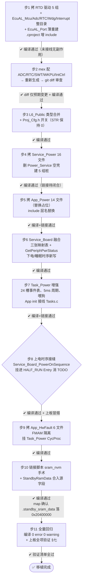

# 7255 平台电源管理模块移植方案

> 源工程：`D:\wnagjin\Compay_Project\CDC_7255\6125\FreeRTOS_S32K312`（WB101 代码基，S32K312 + FreeRTOS + RTD 4.0.0 D2311）
> 目标工程：`D:\wnagjin\Compay_Project\CDC_7255\cdc_7255`（7255 平台 POC，S32K312 + FreeRTOS + RTD 4.0.0 D2311，已于 2026-09-10 切换 FreeRTOS）

## 一、Context

7255 平台 POC 当前只有骨架：`L1_APP/APP_Power/App_Power.c` 四态占位状态机（INIT→POWERON→PMIC_INIT→RUNNING）、`L4_Service/Service_Power/Power_Service.c` 空壳、`L2_Tasks/Task_Power` 四件套骨架（10ms）。7255 真实上电时序（`Service_Board_PowerOnSequence`）已完成但游离于状态机之外（`Service_Board.c:79` 留有 TODO：应放进 HSM 的 HALF_RUN 状态）。

本方案把源工程完整的电源管理模块（**高低压保护、电源管理状态机、上下电时序、STR、休眠唤醒** 五个子系统）统一移植到目标工程，对齐《1.7255平台电源管理.md》"先把 Mcu 的电源管理做了，先移植模块，不管细节"的原则。覆盖范围已用《电源管理Commit汇总.md》（135 条）逐条核实：核心基线 commit 0b38be2a（状态机）/5c2ac4ce（上电时序）/e2c09c4b+f492122b（电压检测）/41f0c649（STR）/fd528387（休眠唤醒）全部存在于源工程当前分支，源即为最新实现，**按当前分支代码整体移植，无需按 commit 分步回放**。

### 已确认的三个决策

| #   | 决策点     | 结论                                                                                                                                                                     |
| --- | ------- | ---------------------------------------------------------------------------------------------------------------------------------------------------------------------- |
| 1   | 状态机策略   | **先照搬 WB101 十状态 HSM**（RESET/HALF_RUN/RUN/EXTERN_RUN/STANDBY/PRE_SLEEP/SLEEP/BATT_ABNORMAL/ALARM/CLOCK）；7255 状态集重定义（work/standby/screensaver/SoCPowerOff/STR/D4…）作为后续阶段 |
| 2   | STR 桩策略 | **走 `FUNC_HSM_USING_STR_EN=0` 路径**（SOC 直接断电）；STR 握手代码（SPI 0x0006）原样移植但不激活，后续翻开关即可启用                                                                                    |
| 3   | 范围边界    | **连带 App_HwFault 一起移植**（commit e680a44d，AVM POC1-4 电源通道故障检测；7255 板卡已有 POC1-4 ADC 引脚 + POC 总使能脚）                                                                        |

## 二、核心原则：只动架构，不动实现

| 保持不变（红线） | 允许改（熔接面） |
|---|---|
| App_Power / Service_Power / App_HwFault 全部业务逻辑、状态迁移表、电压阈值、时序常量、去抖算法 | include 路径层名替换（`L1_Applications`→`L1_APP`、`L4_Services`→`L4_Service`） |
| HSM 引擎（Service_PowerHsm.c，业务无关）与事件路由（Service_PowerEventRouter.c） | Service_Board 融合：7255 真实上下电时序接入 |
| EcuAL McuLowInf 进 STANDBY 全链（Wdg_DeInit→关中断→停 SysTick→WKPU→PMC） | 重建 PIN_IDX / ADC_CH / WKPU 掩码三张板级映射表（WB101 引脚号≠7255） |
| 7255 已完成的 `Service_Board_PowerOnSequence()` 一行不动 | Proj_Cfg.h 打开预留开关、链接脚本 sram_nvm 手术 |
| 源 RTD Ip 驱动文件（库文件直接拷贝） | generate/ 与 board/ 只能走 mex 重新生成，**严禁手改** |

**DLP 透明加密警示**：目标工程的 `App_Power.c`、`Tasks.c`、L6_Public 头、`.cproject` 等文件受 DLP 加密，bash/grep 读到密文。**修改这些文件只能用 Edit/Write 工具，严禁 sed/echo 重定向/脚本批量替换**，否则会把密文写坏。

## 三、总体策略

App/Service 业务层**纯拷贝 + include 层名替换**，平台差异全部收敛到三个熔接面：

1. **Service_Board 融合**（源 1564 行 vs 目标已有 7255 时序，不是覆盖而是合流）
2. **L6_Public 类型合并**（Public_TypeDef 枚举/结构体合并进目标，重名冲突以源为准扩展）
3. **EcuAL LowInf 适配**（目标只启了 UART/PWM，需补 Mcu/Adc/RTC/Wdg/Interrupt/Port 六模块）

## 四、修改清单

### A. 新建（纯拷贝 + 层名替换）

| 源（FreeRTOS_S32K312/CVI_McuPlatform/） | → 目标（CVI_McuPlatform/） | 内容 |
|---|---|---|
| `L1_Applications/App_Power/`（14 文件） | `L1_APP/APP_Power/` | App_Power.c(占位替换)/PowerHsm.c(1995行核心)/PowerHsmCfg.c(10张迁移表)/PowerBatt.c(938行)/PowerAcc.c(471行)/PowerLowInf.c(431行回调装配)/PowerUpInf.c + 各 .h |
| `L4_Services/Service_Power/`（16 文件） | `L4_Service/Service_Power/` | BatDetect.c(1093行电压引擎,阈值宏全在.h)/AccDetect.c(409行)/PowerHsm.c(581行引擎)/PowerEventRouter.c(311行)/PowerHsmState.c(440行)/PowerUpInf.c(323行,14个HsmEntryFunc指针)/PowerLowInf.c(210行)/Service_Power.c + 各 .h。**删除目标空壳 Power_Service.c/h** |
| `L1_Applications/App_HwFault/`（6 文件） | `L1_APP/APP_HwFault/` | HwFault.c(826行故障状态机)/HwFaultLowInf.c(ADC读取薄胶层)/HwFaultUpInf.c(接口表) + 各 .h，详见 §六.6 |
| `L5_EcuAL/EcuAL_Mcu` `EcuAL_Adc` `EcuAL_RTC` `EcuAL_Watchdog` `EcuAL_Interrupt` | `L5_EcuAL/` 同名 | 整目录拷贝 |
| `L5_EcuAL/EcuAL_Port` | `L5_EcuAL/EcuAL_Port` | **薄重建**：只拷 EcuAL_PortUpInf.h 的 DIO_INF2 宏（源 `EcuAL_PortUpInf.h:265/268`）与引脚映射所需部分，不搬完整 Port 配置（目标已有自己的 Port 体系） |
| 源 RTD 驱动：`Adc_Sar_Ip` `Rtc_Ip` `Swt_Ip` `Wkpu_Ip` `Siul2_Icu_Ip` | 目标 RTD 对应目录 | 库文件直接拷贝；目标 `modules.h` **无需修改**（源 USE_ADC 本就 STD_OFF，RTD Ip 不依赖） |
| 桩目录 5 组：`APP_Can` `APP_SocCom` `CanApp_DcmApp`（目标已有骨架则补齐）`Service_CanAsrNm` `Service_SocComm` | 目标对应层 | **签名与源一致、函数体空实现**，只为链接通过；SOC 交互、CAN NM 按详细设计"先不做" |

### B. Service_Board 融合（唯一需要"合流"而非"拷贝"的模块）

- **上电时序**：保留目标 `Service_Board_PowerOnSequence()` 一行不动，挪进 HSM **HALF_RUN 状态的 Entry**（正好消掉 `Service_Board.c:79` 的 TODO；接缝天然对齐——`Service_BoardUpInf` 已有 `PowrOnSequence` 函数指针，由 `App_PowerHsmCfg` 的迁移表调用）
- **下电/睡眠时序**：参照源 `Service_Board` 的 PowerOff/Sleep 序列**新写 7255 版**（引脚号换 7255 的；1.8V 轨时序 d1c74394 按目标硬件确认是否适用，不适用则跳过）
- **三张映射表重建**：
  - `PIN_IDX_*` 宏表（源 `Service_Board.h:34-88`）→ 按 7255 mex 引脚重排
  - `ADC_CH_*` 表：B+ 蓄电池电压、PCB_ID、CanActive + **POC1-4**（POC1=PTD27、POC2=PTD28、POC3=PTA1、POC4=PTD29，当前 mex 配的是 GPIO 输入，需改 ADC 复用，见 D）
  - WKPU 唤醒源掩码（源 `Service_Board.h:127-130`）：源位号 31=ACC/11=CAN/1=RTC 是 **WB101 引脚号，7255 必须重算**（ACC 在 PTE2）
- **状态查询函数**：新增 `Service_Board_GetPeriphPwrStatus()`（上电时序完成后置 TRUE、下电置 FALSE，App_HwFault 依赖它做总开关）

### C. 修改既有文件

| 文件 | 修改 |
|---|---|
| `L2_Tasks/Task_Power/` 四件套 | 事件表 8 槽→24 槽（源事件 ID 全量）；`TASK0_TIMER_PERIOD` **10ms→5ms**（时序常量 `BATT_DETECT_TIME(time)=(time/5)`、`T5_100MS=20` 按 5ms 标定，必须对齐）；CycProc 加喂狗；**新增 App_HwFault 调度**（50ms 分频调 `APP_HWFAULT_UPINF.Init()/MainFunction()`，对齐源 Task_Misc 周期） |
| `L6_Public/Proj_Cfg.h` | 打开预留开关：`ECUAL_ADC/MCU/RTC/Wdg/Interrupt/PORT_LOWINF_EN=1`、`SERVICE_POWER_LOWINF_EN=1`、`TASK_POWER_LOWINF_EN=1`、`APP_POWER_LOWINF_EN=1`、`FUNC_ACC_IO_CHECK_EN=1`；**保持 `FUNC_HSM_USING_STR_EN=0`**、`FUNC_RTC_WAKEUP_EN` 按 7255 是否接 RTC 定；新增 `FUNC_HWFAULT_FMAM_EN=0`（见 §六.6） |
| `L6_Public/Public_TypeDef/` | 合并源工程电源相关枚举/结构体（Power 状态/事件 ID、BatDetect 5 态、STR 结构等），重名处以源为准扩展 |
| `L2_Tasks/Tasks.c` / `Tasks.h` | App_Power 新 init/cycproc 接线（目标已有 E_TASK_MISC=ID6 槽位，但**不新建 Task_Misc**，HwFault 挂 Task_Power） |
| `Project_Settings/Linker_Files/linker_flash_s32k312.ld` | **sram_nvm 手术**（对齐源 `linker_flash_s32k312.ld:52,135-142`）：`int_sram` 起址切出 `sram_nvm : ORIGIN=0x20400000, LENGTH=0x400`（1KB），加 `.standby_sram_data : AT(__standby_data_rom) { *(.my_stanby_ram) } > sram_nvm`；目标已有 `__STANDBY_RAM_LIMIT_END`/`.standby_data` 段与 ASSERT，保留不动 |
| `.cproject` | include 路径增项：`L5_EcuAL` 新模块目录、RTD 新驱动目录、APP_HwFault（**必须用 Edit 工具改，DLP 加密**） |

### D. mex 重生成（S32 Config Tools，严禁手改 generate/ 与 board/）

`test_prj.mex` 增配后重新生成，**生成后 git diff 全量比对，只允许出现预期变更**：

1. **ADC**：新建 AdcSarIp 配置，通道含 B+ 电压、PCB_ID、CanActive、POC1-4（POC 引脚从 GPIO 输入改为 ADC 复用）；分组沿用源 Group0/Group1 双组结构（源 POC3→G0，POC1/2/4→G1，7255 实际通道号以 mex 生成为准，`App_HwFaultLowInf.c` 是薄胶层允许随之适配）
2. **RTC**：Rtc_Ip 配置（休眠唤醒定时）
3. **SWT**：看门狗
4. **WKPU**：唤醒源（CAN/ACC/RTC，7255 引脚号）
5. **IntCtrl**：新增 RTC/SWT/ADC 中断

## 五、11 步执行计划（每步结束可编译验证）

> 每步为串行依赖，未过验证**不得**进入下一步（对应 §八 红线逐条自检）。
> 步 8 为上板冒烟分界，其后各步需硬件验证。

## 六、关键执行细节（防漏防错）

1. **电压阈值全在 `Service_BatDetect.h` 宏**（欠压 6.4/6.9、低压 7.7/8.7、高压 16.3/17.3、过高压 18/18.5V；5 次去抖均值 + 5 态迟滞）。**一行不改**照搬；7255 规范值（<8.5V/>20V 异常，9.5~19V 恢复）后续阶段再标定。
2. **进 STANDBY 链**（`EcuAL_McuLowInf.c:181-226`）整体照搬：`EcuAL_McuLowInf_SetPowerMode` → Wdg_DeInit → DisableAllInterrupts → 停 SysTick → Wkpu_Ip_Init + 使能 WKPU 中断 → `STANDBY_PAD_KEEPING_EN` → Clock_Ip 低功耗 → `Power_Ip_PMC_PrepareLowPowerEntry` → `Power_Ip_SetMode(STANDBY)`。
3. **Standby RAM 红线**：不可直接新增 `__STBY_RAM` 变量——新字段必须加进 `StandbyRamData` 结构体（section `.my_stanby_ram` → sram_nvm 0x20400000, 1KB）。
4. **WKPU 唤醒源解码**：RCM 复位原因 + WISR 位测试，优先级 CAN>ACC>IGN>RTC；位号按 7255 重算。
5. **唤醒源分类器**（b5de1d76：RCM 复位标志/NVM 待机标记 → 0x8000 上报 SOC）属 SOC 交互，桩接口保留、上报逻辑后续阶段做。
6. **App_HwFault 适配**（commit e680a44d）：
   - MIC1-4 检测：源码已被 `#if defined(PROJECT_WEIQIAO_YB103)||defined(PROJECT_WEIQIAO_WY113)` 隔离（`App_HwFault.c:73,807`），7255 无此宏**自动不编译，无需改动**
   - FMAM：7255 **无 FMAM 引脚**（已核实 mex/board），需新增 `FUNC_HWFAULT_FMAM_EN=0` 开关，隔离 `App_HwFault_FMAM_Status()` 调用、`Hw_LdoFault_Reinitialization()` 的 FMAM 分支（该函数仅处理 FMAM，隔离后为空）、`App_HwFaultLowInf_GetAdcValue_FMAM()`（其 `ADC_CH_MCU2FMAM_RF_PWR` 在 7255 不存在）
   - AVM POC1-4：阈值宏（开路<248 / 对地短 2978-3289 / 对电池短 3786-4096 ADC 码值）照搬；检测逻辑纯拷贝
   - 调度：源在 Task_Misc（Init L140 / MainFunction L190）；目标挂 **Task_Power CycProc 50ms 分频**，经 `APP_HWFAULT_UPINF` 接口表调用，与 UpInf 模式一致
   - 消费者（DTC `CanApp_Dcm_DtcCond.c`）在目标为桩，状态先经 UpInf getter 暴露即可
7. **任务挂起补丁 bb47192c**（Standby 时挂起除电源管理外所有任务，修复反复休眠唤醒失败）**不在源当前分支**（仅存于 origin/Mcu_GeneralPlatform_YB103 与 origin/dev_YB103_yth）→ 列为可选增强：`git show bb47192c` 提取后评估合入，不阻塞主移植。

## 七、验证标准

**编译级**（每步）：
- `/s32ds-compile` skill parse+check，0 error；新增文件 0 warning
- map 文件：`.standby_sram_data` 位于 0x20400000、大小 ≤1KB；HSM 十状态符号齐全

**上板级**（步 8 后冒烟，步 11 全项）：
1. 上电：HALF_RUN Entry 执行 7255 上电时序（示波器核对既有 PMIC/1.8V/3.3V 时序与移植前一致）
2. 电压：可调电源 6.0→6.5→8.8→16→18.5V 扫描，状态机按 5 态迟滞迁移，BATT_ABNORMAL 进入/退出正确
3. ACC：ACC ON/OFF 迁移 RUN↔STANDBY 方向正确（50ms 防抖生效）
4. 休眠唤醒：进 STANDBY 后静态电流达标；CAN/ACC/RTC 三源分别唤醒，唤醒源解码正确
5. 断电恢复：深度休眠计时 → RTC 唤醒 → 冷启动
6. HwFault：POC 通道分别接正常/开路/短路负载，`GetAVMPocNStatus()` 返回 1/2/3/4 正确
7. 回归：UART Shell、既有 PWM/风扇功能不受影响

## 八、风险与红线（实施时逐条自检）

1. DLP 加密文件只能 Edit/Write，严禁 shell 重定向 → 否则文件损坏
2. generate/、board/ 严禁手改 → 只走 mex 重生成 + diff 审查
3. `TASK0_TIMER_PERIOD` 必须 5ms → 否则全部时序常量错一倍
4. WKPU 位号必须按 7255 重算 → 沿用 WB101 位号会导致唤醒源误判
5. 电压阈值一行不改（本阶段）→ 改了就是"动实现"
6. Standby RAM 新字段只能进 StandbyRamData 结构体
7. `FUNC_HSM_USING_STR_EN` 保持 0（本阶段）
8. 桩函数签名必须与源一致 → 后续真实现时不用改调用方
9. 拷贝时 include 层名替换是**唯一**允许的源码改动（App/Service 层）
10. 目标 modules.h 不需要改（源 USE_ADC 本就 STD_OFF）
11. 链接脚本改动后必查 ASSERT（standby ram 溢出断言）
12. App_HwFault 的 FMAM 三处必须同步隔离，漏一处即编译错误
13. 删除 Power_Service 空壳前先 grep 目标工程无外部引用

---

| 文档版本 | 最后更新 | 维护者 |
|---|---|---|
| V1.0.0 | 2026-09-11 | 王锦 |
