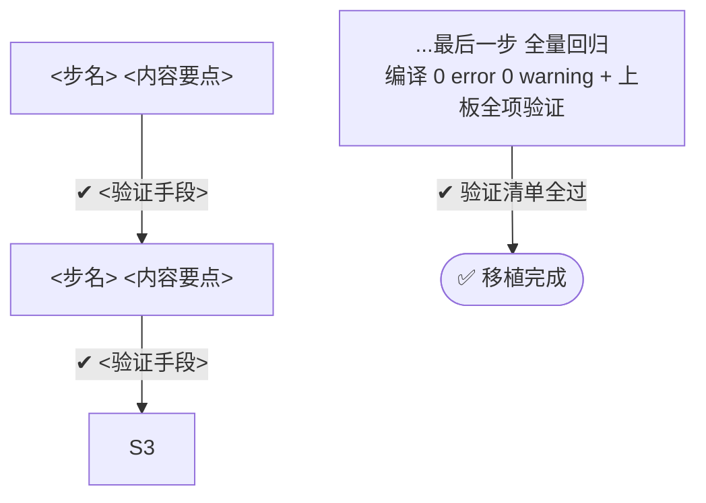

# 移植方案八段式模板

> 本模板从实测高质量的《6125To7255 电源管理移植》方案提炼。生成方案时**逐段对应**，
> 段落顺序与编号保留；表格列可增不可减核心列。范例文档路径见 `config/config.conf`（如有配置）。

总原则（写每一行时自问）：
- **这是移植，不是重写**：目标工程已有代码只允许出现"熔接面"，源代码只允许 include 层名替换。
- **完整性优先于简洁**：宁可方案长，不可漏一条。台账外源文件出现在实施期 = 方案失败。
- **每一步可独立验证**：没有验证手段的步骤不许出现在 §五。
- **能用图就不用文字**：§五 执行计划、状态迁移、架构关系等用 Mermaid 图（flowchart/stateDiagram/graph）表达，文字仅作补充。参考 [example/6125To7255电源管理移植.md](../example/6125To7255电源管理移植.md) 的 §五 flowchart 风格。

---

## 模板正文

```markdown
# <范围名> 移植方案

> 源工程：`<绝对路径>`（<芯片/OS/RTD 基线一句话>）
> 目标工程：`<绝对路径>`（<同上，注明目标当前调度形态/关键状态>）
> 方案文件：`output/<模块名>-port-plan.md`（本方案落盘路径，交互2 依据）

## 〇、输入参数（交互2 的权威输入，来自 Phase 0 用户手动输入）

| 参数 | 值 |
|---|---|
| 源工程 | <绝对路径> |
| 目标工程 | <绝对路径> |
| 移植范围 | <模块/边界描述> |
| 用户要求 | <用户原话> |

## 一、Context

<目标现状：该领域目标工程已有什么——骨架、空壳、TODO，逐条带 file:line 证据>
<源范围：本次移植源工程的哪几个子系统，点名>
<覆盖核实：源 git log / commit 汇总逐条核实的结论——源当前分支是否已含全部实现、
 是否需要按 commit 分步回放（通常结论是"按当前分支整体移植"）>

### 已确认的 N 个决策

| # | 决策点 | 结论 |
|---|-------|------|
（分析中所有需要用户拍板的点：状态机策略 / 开关值 / 范围边界。
 必须在写方案前用 AskUserQuestion 问完并填入，不得留"待定"）

## 二、核心原则：只动架构，不动实现

| 保持不变（红线） | 允许改（熔接面） |
|---|---|
| <源模块全部业务逻辑/状态迁移表/阈值/时序常量/算法> | <include 层名替换> |
| <目标工程已有真实成果，一行不动> | <目标已有代码的融合点，逐个点名> |
| <源 RTD/库文件直接拷贝> | <板级映射表按目标硬件重建> |
| <生成物目录严禁手改，走重生成> | <配置开关打开/新增> |

<工程级警示，如有：DLP 加密文件只能 Edit/Write、生成物只走 mex 等>

## 三、总体策略

<一段话：哪些层纯拷贝 + 什么替换；平台差异全部收敛到 N 个熔接面，逐个列出>

## 四、修改清单

**清单封闭**：本节穷举实施期将创建/修改的**每一个文件**；实施期禁止创建清单外任何文件，缺什么 → 停下补方案，经批准再动。

### A. 新建（纯拷贝 + 层名替换）

| 源（路径） | → 目标（路径） | 内容（文件数/关键文件+行数/要点） |
|---|---|---|

（含：整目录拷贝、RTD 库拷贝、桩目录——桩在"内容"列标明"签名与源一致、函数体空"；
桩文件路径 = 源符号所属模块的对应位置（层名映射后同路径同名），目标已有该文件时桩改为 §四.B 追加项，不进 A 表）

### B. 融合（唯一允许动目标已有代码的地方，逐条说明合流方式）

- <融合点>：<保留目标什么一行不动> + <接入源什么> + <接缝在哪(file:line)>

### C. 修改既有文件

| 文件 | 修改 |
|---|---|
（每行必须能回答"为什么非动不可"——答不出的行删掉）

### D. 生成物/配置重生成（严禁手改，只走工具 + diff 审查）

1. <外设/配置项>：<增配什么>；生成后 git diff 全量比对，只允许出现预期变更

## 五、N 步执行计划（每步结束可编译/可验证）

> 用 Mermaid flowchart 表达，每节点 = 步骤内容 + 验证手段（`-->|"✔ 验证"|`），
> 串行依赖一目了然。步骤排序原则：被依赖者先行——库/驱动 → 配置 → Service → App → 接线 → 融合 → 回归；
> 每步验证必须是具体手段：编译 0 error / git diff 审查 / map 文件符号 / 上板冒烟项。


（有分支/条件验证时用菱形判断节点 `H{条件} -->|是| A` / `H -->|否| B`）

## 六、关键执行细节（防漏防错）

1. <常量在源哪个 .h、一行不改的理由、何时才允许标定>
2. <必须整体照搬的调用链（起止 file:line）>
3. <内存/段约束：新字段只能进哪个结构体>
4. <按目标板必须重算的位号/通道号，沿用源值的后果>
5. <条件编译隔离点，逐一列出，漏一处即编译错误的要标注>
6. <删除/替换目标文件前先 grep 无外部引用>
7. <每个桩回答"源函数在源工程哪个文件(file:line) → 目标对应文件是哪个"；答不出 = 层错位，落点违规>
…（每条 = 实施时"不做就会错"的点，不是背景知识）

## 七、验证标准

**编译级**（每步）：
- <编译命令/skill>，0 error；新增文件 0 warning
- <map/产物检查项>

**上板级**（冒烟 + 全项）：
1. <功能项：操作 → 预期现象，可观测判据>
2. <回归项：目标工程既有功能不受影响>

## 八、风险与红线（实施时逐条自检）

1. <每条一句、机械可判定；编号供逐条打勾>
2. <清单封闭：清单外新建文件 = 违规；桩落点 = 源符号所属模块的对应文件，违者层错位>
```

---

## 段落 ↔ 数据来源对照

| 段落 | 数据来自 |
|---|---|
| 一 Context + 决策表 | analysis-guide.md Phase 1/2 产出 + 决策问答 |
| 二 红线表 | analysis-guide.md Phase 2 的"目标已有成果" + Phase 3 分类 |
| 三 总体策略 | Phase 3 熔接面归纳 |
| 四 修改清单 | completeness-check.md 台账逐条展开 |
| 五 执行计划 | 修改清单按依赖排序 + 每步绑定验证 |
| 六 细节 | Phase 1 提取的五类事实中的"踩坑项" |
| 七 验证标准 | 目标工程已有编译/上板手段 |
| 八 红线 | DLP/生成物/常量对齐等工程约束 + 台账校验失败点 |
