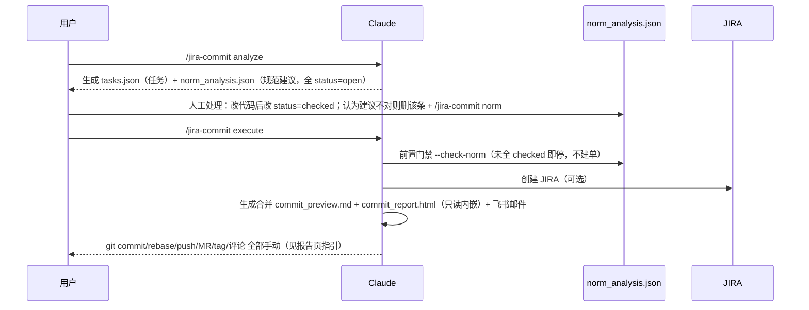

# jira-commit

Git提交与JIRA项目管理集成工具。自动分析代码变更、生成标准化commit消息、创建JIRA任务。



## 快速开始

```bash
# 配置JIRA（首次）
cp config/jira_commit_config_example.json config/jira_commit_config.json
# 编辑 config/jira_commit_config.json 填写认证信息

  "jira_url": "url", #JIRA服务器地址
  "jira_project": "AERDM", # 项目代号（如AERDM）

  "default_pull_branch": "origin/main", # 拉取分支
  "mr_target_branch": "main", # MR 目标分支（master/dev 按项目改）


  "auth": {
    "username": "your_username", # 用户名
    "password": "your_password" # 密码
  },
  "field_mappings": {
    "issuetype": {"name": "任务"},
    "assignee": {"name": "your_username"}, # 用户名
    "customfield_10447": [{"name": "your_username"}], # 用户名
    "customfield_10310": {"value": "EVT"}
  },


```


## 工作流程

```
# 步骤1：分析工程代码变更，AI智能生成任务列表 + 规范分析（norm_analysis.json）
/jira-commit analyze

# 步骤2：预览任务和commit消息（人类可读格式）
/jira-commit preview

# 步骤2.5：人工处理规范建议（改代码→status 改 checked；或删建议→/jira-commit norm 更新规范）
#   未全部 checked 时 execute 会被前置门禁拦下

# 步骤3：execute（前置门禁 → 创建JIRA → 生成合并commit + 只读HTML报告 + 飞书邮件；
#   git commit/rebase/push/MR/tag 均手动，见 commit_report.html）
/jira-commit execute
```

## 子命令

| 子命令 | 作用 |
|--------|------|
| analyze | 扫描未提交变更 → tasks.json + commit_preview.md + **norm_analysis.json**（规范建议，全部 `status: "open"`） |
| preview | 显示 tasks.json 详情 |
| execute | 前置门禁（规范建议全 `checked`）→ 创建 JIRA → 合并 commit + HTML 报告（只读内嵌）+ 飞书邮件 |
| norm | **一句规范 → 三处同步**：`references/norm_spec.md` 条目 + 相关 `CLAUDE.md` + memory |
| reset | 清理 output 产物（含过期 commit_report.html、`review_*` 评审遗留、`_norm/` 等临时产物） |
| tag | 版本打标签 |

## 规范建议三态（norm_analysis.json，人工维护）

- `open`：analyze 生成后的初始态
- `checked`：**认可建议** → 按建议改代码，再人工把 `status` 改为 `"checked"`
- 删除该条：**认为建议不对**（规范过时/有误）→ 从 `suggestions` 数组删掉，并跑 `/jira-commit norm`
  同步更新规范三件套（norm_spec.md / CLAUDE.md / memory），下轮 analyze 不再报同类建议
- 页面**只读**：commit_report.html 每条建议展示 ID + 严重度 + 规则 + 标题（完整 detail/suggestion 见「一键复制」），不改文件

## 核心规则

- **禁止自动执行**，必须手动 `/jira-commit execute`
- `config/jira_commit_config.json` 含密码，不提交Git

## 执行建议（防卡顿）

- analyze 优先分步：先文件清单，再按文件看差异。
- 输出结果优先直接写入 `output/tasks.json` 与 `output/commit_preview.md`。
- 避免单条超长 Bash 命令，减少超时和无输出等待。

## 任务状态

- analyze生成 `output/tasks.json`（jira_key为`jira#`占位符）
- execute时根据 `auto_create_jira` 标志决定是否自动创建JIRA
- 也可手动编辑 tasks.json 修改 jira_key 为真实编号

## 目录结构

```
jira-commit/
├── config/
│   ├── jira_commit_config.json          # JIRA配置（不提交Git）
│   └── jira_commit_config_example.json  # 配置模板
├── output/                              # 运行时生成（gitignore）
│   ├── tasks.json                       # AI生成的任务列表
│   ├── jira_tasks_result.json           # JIRA创建结果
│   ├── commit_preview.md                # commit预览
│   ├── merge_request.md                 # MR 标题+描述（GitLab 提 MR 用）
│   ├── norm_analysis.json               # 规范分析建议（人工推进 status）
│   └── commit_report.html               # 执行报告（规范分析只读内嵌；卡片4 展示 MR 标题/描述）
├── references/
│   └── norm_spec.md                     # 提交规范检查基准（N-01~N-18）
├── script/
│   ├── create_jira_tasks.py             # 创建JIRA任务
│   ├── generate_report.py               # 门禁校验 + 合并commit(commit_preview.md) + HTML报告 + 飞书邮件通知
│   ├── execute_commit.py                # 【已禁用】旧commit/rebase/push逻辑注释保留，转发到generate_report
│   ├── send_mail.py                     # 飞书邮件通知（lark-cli；notify.ps1 弹窗已废弃可删）
│   └── preview_tasks.py                 # 预览任务
└── docs/
    ├── cmd_analyze.md                   # analyze详细步骤
    └── cmd_execute.md                   # execute详细步骤
```

## Commit消息格式

```
[type][JIRA-ID]中文 summary

[what]
1.描述

[why]
原因

[how]
思路

[影响等级]S|A|B|C|D

[建议测试范围]
测试要点
```

**type**: feature / bugfix / config / merge / revert
**影响等级**: S系统 / A应用 / B模块 / C组件 / D细节

## 配置说明

**其他配置项**:
- `commit_types` - commit类型定义
- `impact_levels` - 影响等级定义
- `difficulty_levels` - 任务难度（A/B/C/D对应工作量）
- `field_mappings` - JIRA字段映射
- `due_dates` - 根据难度计算到期日

## 手动Commit工具

不使用AI生成时，可用 `utils/git-tool/Git_Commit提交.html` 手动填写规范commit。
