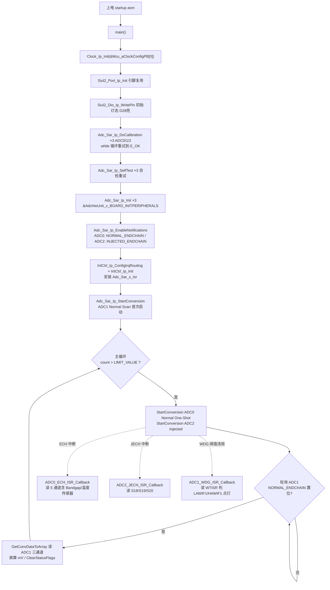
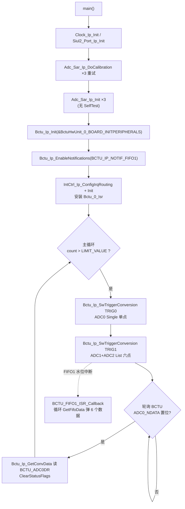
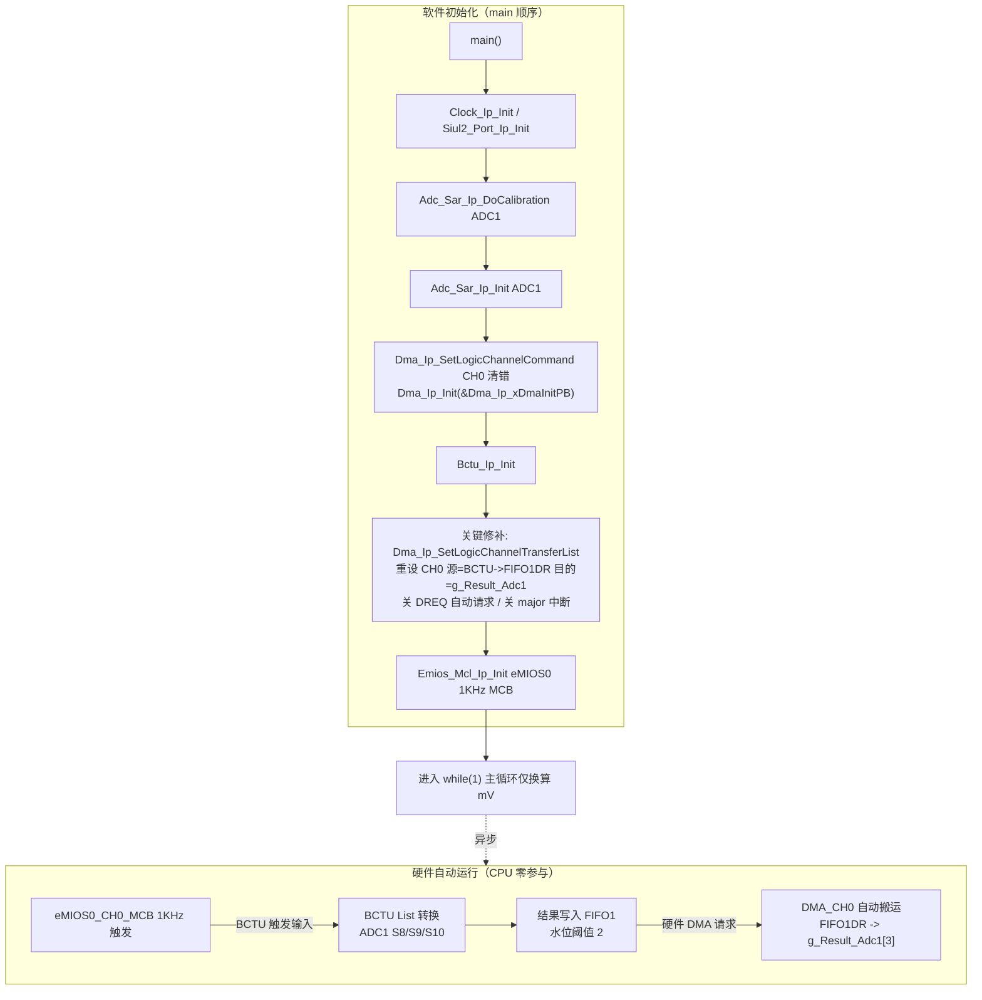

# ADC / BCTU — S32K344 RTD 0.9.0 实战教学

> 源工程:
> - `D:\wnagjin\S32K3_mydetail\详细教学(1)\详细教学\S32K3 Training-RTD\S32DSv3p4_RTDv090\S32K344_ADC_Example_090_34`
> - `D:\wnagjin\S32K3_mydetail\详细教学(1)\详细教学\S32K3 Training-RTD\S32DSv3p4_RTDv090\S32K344_BCTU_Example_090_34`
> - `D:\wnagjin\S32K3_mydetail\详细教学(1)\详细教学\S32K3 Training-RTD\S32DSv3p4_RTDv090\S32K344_ADC_BCTU_090_34`
>
> 源文件:
> - `S32K344_ADC_Example_090_34\src\main.c`（全文 309 行）
> - `S32K344_BCTU_Example_090_34\src\main.c`（全文 222 行）
> - `S32K344_ADC_BCTU_090_34\src\main.c`（全文 190 行）
>
> （代码原样摘录，未经任何修改；缩进中的 Tab/空格混排与行尾空格均保留）

## 1. 外设概述

**SAR ADC**：S32K344 内置 3 个 12 位逐次逼近型 ADC（ADC0/1/2），支持两条转换链：

- **Normal 链**：One-Shot（转完停）与 Scan（连续循环）两种模式，软件 `Adc_Sar_Ip_StartConversion()` 触发；
- **Injected 链**：高优先级，可打断 Normal 链；
- 附带能力：自校准（`DoCalibration`）、自检（`SelfTest`）、Pre-Sample、模拟看门狗（AnaWdg，每通道独立高低阈值）。

**BCTU**（Back-End Cross Triggering Unit，后端交叉触发单元）：硬件触发源（eMIOS/TRGMUX 等，经 BCTU 触发输入线）→ BCTU 按预编程命令列表（List/MPC 模式）直接驱动多个 ADC **并行**转换 → 结果统一写入 BCTU 数据寄存器（Single 模式）或 FIFO0/1（List 模式），CPU 全程不参与。FIFO 支持水位中断与 DMA 请求。

**三工程是 CPU 参与度递减的三级台阶**：

| 台阶 | 工程 | 触发方式 | 数据搬运 |
|---|---|---|---|
| 1 | S32K344_ADC_Example | 软件触发 ADC 转换链 | ECH/JECH 回调 + 轮询读 ADC 寄存器 |
| 2 | S32K344_BCTU_Example | 软件触发 BCTU（Single + List） | 轮询 BCTU_ADC0DR + FIFO1 水位中断回调 |
| 3 | S32K344_ADC_BCTU | eMIOS0 1KHz 硬件触发 BCTU List | FIFO1 水位直接发 DMA 请求，DMA_CH0 搬到 RAM，零 CPU |

换算基准统一为 5V 参考电压 / 12 位满量程 0xFFF（注意工程 3 的 FIFO 数据带标记位，见第 6 节坑 3）。

## 2. 初始化与使用时序（mermaid flowchart 源码）

### 2.1 S32K344_ADC_Example_090_34（软件触发 + 回调/轮询）



### 2.2 S32K344_BCTU_Example_090_34（BCTU 软触发 + FIFO 中断）



### 2.3 S32K344_ADC_BCTU_090_34（eMIOS 硬件触发 + BCTU + DMA 全自动链）



## 3. main.c 原样代码（按逻辑段落分块，每块标注来源工程与行号范围）

### 3.1 S32K344_ADC_Example_090_34 — 软件触发 / 校准自检 / 模拟看门狗

**（ADC 工程 main.c 行 55–67，LOCAL MACROS）**

```c
#define TURN_ON_LED                  1U
#define TURN_OFF_LED                 0U
#define LIMIT_VALUE                  10000000U
#define SARADC_VREF                  5000U                                /* 5v reference voltage */
#define SAR_ADC_INST0                0U                                   /* ADC0 instance used   */
#define SAR_ADC_INST1                1U                                   /* ADC1 instance used   */
#define SAR_ADC_INST2                2U                                   /* ADC2 instance used   */
#define SAR_ADC_INST0_CH_NUM         5U                                   /* ADC0 channel number  */
#define SAR_ADC_INST1_CH_NUM         3U                                   /* ADC1 channel number  */
#define SAR_ADC_INST2_CH_NUM         3U                                   /* ADC2 channel number  */
#define WDG_THRESHOLD_NORMAL         0U                                   /* WDG  range normal    */
#define WDG_LOW_THRESHOLD_VIOLATION  1U                                   /* low  range violation */
#define WDG_HIGH_THRESHOLD_VIOLATION 2U                                   /* high range violation */
```

**（ADC 工程 main.c 行 87–94，GLOBAL VARIABLES）**

```c
uint16 g_Result_Adc0[5];                                 /* ADC0 channel conversion results       */
uint16 g_ResultInMv_Adc0[5];                             /* ADC0 channel conversion results in mv */
uint16 g_Result_Adc1[3];                                 /* ADC1 channel conversion results       */
uint16 g_ResultInMv_Adc1[3];                             /* ADC1 channel conversion results in mv */
uint16 g_Result_Adc2[3];                                 /* ADC2 channel conversion results       */
uint16 g_ResultInMv_Adc2[3];                             /* ADC2 channel conversion results in mv */
uint16 g_Adc_Wdg_Violation_Status;                       /* Status of AnaWatchdog range violation */
uint16 g_Adc_Wdg_Violation_CH_Number;                    /* Channel number of WDG range violation */
```

**（ADC 工程 main.c 行 110–177，三个回调 + ISR 声明）**

```c
/**
* @brief        Adc notification called by the end of Normal chain conversion periodically
* @details      Used to read the conversion results of ADC0_S24(Bandgap)|S25(Tempsensor)|S26(ANAMUX_OUT)|S30(VREFL)|S31(VREFH) channels
*/
void ADC0_ECH_ISR_Callback(void)
{
	uint32 i;

	Adc_Sar_Ip_GetConvDataToArray(SAR_ADC_INST0, ADC_SAR_IP_CONV_CHAIN_NORMAL, SAR_ADC_INST0_CH_NUM, g_Result_Adc0);

    for(i = 0; i < SAR_ADC_INST0_CH_NUM; i++)
	{
	    g_ResultInMv_Adc0[i] =  (uint16) (SARADC_VREF * g_Result_Adc0[i] / (0xFFF));
	}
}

/**
* @brief        Adc notification called by the Watchdog threshold value out of range
* @details      Used to test the detection function of Analog Watchdog low(D29_GREEN)|high(D30_BLUE) threshold value violation
*/
void ADC1_WDG_ISR_Callback(uint16 u16ChanIdx)
{
	(void) u16ChanIdx;
	g_Adc_Wdg_Violation_Status = WDG_THRESHOLD_NORMAL;
	g_Adc_Wdg_Violation_CH_Number = u16ChanIdx; 

	if(0 != (ADC_1->WTISR & ADC_WTISR_LAWIF1_MASK))
	{
		g_Adc_Wdg_Violation_Status = WDG_LOW_THRESHOLD_VIOLATION; /* Low  threshold value test(dog_0): 0x0100-0x0F00 */

		Siul2_Dio_Ip_WritePin(D28_RED_NORMAL_PORT, D28_RED_NORMAL_PIN, TURN_OFF_LED);/* RB:RGBLED32_RED | WB:LED_D28 */
		Siul2_Dio_Ip_WritePin(D29_GREEN_LOW_PORT, D29_GREEN_LOW_PIN, TURN_ON_LED);   /* RB:RGBLED_GREEN | WB:LED_D29 */
		Siul2_Dio_Ip_WritePin(D30_BLUE_HIGH_PORT, D30_BLUE_HIGH_PIN, TURN_OFF_LED);  /* RB:RGBLED0_BLUE | WB:LED_D30 */
	}

	if(0 != (ADC_1->WTISR & ADC_WTISR_HAWIF1_MASK))
	{
		g_Adc_Wdg_Violation_Status = WDG_HIGH_THRESHOLD_VIOLATION;/* High threshold value test(dog_0): 0x0100-0x0F00 */

		Siul2_Dio_Ip_WritePin(D28_RED_NORMAL_PORT, D28_RED_NORMAL_PIN, TURN_OFF_LED);/* RB:RGBLED32_RED | WB:LED_D28 */
		Siul2_Dio_Ip_WritePin(D29_GREEN_LOW_PORT, D29_GREEN_LOW_PIN, TURN_OFF_LED);  /* RB:RGBLED_GREEN | WB:LED_D29 */
		Siul2_Dio_Ip_WritePin(D30_BLUE_HIGH_PORT, D30_BLUE_HIGH_PIN, TURN_ON_LED);   /* RB:RGBLED0_BLUE | WB:LED_D30 */
	}
}

/**
* @brief        Adc notification called by the end of Injected chain conversion periodically
* @details      Used to read the conversion results of ADC2_S18(VREFH)|S19(POT1)|S20(VREFH) channels
*/
void ADC2_JECH_ISR_Callback(void)
{
	uint32 i;

	Adc_Sar_Ip_GetConvDataToArray(SAR_ADC_INST2, ADC_SAR_IP_CONV_CHAIN_INJECTED, SAR_ADC_INST2_CH_NUM, g_Result_Adc2);

    for(i = 0; i < SAR_ADC_INST2_CH_NUM; i++)
	{
	    g_ResultInMv_Adc2[i] = (uint16) (SARADC_VREF * g_Result_Adc2[i] / (0xFFF));
	}
}

/**
* @brief        ADC_0|ADC_1|ADC_2 Interrupt handler
* @details      Defined in Adc_Sar_Ip_Isr.c
*/
extern ISR(Adc_Sar_0_Isr);
extern ISR(Adc_Sar_1_Isr);
extern ISR(Adc_Sar_2_Isr);
```

**（ADC 工程 main.c 行 189–307，main 函数全文）**

```c
int main(void)
{
    /* Write your code here */

	uint32 i;
	uint32 flag;
	uint32 count;
	StatusType status;

	Clock_Ip_Init(&Mcu_aClockConfigPB[0]);
	Siul2_Port_Ip_Init(NUM_OF_CONFIGURED_PINS0, g_pin_mux_InitConfigArr0);

	/* Initialize(AnaWdg Normal) all LED_NORMAL_LOW_HIGH(high-active) firstly.*/
	Siul2_Dio_Ip_WritePin(D28_RED_NORMAL_PORT, D28_RED_NORMAL_PIN, TURN_ON_LED);
	Siul2_Dio_Ip_WritePin(D29_GREEN_LOW_PORT, D29_GREEN_LOW_PIN, TURN_OFF_LED);
	Siul2_Dio_Ip_WritePin(D30_BLUE_HIGH_PORT, D30_BLUE_HIGH_PIN, TURN_OFF_LED);

    /************************************************** Calibrate ADC ************************************************/
    status = (StatusType) Adc_Sar_Ip_DoCalibration(SAR_ADC_INST0);
    while (status != E_OK)
    {
    	status = (StatusType) Adc_Sar_Ip_DoCalibration(SAR_ADC_INST0);
    }
    status = (StatusType) Adc_Sar_Ip_DoCalibration(SAR_ADC_INST1);
    while (status != E_OK)
    {
    	status = (StatusType) Adc_Sar_Ip_DoCalibration(SAR_ADC_INST1);
    }
    status = (StatusType) Adc_Sar_Ip_DoCalibration(SAR_ADC_INST2);
    while (status != E_OK)
    {
    	status = (StatusType) Adc_Sar_Ip_DoCalibration(SAR_ADC_INST2);
    }

    /************************************************** Self-Test ADC ************************************************/
    status = (StatusType) Adc_Sar_Ip_SelfTest(SAR_ADC_INST0);
    while (status != E_OK)
    {
    	status = (StatusType) Adc_Sar_Ip_SelfTest(SAR_ADC_INST0);
    }
    status = (StatusType) Adc_Sar_Ip_SelfTest(SAR_ADC_INST1);
    while (status != E_OK)
    {
    	status = (StatusType) Adc_Sar_Ip_SelfTest(SAR_ADC_INST1);
    }
    status = (StatusType) Adc_Sar_Ip_SelfTest(SAR_ADC_INST2);
    while (status != E_OK)
    {
    	status = (StatusType) Adc_Sar_Ip_SelfTest(SAR_ADC_INST2);
    }

	/************************************************* Initialize ADC ************************************************/
	status = (StatusType) Adc_Sar_Ip_Init(SAR_ADC_INST0, &AdcHwUnit_0_BOARD_INITPERIPHERALS);
    while(status != E_OK)
	{
    	status = (StatusType) Adc_Sar_Ip_Init(SAR_ADC_INST0, &AdcHwUnit_0_BOARD_INITPERIPHERALS);
	}
	status = (StatusType) Adc_Sar_Ip_Init(SAR_ADC_INST1, &AdcHwUnit_1_BOARD_INITPERIPHERALS);
    while(status != E_OK)
	{
    	status = (StatusType) Adc_Sar_Ip_Init(SAR_ADC_INST1, &AdcHwUnit_1_BOARD_INITPERIPHERALS);
	}
	status = (StatusType) Adc_Sar_Ip_Init(SAR_ADC_INST2, &AdcHwUnit_2_BOARD_INITPERIPHERALS);
    while(status != E_OK)
	{
    	status = (StatusType) Adc_Sar_Ip_Init(SAR_ADC_INST2, &AdcHwUnit_2_BOARD_INITPERIPHERALS);
	}

    /*********************************** Enable ADC0|2 ECH|JECH Callback Function ************************************/
	Adc_Sar_Ip_EnableNotifications(SAR_ADC_INST0, ADC_SAR_IP_NOTIF_FLAG_NORMAL_ENDCHAIN);
    Adc_Sar_Ip_EnableNotifications(SAR_ADC_INST2, ADC_SAR_IP_NOTIF_FLAG_INJECTED_ENDCHAIN);

    /**************************** Install and enable ADC1|2 ECH|JECH|WDOG interrupt ISRs. ****************************/
	IntCtrl_Ip_ConfigIrqRouting(&intRouteConfig);     
	IntCtrl_Ip_Init(&IntCtrlConfig_0);

    /* Initialize a SW triggered NORMAL Scan conversion chain on SAR_ADC1.*/
    Adc_Sar_Ip_StartConversion(SAR_ADC_INST1, ADC_SAR_IP_CONV_CHAIN_NORMAL);

	while(1)
	{
		count++;

		if(count > LIMIT_VALUE)
		{
            /* Start a SW triggered NORMAL One-Shot conversion chain on SAR_ADC0. */
		    Adc_Sar_Ip_StartConversion(SAR_ADC_INST0, ADC_SAR_IP_CONV_CHAIN_NORMAL);

		    /* Start a Software triggered Injected conversion chain on SAR_ADC_2. */
		    Adc_Sar_Ip_StartConversion(SAR_ADC_INST2, ADC_SAR_IP_CONV_CHAIN_INJECTED);

		    while(!((flag = Adc_Sar_Ip_GetStatusFlags(SAR_ADC_INST1)) & ADC_SAR_IP_NOTIF_FLAG_NORMAL_ENDCHAIN))
		    {
		    	/* Wait for the Normal Scan conversion be completed on SAR_ADC_1. */
		    }

		    /* Get conversion data of ADC1_S8(VREFH)|S9(VREFH)|S10(POT0) channel. */
		    Adc_Sar_Ip_GetConvDataToArray(SAR_ADC_INST1, ADC_SAR_IP_CONV_CHAIN_NORMAL, SAR_ADC_INST1_CH_NUM, g_Result_Adc1);

		    for(i = 0; i < SAR_ADC_INST1_CH_NUM; i++)
		    {
		    	g_ResultInMv_Adc1[i] =  (uint16) (SARADC_VREF * g_Result_Adc1[i] / (0xFFF));
		    }

		    Adc_Sar_Ip_ClearStatusFlags(SAR_ADC_INST1, ADC_SAR_IP_NOTIF_FLAG_NORMAL_ENDCHAIN);

			count = 0;
		}
	}

    for(;;)
    {
        if(exit_code != 0)
        {
            break;
        }
    }
    return exit_code;
}
```

### 3.2 S32K344_BCTU_Example_090_34 — BCTU 软触发链（Single + List/FIFO）

**（BCTU 工程 main.c 行 56–65，LOCAL MACROS）**

```c
#define LIMIT_VALUE                  10000000U
#define SARADC_VREF                  5000U
#define SAR_ADC_INST0                0U                                    /* ADC0 instance used  */
#define SAR_ADC_INST1                1U                                    /* ADC1 instance used  */
#define SAR_ADC_INST2                2U                                    /* ADC2 instance used  */
#define BCTU_INST0                   0U
#define BCTU_SW_TRIG0_IDX            0U                                    /* ADC0  - eMIOS0_CH0  */
#define BCTU_SW_TRIG1_IDX            1U                                    /* ADC12 - eMIOS0_CH1  */
#define BCTU_USED_FIFO1_IDX          0U                                    /* FIFO1 - 16 words    */
#define BCTU_FIFO1_VALID_ENTRIES     6U                                    /* 6 = 3(ADC1)+3(ADC2) */
```

**（BCTU 工程 main.c 行 85–88，GLOBAL VARIABLES）**

```c
uint16 g_Result_Adc0;                                    /* ADC0  channel conversion result       */
uint16 g_ResultInMv_Adc0;                                /* ADC0  channel conversion result in mv */
uint16 g_Result_Adc12[6];                                /* ADC12 channel conversion result       */
uint16 g_ResultInMv_Adc12[6];                            /* ADC12 channel conversion result in mv */
```

**（BCTU 工程 main.c 行 104–124，FIFO1 水位回调 + ISR 声明）**

```c
/**
* @brief        Bctu notification called by the number of valid FIFO entries is greater than the watermark level for that FIFO
* @details      Read results of ADC1_S8(VREFH)|ADC2_S18(VREFH)|ADC1_S9(VREFH)|ADC2_S19(POT1)|ADC1_S10(POT0)|ADC2_S20(VREFH) channels
*
*/
void BCTU_FIFO1_ISR_Callback(void)
{
	uint32 i;

    for(i = 0; i < BCTU_FIFO1_VALID_ENTRIES; i++)
    {
    	g_Result_Adc12[i] = Bctu_Ip_GetFifoData(BCTU_INST0, BCTU_USED_FIFO1_IDX);
    	g_ResultInMv_Adc12[i] =  (uint16) (SARADC_VREF * g_Result_Adc12[i] / (0xFFF));
    }
}

/**
* @brief        BCTU Interrupt handler
* @details      Defined in Bctu_Ip_Isr.c
*/
extern ISR(Bctu_0_Isr);
```

**（BCTU 工程 main.c 行 135–220，main 函数全文）**

```c
int main(void)
{
    /* Write your code here */

	uint32 flag;
	uint32 count;
	StatusType status;

	Clock_Ip_Init(&Mcu_aClockConfigPB[0]);
	Siul2_Port_Ip_Init(NUM_OF_CONFIGURED_PINS0, g_pin_mux_InitConfigArr0);

    /************************************************** Calibrate ADC ************************************************/
    status = (StatusType) Adc_Sar_Ip_DoCalibration(SAR_ADC_INST0);
    while (status != E_OK)
    {
    	status = (StatusType) Adc_Sar_Ip_DoCalibration(SAR_ADC_INST0);
    }
    status = (StatusType) Adc_Sar_Ip_DoCalibration(SAR_ADC_INST1);
    while (status != E_OK)
    {
    	status = (StatusType) Adc_Sar_Ip_DoCalibration(SAR_ADC_INST1);
    }
    status = (StatusType) Adc_Sar_Ip_DoCalibration(SAR_ADC_INST2);
    while (status != E_OK)
    {
    	status = (StatusType) Adc_Sar_Ip_DoCalibration(SAR_ADC_INST2);
    }

	/************************************************* Initialize ADC ************************************************/
	status = (StatusType) Adc_Sar_Ip_Init(SAR_ADC_INST0, &AdcHwUnit_0_BOARD_INITPERIPHERALS);
    while(status != E_OK)
	{
    	status = (StatusType) Adc_Sar_Ip_Init(SAR_ADC_INST0, &AdcHwUnit_0_BOARD_INITPERIPHERALS);
	}
	status = (StatusType) Adc_Sar_Ip_Init(SAR_ADC_INST1, &AdcHwUnit_1_BOARD_INITPERIPHERALS);
    while(status != E_OK)
	{
    	status = (StatusType) Adc_Sar_Ip_Init(SAR_ADC_INST1, &AdcHwUnit_1_BOARD_INITPERIPHERALS);
	}
	status = (StatusType) Adc_Sar_Ip_Init(SAR_ADC_INST2, &AdcHwUnit_2_BOARD_INITPERIPHERALS);
    while(status != E_OK)
	{
    	status = (StatusType) Adc_Sar_Ip_Init(SAR_ADC_INST2, &AdcHwUnit_2_BOARD_INITPERIPHERALS);
	}

    /************************************************ Initialize BCTU ************************************************/
    Bctu_Ip_Init(BCTU_INST0, &BctuHwUnit_0_BOARD_INITPERIPHERALS);
    Bctu_Ip_EnableNotifications(BCTU_INST0, BCTU_IP_NOTIF_FIFO1);                       /* Enable FIFO1 notification */

    /**************************** Install and enable BCTU ISR - FIFO1 WaterMark Callback. ****************************/
	IntCtrl_Ip_ConfigIrqRouting(&intRouteConfig);  
	IntCtrl_Ip_Init(&IntCtrlConfig_0);

	while(1)
	{
		count++;

		if(count > LIMIT_VALUE)
		{
			/* Start a SW triggered Single(ADC0)|List(ADC12) conversion on BCTU. */
			Bctu_Ip_SwTriggerConversion(BCTU_INST0, BCTU_SW_TRIG0_IDX); /* ADC0  */
			Bctu_Ip_SwTriggerConversion(BCTU_INST0, BCTU_SW_TRIG1_IDX); /* ADC12 */

		    while(!((flag = Bctu_Ip_GetStatusFlags(BCTU_INST0)) & BCTU_IP_STATUS_ADC0_NDATA))
		    {
		    	/* Wait for the BCTU Single conversion be completed on SAR_ADC0. */
		    }

			g_Result_Adc0 = Bctu_Ip_GetConvData(BCTU_INST0, SAR_ADC_INST0);
			g_ResultInMv_Adc0 =  (uint16) (SARADC_VREF * g_Result_Adc0 / (0xFFF));

			Bctu_Ip_ClearStatusFlags(BCTU_INST0, BCTU_IP_STATUS_ADC0_NDATA);

			count = 0;
		}
	}

    for(;;)
    {
        if(exit_code != 0)
        {
            break;
        }
    }
    return exit_code;
}
```

### 3.3 S32K344_ADC_BCTU_090_34 — eMIOS 硬件触发 + BCTU + DMA 联合

**（ADC_BCTU 工程 main.c 行 57–65，LOCAL MACROS）**

```c
#define TURN_ON_LED                  1U
#define TURN_OFF_LED                 0U
#define LIMIT_VALUE                  10000000U
#define SARADC_VREF                  5000U                                /* 5v reference voltage */
#define SAR_ADC_INST1                1U                                   /* ADC1 instance used   */
#define SAR_ADC_INST1_CH_NUM         3U                                   /* ADC1 channel number  */
#define EMIOS_INST0                  0U
#define BCTU_INST0                   0U
#define DMA_INST0_CH0                0U
```

**（ADC_BCTU 工程 main.c 行 85–86，GLOBAL VARIABLES）**

```c
uint16 g_Result_Adc1[3];                                 /* ADC1 channel conversion results       */
uint16 g_ResultInMv_Adc1[3];                             /* ADC1 channel conversion results in mv */
```

**（ADC_BCTU 工程 main.c 行 112–188，main 函数全文；本工程无任何 CPU 中断回调）**

```c
int main(void)
{
    /* Write your code here */

	uint32 i;
	uint32 count;
	StatusType status;
	Dma_Ip_LogicChannelTransferListType Transparalist[1][4];

	Clock_Ip_Init(&Mcu_aClockConfigPB[0]);
	Siul2_Port_Ip_Init(NUM_OF_CONFIGURED_PINS0, g_pin_mux_InitConfigArr0);

    Siul2_Dio_Ip_WritePin(D28_RED_PORT, D28_RED_PIN, TURN_OFF_LED);

    /************************************************** Calibrate ADC ************************************************/
    status = (StatusType) Adc_Sar_Ip_DoCalibration(SAR_ADC_INST1);
    while (status != E_OK)
    {
    	status = (StatusType) Adc_Sar_Ip_DoCalibration(SAR_ADC_INST1);
    }

	/************************************************* Initialize ADC ************************************************/
	status = (StatusType) Adc_Sar_Ip_Init(SAR_ADC_INST1, &AdcHwUnit_1_BOARD_INITPERIPHERALS);
    while(status != E_OK)
	{
    	status = (StatusType) Adc_Sar_Ip_Init(SAR_ADC_INST1, &AdcHwUnit_1_BOARD_INITPERIPHERALS);
	}

    /************************************************* Initialize DMA ************************************************/
    Dma_Ip_SetLogicChannelCommand(DMA_INST0_CH0, DMA_IP_CH_CLEAR_ERROR);
    Dma_Ip_Init(&Dma_Ip_xDmaInitPB);

    /************************************************ Initialize BCTU ************************************************/
    Bctu_Ip_Init(BCTU_INST0, &BctuHwUnit_0_BOARD_INITPERIPHERALS);

    /* Note: 1.Due to "Bctu_Ip_Init()" modify configurations, set DMA_CH0 command list to update correct parameters. */
	Transparalist[0][0].Param = DMA_IP_CH_SET_CONTROL_DIS_AUTO_REQUEST;  /* Enable Hardware request (set CSR[DREQ])  */
	Transparalist[0][0].Value = false;
	Transparalist[0][1].Param = DMA_IP_CH_SET_CONTROL_EN_MAJOR_INTERRUPT;/* Disable major interrupt (enable by BCTU) */
	Transparalist[0][1].Value = false;
	Transparalist[0][2].Param = DMA_IP_CH_SET_SOURCE_ADDRESS;            /* Configure the DMA_CH0 source      address*/
	Transparalist[0][2].Value = (uint32) &(BCTU->FIFO1DR);
	Transparalist[0][3].Param = DMA_IP_CH_SET_DESTINATION_ADDRESS;       /* Configure the DMA_CH0 destination address*/
	Transparalist[0][3].Value = (uint32) &(g_Result_Adc1[0]);

	Dma_Ip_SetLogicChannelTransferList(0, Transparalist[0], 4);          /* Update DMA_CH0 configuration by the list */

    /************************************************ Initialize eMIOS ***********************************************/
	Emios_Mcl_Ip_Init(EMIOS_INST0, &Emios_Mcl_Ip_0_Config_BOARD_INITPERIPHERALS);     /* Initialize eMIOS0: 1KHz MCB */

	while(1)
	{
		count++;

		if(count > LIMIT_VALUE)
		{
			Siul2_Dio_Ip_TogglePins(D28_RED_PORT, 1<<D28_RED_PIN);

			/* Data ADC1_S8(VREFH)|S9(VREFH)|S10(POT0) channels.*/
		    for(i = 0; i < SAR_ADC_INST1_CH_NUM; i++)
		    {
		    	g_ResultInMv_Adc1[i] = (uint16) (SARADC_VREF * ((g_Result_Adc1[i] & 0x7FFF) >> 3) / (0xFFF));
		    }

			count = 0;
		}
	}

    for(;;)
    {
        if(exit_code != 0)
        {
            break;
        }
    }
    return exit_code;
}
```

## 4. API 速查

### 4.1 S32K344_ADC_Example_090_34

| API | 作用 | 关键参数 |
|---|---|---|
| `Adc_Sar_Ip_DoCalibration` | ADC 自校准，须重试到返回 E_OK | 实例号 0/1/2 |
| `Adc_Sar_Ip_SelfTest` | ADC 自检 | 实例号 |
| `Adc_Sar_Ip_Init` | 按 PBcfg 初始化 ADC 硬件单元 | 实例 + `&AdcHwUnit_x_BOARD_INITPERIPHERALS` |
| `Adc_Sar_Ip_EnableNotifications` | 使能通知源 | `ADC_SAR_IP_NOTIF_FLAG_NORMAL_ENDCHAIN` / `ADC_SAR_IP_NOTIF_FLAG_INJECTED_ENDCHAIN` |
| `Adc_Sar_Ip_StartConversion` | 软件启动转换链 | `ADC_SAR_IP_CONV_CHAIN_NORMAL` / `ADC_SAR_IP_CONV_CHAIN_INJECTED` |
| `Adc_Sar_Ip_GetStatusFlags` | 读状态标志（轮询用） | 实例号 |
| `Adc_Sar_Ip_GetConvDataToArray` | 整链批量读结果到数组 | 实例 + 链类型 + 通道数 + 目的数组 |
| `Adc_Sar_Ip_ClearStatusFlags` | 清状态标志（轮询前必清） | 实例 + 标志 |
| `IntCtrl_Ip_ConfigIrqRouting` / `IntCtrl_Ip_Init` | 配置并安装 ADC ISR 路由 | `&intRouteConfig` / `&IntCtrlConfig_0` |
| `Siul2_Dio_Ip_WritePin` | 看门狗指示灯控制 | 端口/引脚宏 + 电平 |

### 4.2 S32K344_BCTU_Example_090_34

| API | 作用 | 关键参数 |
|---|---|---|
| `Bctu_Ip_Init` | 初始化 BCTU | `BCTU_INST0` + `&BctuHwUnit_0_BOARD_INITPERIPHERALS` |
| `Bctu_Ip_EnableNotifications` | 使能 FIFO 通知 | `BCTU_IP_NOTIF_FIFO1` |
| `Bctu_Ip_SwTriggerConversion` | 软件触发一次 BCTU 转换 | 触发索引 `BCTU_SW_TRIG0_IDX`(ADC0 Single) / `BCTU_SW_TRIG1_IDX`(ADC12 List) |
| `Bctu_Ip_GetStatusFlags` | 读 BCTU 状态 | 实例号 |
| `Bctu_Ip_GetConvData` | 读 Single 结果寄存器 BCTU_ADC0DR | 实例 + ADC 实例号 |
| `Bctu_Ip_GetFifoData` | 从 FIFO 弹出一个数据 | 实例 + FIFO 索引 |
| `Bctu_Ip_ClearStatusFlags` | 清状态标志 | `BCTU_IP_STATUS_ADC0_NDATA` |
| `Adc_Sar_Ip_DoCalibration` / `Adc_Sar_Ip_Init` | ADC 侧仍需先校准再初始化 | 同 4.1（本工程无 SelfTest） |

### 4.3 S32K344_ADC_BCTU_090_34

| API | 作用 | 关键参数 |
|---|---|---|
| `Dma_Ip_SetLogicChannelCommand` | 通道命令 | `DMA_INST0_CH0` + `DMA_IP_CH_CLEAR_ERROR` |
| `Dma_Ip_Init` | 初始化 eDMA 全局与各逻辑通道 TCD | `&Dma_Ip_xDmaInitPB` |
| `Dma_Ip_SetLogicChannelTransferList` | 运行时批量更新通道参数 | 通道号 + `Transparalist` + 条目数 4 |
| `Bctu_Ip_Init` | 初始化 BCTU（FIFO1 DMA 使能在此配置） | 同 4.2 |
| `Emios_Mcl_Ip_Init` | 初始化 eMIOS MCL（1KHz MCB 触发源） | `EMIOS_INST0` + `&Emios_Mcl_Ip_0_Config_BOARD_INITPERIPHERALS` |
| `Siul2_Dio_Ip_TogglePins` | 主循环节拍指示 | 端口 + 掩码 `1<<D28_RED_PIN` |

### 4.4 三工程差异对比表

| 维度 | S32K344_ADC_Example | S32K344_BCTU_Example | S32K344_ADC_BCTU |
|---|---|---|---|
| 使用 ADC 实例 | ADC0 + ADC1 + ADC2 | ADC0 + ADC1 + ADC2（挂 BCTU 下） | 仅 ADC1 |
| 转换触发 | 软件触发转换链 | BCTU 软件触发（SW_TRIG0/1） | eMIOS0_CH0 1KHz 硬件触发 BCTU |
| 转换组织 | Normal One-Shot / Normal Scan / Injected | BCTU Single（ADC0）+ List/MPC（ADC12 并行） | BCTU List（3 项，水位 2） |
| 结果去处 | ADC 自身数据寄存器 | Single→BCTU_ADC0DR；List→FIFO1 | FIFO1 → DMA_CH0 → g_Result_Adc1[] |
| CPU 读取方式 | ECH/JECH 回调 + 轮询 + WDG 回调 | 轮询 NDATA + FIFO1 水位中断回调 | 零 CPU（DMA 搬运，主循环只换算 mV） |
| 校准/自检 | DoCalibration + SelfTest ×3 | 仅 DoCalibration ×3 | 仅 DoCalibration ×1 |
| CPU 中断 | ADC0/1/2 三路 ISR | BCTU 一路 ISR | 无（`pvWatermarkNotification = NULL_PTR`） |
| 结果换算 | `raw / 0xFFF` | `raw / 0xFFF` | `(raw & 0x7FFF) >> 3` 再 `/ 0xFFF`（FIFO 带标记位） |
| 涉及 RTD 模块 | Pins/Siul2/Clock/IntCtrl/Adc_Sar | + Bctu | + Emios + Dma，去掉 IntCtrl |

## 5. 配置生成物（board/generate 下 Cfg/PBcfg）

### 5.1 S32K344_ADC_Example_090_34

| 文件 | 关键符号（实证行号） |
|---|---|
| `generate\src\Adc_Sar_Ip_BOARD_InitPeripherals_PBcfg.c` | `AdcHwUnit_0_BOARD_INITPERIPHERALS`(L201)、`AdcHwUnit_1_BOARD_INITPERIPHERALS`(L252)、`AdcHwUnit_2_BOARD_INITPERIPHERALS`(L303) |
| `generate\src\IntCtrl_Ip_Cfg.c` | `intRouteConfig`、`IntCtrlConfig_0`（含 ECH/JECH/WDG 回调挂接） |
| `board\Clock_Ip_Cfg.c` | `Mcu_aClockConfigPB[]` |
| `board\Siul2_Port_Ip_Cfg.c` | `g_pin_mux_InitConfigArr0`、`NUM_OF_CONFIGURED_PINS0`、D28/D29/D30 引脚宏 |

### 5.2 S32K344_BCTU_Example_090_34

| 文件 | 关键符号（实证行号） |
|---|---|
| `generate\src\Bctu_Ip_BOARD_InitPeripherals_PBcfg.c` | `BctuHwUnit_0_BOARD_INITPERIPHERALS`(L199)；FIFO 配置数组(L169)：`.bFifoDmaEnable = FALSE`；ADC 侧 `.bHwTriggersEn = FALSE`(L119/L128)；全局 `.bGlobalHwTriggersEn = FALSE`(L202) —— 纯软触发模式的实证 |
| `generate\src\Adc_Sar_Ip_BOARD_InitPeripherals_PBcfg.c` | ADC0/1/2 三份配置（BCTU 从属模式下配置） |
| `generate\src\IntCtrl_Ip_Cfg.c` | BCTU ISR 路由 |
| `board\Clock_Ip_Cfg.c` / `board\Siul2_Port_Ip_Cfg.c` | 同 5.1 |

### 5.3 S32K344_ADC_BCTU_090_34

| 文件 | 关键符号（实证行号） |
|---|---|
| `generate\src\Dma_Ip_BOARD_InitPeripherals_PBcfg.c` | `LogicChannel0GlobalConfigPB`(L120)：`.SourceMux = DMA_IP_REQ_MUX0_BCTU_FIFO1`(L127)；`LogicChannel0TransferConfigPB`(L142)；注意 `IntCallback = NULL_PTR`(L215) —— 纯硬件搬运不需要回调 |
| `generate\src\Bctu_Ip_BOARD_InitPeripherals_PBcfg.c` | `.bHwTriggersEn = TRUE`(L130)、`.bGlobalHwTriggersEn = TRUE`(L189)；FIFO1：`.bFifoDmaEnable = TRUE`(L163)、`.u32FifoDmaChannel = DMA_LOGIC_CH_0`(L164)、`.u8WatermarkValue = 2U`(L161)、`.pvWatermarkNotification = NULL_PTR`(L166)；List 3 项(L137–152)，末项 `.bLastChanInList = TRUE` |
| `generate\src\Adc_Sar_Ip_BOARD_InitPeripherals_PBcfg.c` | 仅 `AdcHwUnit_1_BOARD_INITPERIPHERALS` |
| `generate\src\Emios_Mcl_Ip_BOARD_InitPeripherals_PBcfg.c` | `Emios_Mcl_Ip_0_Config_BOARD_INITPERIPHERALS`（1KHz MCB） |
| `generate\src\Dma_Ip_Cfg.c` | DMA 通道/中断基础配置 |

## 6. 常见坑（仅实证的）

1. **校准/自检/初始化必须循环重试到 `E_OK`**：三个工程全部用 `while (status != E_OK)` 包住 `DoCalibration`/`SelfTest`/`Init`（如 ADC 工程 main.c L207–221）。校准失败就往下走，读数全错。
2. **`Bctu_Ip_Init()` 会覆盖 DMA 通道配置**：ADC_BCTU 工程 main.c L147 注释原文 `Due to "Bctu_Ip_Init()" modify configurations, set DMA_CH0 command list to update correct parameters.`，所以 L157 在 `Bctu_Ip_Init` **之后**、`Emios_Mcl_Ip_Init` 之前，用 `Dma_Ip_SetLogicChannelTransferList` 重下源地址（`BCTU->FIFO1DR`）、目的地址、关 DREQ 自动请求、关 major 中断。顺序反了链路就断。
3. **FIFO1 数据带标记位，不能直接除 0xFFF**：ADC_BCTU 工程 main.c L173 的换算是 `(g_Result_Adc1[i] & 0x7FFF) >> 3`——FIFO 出来的 32 位字低 15 位有效、结果在 bit[14:3]；而 ADC/BCTU 两工程读裸寄存器直接 `/0xFFF`。抄换算公式前先确认数据来源。
4. **FIFO→DMA 请求源两边都要配**：`Dma_Ip_BOARD_InitPeripherals_PBcfg.c` L127 的 `.SourceMux = DMA_IP_REQ_MUX0_BCTU_FIFO1`，同时 BCTU 侧 `.bFifoDmaEnable = TRUE`、`.u32FifoDmaChannel = DMA_LOGIC_CH_0`，缺一边 DMA 收不到请求。
5. **软触发 BCTU 与硬触发 BCTU 的 PBcfg 开关完全相反**：BCTU 工程（软触发）`.bHwTriggersEn = FALSE` + `.bGlobalHwTriggersEn = FALSE`；ADC_BCTU 工程（硬触发）两者都是 TRUE。从软触发工程改硬触发，只改 main.c 不改 GUI 配置等于没改。
6. **轮询模式读完必须 `ClearStatusFlags`**：ADC 工程 L293 清 `NORMAL_ENDCHAIN`、BCTU 工程 L206 清 `ADC0_NDATA`，否则下一轮轮询立即"假完成"。
7. **Normal Scan 首次启动在主循环外**：ADC 工程 L266 在进 `while(1)` 前先 `StartConversion` 一次启动 Scan 链，主循环内只触发 ADC0/ADC2；Scan 链与 One-Shot 链的启动语义不同。
8. **看门狗回调里自己区分低/高违规**：`ADC1_WDG_ISR_Callback` 直接读 `ADC_1->WTISR` 的 `LAWIF1/HAWIF1` 位（L136/L145），通知参数 `u16ChanIdx` 只告诉你是哪个通道，不告诉你是哪种违规。
9. **BCTU 模式下 ADC 侧仍然要单独校准**：BCTU、ADC_BCTU 两工程都保留了 `Adc_Sar_Ip_DoCalibration` ×3/×1（BCTU 工程 L147–161）。BCTU 只管触发，不管校准。

