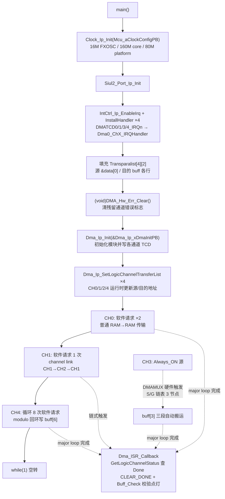

# eDMA — S32K344 RTD 0.9.0 实战教学

> 源工程: `D:\wnagjin\S32K3_mydetail\详细教学(1)\详细教学\S32K3 Training-RTD\S32DSv3p4_RTDv090\S32K344_eDMA_Example_090_34`
> 源文件: `S32K344_eDMA_Example_090_34\src\main.c`（全文 236 行；代码原样摘录，未经任何修改，Tab/空格混排与行尾空格保留）
> 说明: 该工程无 ReadMe.txt，工程功能描述以 main.c 顶部注释（L25–34，原样摘录于 3.1 节）为准。

## 1. 外设概述

**eDMA**（enhanced Direct Memory Access）：搬运描述符为 TCD（Transfer Control Descriptor，含源/目的地址、步长、minor/major 计数、完成中断等）。S32K3 上经 **DMAMUX** 把外设请求映射到 DMA 通道。

本工程一个 main.c 演示 4 种通道玩法（对应 main.c L25–34 注释原文）：

| 逻辑通道 | 特性 | 触发方式 | 演示内容 |
|---|---|---|---|
| DMA_CH0 | 普通传输 | 软件请求（连续 2 次） | data[8] → buff[0][8]，RAM→RAM |
| DMA_CH1↔CH2 | channel link | CH1 软件请求 | CH1 完成 → 链到 CH2 → 再链回 CH1 |
| DMA_CH3 | scatter/gather（S/G） | Always_ON 源经 DMAMUX 硬件触发 | 3 节点链表自动搬运，不需软件请求 |
| DMA_CH4 | modulo（取模回环） | 软件请求 ×8 | data[0..7] 循环写 buff[6][0..7] |

- 全部通道工作在中断模式，`Dma_ISR_Callback` 统一处理完成/错误事件（回调在 RTD GUI 即 .mex 里注册，生成进 PBcfg，见第 5 节）。
- 时钟配置：16M FXOSC、核心 160MHz PLL、平台 80MHz（L27 注释原文）。
- API 用**逻辑通道号**（0~4），NVIC 中断是 **DMATCD0/1/3/4_IRQn**（每硬件 TCD 一路，CH2 由 CH1 链式触发不单独装 ISR）。

## 2. 初始化与使用时序（mermaid flowchart 源码）



## 3. main.c 原样代码（按逻辑段落分块，每块标注行号范围）

### 3.1 S32K344_eDMA_Example_090_34

**（eDMA 工程 main.c 行 25–34，工程功能说明注释——本工程无 ReadMe.txt，以此为准）**

```c
/*************************************************************************
 * S32K344-WB( schematic: SPF-47478 Rev.A ) DMA sample:To show soft DMA transfer and channel link,S/G and modulo feature.
 * This example initialize the MCU clock: 16M FXOSC, 160MHz PLL for core and 80 MHz for platform.
 * The DMA_CH0(logic channel number) is used to realize a normal DMA transfer from RAM to RAM.
 * The DMA_CH1 is configured to show channel link feature.The linked channel is DMA_CH2;
 * The DMA_CH3 is configured to demonstrate scatter/gather feature and It is triggered by Always_ON source through DMAMUX.
 * The S/G linked list length is 3.
 * The DMA_CH4 is used to implement modulo feature.Update data in a specific area.
 * All channels work in interrupt mode and there is a callback to handle transfer events.
 *************************************************************************/
```

**（eDMA 工程 main.c 行 36–58，include + 全局数据 + 函数原型）**

```c
/* Including necessary configuration files. */
#include "Mcal.h"

#include "Clock_Ip.h"
#include "Siul2_Port_Ip.h"
#include "Siul2_Dio_Ip.h"
#include "Siul2_Port_Ip_Cfg.h"
#include "Cache_Ip.h"
#include "Dma_Ip.h"
#include "IntCtrl_Ip_Cfg.h"
#include "IntCtrl_Ip.h"


volatile int exit_code = 0;
__attribute__((aligned(8))) uint8 data[8] = {0x11,0x22,0x33,0x44,0X55,0X66,0X77,0X88};/* Source */
__attribute__((aligned(8))) uint8 buff[7][8] = {0};   				 	 /* Destination address */
Dma_Ip_LogicChannelTransferListType Transparalist[4][2] = {0};			 /* Transfer parameters list */
uint8_t numberOfBytes = 2;
uint32_t times = 2500000;
/* User includes */

uint8_t DMA_Hw_Err_Clear(void);
int Buff_Check(uint8_t (*dest)[8], void *src,uint8_t line, uint8_t row);
```

**（eDMA 工程 main.c 行 66–133，main 函数全文）**

```c
int main(void)
{
    /* Write your code here */
	Clock_Ip_Init(Mcu_aClockConfigPB); 	/*Initialize system clock and peripheral clock configuration*/
	Siul2_Port_Ip_Init(NUM_OF_CONFIGURED_PINS0, g_pin_mux_InitConfigArr0);

	/* DMA scatter/gather feature.The transfer will be performed automatically because of HW trigger through DMAMUX */

	/* Set interrupt configuration.Of course you could also use IntCtrl_Ip_Init().*/
	IntCtrl_Ip_EnableIrq(DMATCD0_IRQn);										/* Enable IRQ*/
	IntCtrl_Ip_InstallHandler(DMATCD0_IRQn,Dma0_Ch0_IRQHandler, NULL_PTR);	/* Install ISR */
	IntCtrl_Ip_EnableIrq(DMATCD1_IRQn);										/* Enable IRQ*/
	IntCtrl_Ip_InstallHandler(DMATCD1_IRQn,Dma0_Ch1_IRQHandler, NULL_PTR);	/* Install ISR */
	IntCtrl_Ip_EnableIrq(DMATCD3_IRQn);										/* Enable IRQ*/
	IntCtrl_Ip_InstallHandler(DMATCD3_IRQn,Dma0_Ch3_IRQHandler, NULL_PTR);	/* Install ISR */
	IntCtrl_Ip_EnableIrq(DMATCD4_IRQn);										/* Enable IRQ*/
	IntCtrl_Ip_InstallHandler(DMATCD4_IRQn,Dma0_Ch4_IRQHandler, NULL_PTR);	/* Install ISR */

	/* Set DMA command list. E.g. source and destination address  */
	Transparalist[0][0].Param =  DMA_IP_CH_SET_SOURCE_ADDRESS;
	Transparalist[0][0].Value = (uint32_t)&data[0];
	Transparalist[0][1].Param =  DMA_IP_CH_SET_DESTINATION_ADDRESS;
	Transparalist[0][1].Value = (uint32_t)&buff[0][0];

	Transparalist[1][0].Param =  DMA_IP_CH_SET_SOURCE_ADDRESS;
	Transparalist[1][0].Value = (uint32_t)&data[0];
	Transparalist[1][1].Param =  DMA_IP_CH_SET_DESTINATION_ADDRESS;
	Transparalist[1][1].Value = (uint32_t)&buff[1][0];

	Transparalist[2][0].Param =  DMA_IP_CH_SET_SOURCE_ADDRESS;
	Transparalist[2][0].Value = (uint32_t)&data[0];
	Transparalist[2][1].Param =  DMA_IP_CH_SET_DESTINATION_ADDRESS;
	Transparalist[2][1].Value = (uint32_t)&buff[2][0];

	Transparalist[3][0].Param =  DMA_IP_CH_SET_SOURCE_ADDRESS;
	Transparalist[3][0].Value = (uint32_t)&data[0];
	Transparalist[3][1].Param =  DMA_IP_CH_SET_DESTINATION_ADDRESS;
	Transparalist[3][1].Value = (uint32_t)&buff[6][0];

	(void)DMA_Hw_Err_Clear();
	Dma_Ip_Init(&Dma_Ip_xDmaInitPB);						/* Initialize DMA module and
	 	 	 	 	 	 	 	 	 	 	 	 	 	 	 set TCD blocks of channels (soft DMA) */

	/* DMA scatter/gather feature.The transfer will be performed automatically because of HW trigger through DMAMUX */
	/* Set DMA source and destination address.If DMA is configured for supporting peripherals,these steps is not necessary. */
	Dma_Ip_SetLogicChannelTransferList(0, Transparalist[0], 2);
	Dma_Ip_SetLogicChannelTransferList(1, Transparalist[1], 2);
	Dma_Ip_SetLogicChannelTransferList(2, Transparalist[2], 2);
	Dma_Ip_SetLogicChannelTransferList(4, Transparalist[3], 2);

	/* Normal software DMA transfer from RAM to RAM . */
	Dma_Ip_SetLogicChannelCommand(0, DMA_IP_CH_SET_SOFTWARE_REQUEST); 		/* Soft start DMA transfer */
	Dma_Ip_SetLogicChannelCommand(0, DMA_IP_CH_SET_SOFTWARE_REQUEST);		/* Soft start DMA transfer */

	/* DMA link feature.CH1 link CH2,and then CH2 link CH1. */
	Dma_Ip_SetLogicChannelCommand(1, DMA_IP_CH_SET_SOFTWARE_REQUEST);		/* Soft start DMA transfer */

	/* DMA modulo feature. 8 transfers between data[0]~data[7] and buff[6][0]~buff[6][7] */
	for(;exit_code < 8; exit_code++)
	{
		Dma_Ip_SetLogicChannelCommand(4, DMA_IP_CH_SET_SOFTWARE_REQUEST);	/* Soft start DMA transfer */
		while(times--);
		times = 2500000;
	}

	while(1);
    return exit_code;
}
```

**（eDMA 工程 main.c 行 145–158，DMA 错误检查清零函数）**

```c
uint8_t DMA_Hw_Err_Clear(void)
{
	uint8_t ch = 0;
	Dma_Ip_LogicInstanceStatusType status ;
	Dma_Ip_GetLogicInstanceStatus(DMA_LOGIC_INST_0,&status);
	if(status.Errors & eDMA_ES_VLD_MASK)
	{
		for(;ch < DMA_IP_NOF_CFG_LOGIC_CHANNELS;ch++)
		{
			Dma_Ip_SetLogicChannelCommand(ch, DMA_IP_CH_CLEAR_ERROR);
		}
	}
	return ch;
}
```

**（eDMA 工程 main.c 行 173–198，搬运结果校验函数）**

```c
int Buff_Check(uint8_t (*dest)[8], void *src,uint8_t line, uint8_t row)   	 /* Check data */
{
	int line_count = 0, row_count = 0;
	uint8_t* p = NULL;

	if (dest == NULL)
		return FALSE;
	else
	{
		while(line_count < line)
		{
			p = (uint8_t*)dest++;											/* Get line address */
			for (row_count = 0; row_count < row; row_count++)
			{
				if(*(p++) != *((uint8_t*)src+row_count))					/* Check every data */
				{
					return FALSE;
				}
			}
			line_count++;													/* Next line */
		};
	}

	return TRUE;

}
```

**（eDMA 工程 main.c 行 210–233，DMA 传输事件回调——在 RTD GUI 注册，非代码安装）**

```c
void Dma_ISR_Callback(void)
{
	uint32_t ch = 0;
	Dma_Ip_LogicChannelStatusType ch_status;
	for(;ch < DMA_IP_NOF_CFG_LOGIC_CHANNELS;ch++)
	{
		Dma_Ip_GetLogicChannelStatus(ch,&ch_status);
		if(ch_status.Done == TRUE)
		{
			Dma_Ip_SetLogicChannelCommand(ch, DMA_IP_CH_CLEAR_DONE);
			if(ch == 0 && Buff_Check(buff,data,1,4))
				Siul2_Dio_Ip_WritePin(LED1_PORT, LED1_PIN , 1U);
			if(ch == 1 && Buff_Check(buff[1],data,2,4))
				Siul2_Dio_Ip_WritePin(LED2_PORT, LED2_PIN , 1U);
			if(ch == 3 && Buff_Check(buff[3],data,3,4))
				Siul2_Dio_Ip_WritePin(LED3_PORT, LED3_PIN , 1U);
			if(ch == 4 && Buff_Check(buff[6],data,1,8))
				Siul2_Dio_Ip_WritePin(LED4_PORT, LED4_PIN , 1U);
		}
		else if(ch_status.Errors == TRUE)
			DMA_Hw_Err_Clear();
	}

}
```

## 4. API 速查

| API | 作用 | 关键参数 |
|---|---|---|
| `IntCtrl_Ip_EnableIrq` | 使能 DMA 通道 IRQ | `DMATCD0/1/3/4_IRQn` |
| `IntCtrl_Ip_InstallHandler` | 安装用户 ISR（`Dma0_ChX_IRQHandler` 由 RTD 生成，内部回调用户函数） | IRQn + handler + 用户参数 |
| `Dma_Ip_Init` | 初始化 eDMA 模块并写各逻辑通道 TCD | `&Dma_Ip_xDmaInitPB` |
| `Dma_Ip_SetLogicChannelTransferList` | 运行时批量更新通道参数（源/目的地址等） | 逻辑通道 + `Transparalist` + 条目数 2 |
| `Dma_Ip_SetLogicChannelCommand` | 通道命令：软触发 / 清错误 / 清 DONE | `DMA_IP_CH_SET_SOFTWARE_REQUEST`、`DMA_IP_CH_CLEAR_ERROR`、`DMA_IP_CH_CLEAR_DONE` |
| `Dma_Ip_GetLogicInstanceStatus` | 读实例级错误状态 | `DMA_LOGIC_INST_0` + 状态结构 |
| `Dma_Ip_GetLogicChannelStatus` | 读通道状态（Done/Errors） | 逻辑通道 + 状态结构 |

## 5. 配置生成物（board/generate 下 Cfg/PBcfg）

| 文件 | 关键符号（实证行号） |
|---|---|
| `generate\src\Dma_Ip_BOARD_InitPeripherals_PBcfg.c` | `LogicChannel0~4GlobalConfigPB`(L121/183/245/307/329)、`LogicChannel0/1/2/4TransferConfigPB`(L143/205/267/351)；CH3 的 S/G 链表：`LogicChannel3Stcd0~2PB`(L401/403/405，`__attribute__((aligned(32)))`)、`LogicChannel3TransferElem0~2PB`(L421/470/519)、`LogicChannel3SgaElem0~2ConfigPB`(L462/511/560，NextConfig 串成环)、`LogicChannel3SgaArrayPB`(L568)；回调注册：`extern void Dma_ISR_Callback(void);` + `.IntCallback = Dma_ISR_Callback` 共 4 处(L583/592、L600/609、L632/641、L649/658)——CH0/1/3/4 每通道一个 |
| `generate\src\Dma_Ip_Cfg.c` | `Dma_Ip_xLogicChannelResetConfig`(L126) 等基础配置 |
| `generate\src\IntCtrl_Ip_Cfg.c` | IRQ 配置 |
| `board\Clock_Ip_Cfg.c` | `Mcu_aClockConfigPB` |
| `board\Siul2_Port_Ip_Cfg.c` | `g_pin_mux_InitConfigArr0`、LED1~LED4 引脚宏 |
| `WB_S32K344_DMA_Sample_090_34.mex` | `dmaLogicChannel_InterruptCallback = Dma_ISR_Callback` 4 处(L510/597/771/1009)——回调在 S32_CT 图形界面注册、代码生成，不在 main.c 里挂 |

## 6. 常见坑（仅实证的）

1. **`Dma_Ip_Init` 之前先清残留错误**：main.c L105 `(void)DMA_Hw_Err_Clear();` 在 `Dma_Ip_Init` 前调用，读 `Dma_Ip_GetLogicInstanceStatus`，若有 `eDMA_ES_VLD_MASK` 错误就对全部 `DMA_IP_NOF_CFG_LOGIC_CHANNELS` 逐通道 `CLEAR_ERROR`。上电残留错误标志不清，通道可能拒绝启动。
2. **软 DMA 的源/目的地址必须在 Init 后用 `SetLogicChannelTransferList` 重新下发**：L110 注释原文 `If DMA is configured for supporting peripherals,these steps is not necessary.`——纯软件 RAM→RAM 场景这步不可省（ADC_BCTU 工程同理，见 adc.md 坑 2）。
3. **CH0 软请求连写两次**：L117–118 对通道 0 连续两次 `DMA_IP_CH_SET_SOFTWARE_REQUEST`，每次软请求执行一轮 major loop；与 `numberOfBytes = 2`（L53）及回调里 `Buff_Check(buff,data,1,4)`（L220，校验 4 字节）吻合——两次共搬运 4 字节。抄代码时按你的字节数决定请求次数。（次数与字节数的对应关系是从代码数值推断，例程未写明。）
4. **CH3 不需要软触发**：L30 注释与 L72/L109 注释都说 S/G 由 **Always_ON 源经 DMAMUX 硬件触发自动执行**，main 里对 CH3 只装 ISR、只下发地址，从不软请求。
5. **回调在 GUI 注册，不在代码里 Install**：`Dma_ISR_Callback` 的注册来自 `.mex` 的 `dmaLogicChannel_InterruptCallback` 设置，生成到 PBcfg 的 `.IntCallback` 字段；main 里 `InstallHandler` 装的是 RTD 生成的 `Dma0_ChX_IRQHandler`，它再调你的回调。两层别混淆。
6. **S/G 的 Stcd 必须至少 32 字节对齐**：PBcfg L401–405 全部 `__attribute__(( aligned(32) ))`。自己手写 S/G 链表时对齐不满足会出总线错误。
7. **`exit_code` 被复用为 for 循环变量**：L124 `for(;exit_code < 8; exit_code++)` 用全局 `exit_code` 计数，跑完值 = 8；且 L131 `while(1);` 之后的 `return exit_code;` 永远不可达。例程写法，别模仿到正式代码。
8. **CH2 不单独装 ISR**：四路 `InstallHandler` 只有 DMATCD0/1/3/4，CH2 由 CH1 的 channel link 带动，完成事件并入链首处理。
9. **`buff`/`data` 手工 `aligned(8)`**：L50–51。eDMA 对源/目的地址的对齐要求随传输宽度变化，源数组不对齐可能触发配置错误。
10. **`Buff_Check` 的指针算术依赖固定行宽 8**：L173 形参 `uint8_t (*dest)[8]`，L184 `p = (uint8_t*)dest++` 每轮推进一行 8 字节。目的数组行宽不是 8 时直接抄会越界。
