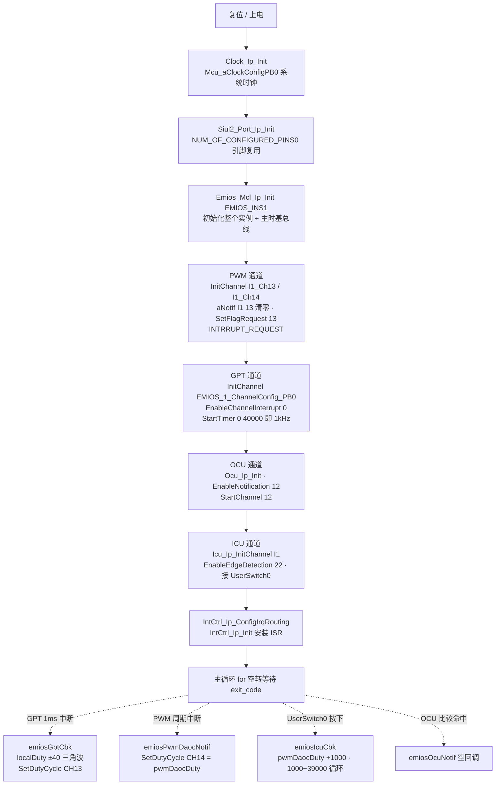
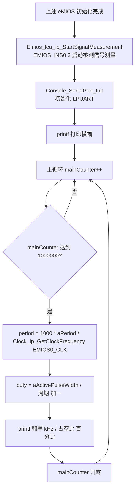

# eMIOS（增强型模块化 IO 系统） — S32K344 RTD 0.9.0 实战教学

> 源工程①（综合演示）: D:\wnagjin\S32K3_mydetail\详细教学(1)\详细教学\S32K3 Training-RTD\S32DSv3p4_RTDv090\S32K344_EMIOS_Example_090_34
> 源文件①: D:\wnagjin\S32K3_mydetail\详细教学(1)\详细教学\S32K3 Training-RTD\S32DSv3p4_RTDv090\S32K344_EMIOS_Example_090_34\src\main.c（代码原样摘录，未经任何修改）
> 源工程②（占空比测量）: D:\wnagjin\S32K3_mydetail\详细教学(1)\详细教学\S32K3 Training-RTD\S32DSv3p4_RTDv090\S32K344_EMIOS_DutyMeasurement_090_34
> 源文件②: D:\wnagjin\S32K3_mydetail\详细教学(1)\详细教学\S32K3 Training-RTD\S32DSv3p4_RTDv090\S32K344_EMIOS_DutyMeasurement_090_34\src\main.c（代码原样摘录，未经任何修改）
> 排他区参考: D:\wnagjin\S32K3_mydetail\详细教学(1)\详细教学\S32K3 Training-RTD\S32DSv3p4_RTDv090\S32K344_EMIOS_Example_090_34\RTD\src\SchM_Pwm.c（摘录关键片段）

## 1. 外设概述

eMIOS（enhanced Modular IO System）是 S32K3 里功能最强的定时器/IO 子系统，一个实例（instance）由若干 **Unified Channel（UC）** 组成，每个通道可独立配置成不同工作模式，共享同一套**主总线时基**。RTD 0.9.0 把 eMIOS 拆成 5 个 IP 驱动，每个驱动对应一类应用：

| 驱动 | 作用 | 本项目通道 |
|---|---|---|
| `Emios_Mcl_Ip` | MCL（Module Configuration Layer）——整个实例的时基/全局时基总线初始化，必须先于其它 eMIOS 驱动调用 | EMIOS0 / EMIOS1 / EMIOS2 |
| `Emios_Pwm_Ip` | PWM 输出，支持 OPWMB（输出 PWM，缓冲）和 DAOC（输出 PWM，带翻转标志）两种模式 | EVB: INS1 CH13/CH14；WB: INS2 CH10/CH11 |
| `Emios_Gpt_Ip` | 通用定时器（单次/周期定时中断），本项目当"时基心跳"用 | EVB: INS1 CH0；WB: INS2 CH0 |
| `Emios_Ocu_Ip` | 输出比较（OCU），到比较值输出翻转/置位 | EVB: INS1 CH12；WB: INS2 CH9 |
| `Emios_Icu_Ip` | 输入捕获（ICU），测边沿/周期/脉宽；也用于"按键边沿检测" | EVB: INS1 CH22；WB: INS2 CH14 |

**实验逻辑（工程①，综合演示）**：
- GPT CH0 每 1ms 中断一次（`160MHz / 4 / 40000 = 1kHz`），回调 `emiosGptCbk` 让 `localDuty` 以 ±40 步进在 0~40000 之间做三角波，实时改写 PWM CH13 占空比。
- PWM CH13 每周期触发一次 DAOC/OPWMB 中断，回调 `emiosPwmDaocNotif` 用 `pwmDaocDuty` 改写 PWM CH14 占空比。
- ICU CH22 接 UserSwitch0，每次按下触发回调 `emiosIcuCbk`，让 `pwmDaocDuty` 以 +1000 步进在 1000~39000 循环。
  结果：CH13 占空比自动来回扫（三角波），CH14 占空比随按键阶梯上升。

**实验逻辑（工程②，占空比测量）**：在工程①基础上增加一个"被测信号"通道 ICU0 CH3，用 `Emios_Icu_Ip_StartSignalMeasurement(EMIOS_INS0, 3)` 启动信号测量，主循环每 `1000000` 次读取 `eMios_Icu_Ip_ChState[0][3]` 的周期/有效脉宽，算出频率与占空比通过 LPUART `printf` 打印。PWM CH13 三角波步进改为 ±20（0~20000），按键回调改为 ±50（20~18000）。

## 2. 初始化与使用时序

工程①（EVB 分支）从复位到稳态的完整时序：



工程②（占空比测量）额外多两步：



关键点：**`Emios_Mcl_Ip_Init` 必须最先调用**，它把实例的全局时基（global time base）和主总线时钟配好，之后 `Emios_*_Ip_InitChannel` 才能把各 UC 挂到时基上。工程②里 `EMIOS_INS0` 只用来跑 ICU 测量，所以对 INS0 只调了 `Emios_Mcl_Ip_Init` + `Emios_Icu_Ip_InitChannel`，没有 PWM/GPT/OCU。

## 3. main.c 原样代码

### 3.1 工程① S32K344_EMIOS_Example_090_34\src\main.c（共 236 行）

```c
/* ===== src/main.c 第 1-23 行：文件头（版权/版本） ===== */
/*==================================================================================================
*   Project              : RTD AUTOSAR 4.4
*   Platform             : CORTEXM
*   Peripheral           : S32K3XX
*   Dependencies         : none
*
*   Autosar Version      : 4.4.0
*   Autosar Revision     : ASR_REL_4_4_REV_0000
*   Autosar Conf.Variant :
*   SW Version           : 0.9.0
*   Build Version        : S32K3_RTD_0_9_0__ASR_REL_4_4_REV_0000_20210326
*
*   (c) Copyright 2020 - 2021 NXP Semiconductors
*   All Rights Reserved.
*
*   NXP Confidential. This software is owned or controlled by NXP and may only be
*   used strictly in accordance with the applicable license terms. By expressly
*   accepting such terms or by downloading, installing, activating and/or otherwise
*   using the software, you are agreeing that you have read, and that you agree to
*   comply with and are bound by, such license terms. If you do not agree to be
*   bound by the applicable license terms, then you may not retain, install,
*   activate or otherwise use the software.
==================================================================================================*/
```

```c
/* ===== src/main.c 第 25-49 行：文件注释 + 头文件包含 ===== */

/**
*   @file main.c
*
*   @addtogroup main_module main module documentation
*   @{
*/

/* Including necessary configuration files. */
/*==================================================================================================
*                                        INCLUDE FILES
* 1) system and project includes
* 2) needed interfaces from external units
* 3) internal and external interfaces from this unit
==================================================================================================*/
#include "Mcal.h"
/* User includes */
#include "Clock_Ip.h"
#include "IntCtrl_Ip.h"
#include "Siul2_Port_Ip.h"
/* eMIOS components */
#include "Emios_Mcl_Ip.h"
#include "Emios_Ocu_Ip.h"
#include "Emios_Icu_Ip.h"
#include "Emios_Pwm_Ip.h"
#include "Emios_Gpt_Ip.h"
```

```c
/* ===== src/main.c 第 51-85 行：局部宏 + 全局变量 ===== */

/*==================================================================================================
*                                       LOCAL MACROS
==================================================================================================*/
#define USE_EVB    1    /* Set to 1 if you use EVB to run this project. */
#define USE_WB     0    /* Set to 1 if you use WB to run this project.  */

#define EMIOS_INS0 0
#define EMIOS_INS1 1
#define EMIOS_INS2 2

#define UP         1
#define DOWON      0

/*==================================================================================================
*                                      LOCAL CONSTANTS
==================================================================================================*/


/*==================================================================================================
*                                      LOCAL VARIABLES
==================================================================================================*/


/*==================================================================================================
*                                      GLOBAL CONSTANTS
==================================================================================================*/


/*==================================================================================================
*                                      GLOBAL VARIABLES
==================================================================================================*/
extern uint8 Emios_Pwm_Ip_aNotif[EMIOS_PWM_INSTANCE_COUNT][EMIOS_PWM_CHANNEL_COUNT];
uint16 pwmDaocDuty = 1000;

volatile int exit_code = 0;
```

```c
/* ===== src/main.c 第 87-107 行：函数原型区 + main 注释 ===== */

/*==================================================================================================
*                                   LOCAL FUNCTION PROTOTYPES
==================================================================================================*/


/*==================================================================================================
*                                       LOCAL FUNCTIONS
==================================================================================================*/


/*==================================================================================================
*                                       GLOBAL FUNCTIONS
==================================================================================================*/

/*!
  \brief The main function for the project.
  \details The startup initialization sequence is the following:
 * - startup asm routine
 * - main()
*/
```

```c
/* ===== src/main.c 第 107-161 行：main() 主体（初始化 + 空转循环） ===== */
int main(void)
{
    /* Write your code here */
    Clock_Ip_Init(&Mcu_aClockConfigPB[0]);
    Siul2_Port_Ip_Init(NUM_OF_CONFIGURED_PINS0, g_pin_mux_InitConfigArr0);
    /* Initialize eMIOS instance including master timer bus. */
#if USE_EVB
    Emios_Mcl_Ip_Init(EMIOS_INS1, &Emios_Mcl_Ip_1_Config_BOARD_INITPERIPHERALS);
    /* Initialize PWM channel. */
    Emios_Pwm_Ip_InitChannel(EMIOS_INS1, &Emios_Pwm_Ip_BOARD_InitPeripherals_I1_Ch13);
    Emios_Pwm_Ip_InitChannel(EMIOS_INS1, &Emios_Pwm_Ip_BOARD_InitPeripherals_I1_Ch14);
    Emios_Pwm_Ip_aNotif[EMIOS_INS1][13] = 0; /* Because initial duty is 0%. */
    Emios_Pwm_Ip_SetFlagRequest(EMIOS_INS1, 13, EMIOS_PWM_INTERRUPT_REQUEST);
    /* Initialize GPT channel.*/
    Emios_Gpt_Ip_InitChannel(EMIOS_INS1, &EMIOS_1_ChannelConfig_PB[0]);
    Emios_Gpt_Ip_EnableChannelInterrupt(EMIOS_INS1, 0);
    Emios_Gpt_Ip_StartTimer(EMIOS_INS1, 0, 40000); /* GPT runs at 160MHz / 4 / 40000 = 1kHz */
    /* Initialize OCU channel. */
    Emios_Ocu_Ip_Init(&Emios_Ocu_Ip_ModuleCfgPB_BOARD_INITPERIPHERALS);
    Emios_Ocu_Ip_EnableNotification(EMIOS_INS1, 12);
    Emios_Ocu_Ip_StartChannel(EMIOS_INS1, 12);
    /* Initialize ICU channel. */
    Emios_Icu_Ip_InitChannel(EMIOS_INS1, &eMios_Icu_Ip_1_Config_PB_BOARD_INITPERIPHERALS);
    Emios_Icu_Ip_EnableEdgeDetection(EMIOS_INS1, 22);
#elif USE_WB
    Emios_Mcl_Ip_Init(EMIOS_INS2, &Emios_Mcl_Ip_2_Config_BOARD_INITPERIPHERALS);
    /* Initialize PWM channel. */
    Emios_Pwm_Ip_InitChannel(EMIOS_INS2, &Emios_Pwm_Ip_BOARD_InitPeripherals_I2_Ch10);
    Emios_Pwm_Ip_InitChannel(EMIOS_INS2, &Emios_Pwm_Ip_BOARD_InitPeripherals_I2_Ch11);
    Emios_Pwm_Ip_aNotif[EMIOS_INS2][10] = 0; /* Because initial duty is 0%. */
    Emios_Pwm_Ip_SetFlagRequest(EMIOS_INS2, 10, EMIOS_PWM_INTERRUPT_REQUEST);
    /* Initialize GPT channel.*/
    Emios_Gpt_Ip_InitChannel(EMIOS_INS2, &EMIOS_2_ChannelConfig_PB[0]);
    Emios_Gpt_Ip_EnableChannelInterrupt(EMIOS_INS2, 0);
    Emios_Gpt_Ip_StartTimer(EMIOS_INS2, 0, 40000); /* GPT runs at 160MHz / 4 / 40000 = 1kHz */
    /* Initialize OCU channel. */
    Emios_Ocu_Ip_Init(&Emios_Ocu_Ip_ModuleCfgPB_BOARD_INITPERIPHERALS);
    Emios_Ocu_Ip_EnableNotification(EMIOS_INS2, 9);
    Emios_Ocu_Ip_StartChannel(EMIOS_INS2, 9);
    /* Initialize ICU channel. */
    Emios_Icu_Ip_InitChannel(EMIOS_INS2, &eMios_Icu_Ip_2_Config_PB_BOARD_INITPERIPHERALS);
    Emios_Icu_Ip_EnableEdgeDetection(EMIOS_INS2, 14);
#endif
    /* Configure interrupts. */
    IntCtrl_Ip_ConfigIrqRouting(&intRouteConfig);
    IntCtrl_Ip_Init(&IntCtrlConfig_0);
    for(;;)
    {
        if(exit_code != 0)
        {
            break;
        }
    }
    return exit_code;
}
```

```c
/* ===== src/main.c 第 163-189 行：GPT 回调 emiosGptCbk ===== */

/*==================================================================================================
*                                       CALLBACK FUNCTIONs
==================================================================================================*/
/*==================================================================================================
 * @brief void emiosGptCbk (uint8 channel)
 * @details Callback function for GPT.
 =================================================================================================*/
void emiosGptCbk (uint8 channel)
{
    static uint16 localDuty = 0;
    static bool UpDown = UP;
    (void)channel;
#if USE_EVB
    Emios_Pwm_Ip_SetDutyCycle(EMIOS_INS1, 13, localDuty);
#elif USE_WB
    Emios_Pwm_Ip_SetDutyCycle(EMIOS_INS2, 10, localDuty);
#endif
    localDuty = UpDown ? (localDuty + 40) : (localDuty - 40);
    if (localDuty == 40000)
    {
        UpDown = DOWON;
    }
    else if (localDuty == 0)
    {
        UpDown = UP;
    }
}
```

```c
/* ===== src/main.c 第 191-234 行：ICU/OCU/PWM 回调 ===== */

/*==================================================================================================
 * @brief void emiosIcuCbk (void)
 * @details Callback function for ICU.
 =================================================================================================*/
void emiosIcuCbk (void)
{
    pwmDaocDuty = pwmDaocDuty + 1000;
    if (pwmDaocDuty > 39000)
    {
        pwmDaocDuty = 1000;
    }
}

/*==================================================================================================
 * @brief void emiosOcuNotif (uint16 Channel)
 * @details Callback function for OCU.
 =================================================================================================*/
void emiosOcuNotif (uint16 Channel)
{
    (void)Channel;
}

/*==================================================================================================
 * @brief void emiosPwmOpwmbNotif (void * callbackParameter)
 * @details Callback function for PWM working at OPWMB mode.
 =================================================================================================*/
void emiosPwmOpwmbNotif (void * callbackParameter)
{
    (void)callbackParameter;
}

/*==================================================================================================
 * @brief void emiosPwmDaocNotif (void * callbackParameter)
 * @details Callback function for PWM working at DAOC mode.
 =================================================================================================*/
void emiosPwmDaocNotif (void * callbackParameter)
{
    (void)callbackParameter;
#if USE_EVB
    Emios_Pwm_Ip_SetDutyCycle(EMIOS_INS1, 14, pwmDaocDuty);
#elif USE_WB
    Emios_Pwm_Ip_SetDutyCycle(EMIOS_INS2, 11, pwmDaocDuty);
#endif
}

/** @} */
```

### 3.2 工程② S32K344_EMIOS_DutyMeasurement_090_34\src\main.c（共 273 行）

```c
/* ===== src/main.c 第 1-23 行：文件头（版权/版本） ===== */
/*==================================================================================================
*   Project              : RTD AUTOSAR 4.4
*   Platform             : CORTEXM
*   Peripheral           : S32K3XX
*   Dependencies         : none
*
*   Autosar Version      : 4.4.0
*   Autosar Revision     : ASR_REL_4_4_REV_0000
*   Autosar Conf.Variant :
*   SW Version           : 0.9.0
*   Build Version        : S32K3_RTD_0_9_0__ASR_REL_4_4_REV_0000_20210326
*
*   (c) Copyright 2020 - 2021 NXP Semiconductors
*   All Rights Reserved.
*
*   NXP Confidential. This software is owned or controlled by NXP and may only be
*   used strictly in accordance with the applicable license terms. By expressly
*   accepting such terms or by downloading, installing, activating and/or otherwise
*   using the software, you are agreeing that you have read, and that you agree to
*   comply with and are bound by, such license terms. If you do not agree to be
*   bound by the applicable license terms, then you may not retain, install,
*   activate or otherwise use the software.
==================================================================================================*/
```

```c
/* ===== src/main.c 第 25-63 行：文件注释 + 头文件 + 局部宏 ===== */

/**
*   @file main.c
*
*   @addtogroup main_module main module documentation
*   @{
*/

/* Including necessary configuration files. */
/*==================================================================================================
*                                        INCLUDE FILES
* 1) system and project includes
* 2) needed interfaces from external units
* 3) internal and external interfaces from this unit
==================================================================================================*/
#include "Mcal.h"
/* User includes */
#include "Clock_Ip.h"
#include "IntCtrl_Ip.h"
#include "Siul2_Port_Ip.h"
/* eMIOS components */
#include "Emios_Mcl_Ip.h"
#include "Emios_Ocu_Ip.h"
#include "Emios_Icu_Ip.h"
#include "Emios_Pwm_Ip.h"
#include "Emios_Gpt_Ip.h"
/* For printf() function by UART */
#include "retarget.h"
#include "stdio.h"

/*==================================================================================================
*                                       LOCAL MACROS
==================================================================================================*/

#define EMIOS_INS0 0
#define EMIOS_INS1 1
#define EMIOS_INS2 2

#define UP         1
#define DOWON      0
```

```c
/* ===== src/main.c 第 65-101 行：常量/变量区 + main 注释 ===== */

/*==================================================================================================
*                                      LOCAL CONSTANTS
==================================================================================================*/


/*==================================================================================================
*                                      LOCAL VARIABLES
==================================================================================================*/


/*==================================================================================================
*                                      GLOBAL CONSTANTS
==================================================================================================*/


/*==================================================================================================
*                                      GLOBAL VARIABLES
==================================================================================================*/
extern uint8 Emios_Pwm_Ip_aNotif[EMIOS_PWM_INSTANCE_COUNT][EMIOS_PWM_CHANNEL_COUNT];
extern eMios_Icu_Ip_ChStateType eMios_Icu_Ip_ChState[EMIOS_ICU_INSTANCE_COUNT][EMIOS_IP_NUM_OF_CHANNELS];
uint16 pwmDaocDuty = 20;

volatile int exit_code = 0;

/*==================================================================================================
*                                   LOCAL FUNCTION PROTOTYPES
==================================================================================================*/


/*==================================================================================================
*                                       LOCAL FUNCTIONS
==================================================================================================*/


/*==================================================================================================
*                                       GLOBAL FUNCTIONS
==================================================================================================*/

/*!
  \brief The main function for the project.
  \details The startup initialization sequence is the following:
 * - startup asm routine
 * - main()
*/
```

```c
/* ===== src/main.c 第 109-166 行：main() 初始化（含 ICU0 测量通道 + LPUART） ===== */
int main(void)
{
    /* Write your variable here.*/
    uint32 mainCounter = 0;
    float32 duty;
    float32 period;
    /* Write your code here */
    Clock_Ip_Init(&Mcu_aClockConfigPB[0]);
    Siul2_Port_Ip_Init(NUM_OF_CONFIGURED_PINS0, g_pin_mux_InitConfigArr0);
    /* Initialize eMIOS instance including master timer bus. */
#if USE_EVB
    Emios_Mcl_Ip_Init(EMIOS_INS0, &Emios_Mcl_Ip_0_Config_BOARD_INITPERIPHERALS);
    Emios_Mcl_Ip_Init(EMIOS_INS1, &Emios_Mcl_Ip_1_Config_BOARD_INITPERIPHERALS);
    /* Initialize PWM channel. */
    Emios_Pwm_Ip_InitChannel(EMIOS_INS1, &Emios_Pwm_Ip_BOARD_InitPeripherals_I1_Ch13);
    Emios_Pwm_Ip_InitChannel(EMIOS_INS1, &Emios_Pwm_Ip_BOARD_InitPeripherals_I1_Ch14);
    Emios_Pwm_Ip_aNotif[EMIOS_INS1][13] = 0; /* Because initial duty is 0%. */
    Emios_Pwm_Ip_SetFlagRequest(EMIOS_INS1, 13, EMIOS_PWM_INTERRUPT_REQUEST);
    /* Initialize GPT channel.*/
    Emios_Gpt_Ip_InitChannel(EMIOS_INS1, &EMIOS_1_ChannelConfig_PB[0]);
    Emios_Gpt_Ip_EnableChannelInterrupt(EMIOS_INS1, 0);
    Emios_Gpt_Ip_StartTimer(EMIOS_INS1, 0, 40000); /* GPT runs at 160MHz / 4 / 40000 = 1kHz */
    /* Initialize OCU channel. */
    Emios_Ocu_Ip_Init(&Emios_Ocu_Ip_ModuleCfgPB_BOARD_INITPERIPHERALS);
    Emios_Ocu_Ip_EnableNotification(EMIOS_INS1, 12);
    Emios_Ocu_Ip_StartChannel(EMIOS_INS1, 12);
    /* Initialize ICU channel. */
    Emios_Icu_Ip_InitChannel(EMIOS_INS0, &eMios_Icu_Ip_0_Config_PB_BOARD_INITPERIPHERALS);
    Emios_Icu_Ip_InitChannel(EMIOS_INS1, &eMios_Icu_Ip_1_Config_PB_BOARD_INITPERIPHERALS);
    Emios_Icu_Ip_StartSignalMeasurement(EMIOS_INS0, 3);   /* Used for duty measurement. */
    Emios_Icu_Ip_EnableEdgeDetection(EMIOS_INS1, 22);     /* Used for UserSwitch0       */
#elif USE_WB
    Emios_Mcl_Ip_Init(EMIOS_INS0, &Emios_Mcl_Ip_0_Config_BOARD_INITPERIPHERALS);
    Emios_Mcl_Ip_Init(EMIOS_INS2, &Emios_Mcl_Ip_2_Config_BOARD_INITPERIPHERALS);
    /* Initialize PWM channel. */
    Emios_Pwm_Ip_InitChannel(EMIOS_INS2, &Emios_Pwm_Ip_BOARD_InitPeripherals_I2_Ch10);
    Emios_Pwm_Ip_InitChannel(EMIOS_INS2, &Emios_Pwm_Ip_BOARD_InitPeripherals_I2_Ch11);
    Emios_Pwm_Ip_aNotif[EMIOS_INS2][10] = 0; /* Because initial duty is 0%. */
    Emios_Pwm_Ip_SetFlagRequest(EMIOS_INS2, 10, EMIOS_PWM_INTERRUPT_REQUEST);
    /* Initialize GPT channel.*/
    Emios_Gpt_Ip_InitChannel(EMIOS_INS2, &EMIOS_2_ChannelConfig_PB[0]);
    Emios_Gpt_Ip_EnableChannelInterrupt(EMIOS_INS2, 0);
    Emios_Gpt_Ip_StartTimer(EMIOS_INS2, 0, 40000); /* GPT runs at 160MHz / 4 / 40000 = 1kHz */
    /* Initialize OCU channel. */
    Emios_Ocu_Ip_Init(&Emios_Ocu_Ip_ModuleCfgPB_BOARD_INITPERIPHERALS);
    Emios_Ocu_Ip_EnableNotification(EMIOS_INS2, 9);
    Emios_Ocu_Ip_StartChannel(EMIOS_INS2, 9);
    /* Initialize ICU channel. */
    Emios_Icu_Ip_InitChannel(EMIOS_INS0, &eMios_Icu_Ip_0_Config_PB_BOARD_INITPERIPHERALS);
    Emios_Icu_Ip_InitChannel(EMIOS_INS2, &eMios_Icu_Ip_2_Config_PB_BOARD_INITPERIPHERALS);
    Emios_Icu_Ip_StartSignalMeasurement(EMIOS_INS0, 3);   /* Used for duty measurement. */
    Emios_Icu_Ip_EnableEdgeDetection(EMIOS_INS2, 14);     /* Used for UserSwitch0       */
#endif
    /* Initialize LPUART */
    Console_SerialPort_Init();
    /* Configure interrupts. */
    IntCtrl_Ip_ConfigIrqRouting(&intRouteConfig);
    IntCtrl_Ip_Init(&IntCtrlConfig_0);
```

```c
/* ===== src/main.c 第 167-195 行：printf 横幅 + 主循环占空比计算 ===== */
    /* Sent information to PC. */
    printf("**********************************************\n");
    printf("*    S32K344 use case of eMIOS components    *\n");
    printf("*    In this project can carry out the m-    *\n");
    printf("*    easurement of input signal's duty.      *\n");
    printf("**********************************************\n");
    for(;;)
    {
        mainCounter++;
        if (mainCounter > 1000000)
        {
            period = 1000 * (float32)eMios_Icu_Ip_ChState[0][3].eMios_Icu_Ip_aPeriod/
                    (float32)Clock_Ip_GetClockFrequency(EMIOS0_CLK);
            duty = (float32)eMios_Icu_Ip_ChState[0][3].eMios_Icu_Ip_aActivePulseWidth/
                    (float32)(eMios_Icu_Ip_ChState[0][3].eMios_Icu_Ip_aPeriod + 1);
            printf("Frequency is %.4f kHz\n", 1/period);
            printf("Duty is   %.4f %%\n", duty*100);
            printf("_______________________________\n");

            mainCounter = 0;
        }

        if(exit_code != 0)
        {
            break;
        }
    }
    return exit_code;
}
```

```c
/* ===== src/main.c 第 197-257 行：GPT / ICU 回调 ===== */

/*==================================================================================================
*                                       CALLBACK FUNCTIONs
==================================================================================================*/
/*==================================================================================================
 * @brief void emiosGptCbk (uint8 channel)
 * @details Callback function for GPT.
 =================================================================================================*/
void emiosGptCbk (uint8 channel)
{
    static uint16 localDuty = 0;
    static bool UpDown = UP;
    (void)channel;

#if USE_EVB
    Emios_Pwm_Ip_SetDutyCycle(EMIOS_INS1, 13, localDuty);
#elif USE_WB
    Emios_Pwm_Ip_SetDutyCycle(EMIOS_INS2, 10, localDuty);
#endif

    localDuty = UpDown ? (localDuty + 20) : (localDuty - 20);

    if (localDuty == 20000)
    {
        UpDown = DOWON;
    }
    else if (localDuty == 0)
    {
        UpDown = UP;
    }
}

/*==================================================================================================
 * @brief void emiosIcuSw0Cbk (void)
 * @details Callback function for ICU.
 =================================================================================================*/
void emiosIcuSw0Cbk (void)
{
    pwmDaocDuty = pwmDaocDuty + 50;
    if (pwmDaocDuty > 18000)
    {
        pwmDaocDuty = 20;
    }
}

/*==================================================================================================
 * @brief void emiosOcuNotif (uint16 Channel)
 * @details Callback function for OCU.
 =================================================================================================*/
void emiosOcuNotif (uint16 Channel)
{
    (void)Channel;
}

/*==================================================================================================
 * @brief void emiosPwmOpwmbNotif (void * callbackParameter)
 * @details Callback function for PWM working at OPWMB mode.
 =================================================================================================*/
void emiosPwmOpwmbNotif (void * callbackParameter)
{
    (void)callbackParameter;
}
```

```c
/* ===== src/main.c 第 259-273 行：PWM DAOC 回调 + 文件尾 ===== */

/*==================================================================================================
 * @brief void emiosPwmDaocNotif (void * callbackParameter)
 * @details Callback function for PWM working at DAOC mode.
 =================================================================================================*/
void emiosPwmDaocNotif (void * callbackParameter)
{
#if USE_EVB
    Emios_Pwm_Ip_SetDutyCycle(EMIOS_INS1, 14, pwmDaocDuty);
#elif USE_WB
    Emios_Pwm_Ip_SetDutyCycle(EMIOS_INS2, 11, pwmDaocDuty);
#endif
    (void)callbackParameter;
}

/** @} */
```

### 3.3 排他区实现片段（S32K344_EMIOS_Example_090_34\RTD\src\SchM_Pwm.c，共 1680 行）

SchM_Pwm.c 是 AUTOSAR Schedule Manager 为 PWM 模块生成的**排他区（Exclusive Area）模板代码**，内容高度重复（EXCLUSIVE_AREA_00 ~ EXCLUSIVE_AREA_30 各一对 Enter/Exit），此处只摘录理解机制所必需的关键片段，其余同构。

```c
/* ===== RTD/src/SchM_Pwm.c 第 42-58 行：头文件与源码版本 ===== */
#include "Std_Types.h"
#include "Mcal.h"
#include "OsIf.h"
#include "SchM_Pwm.h"
#ifdef MCAL_TESTING_ENVIRONMENT
#include "EUnit.h" /* EUnit Test Suite */
#endif

/*==================================================================================================
*                               SOURCE FILE VERSION INFORMATION
==================================================================================================*/
#define SCHM_PWM_AR_RELEASE_MAJOR_VERSION_C     4
#define SCHM_PWM_AR_RELEASE_MINOR_VERSION_C     4
#define SCHM_PWM_AR_RELEASE_REVISION_VERSION_C  0
#define SCHM_PWM_SW_MAJOR_VERSION_C             0
#define SCHM_PWM_SW_MINOR_VERSION_C             9
#define SCHM_PWM_SW_PATCH_VERSION_C             0
```

```c
/* ===== RTD/src/SchM_Pwm.c 第 63-99 行：平台相关的中断状态掩码与判定宏 ===== */
#ifdef MCAL_PLATFORM_ARM
    #if (MCAL_PLATFORM_ARM == MCAL_ARM_AARCH64)
        #define ISR_STATE_MASK     ((uint32)0x00000002UL)   /**< @brief DAIF bit I and F */
    #elif  (MCAL_PLATFORM_ARM == MCAL_ARM_RARCH)
        #define ISR_STATE_MASK     ((uint32)0x00000080UL)   /**< @brief CPSR bit I */
    #else
        #ifdef MCAL_ENABLE_USER_MODE_SUPPORT
            #define ISR_STATE_MASK     ((uint32)0x000000FFUL)   /**< @brief BASEPRI[7:0] mask */
        #else
            #define ISR_STATE_MASK     ((uint32)0x00000001UL)   /**< @brief PRIMASK bit 0 */
        #endif
    #endif 
#else
    #ifdef MCAL_PLATFORM_S12
        #define ISR_STATE_MASK     ((uint32)0x00000010UL)   /**< @brief I bit of CCR */
    #else
        #define ISR_STATE_MASK     ((uint32)0x00008000UL)   /**< @brief EE bit of MSR */
    #endif
#endif
/*==================================================================================================
*                                       LOCAL MACROS
==================================================================================================*/
#ifdef MCAL_PLATFORM_ARM
    #if (MCAL_PLATFORM_ARM == MCAL_ARM_AARCH64)
        #define ISR_ON(msr)            (uint32)(((uint32)(msr) & (uint32)(ISR_STATE_MASK)) != (uint32)3)
    #elif  (MCAL_PLATFORM_ARM == MCAL_ARM_RARCH)
        #define ISR_ON(msr)            (uint32)(((uint32)(msr) & (uint32)(ISR_STATE_MASK)) != (uint32)(ISR_STATE_MASK))
    #else
        #define ISR_ON(msr)            (uint32)(((uint32)(msr) & (uint32)(ISR_STATE_MASK)) == (uint32)0)
    #endif    
#else
    #ifdef MCAL_PLATFORM_S12
        #define ISR_ON(msr)            (uint32)(((uint32)(msr) & (uint32)(ISR_STATE_MASK)) == (uint32)0)
    #else
        #define ISR_ON(msr)            (uint32)((uint32)(msr) & (uint32)(ISR_STATE_MASK))
    #endif
#endif
```

```c
/* ===== RTD/src/SchM_Pwm.c 第 113-129 行：排他区 msr / reentry_guard 变量（节选前 8 组） ===== */
#define RTE_START_SEC_VAR_NO_INIT_32_NO_CACHEABLE
#include "Rte_MemMap.h"
static volatile uint32 msr_PWM_EXCLUSIVE_AREA_00[10U];
static volatile uint32 reentry_guard_PWM_EXCLUSIVE_AREA_00[10U];
static volatile uint32 msr_PWM_EXCLUSIVE_AREA_01[10U];
static volatile uint32 reentry_guard_PWM_EXCLUSIVE_AREA_01[10U];
static volatile uint32 msr_PWM_EXCLUSIVE_AREA_02[10U];
static volatile uint32 reentry_guard_PWM_EXCLUSIVE_AREA_02[10U];
static volatile uint32 msr_PWM_EXCLUSIVE_AREA_03[10U];
static volatile uint32 reentry_guard_PWM_EXCLUSIVE_AREA_03[10U];
static volatile uint32 msr_PWM_EXCLUSIVE_AREA_04[10U];
static volatile uint32 reentry_guard_PWM_EXCLUSIVE_AREA_04[10U];
static volatile uint32 msr_PWM_EXCLUSIVE_AREA_05[10U];
static volatile uint32 reentry_guard_PWM_EXCLUSIVE_AREA_05[10U];
static volatile uint32 msr_PWM_EXCLUSIVE_AREA_06[10U];
static volatile uint32 reentry_guard_PWM_EXCLUSIVE_AREA_06[10U];
static volatile uint32 msr_PWM_EXCLUSIVE_AREA_07[10U];
static volatile uint32 reentry_guard_PWM_EXCLUSIVE_AREA_07[10U];
```

```c
/* ===== RTD/src/SchM_Pwm.c 第 405-427 行：Pwm_schm_read_msr 读 PRIMASK ===== */
/** 
* @brief   This function returns the MSR register value (32 bits). 
* @details This function returns the MSR register value (32 bits). 
*     
* @param[in]     void        No input parameters
* @return        uint32 msr  This function returns the MSR register value (32 bits). 
* 
* @pre  None
* @post None
* 
*/
uint32 Pwm_schm_read_msr(void)
{
    register uint32 reg_tmp;

#ifdef MCAL_ENABLE_USER_MODE_SUPPORT
   __asm volatile( " mrs %0, basepri " : "=r" (reg_tmp) );
#else
   __asm volatile( " mrs %0, primask " : "=r" (reg_tmp) );
#endif

    return (uint32)reg_tmp;
}
```

```c
/* ===== RTD/src/SchM_Pwm.c 第 430-473 行：EXCLUSIVE_AREA_00 的 Enter/Exit（其余 01~30 同构） ===== */
#define RTE_STOP_SEC_CODE
#include "Rte_MemMap.h"

/*==================================================================================================
*                                        GLOBAL FUNCTIONS
==================================================================================================*/
#define RTE_START_SEC_CODE
#include "Rte_MemMap.h"

void SchM_Enter_Pwm_PWM_EXCLUSIVE_AREA_00(void)
{
    uint32 u32CoreId = (uint32)OsIf_GetCoreID();

    if(0UL == reentry_guard_PWM_EXCLUSIVE_AREA_00[u32CoreId])
    {
#ifdef MCAL_ENABLE_USER_MODE_SUPPORT
        msr_PWM_EXCLUSIVE_AREA_00[u32CoreId] = OsIf_Trusted_Call_Return(Pwm_schm_read_msr);
#else
        msr_PWM_EXCLUSIVE_AREA_00[u32CoreId] = Pwm_schm_read_msr();  /*read MSR (to store interrupts state)*/
#endif /* MCAL_ENABLE_USER_MODE_SUPPORT */
        if (ISR_ON(msr_PWM_EXCLUSIVE_AREA_00[u32CoreId])) /*if MSR[EE] = 0, skip calling Suspend/Resume AllInterrupts*/
        {
            OsIf_SuspendAllInterrupts();
#ifdef _ARM_DS5_C_S32K3XX_
            ASM_KEYWORD(" nop ");/* Compiler fix - forces the CSPID instruction to be generated with -02, -Ospace are selected*/
#endif
        }
    }
    reentry_guard_PWM_EXCLUSIVE_AREA_00[u32CoreId]++;
}

void SchM_Exit_Pwm_PWM_EXCLUSIVE_AREA_00(void)
{
    uint32 u32CoreId = (uint32)OsIf_GetCoreID();

    reentry_guard_PWM_EXCLUSIVE_AREA_00[u32CoreId]--;
    if ((ISR_ON(msr_PWM_EXCLUSIVE_AREA_00[u32CoreId]))&&(0UL == reentry_guard_PWM_EXCLUSIVE_AREA_00[u32CoreId]))         /*if interrupts were enabled*/
    {
        OsIf_ResumeAllInterrupts();
#ifdef _ARM_DS5_C_S32K3XX_
        ASM_KEYWORD(" nop ");/* Compiler fix - forces the CSPID instruction to be generated with -02, -Ospace are selected*/
#endif
    }
}
```

## 4. 关键 API 与配置解析

### 4.1 初始化 API

| API | 作用 | 关键参数 |
|---|---|---|
| `Emios_Mcl_Ip_Init(instance, &cfg)` | 初始化 eMIOS 实例 + 主时基总线（MCL 层） | `instance`=EMIOS_INS0/1/2；`cfg`=`Emios_Mcl_Ip_x_Config_BOARD_INITPERIPHERALS`。**必须最先调** |
| `Emios_Pwm_Ip_InitChannel(instance, &chCfg)` | 初始化一个 PWM UC 通道 | `chCfg`=`Emios_Pwm_Ip_BOARD_InitPeripherals_Ix_Chy` |
| `Emios_Pwm_Ip_SetFlagRequest(instance, ch, EMIOS_PWM_INTERRUPT_REQUEST)` | 使能该 PWM 通道中断请求 | 仅 CH13（EVB）/ CH10（WB）使能，用于 DAOC 模式回调 |
| `Emios_Gpt_Ip_InitChannel(instance, &chCfg)` | 初始化 GPT 通道 | `chCfg`=`EMIOS_x_ChannelConfig_PB[0]` |
| `Emios_Gpt_Ip_EnableChannelInterrupt(instance, ch)` + `Emios_Gpt_Ip_StartTimer(instance, ch, period)` | 使能 GPT 中断并按计数值启动 | `period`=40000，对应 `160MHz/4/40000=1kHz` |
| `Emios_Ocu_Ip_Init(&cfg)` | 初始化 OCU 模块（**注意无 instance 参数**，配置里带） | `cfg`=`Emios_Ocu_Ip_ModuleCfgPB_BOARD_INITPERIPHERALS` |
| `Emios_Icu_Ip_InitChannel(instance, &chCfg)` | 初始化 ICU 通道 | 工程②对 INS0/INS1 各调一次 |
| `Emios_Icu_Ip_EnableEdgeDetection(instance, ch)` | 使能边沿检测（本项目当"按键"用） | ch=22（EVB）/ 14（WB） |
| `Emios_Icu_Ip_StartSignalMeasurement(instance, ch)` | **启动信号测量**（周期/脉宽） | 仅工程②：`EMIOS_INS0, 3` |

### 4.2 运行时 API

| API | 作用 | 关键参数 |
|---|---|---|
| `Emios_Pwm_Ip_SetDutyCycle(instance, ch, duty)` | 改占空比（内部按 period 做限幅） | duty 值域 0~period；CH13 三角波最大 40000（工程①）/20000（工程②） |
| `Clock_Ip_GetClockFrequency(EMIOS0_CLK)` | 取 eMIOS0 时钟频率，用于算实测周期 | 工程②：`period = 1000 * aPeriod / freq` |
| `eMios_Icu_Ip_ChState[i][ch].eMios_Icu_Ip_aPeriod` | 最近一次测量到的**周期计数**（ICU CH3） | 工程②直接读该全局结构 |
| `eMios_Icu_Ip_ChState[i][ch].eMios_Icu_Ip_aActivePulseWidth` | 最近一次测量到的**有效脉宽计数** | `duty = 脉宽 /（周期+1）` |

### 4.3 回调函数

| 回调 | 触发源 | 行为 |
|---|---|---|
| `emiosGptCbk(uint8 channel)` | GPT CH0 每 1ms | 三角波步进改写 PWM CH13 占空比（工程①±40，工程②±20） |
| `emiosIcuCbk(void)` / `emiosIcuSw0Cbk(void)` | ICU 边沿（UserSwitch0） | `pwmDaocDuty` 阶梯累加（工程①+1000，工程②+50） |
| `emiosPwmDaocNotif(void*)` | PWM CH13 周期中断 | 用 `pwmDaocDuty` 改写 PWM CH14 占空比 |
| `emiosPwmOpwmbNotif(void*)`、`emiosOcuNotif(uint16)` | PWM/OCU | 本项目为空实现，占位 |

### 4.4 配置生成物关键点（来自工程 README.md）

- **`EMIOS_PWM_MODE_DAOC` vs `EMIOS_PWM_MODE_DAOC_FLAG`**：`generate\src\Emios_Pwm_Ip_BOARD_InitPeripherals_PBcfg.c` 里每次在 S32 ConfigTools 里 Update Code 后，DAOC 模式宏要手动改成 `EMIOS_PWM_MODE_DAOC_FLAG`，否则 DAOC 回调不触发。
- **`.periodCount` 要改 20000**：`Emios_Pwm_Ip_BOARD_InitPeripherals_Ix_Chx` 的 `.periodCount` 每次 Update Code 后要改回 **20000**（工程② PWM 周期的基准）。
- **板型宏在 main.c 里**：`USE_EVB` / `USE_WB` 定义在 `src\main.c` 顶部，工程②的 main.c 里**没**定义（依赖其它文件的定义），移植时要注意。

## 5. 实战要点 / 常见问题

1. **MCL 必须先于任何通道驱动**：`Emios_Mcl_Ip_Init` 建立实例主时基总线，漏掉会出现通道"初始化成功但无波形"。工程②里对 EMIOS0 只做 ICU，也照样先调 `Emios_Mcl_Ip_Init(EMIOS_INS0, ...)`（L120）。
2. **GPT 时基是 160MHz/4 再除 period**：`Emios_Gpt_Ip_StartTimer(EMIOS_INS1, 0, 40000)` 注释直接算好 `160MHz/4/40000=1kHz`（L123）。想改中断频率就按这个公式改 period（clk/4 是 eMIOS 内部预分频）。
3. **PWM 回调需先 SetFlagRequest**：只在 CH13 上调了 `Emios_Pwm_Ip_SetFlagRequest(..., EMIOS_PWM_INTERRUPT_REQUEST)`（L119），这样 DAOC 回调 `emiosPwmDaocNotif` 才会周期触发去改 CH14；漏调则 CH14 占空比永远不变。
4. **初始占空比 0% 的注释来历**：`Emios_Pwm_Ip_aNotif[EMIOS_INS1][13] = 0;` 后跟注释 `/* Because initial duty is 0%. */`（L118）——这是清通知标志位，不是设占空比。
5. **工程②读测量值的分母 +1**：`duty = aActivePulseWidth / (aPeriod + 1)`（L180-181），脉宽计数最大为 period（不 +1 会得到 100% 溢出边界），照抄即可。
6. **工程② mainCounter 门限 1000000**：`if (mainCounter > 1000000)`（L176）是纯软件"分频"，让 printf 不至于刷屏；改小可提高刷新率。
7. **SchM 排他区是 Suspend/ResumeAllInterrupts 的引用计数封装**：`SchM_Enter_*` 读 PRIMASK（`Pwm_schm_read_msr`）判断中断是否本来就开着，`reentry_guard_*` 做嵌套计数，`SchM_Exit_*` 归零且原本中断开着才 `OsIf_ResumeAllInterrupts()`（L439-473）。这部分是生成代码，不用手改；但**每个 EXCLUSIVE_AREA 的 msr/reentry_guard 数组都是 `[10U]` 按核索引**，多核工程要知道 index=CoreID。
8. **`_ARM_DS5_C_S32K3XX_` 的 nop 是编译器坑修正**：`ASM_KEYWORD(" nop ")` 注释写明"forces the CSPID instruction to be generated with -O2, -Ospace"（L454），GCC 编译时该分支不生效，属正常。
9. **RtD 版本**：本训练库为 `S32K3_RTD_0_9_0__ASR_REL_4_4_REV_0000_20210326`（BETA）。0.9.0 之后 NXP 把 `Emios_*_Ip` 部分 API 更名/合并到 eMIOS MCAL，移植到新版 RTD 时以新版 API 头为准。
