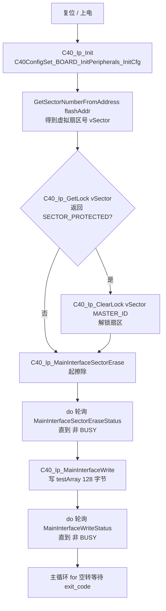
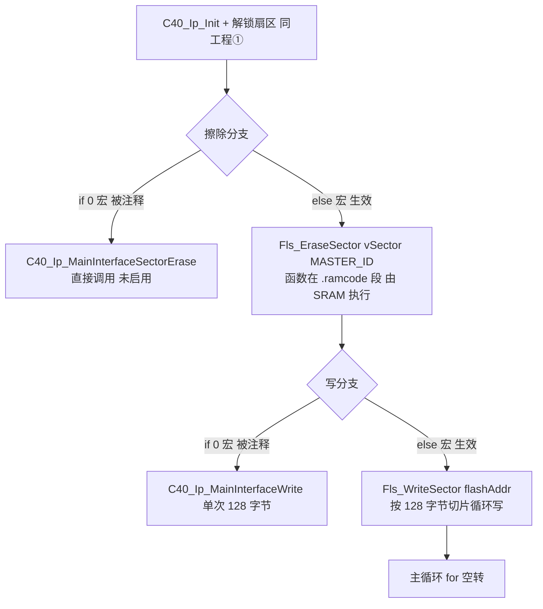
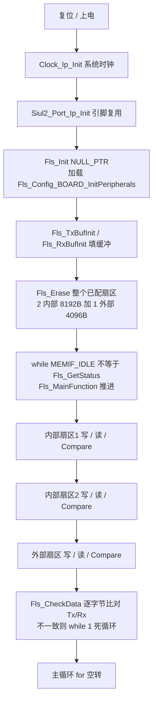
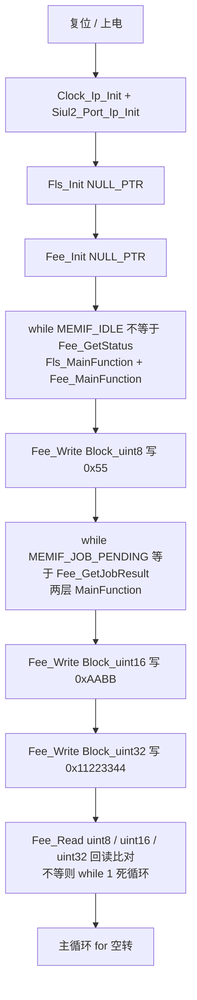

# Flash（C40 底层驱动 + Fls/Fee NVM 驱动） — S32K344 RTD 0.9.0 实战教学

> 源工程①（C40 底层读写）: D:\wnagjin\S32K3_mydetail\详细教学(1)\详细教学\S32K3 Training-RTD\S32DSv3p4_RTDv090\S32K344_C40_Example_090_34
> 源文件①: D:\wnagjin\S32K3_mydetail\详细教学(1)\详细教学\S32K3 Training-RTD\S32DSv3p4_RTDv090\S32K344_C40_Example_090_34\src\main.c（代码原样摘录，未经任何修改）
> 源工程②（C40 驱动搬 RAM 执行）: D:\wnagjin\S32K3_mydetail\详细教学(1)\详细教学\S32K3 Training-RTD\S32DSv3p4_RTDv090\S32K344_C40_ExampleDrvInRam_090_34
> 源文件②: D:\wnagjin\S32K3_mydetail\详细教学(1)\详细教学\S32K3 Training-RTD\S32DSv3p4_RTDv090\S32K344_C40_ExampleDrvInRam_090_34\src\main.c（代码原样摘录，未经任何修改）
> 源工程③（AUTOSAR Fls）: D:\wnagjin\S32K3_mydetail\详细教学(1)\详细教学\S32K3 Training-RTD\S32DSv3p4_RTDv090\S32K344_FLS_Sample_090_34
> 源文件③: D:\wnagjin\S32K3_mydetail\详细教学(1)\详细教学\S32K3 Training-RTD\S32DSv3p4_RTDv090\S32K344_FLS_Sample_090_34\src\main.c（代码原样摘录，未经任何修改）
> 源工程④（AUTOSAR Fee）: D:\wnagjin\S32K3_mydetail\详细教学(1)\详细教学\S32K3 Training-RTD\S32DSv3p4_RTDv090\S32K344_FEE_Sample_090_34
> 源文件④: D:\wnagjin\S32K3_mydetail\详细教学(1)\详细教学\S32K3 Training-RTD\S32DSv3p4_RTDv090\S32K344_FEE_Sample_090_34\src\main.c（代码原样摘录，未经任何修改）
> 底层驱动: D:\wnagjin\S32K3_mydetail\详细教学(1)\详细教学\S32K3 Training-RTD\S32DSv3p4_RTDv090\S32K344_C40_Example_090_34\RTD\src\C40_Ip.c（摘录关键 API 片段）
> 配置生成物: S32K344_FLS_Sample_090_34\generate\src\Fls_BOARD_InitPeripherals_PBcfg.c、S32K344_FEE_Sample_090_34\generate\src\Fee_Cfg.c、S32K344_FEE_Sample_090_34\generate\include\Fee_Cfg.h、S32K344_FLS_Sample_090_34\generate\src\Fls_Cfg.c

## 1. 外设概述

S32K3 的 NVM 栈是分层的：最下面是硬件 Flash 控制器 **C40**（数据 Flash + 程序 Flash），往上依次是 MCAL 的 **C40_Ip**（NR 底层驱动）、**Fls**（AUTOSAR Flash Driver，静态扇区擦写读写）、**Fee**（AUTOSAR Flash EEPROM Emulation，把逻辑块映射到 Flash 扇区，模拟 EEPROM 掉电保持）。四个工程正好各演示一层。

| 驱动 / 层 | 作用 | 对应工程 |
|---|---|---|
| `C40_Ip` | 直接操作 C40 Flash 控制器：Init / GetLock / ClearLock / MainInterfaceSectorErase / MainInterfaceWrite / MainInterfaceSectorEraseStatus / MainInterfaceWriteStatus | ① C40_Example、② C40_ExampleDrvInRam |
| `Fls` | AUTOSAR Flash Driver，按配置的逻辑扇区做 Erase / Write / Read / Compare，非阻塞靠 `Fls_MainFunction` 推进 | ③ FLS_Sample |
| `Fee` | AUTOSAR Flash EEPROM Emulation，按逻辑块（FeeBlock）做 Write / Read，非阻塞靠 `Fee_MainFunction` + 下层 `Fls_MainFunction` 推进 | ④ FEE_Sample |

**C40 关键物理特性（写代码前必须知道）**：
- 数据 Flash 一个物理扇区（sector）= **8192 字节**（`0x2000`）；程序 Flash 扇区同大小。
- C40 主接口（Main Interface）单次写粒度：**8 字节对齐**，长度是 8 字节的整数倍，单次最大 **128 字节**（`C40_DATA_SIZE_BYTES_U32`）。
- **不能擦/写正在执行代码所在的同一个块**（否则 read-while-write 冲突，触发 RWE 错误位）。工程②就是把擦写函数搬到 SRAM（`.ramcode` 段）来规避这个限制。

**实验逻辑（工程①，C40 底层读写）**：
- `flashAddr = 0x00560000u`（数据 Flash 内某一扇区），`testArray[128]` 填 0x00~0x7F。
- 流程：`C40_Ip_Init` → `GetSectorNumberFromAddress(flashAddr)` 求出虚拟扇区号 → 若扇区被保护则 `C40_Ip_ClearLock` 解锁 → `C40_Ip_MainInterfaceSectorErase` 起擦除，`do/while` 轮询 `...EraseStatus` 直到非 BUSY → `C40_Ip_MainInterfaceWrite` 写 128 字节，`do/while` 轮询 `...WriteStatus` 直到非 BUSY。
- 验证：用调试器看 `0x00560000` 地址处应为 0x00 0x01 0x02 ... 0x7F。

**实验逻辑（工程②，驱动搬 RAM）**：与①几乎一样，`flashAddr = 0x00460000u`，`testArray[256]`（`C40_DATA_SIZE_BYTES_U32*2`）。新增两个函数 `Fls_EraseSector` / `Fls_WriteSector`，用 `__attribute__((section (".ramcode")))` 定位到 SRAM 执行，`Fls_WriteSector` 内部按 128 字节切片循环写。main 里用 `#if 0/#else` 在"直接调用 C40 API"和"调用 RAM 版函数"之间切换。

**实验逻辑（工程③，Fls）**：配了 3 个逻辑扇区——数据 Flash 2 个 8192B 扇区（内部）+ 外部 QSPI Flash 1 个 4096B 扇区。`Fls_TxData[104]` 递增填充，依次对 3 个扇区做 `Fls_Erase` → `Fls_Write` → `Fls_Read` → `Fls_Compare`，每步 `while(MEMIF_IDLE != Fls_GetStatus()) Fls_MainFunction();` 推动，最后 `Fls_CheckData` 逐字节比对 Tx/Rx。

**实验逻辑（工程④，Fee）**：配了 3 个逻辑块（uint8 / uint16 / uint32 各一块），分别 `Fee_Write` 写入 0x55、0xAABB、0x11223344，每步 `while(MEMIF_JOB_PENDING == Fee_GetJobResult()) { Fls_MainFunction(); Fee_MainFunction(); }` 推进，再 `Fee_Read` 回读到 `Fee_ReadBack` 比对。Fee 在 Flash 上做"日志式"追加写 + 掉电恢复，所以底层仍是 Fls，需要两层 MainFunction 一起跑。

## 2. 初始化与使用时序

工程①（C40 底层读写）从复位到稳态的完整时序：



工程②（驱动搬 RAM）与①的差异只有两处，用 `#if 0/#else` 切换：



工程③（Fls）的初始化与运行时时序：



工程④（Fee）的初始化与运行时时序：



关键点：**C40 层是"发起 + 轮询状态"两段式**（`MainInterfaceXxx` 发起，`MainInterfaceXxxStatus`/`MainInterfaceXxx` 的 Status 变体轮询），因为 C40 擦除/写入是硬件异步的。**Fls/Fee 层是"请求 + MainFunction 状态机"两段式**，必须周期性调 `Fls_MainFunction`（和 Fee 的 `Fee_MainFunction`）把状态机往前推，`xxx_GetStatus()`/`Fee_GetJobResult()` 只是查询。

## 3. main.c 原样代码

### 3.1 工程① S32K344_C40_Example_090_34\src\main.c（136 行）

```c
/* ===== src/main.c 第 1-38 行：文件头 + includes ===== */
/*==================================================================================================
*   Project              : RTD AUTOSAR 4.4
*   Platform             : CORTEXM
*   Peripheral           : S32K3XX
*   Dependencies         : none
*
*   Autosar Version      : 4.4.0
*   Autosar Revision     : ASR_REL_4_4_REV_0000
*   Autosar Conf.Variant :
*   SW Version           : 0.9.0
*   Build Version        : S32K3_RTD_0_9_0__ASR_REL_4_4_REV_0000_20210326
*
*   (c) Copyright 2020 - 2021 NXP Semiconductors
*   All Rights Reserved.
*
*   NXP Confidential. This software is owned or controlled by NXP and may only be
*   used strictly in accordance with the applicable license terms. By expressly
*   accepting such terms or by downloading, installing, activating and/or otherwise
*   using the software, you are agreeing that you have read, and that you agree to
*   comply with and are bound by, such license terms. If you do not agree to be
*   bound by the applicable license terms, then you may not retain, install,
*   activate or otherwise use the software.
==================================================================================================*/

/**
*   @file main.c
*
*   @addtogroup main_module main module documentation
*   @{
*/

/* Including necessary configuration files. */
#include "Mcal.h"

volatile int exit_code = 0;

/* User includes */
#include "C40_Ip.h"
```

```c
/* ===== src/main.c 第 40-46 行：宏 + flashAddr ===== */


#define FLS_MASTER_ID                (0U)
#define FLS_SECTOR_MAX_WRITE_SIZE    (C40_DATA_SIZE_BYTES_U32)


/* can't erase&write the same block where the code is to prevent collisions, check the reg MCRS - RWE(read write error)  */
uint32 flashAddr = 0x00560000u ;
```

```c
/* ===== src/main.c 第 48-73 行：DEV_ASSERT + testArray ===== */
static inline void DEV_ASSERT(volatile bool x)
{
    if(x)
    {
    }
    else
    {
        for (;;)
        {
        }
    }
}


/* dummy variable                                                             */
uint8_t testArray[C40_DATA_SIZE_BYTES_U32] =
{
  0x00,0x01,0x02,0x03,0x04,0x05,0x06,0x07,0x08,0x09,0x0a,0x0b,0x0c,0x0d,0x0e,0x0f,
  0x10,0x11,0x12,0x13,0x14,0x15,0x16,0x17,0x18,0x19,0x1a,0x1b,0x1c,0x1d,0x1e,0x1f,
  0x20,0x21,0x22,0x23,0x24,0x25,0x26,0x27,0x28,0x29,0x2a,0x2b,0x2c,0x2d,0x2e,0x2f,
  0x30,0x31,0x32,0x33,0x34,0x35,0x36,0x37,0x38,0x39,0x3a,0x3b,0x3c,0x3d,0x3e,0x3f,
  0x40,0x41,0x42,0x43,0x44,0x45,0x46,0x47,0x48,0x49,0x4a,0x4b,0x4c,0x4d,0x4e,0x4f,
  0x50,0x51,0x52,0x53,0x54,0x55,0x56,0x57,0x58,0x59,0x5a,0x5b,0x5c,0x5d,0x5e,0x5f,
  0x60,0x61,0x62,0x63,0x64,0x65,0x66,0x67,0x68,0x69,0x6a,0x6b,0x6c,0x6d,0x6e,0x6f,
  0x70,0x71,0x72,0x73,0x74,0x75,0x76,0x77,0x78,0x79,0x7a,0x7b,0x7c,0x7d,0x7e,0x7f,
};
```

```c
/* ===== src/main.c 第 75-134 行：main ===== */
/*!
  \brief The main function for the project.
  \details The startup initialization sequence is the following:
 * - startup asm routine
 * - main()
*/
int main(void)
{
    /* Write your code here */


	C40_Ip_VirtualSectorsType vSector ;

	C40_Ip_StatusType C40_Ip_Status ;

    /* Initialize C40 driver */
	C40_Ip_Status = C40_Ip_Init(&C40ConfigSet_BOARD_InitPeripherals_InitCfg);
    DEV_ASSERT( STATUS_C40_IP_SUCCESS == C40_Ip_Status );

	vSector = GetSectorNumberFromAddress(flashAddr);

    /* Unlock sector */
    if (STATUS_C40_IP_SECTOR_PROTECTED == C40_Ip_GetLock(vSector))
    {
    	C40_Ip_Status = C40_Ip_ClearLock(vSector, FLS_MASTER_ID);
    	DEV_ASSERT( STATUS_C40_IP_SUCCESS == C40_Ip_Status );
    }

    /* Erase sector */

    C40_Ip_Status = C40_Ip_MainInterfaceSectorErase(vSector, FLS_MASTER_ID);
    do
    {
    	C40_Ip_Status = C40_Ip_MainInterfaceSectorEraseStatus();

        DEV_ASSERT( STATUS_C40_IP_SUCCESS == C40_Ip_Status );
    }
    while (STATUS_C40_IP_BUSY == C40_Ip_Status);

    /* Write data */
    C40_Ip_Status = C40_Ip_MainInterfaceWrite(flashAddr,sizeof(testArray),(const uint8 *)testArray,FLS_MASTER_ID);
    DEV_ASSERT( STATUS_C40_IP_SUCCESS == C40_Ip_Status );
    do
    {
    	C40_Ip_Status = C40_Ip_MainInterfaceWriteStatus();
        DEV_ASSERT( STATUS_C40_IP_SUCCESS == C40_Ip_Status );
    }
    while (STATUS_C40_IP_BUSY == C40_Ip_Status);


    for(;;)
    {
        if(exit_code != 0)
        {
            break;
        }
    }
    return exit_code;
}

/** @} */
```

### 3.2 工程② S32K344_C40_ExampleDrvInRam_090_34\src\main.c（204 行）

```c
/* ===== src/main.c 第 1-38 行：文件头 + includes（与工程①相同） ===== */
/*==================================================================================================
*   Project              : RTD AUTOSAR 4.4
*   Platform             : CORTEXM
*   Peripheral           : S32K3XX
*   Dependencies         : none
*
*   Autosar Version      : 4.4.0
*   Autosar Revision     : ASR_REL_4_4_REV_0000
*   Autosar Conf.Variant :
*   SW Version           : 0.9.0
*   Build Version        : S32K3_RTD_0_9_0__ASR_REL_4_4_REV_0000_20210326
*
*   (c) Copyright 2020 - 2021 NXP Semiconductors
*   All Rights Reserved.
*
*   NXP Confidential. This software is owned or controlled by NXP and may only be
*   used strictly in accordance with the applicable license terms. By expressly
*   accepting such terms or by downloading, installing, activating and/or otherwise
*   using the software, you are agreeing that you have read, and that you agree to
*   comply with and are bound by, such license terms. If you do not agree to be
*   bound by the applicable license terms, then you may not retain, install,
*   activate or otherwise use the software.
==================================================================================================*/

/**
*   @file main.c
*
*   @addtogroup main_module main module documentation
*   @{
*/

/* Including necessary configuration files. */
#include "Mcal.h"

volatile int exit_code = 0;

/* User includes */
#include "C40_Ip.h"
```

```c
/* ===== src/main.c 第 40-46 行：宏 + flashAddr（注意地址为 0x00460000） ===== */


#define FLS_MASTER_ID                (0U)
#define FLS_SECTOR_MAX_WRITE_SIZE    (C40_DATA_SIZE_BYTES_U32)


/* can't erase&write the same block where the code is to prevent collisions, check the reg MCRS - RWE(read write error)  */
uint32 flashAddr = 0x00460000u ;
```

```c
/* ===== src/main.c 第 48-83 行：DEV_ASSERT + testArray（256 字节） ===== */
static inline void DEV_ASSERT(volatile bool x)
{
    if(x)
    {
    }
    else
    {
        for (;;)
        {
        }
    }
}


/* dummy variable                                                             */
uint8_t testArray[C40_DATA_SIZE_BYTES_U32*2] =
{
  0x00,0x01,0x02,0x03,0x04,0x05,0x06,0x07,0x08,0x09,0x0a,0x0b,0x0c,0x0d,0x0e,0x0f,
  0x10,0x11,0x12,0x13,0x14,0x15,0x16,0x17,0x18,0x19,0x1a,0x1b,0x1c,0x1d,0x1e,0x1f,
  0x20,0x21,0x22,0x23,0x24,0x25,0x26,0x27,0x28,0x29,0x2a,0x2b,0x2c,0x2d,0x2e,0x2f,
  0x30,0x31,0x32,0x33,0x34,0x35,0x36,0x37,0x38,0x39,0x3a,0x3b,0x3c,0x3d,0x3e,0x3f,
  0x40,0x41,0x42,0x43,0x44,0x45,0x46,0x47,0x48,0x49,0x4a,0x4b,0x4c,0x4d,0x4e,0x4f,
  0x50,0x51,0x52,0x53,0x54,0x55,0x56,0x57,0x58,0x59,0x5a,0x5b,0x5c,0x5d,0x5e,0x5f,
  0x60,0x61,0x62,0x63,0x64,0x65,0x66,0x67,0x68,0x69,0x6a,0x6b,0x6c,0x6d,0x6e,0x6f,
  0x70,0x71,0x72,0x73,0x74,0x75,0x76,0x77,0x78,0x79,0x7a,0x7b,0x7c,0x7d,0x7e,0x7f,

  0x00,0x01,0x02,0x03,0x04,0x05,0x06,0x07,0x08,0x09,0x0a,0x0b,0x0c,0x0d,0x0e,0x0f,
  0x10,0x11,0x12,0x13,0x14,0x15,0x16,0x17,0x18,0x19,0x1a,0x1b,0x1c,0x1d,0x1e,0x1f,
  0x20,0x21,0x22,0x23,0x24,0x25,0x26,0x27,0x28,0x29,0x2a,0x2b,0x2c,0x2d,0x2e,0x2f,
  0x30,0x31,0x32,0x33,0x34,0x35,0x36,0x37,0x38,0x39,0x3a,0x3b,0x3c,0x3d,0x3e,0x3f,
  0x40,0x41,0x42,0x43,0x44,0x45,0x46,0x47,0x48,0x49,0x4a,0x4b,0x4c,0x4d,0x4e,0x4f,
  0x50,0x51,0x52,0x53,0x54,0x55,0x56,0x57,0x58,0x59,0x5a,0x5b,0x5c,0x5d,0x5e,0x5f,
  0x60,0x61,0x62,0x63,0x64,0x65,0x66,0x67,0x68,0x69,0x6a,0x6b,0x6c,0x6d,0x6e,0x6f,
  0x70,0x71,0x72,0x73,0x74,0x75,0x76,0x77,0x78,0x79,0x7a,0x7b,0x7c,0x7d,0x7e,0x7f,

};
```

```c
/* ===== src/main.c 第 85-135 行：.ramcode 段内的擦/写函数 ===== */
#if 1

C40_Ip_StatusType __attribute__((section (".ramcode"))) Fls_EraseSector(C40_Ip_VirtualSectorsType Fls_VirtualSector,uint8 u8DomainIdValue)
{
    C40_Ip_StatusType C40_Ip_Status = STATUS_C40_IP_ERROR ;

    /* Erase sector */
    C40_Ip_Status = C40_Ip_MainInterfaceSectorErase(Fls_VirtualSector, u8DomainIdValue);
    do
    {
        C40_Ip_Status = C40_Ip_MainInterfaceSectorEraseStatus();
    }
    while (STATUS_C40_IP_BUSY == C40_Ip_Status);

    return C40_Ip_Status ;
}

C40_Ip_StatusType __attribute__((section (".ramcode"))) Fls_WriteSector(volatile uint32 u32LogicalAddress, uint32 u32Length,const uint8 *pSourceAddressPtr, uint8 u8DomainIdValue)
{
    C40_Ip_StatusType C40_Ip_Status = STATUS_C40_IP_ERROR ;

    uint32_t writeLen = 0u ;

    while (u32Length > 0)
    {
        if(u32Length > FLS_SECTOR_MAX_WRITE_SIZE)
        {
            writeLen = FLS_SECTOR_MAX_WRITE_SIZE ;
        }
        else
        {
            writeLen = u32Length ;
        }

        /* Write data */
        C40_Ip_Status = C40_Ip_MainInterfaceWrite(u32LogicalAddress,writeLen,(const uint8_t*) pSourceAddressPtr, u8DomainIdValue);
        do
        {
            C40_Ip_Status = C40_Ip_MainInterfaceWriteStatus();
        } while (STATUS_C40_IP_BUSY == C40_Ip_Status);

        u32LogicalAddress += writeLen;
        pSourceAddressPtr += writeLen;
        u32Length -= writeLen;

    }

    return C40_Ip_Status ;
}

#endif
```

```c
/* ===== src/main.c 第 137-202 行：main（#if 0/#else 切换 RAM 版函数） ===== */
/*!
  \brief The main function for the project.
  \details The startup initialization sequence is the following:
 * - startup asm routine
 * - main()
*/
int main(void)
{
    /* Write your code here */

	C40_Ip_VirtualSectorsType vSector ;

	C40_Ip_StatusType C40_Ip_Status ;

    /* Initialize C40 driver */
	C40_Ip_Status = C40_Ip_Init(&C40ConfigSet_BOARD_InitPeripherals_InitCfg);
    DEV_ASSERT( STATUS_C40_IP_SUCCESS == C40_Ip_Status );

	vSector = GetSectorNumberFromAddress(flashAddr);

    /* Unlock sector */
    if (STATUS_C40_IP_SECTOR_PROTECTED == C40_Ip_GetLock(vSector))
    {
    	C40_Ip_Status = C40_Ip_ClearLock(vSector, FLS_MASTER_ID);
    	DEV_ASSERT( STATUS_C40_IP_SUCCESS == C40_Ip_Status );
    }

    /* Erase sector */
#if 0
    C40_Ip_Status = C40_Ip_MainInterfaceSectorErase(vSector, FLS_MASTER_ID);
    do
    {
    	C40_Ip_Status = C40_Ip_MainInterfaceSectorEraseStatus();

        DEV_ASSERT( STATUS_C40_IP_SUCCESS == C40_Ip_Status );
    }
    while (STATUS_C40_IP_BUSY == C40_Ip_Status);

#else
    C40_Ip_Status = Fls_EraseSector(vSector, FLS_MASTER_ID);
#endif


    /* Write data */
#if 0
    C40_Ip_Status = C40_Ip_MainInterfaceWrite(flashAddr,sizeof(testArray),(const uint8 *)testArray,FLS_MASTER_ID);
    DEV_ASSERT( STATUS_C40_IP_SUCCESS == C40_Ip_Status );
    do
    {
    	C40_Ip_Status = C40_Ip_MainInterfaceWriteStatus();
        DEV_ASSERT( STATUS_C40_IP_SUCCESS == C40_Ip_Status );
    }
    while (STATUS_C40_IP_BUSY == C40_Ip_Status);
#else
    C40_Ip_Status = Fls_WriteSector(flashAddr,sizeof(testArray),(const uint8 *)testArray,FLS_MASTER_ID);
#endif

    for(;;)
    {
        if(exit_code != 0)
        {
            break;
        }
    }
    return exit_code;
}

/** @} */
```

### 3.3 工程③ S32K344_FLS_Sample_090_34\src\main.c（213 行）

```c
/* ===== src/main.c 第 1-58 行：文件头 + includes + 宏 + 声明 ===== */
/*==================================================================================================
*   Project              : RTD AUTOSAR 4.4
*   Platform             : CORTEXM
*   Peripheral           : S32K3XX
*   Dependencies         : none
*
*   Autosar Version      : 4.4.0
*   Autosar Revision     : ASR_REL_4_4_REV_0000
*   Autosar Conf.Variant :
*   SW Version           : 0.9.0
*   Build Version        : S32K3_RTD_0_9_0__ASR_REL_4_4_REV_0000_20210326
*
*   (c) Copyright 2020 - 2021 NXP Semiconductors
*   All Rights Reserved.
*
*   NXP Confidential. This software is owned or controlled by NXP and may only be
*   used strictly in accordance with the applicable license terms. By expressly
*   accepting such terms or by downloading, installing, activating and/or otherwise
*   using the software, you are agreeing that you have read, and that you agree to
*   comply with and are bound by, such license terms. If you do not agree to be
*   bound by the applicable license terms, then you may not retain, install,
*   activate or otherwise use the software.
==================================================================================================*/

/**
*   @file main.c
*
*   @addtogroup main_module main module documentation
*   @{
*/

/* Including necessary configuration files. */
#include "Mcal.h"
#include "Clock_Ip.h"
#include "Siul2_Port_Ip.h"
#include "Siul2_Dio_Ip.h"
#include "Fls.h"
#include "SchM_Fls.h"

/*Fls start address, this is the logical address, not the physical address*/
#define FLS_START_ADDR                0U
/*Internal flash sector size(C40 Data flash sector):8192 Bytes*/
#define FLS_INTERNAL_SECTOR_SIZE      0x2000U
/*External flash sector size(S25FL128L):4096 Bytes*/
#define FLS_EXTERNAL_SECTOR_SIZE      0x1000U
/*Configured number of sectors*/
#define FLS_NUMBER_OF_INTERNAL_SECTOR 2U
#define FLS_NUMBER_OF_EXTERNAL_SECTOR 1U
#define FLS_NUMBER_OF_SECTOR (FLS_NUMBER_OF_INTERNAL_SECTOR + FLS_NUMBER_OF_EXTERNAL_SECTOR)
/*The buffer length of test data*/
#define FLS_BUF_SIZE                  104U

uint8 Fls_TxData[FLS_BUF_SIZE];
uint8 Fls_RxData[FLS_BUF_SIZE];

void Fls_TxBufInit(void);
void Fls_RxBufInit(void);
bool Fls_CheckData(uint8 size);
```

```c
/* ===== src/main.c 第 60-102 行：缓冲区函数 + 回调 ===== */
void Fls_TxBufInit(void)
{
    uint8 i;

    for (i = 0; i < FLS_BUF_SIZE; i++)
    {
    	Fls_TxData[i]  = i;
    }
}

void Fls_RxBufInit(void)
{
    uint8 i;

    for (i = 0; i < FLS_BUF_SIZE; i++)
    {
    	Fls_RxData[i]  = 0U;
    }
}

bool Fls_CheckData(uint8 size)
{
    uint8 i;

    for (i = 0; i < size; i++)
    {
        if (Fls_RxData[i] != Fls_TxData[i])
        {
            return false;
        }
    }
    return true;
}

void Fee_JobEndNotification(void)
{

}

void Fee_JobErrorNotification(void)
{

}
```

```c
/* ===== src/main.c 第 104-211 行：main ===== */
volatile int exit_code = 0;
/* User includes */

/*!
  \brief The main function for the project.
  \details The startup initialization sequence is the following:
 * - startup asm routine
 * - main()
*/
int main(void)
{
    /* Write your code here */
	/*
	 * initialize MCU system clock
	 */
	Clock_Ip_Init(&Mcu_aClockConfigPB[0]);
	/*
	 * initialize used pins
	 */
	Siul2_Port_Ip_Init(NUM_OF_CONFIGURED_PINS0,g_pin_mux_InitConfigArr0);
	/* Initialize Fls driver */
	Fls_Init(NULL_PTR);
	/* Initialize Tx and Rx Buffer */
	Fls_TxBufInit();
	Fls_RxBufInit();

	/* Erase entire Fls sector configured */
	Fls_Erase(FLS_START_ADDR, FLS_INTERNAL_SECTOR_SIZE*FLS_NUMBER_OF_INTERNAL_SECTOR+FLS_EXTERNAL_SECTOR_SIZE*FLS_NUMBER_OF_EXTERNAL_SECTOR);
	while(MEMIF_IDLE != Fls_GetStatus())
	{
	  Fls_MainFunction();
	}
	/*Internal Flash 1st sector*/
	Fls_Write(FLS_START_ADDR, Fls_TxData, FLS_BUF_SIZE);
	while(MEMIF_IDLE != Fls_GetStatus())
	{
	  Fls_MainFunction();
	}
	/* Read data from internal 1st sector */
	Fls_Read(FLS_START_ADDR, Fls_RxData, FLS_BUF_SIZE);
	while(MEMIF_IDLE != Fls_GetStatus())
	{
	  Fls_MainFunction();
	}
	/* Compare data in internal 1st sector to Txdata buffer*/
	Fls_Compare(FLS_START_ADDR, Fls_TxData, FLS_BUF_SIZE);
	while(MEMIF_IDLE != Fls_GetStatus())
	{
	  Fls_MainFunction();
	}
	/*Internal Flash 2nd sector*/
	Fls_RxBufInit();
	Fls_Write(FLS_START_ADDR+FLS_INTERNAL_SECTOR_SIZE, Fls_TxData, FLS_BUF_SIZE);
	while(MEMIF_IDLE != Fls_GetStatus())
	{
	  Fls_MainFunction();
	}
	/* Read data from internal 2nd sector */
	Fls_Read(FLS_START_ADDR+FLS_INTERNAL_SECTOR_SIZE, Fls_RxData, FLS_BUF_SIZE);
	while(MEMIF_IDLE != Fls_GetStatus())
	{
	  Fls_MainFunction();
	}
	/* Compare data in internal 2nd sector to Txdata buffer*/
	Fls_Compare(FLS_START_ADDR+FLS_INTERNAL_SECTOR_SIZE, Fls_TxData, FLS_BUF_SIZE);
	while(MEMIF_IDLE != Fls_GetStatus())
	{
	  Fls_MainFunction();
	}
	/* Compare data between Tx and Rx buffer */
	if(!Fls_CheckData(FLS_BUF_SIZE))
	{
	  while(1);
	}
	/*External Flash sector*/
	Fls_RxBufInit();
	Fls_Write(FLS_START_ADDR+FLS_INTERNAL_SECTOR_SIZE*FLS_NUMBER_OF_INTERNAL_SECTOR, Fls_TxData, FLS_BUF_SIZE);
	while(MEMIF_IDLE != Fls_GetStatus())
	{
	  Fls_MainFunction();
	}
	/* Read data from external sector */
	Fls_Read(FLS_START_ADDR+FLS_INTERNAL_SECTOR_SIZE*FLS_NUMBER_OF_INTERNAL_SECTOR, Fls_RxData, FLS_BUF_SIZE);
	while(MEMIF_IDLE != Fls_GetStatus())
	{
	  Fls_MainFunction();
	}
	/* Compare data in external sector to Txdata buffer*/
	Fls_Compare(FLS_START_ADDR+FLS_INTERNAL_SECTOR_SIZE*FLS_NUMBER_OF_INTERNAL_SECTOR, Fls_TxData, FLS_BUF_SIZE);
	while(MEMIF_IDLE != Fls_GetStatus())
	{
	  Fls_MainFunction();
	}
	/* Compare data between Tx and Rx buffer */
	if(!Fls_CheckData(FLS_BUF_SIZE))
	{
	  while(1);
	}

    for(;;)
    {
        if(exit_code != 0)
        {
            break;
        }
    }
    return exit_code;
}

/** @} */
```

### 3.4 工程④ S32K344_FEE_Sample_090_34\src\main.c（148 行）

```c
/* ===== src/main.c 第 1-61 行：文件头 + includes + 宏 + 测试变量 ===== */
/*==================================================================================================
*   Project              : RTD AUTOSAR 4.4
*   Platform             : CORTEXM
*   Peripheral           : S32K3XX
*   Dependencies         : none
*
*   Autosar Version      : 4.4.0
*   Autosar Revision     : ASR_REL_4_4_REV_0000
*   Autosar Conf.Variant :
*   SW Version           : 0.9.0
*   Build Version        : S32K3_RTD_0_9_0__ASR_REL_4_4_REV_0000_20210326
*
*   (c) Copyright 2020 - 2021 NXP Semiconductors
*   All Rights Reserved.
*
*   NXP Confidential. This software is owned or controlled by NXP and may only be
*   used strictly in accordance with the applicable license terms. By expressly
*   accepting such terms or by downloading, installing, activating and/or otherwise
*   using the software, you are agreeing that you have read, and that you agree to
*   comply with and are bound by, such license terms. If you do not agree to be
*   bound by the applicable license terms, then you may not retain, install,
*   activate or otherwise use the software.
==================================================================================================*/

/**
*   @file main.c
*
*   @addtogroup main_module main module documentation
*   @{
*/

/* Including necessary configuration files. */
#include "Mcal.h"
#include "Clock_Ip.h"
#include "Siul2_Port_Ip.h"
#include "Siul2_Dio_Ip.h"
#include "Fls.h"
#include "SchM_Fls.h"
#include "Fee.h"

extern void Fee_MainFunction(void);

/*Fls start address, this is the logical address, not the physical address*/
#define FLS_START_ADDR                0U
/*Internal flash sector size(C40 Data flash sector):8192 Bytes*/
#define FLS_INTERNAL_SECTOR_SIZE      0x2000U
/*External flash sector size(S25FL128L):4096 Bytes*/
#define FLS_EXTERNAL_SECTOR_SIZE      0x1000U
/*Configured number of sectors*/
#define FLS_NUMBER_OF_INTERNAL_SECTOR 2U
#define FLS_NUMBER_OF_EXTERNAL_SECTOR 1U
#define FLS_NUMBER_OF_SECTOR (FLS_NUMBER_OF_INTERNAL_SECTOR + FLS_NUMBER_OF_EXTERNAL_SECTOR)
/*The buffer length of test data*/
#define FLS_BUF_SIZE                  104U

uint8 Fee_TxUint8 = 0x55;
uint16 Fee_TxUint16 = 0xaabb;
uint32 Fee_TxUint32 = 0x11223344;
uint32 Fee_ReadBack = 0;

volatile int exit_code = 0;
/* User includes */
```

```c
/* ===== src/main.c 第 64-146 行：main ===== */
/*!
  \brief The main function for the project.
  \details The startup initialization sequence is the following:
 * - startup asm routine
 * - main()
*/
int main(void)
{
    /* Write your code here */
	/*
	 * initialize MCU system clock
	 */
	Clock_Ip_Init(&Mcu_aClockConfigPB[0]);
	/*
	 * initialize used pins
	 */
	Siul2_Port_Ip_Init(NUM_OF_CONFIGURED_PINS0,g_pin_mux_InitConfigArr0);
	/* Initialize Fls driver */
	Fls_Init(NULL_PTR); /* Initialize Fls driver */
	Fee_Init(NULL_PTR); /* Initialize Fee driver */
	while(MEMIF_IDLE != Fee_GetStatus())
	{
		Fls_MainFunction();
		Fee_MainFunction();
	}
	Fee_Write(FeeConf_FeeBlockConfiguration_FeeBlock_uint8, &Fee_TxUint8);
	while(MEMIF_JOB_PENDING == Fee_GetJobResult())
	{
		Fls_MainFunction();
		Fee_MainFunction();
	}
	Fee_Write(FeeConf_FeeBlockConfiguration_FeeBlock_uint16, (uint8 *)&Fee_TxUint16);
	while(MEMIF_JOB_PENDING == Fee_GetJobResult())
	{
		Fls_MainFunction();
		Fee_MainFunction();
	}
	Fee_Write(FeeConf_FeeBlockConfiguration_FeeBlock_uint32, (uint8 *)&Fee_TxUint32);
	while(MEMIF_JOB_PENDING == Fee_GetJobResult())
	{
		Fls_MainFunction();
		Fee_MainFunction();
	}
	Fee_Read(FeeConf_FeeBlockConfiguration_FeeBlock_uint8, 0, (uint8 *)&Fee_ReadBack, sizeof(Fee_TxUint8));
	while(MEMIF_JOB_PENDING == Fee_GetJobResult())
	{
		Fls_MainFunction();
		Fee_MainFunction();
	}
	if(Fee_ReadBack != Fee_TxUint8)
	{
		while(1);
	}
	Fee_Read(FeeConf_FeeBlockConfiguration_FeeBlock_uint16, 0, (uint8 *)&Fee_ReadBack, sizeof(Fee_TxUint16));
	while(MEMIF_JOB_PENDING == Fee_GetJobResult())
	{
		Fls_MainFunction();
		Fee_MainFunction();
	}
	if(Fee_ReadBack != Fee_TxUint16)
	{
		while(1);
	}
	Fee_Read(FeeConf_FeeBlockConfiguration_FeeBlock_uint32, 0, (uint8 *)&Fee_ReadBack, sizeof(Fee_TxUint32));
	while(MEMIF_JOB_PENDING == Fee_GetJobResult())
	{
		Fls_MainFunction();
		Fee_MainFunction();
	}
	if(Fee_ReadBack != Fee_TxUint32)
	{
		while(1);
	}

    for(;;)
    {
        if(exit_code != 0)
        {
            break;
        }
    }
    return exit_code;
}

/** @} */
```

### 3.5 关键配置文件与底层驱动片段

Fls 的真正配置不在 `Fls_Cfg.c`（该文件在 `FLS_PRECOMPILE_SUPPORT` 关闭时几乎为空壳，只含版本校验宏），而在生成的 `Fls_BOARD_InitPeripherals_PBcfg.c`：

```c
/* ===== S32K344_FLS_Sample_090_34\generate\src\Fls_BOARD_InitPeripherals_PBcfg.c 第 166-235 行：扇区几何 + 通道 ===== */
/* aFlsSectorEndAddr */
static const Fls_AddressType FlsConfigSet_BOARD_InitPeripherals_aFlsSectorEndAddr[3] =
{
    (Fls_AddressType)8191U,  /* FlsSector_0 */
    (Fls_AddressType)16383U,  /* FlsSector_1 */
    (Fls_AddressType)20479U  /* FlsSector_2 */
};


/* paSectorSize */
static const Fls_LengthType FlsConfigSet_BOARD_InitPeripherals_aFlsSectorSize[3] =
{
    (Fls_LengthType)8192U,  /* FlsSector_0 */
    (Fls_LengthType)8192U,  /* FlsSector_1 */
    (Fls_LengthType)4096U  /* FlsSector_2 */
};


/* paSectorProgSize */
static const Fls_ProgSizeType FlsConfigSet_BOARD_InitPeripherals_aFlsProgSize[3] =
{
    (Fls_ProgSizeType)FLS_WRITE_DOUBLE_WORD,  /* FlsSector_0 */
    (Fls_ProgSizeType)FLS_WRITE_DOUBLE_WORD,  /* FlsSector_1 */
    (Fls_ProgSizeType)FLS_WRITE_256BYTES_PAGE  /* FlsSector_2 */
};


/* paSectorPageSize */
static const Fls_LengthType FlsConfigSet_BOARD_InitPeripherals_aFlsSectorPageSize[3] =
{
    (Fls_LengthType)8U,  /* FlsSector_0 */
    (Fls_LengthType)8U,  /* FlsSector_1 */
    (Fls_LengthType)256U  /* FlsSector_2 */
};

/* Info structure (reg prot, ecc trigger, etc) for each internal flash sector. */
static const Fls_Flash_InternalSectorInfoType FlsSector_0_FlsConfigSet_BOARD_InitPeripherals_sInternalSectorInfo =
{
    (volatile uint32*)(FLS_DATA_FLASH_BASE_ADDR + 0x000000UL),  /* pSectorStartAddressPtr */
    (Fls_BlockNumberOfSectorType)(FLS_DATA_BLOCK), /* data block */
    (boolean)FALSE,  /* bEccTriggersExc */
    0U  /* Sector location to calculate cfgCRC */
};

static const Fls_Flash_InternalSectorInfoType FlsSector_1_FlsConfigSet_BOARD_InitPeripherals_sInternalSectorInfo =
{
    (volatile uint32*)(FLS_DATA_FLASH_BASE_ADDR + 0x002000UL),  /* pSectorStartAddressPtr */
    (Fls_BlockNumberOfSectorType)(FLS_DATA_BLOCK), /* data block */
    (boolean)FALSE,  /* bEccTriggersExc */
    1U  /* Sector location to calculate cfgCRC */
};

/* FLASH physical sectorization description */
static const Fls_Flash_InternalSectorInfoType * const FlsConfigSet_BOARD_InitPeripherals_aSectorList[3] =
{
    /* FLS_DATA_ARRAY_0_BLOCK_4_S000 */
    &FlsSector_0_FlsConfigSet_BOARD_InitPeripherals_sInternalSectorInfo,
    /* FLS_DATA_ARRAY_0_BLOCK_4_S001 */
    &FlsSector_1_FlsConfigSet_BOARD_InitPeripherals_sInternalSectorInfo,
    /* FLS_EXT_SECTOR */
    NULL_PTR
};

/* paHwCh */
static const Fls_HwChType FlsConfigSet_BOARD_InitPeripherals_paHwCh[3] =
{
    FLS_CH_INTERN,  /* FlsSector_0 */
    FLS_CH_INTERN,  /* FlsSector_1 */
    FLS_CH_QSPI  /* FlsSector_2 */
};
```

```c
/* ===== S32K344_FLS_Sample_090_34\generate\src\Fls_BOARD_InitPeripherals_PBcfg.c 第 300-327 行：Fls_Config 顶层结构 ===== */
const Fls_ConfigType Fls_Config_BOARD_InitPeripherals =
{
    (Fls_AcErasePtrType)&C40_Ip_AccessCode,  /* FlsAcErase */
    (Fls_AcWritePtrType)&C40_Ip_AccessCode,  /* FlsAcWrite */
    NULL_PTR,  /* FlsACCallback */
    &Fee_JobEndNotification,  /* FlsJobEndNotification */
    &Fee_JobErrorNotification,  /* FlsJobErrorNotification */
    NULL_PTR,  /* FlsMCoreTimeoutNotification */
    NULL_PTR,  /* FlsReadFunctionCallout */
    MEMIF_MODE_SLOW,  /* FlsDefaultMode */
    256U,  /* FlsMaxReadFastMode */
    128U,  /* FlsMaxReadNormalMode */
    256U,  /* FlsMaxWriteFastMode */
    256U,  /* FlsMaxWriteNormalMode */
    3U,  /* FlsSectorCount */
    &FlsConfigSet_BOARD_InitPeripherals_aFlsSectorEndAddr,  /* (*paSectorEndAddr)[] */
    &FlsConfigSet_BOARD_InitPeripherals_aFlsSectorSize,  /* (*paSectorSize)[] */
    &FlsConfigSet_BOARD_InitPeripherals_aSectorList,  /* (*pSectorList)[] */
    &FlsConfigSet_BOARD_InitPeripherals_aFlsSectorFlags,  /* (*paSectorFlags)[] */
    &FlsConfigSet_BOARD_InitPeripherals_aFlsProgSize,  /* (*paSectorProgSize)[] */
    &FlsConfigSet_BOARD_InitPeripherals_aFlsSectorPageSize,  /* (*paSectorPageSize)[] */
    &FlsConfigSet_BOARD_InitPeripherals_aFlsSectorUnlock,  /* (*paSectorUnlock)[] */
    &FlsConfigSet_BOARD_InitPeripherals_paHwCh,  /* (*paHwCh)[] */
    &FlsConfigSet_BOARD_InitPeripherals_paSectorHwAddress,  /* (*paSectorHwAddress)[] */
    &Fls_QspiConfigSet_BOARD_InitPeripherals,  /* pFlsQspiCfgConfig */
    &FlsConfigSet_BOARD_InitPeripherals_InitCfg,  /* (*pFlsC40CfgConfig) */
    43838U  /* configCrc */
};
```

Fee 的配置生成物 `Fee_Cfg.c`（簇组 + 逻辑块）：

```c
/* ===== S32K344_FEE_Sample_090_34\generate\src\Fee_Cfg.c 第 84-149 行：簇组与块配置 ===== */
/* Configuration of cluster group FeeClusterGroup_0 */
static const Fee_ClusterType Fee_FeeClusterGroup_0[2] =
{
    /*FeeCluster_0*/
    {
        0, /* Start address */
        8192 /* Size */
    },
    /*FeeCluster_1*/
    {
        8192, /* Start address */
        8192 /* Size */
    }
};

/* Configuration of cluster group set */
const Fee_ClusterGroupType Fee_ClrGrps[FEE_NUMBER_OF_CLUSTER_GROUPS] =
{
    /*FeeClusterGroup_0*/
    {
        Fee_FeeClusterGroup_0, /* Cluster set */
        2U, /* Number of clusters */
        0U /* Size of the reserved area */
    }
};

/* Configuration of Fee blocks */
const Fee_BlockConfigType Fee_BlockConfig[FEE_CRT_CFG_NR_OF_BLOCKS] =
{
    /*FeeBlock_uint8*/
    {
        FeeConf_FeeBlockConfiguration_FeeBlock_uint8, /* FeeBlockNumber symbol */
        1, /* FeeBlockSize */
        0, /* FeeClusterGroup */
        (boolean)FALSE, /* FeeImmediateData */
#if (FEE_SWAP_FOREIGN_BLOCKS_ENABLED == STD_ON)
        FEE_PROJECT_APPLICATION /* Fee Block Assignment to a project */
#else
        FEE_PROJECT_RESERVED
#endif
    },
    /*FeeBlock_uint16*/
    {
        FeeConf_FeeBlockConfiguration_FeeBlock_uint16, /* FeeBlockNumber symbol */
        2, /* FeeBlockSize */
        0, /* FeeClusterGroup */
        (boolean)FALSE, /* FeeImmediateData */
#if (FEE_SWAP_FOREIGN_BLOCKS_ENABLED == STD_ON)
        FEE_PROJECT_APPLICATION /* Fee Block Assignment to a project */
#else
        FEE_PROJECT_RESERVED
#endif
    },
    /*FeeBlock_uint32*/
    {
        FeeConf_FeeBlockConfiguration_FeeBlock_uint32, /* FeeBlockNumber symbol */
        4, /* FeeBlockSize */
        0, /* FeeClusterGroup */
        (boolean)FALSE, /* FeeImmediateData */
#if (FEE_SWAP_FOREIGN_BLOCKS_ENABLED == STD_ON)
        FEE_PROJECT_APPLICATION /* Fee Block Assignment to a project */
#else
        FEE_PROJECT_RESERVED
#endif
    }
};
```

Fee 的配置头 `Fee_Cfg.h` 关键宏（块符号名、块数量、虚页大小、块开销）：

```c
/* ===== S32K344_FEE_Sample_090_34\generate\include\Fee_Cfg.h 第 105-107 行 ===== */
/* The size in bytes to which logical blocks shall be aligned */
/** @implements   FeeVirtualPageSize_Object */
#define FEE_VIRTUAL_PAGE_SIZE                    8U
```

```c
/* ===== S32K344_FEE_Sample_090_34\generate\include\Fee_Cfg.h 第 131-144 行 ===== */
/* Number of configured Fee cluster groups */
#define FEE_NUMBER_OF_CLUSTER_GROUPS             1U

/* Number of configured Fee blocks */
#define FEE_CRT_CFG_NR_OF_BLOCKS                 3U

/* Maximum number of Fee blocks in all project versions and configurations */
#define FEE_MAX_NR_OF_BLOCKS                     FEE_CRT_CFG_NR_OF_BLOCKS
/* Management overhead per logical block in bytes */
/** @implements   FeeBlockOverhead_Object */
#define FEE_BLOCK_OVERHEAD                       32U

/* Management overhead per logical cluster in bytes */
#define FEE_CLUSTER_OVERHEAD                     32U
```

```c
/* ===== S32K344_FEE_Sample_090_34\generate\include\Fee_Cfg.h 第 176-179 行 ===== */
/* Symbolic names of configured Fee blocks */
#define FeeConf_FeeBlockConfiguration_FeeBlock_uint8       1
#define FeeConf_FeeBlockConfiguration_FeeBlock_uint16       2
#define FeeConf_FeeBlockConfiguration_FeeBlock_uint32       3
```

`Fls_Cfg.c` 本体（仅版本校验，无扇区配置）：

```c
/* ===== S32K344_FLS_Sample_090_34\generate\src\Fls_Cfg.c 第 25-93 行：precompile 才有效，实为版本校验 ===== */
/**
*   @file Fls_Cfg.c
*
*   @addtogroup FLS
*   @{
*/

/* implements Fls_Cfg.c_Artifact */

#ifdef __cplusplus
extern "C"{
#endif


/*==================================================================================================
*                                        INCLUDE FILES
* 1) system and project includes
* 2) needed interfaces from external units
* 3) internal and external interfaces from this unit
==================================================================================================*/
#include "Fls.h"

#ifdef FLS_PRECOMPILE_SUPPORT

/*==================================================================================================
*                              SOURCE FILE VERSION INFORMATION
==================================================================================================*/
#define FLS_VENDOR_ID_PCFG_C                      43
#define FLS_AR_RELEASE_MAJOR_VERSION_PCFG_C       4
#define FLS_AR_RELEASE_MINOR_VERSION_PCFG_C       4
#define FLS_AR_RELEASE_REVISION_VERSION_PCFG_C    0
#define FLS_SW_MAJOR_VERSION_PCFG_C               0
#define FLS_SW_MINOR_VERSION_PCFG_C               9
#define FLS_SW_PATCH_VERSION_PCFG_C               0
```

（中间第 60-92 行为标准的版本校验 `#if ... #error` 块，均为生成样板，此处略去逐字摘录；文件在第 93 行结束 `#ifdef FLS_PRECOMPILE_SUPPORT`）

```c
/* ===== S32K344_FLS_Sample_090_34\generate\src\Fls_Cfg.c 第 93-98 行 ===== */
#endif /* FLS_PRECOMPILE_SUPPORT */
#ifdef __cplusplus
}
#endif

/** @}*/
```

C40 底层驱动 `C40_Ip.c` 的三个关键 API 片段：

```c
/* ===== S32K344_C40_Example_090_34\RTD\src\C40_Ip.c 第 1291-1371 行：MainInterfaceSectorErase ===== */
C40_Ip_StatusType C40_Ip_MainInterfaceSectorErase
(
    C40_Ip_VirtualSectorsType Fls_VirtualSector,
    uint8 u8DomainIdValue
)
{
    C40_Ip_StatusType eReturnCode = STATUS_C40_IP_ERROR;
    uint32 u32LogicalAddress = 0U;


#if(STD_ON == C40_TIMEOUT_SUPERVISION_ENABLED)
     /* Prepare timeout counter */
     C40_Ip_ElapsedTicks = 0UL;
     C40_Ip_TimeoutTicks = OsIf_MicrosToTicks(((boolean)FALSE == C40_Ip_Async)?C40_SYNC_ERASE_TIMEOUT:C40_ASYNC_ERASE_TIMEOUT, (OsIf_CounterType)C40_TIMEOUT_TYPE);
     C40_Ip_CurrentTicks = OsIf_GetCounter((OsIf_CounterType)C40_TIMEOUT_TYPE);
#endif
    /*check length and u32offet should align with C40_SECTOR_SIZE */
    if(Fls_VirtualSector > C40_UTEST_ARRAY_0_S000)
    {
        /* Wrong input parameters*/
        return STATUS_C40_IP_ERROR_INPUT_PARAM;
    }

    /* Verify that there is no other job in progress */
    if(0UL != (Flash_BaseAddress->MCR & (FLASH_MCR_ERS_MASK|FLASH_MCR_PGM_MASK)))
    {
        return STATUS_C40_IP_ERROR;
    }

    if(0UL != (Flash_BaseAddress->UT0 & FLASH_UT0_UTE_MASK))
    {
        return STATUS_C40_IP_ERROR;
    }

    /* Check the lock bit */
    if(STATUS_C40_IP_SECTOR_UNPROTECTED != C40_Ip_GetLock(Fls_VirtualSector))
    {
        return STATUS_C40_IP_ERROR;
    }

    /* Fault Injection point: lock sector to test MSCR_PEP bit */
    MCAL_FAULT_INJECTION_POINT(FLS_FIP_LOCK_INTSECTOR_C40SECTORERASE);

    /* Clear all the error flags */
    C40_Ip_ClearAllErrorFlagsMainInterface();

    /* Address of the sector to be erased */
    u32LogicalAddress = C40_Ip_GetBaseAddressOfSector(Fls_VirtualSector);
#if((C40_ERASE_VERIFICATION_ENABLED == STD_ON) || (STD_ON == C40_IP_SYNCRONIZE_CACHE))
    /* Prepare address for the blank check */
    u32ErasedSectorAddress = u32LogicalAddress;
#endif
#if (STD_ON == C40_ENABLE_USER_MODE_SUPPORT)
    eReturnCode = (C40_Ip_StatusType)OsIf_Trusted_Call_Return2param(C40_Ip_MainInterfaceWriteJobAddress, u32LogicalAddress, u8DomainIdValue);
#else
    eReturnCode = (C40_Ip_StatusType)C40_Ip_MainInterfaceWriteJobAddress(u32LogicalAddress, u8DomainIdValue);
#endif    
    if(eReturnCode == STATUS_C40_IP_SUCCESS)
    {
        /* One and only one ADATA register must also be written. This is referred to as an erase interlock write.*/
        Flash_BaseAddress->DATA[0] = FLASH_DATA_PDATA((uint32)0xFFFFFFFFU);
        /* Setup erase operation */
        Flash_BaseAddress->MCR |= FLASH_MCR_ERS_MASK;
        /* Flash memory erase will be on a sector */
        Flash_BaseAddress->MCR &= ~FLASH_MCR_ESS_MASK;
        /* if Async is true */
        if(TRUE == C40_Ip_Async)
        {
            /* Start flash access */
            C40_Ip_FlashAccessCalloutStart();
            /* start internal erase/program sequence */
            Flash_BaseAddress->MCR |= FLASH_MCR_EHV_MASK;
        /* if Sync mode */
        }
        else
        {
        }
    }

    return eReturnCode;
}
```

```c
/* ===== S32K344_C40_Example_090_34\RTD\src\C40_Ip.c 第 1474-1577 行：MainInterfaceWrite（函数头至写循环，逐字） ===== */
C40_Ip_StatusType C40_Ip_MainInterfaceWrite
(
    volatile uint32 u32LogicalAddress,
    uint32 u32Length,
    const uint8 *pSourceAddressPtr,
    uint8 u8DomainIdValue
)
{
    C40_Ip_StatusType eReturnCode;
    uint32 u32DatasWrite;
    uint8 Fls_u8LocationWritesDataRegs;
    uint32 Fls_u32SourceAddressPtr;
    uint8 u8Counter1;
    uint8 u8TmpData;
    /* story address to check failed operation */
    C40_Ip_u32LogicalAddressCheckFail = u32LogicalAddress;
    C40_Ip_eOpStatus = C40_IP_PGM_WRITE;
    uint32 u32RemainLength = u32Length;

#if(STD_ON == C40_TIMEOUT_SUPERVISION_ENABLED)
    /* Prepare timeout counter */
    C40_Ip_ElapsedTicks = 0UL;
    C40_Ip_TimeoutTicks = OsIf_MicrosToTicks(((boolean)FALSE == C40_Ip_Async)?C40_SYNC_WRITE_TIMEOUT:C40_ASYNC_WRITE_TIMEOUT, (OsIf_CounterType)C40_TIMEOUT_TYPE);
    C40_Ip_CurrentTicks = OsIf_GetCounter((OsIf_CounterType)C40_TIMEOUT_TYPE);
#endif

    eReturnCode = C40_Ip_MainInterfaceWritePreCheck(u32LogicalAddress, u32Length, pSourceAddressPtr);
    if (STATUS_C40_IP_SUCCESS != eReturnCode)
    {
        return eReturnCode;
    }

#if( C40_ERASE_VERIFICATION_ENABLED == STD_ON )
    /* Verify blank check before writing the data */
    if (STATUS_C40_IP_SUCCESS != C40_Ip_Compare(u32LogicalAddress, u32Length, NULL_PTR))
    {
        return STATUS_C40_IP_ERROR_BLANK_CHECK;
    }
#endif

    /* Clear all the error flags */
    C40_Ip_ClearAllErrorFlagsMainInterface();

    /* The numerical order of Sector Offset Address based on (calculated by) PageSize in a block of write buffer size (128 bytes in case of main interface)*/
    /* Get the number of the starting registers pair. */
    Fls_u8LocationWritesDataRegs = ((uint8)(u32LogicalAddress%C40_DATA_SIZE_BYTES_U32)/(uint8)C40_WRITE_DOUBLE_WORD);
    /*
    * Actual start location needs to be written to DATA registers (DATA[0], DATA[1] ..)
    * Ex: if u32LogicalAddress = 0 it means that data will be written starting from the DATA[0] register.
    *     if u32LogicalAddress = 8 it means that data will be written starting from the DATA[2] register.
    */
    /* Get the register number */
    Fls_u8LocationWritesDataRegs = (Fls_u8LocationWritesDataRegs * 2U);

#if (STD_ON == C40_ENABLE_USER_MODE_SUPPORT)
    eReturnCode = (C40_Ip_StatusType)OsIf_Trusted_Call_Return2param(C40_Ip_MainInterfaceWriteJobAddress, u32LogicalAddress, u8DomainIdValue);
#else
    eReturnCode = (C40_Ip_StatusType)C40_Ip_MainInterfaceWriteJobAddress(u32LogicalAddress, u8DomainIdValue);
#endif 

    Fls_u32SourceAddressPtr = (uint32)pSourceAddressPtr;

#if((STD_ON == C40_PROGRAM_VERIFICATION_ENABLED) || (STD_ON == C40_IP_SYNCRONIZE_CACHE))
    u32ProgrammedAddress = u32LogicalAddress;
    u32ProgrammedLength = u32Length;
#endif

#if(STD_ON == C40_PROGRAM_VERIFICATION_ENABLED)
    pProgrammedData = pSourceAddressPtr;
#endif

    if(eReturnCode != STATUS_C40_IP_SUCCESS)
    {
        return eReturnCode;
    }

    while(u32RemainLength > 0U)
    {
        u32DatasWrite = 0U;
        /* Checking source address was not aligned*/
        if( 0U != ((uint32)Fls_u32SourceAddressPtr % 4U))
        {
            for (u8Counter1 = 0; u8Counter1 < 4U; u8Counter1++)
            {
                /* Read 1 separate byte for source address */
                u8TmpData = *(uint8 *)Fls_u32SourceAddressPtr;
                u32DatasWrite = u32DatasWrite | (uint32)((uint32)u8TmpData << ((uint32)u8Counter1*8UL));
                Fls_u32SourceAddressPtr += 1U;
            }
        }
        /* source address was aligned */
        else
        {
            /* Read 4bytes for source address*/
            u32DatasWrite = *(uint32 *)Fls_u32SourceAddressPtr;
            /* Increase the source address pointer*/
            Fls_u32SourceAddressPtr += 4U;
        }
        Flash_BaseAddress->DATA[Fls_u8LocationWritesDataRegs] = u32DatasWrite;
        /* Increase the written data registers */
        Fls_u8LocationWritesDataRegs += 1U;
        /* Decrease length */
        u32RemainLength -= 4U;
    }
```

（第 1579-1598 行为设置 `MCR |= PGM`、开 `EHV` 启动编程并返回，与擦除尾部同构，此处从略）

```c
/* ===== S32K344_C40_Example_090_34\RTD\src\C40_Ip.c 第 2388-2414 行：GetSectorNumberFromAddress ===== */
C40_Ip_VirtualSectorsType GetSectorNumberFromAddress(uint32 u32JobAddress)
{
    C40_Ip_VirtualSectorsType Fls_VirtualSectors;

    if      ((u32JobAddress >= (uint32)FLS_UTEST_BLOCK_BASE_ADDR)  && (u32JobAddress <= (uint32)FLS_UTEST_BLOCK_END_ADDR))
    {
        /* The address is from the Utest sector */
        Fls_VirtualSectors = C40_UTEST_ARRAY_0_S000;
    }
    else if ((u32JobAddress >= (uint32)FLS_DATA_BLOCK_BASE_ADDR)   && (u32JobAddress <= (uint32)FLS_DATA_BLOCK_END_ADDR))
    {
        /* The address is from the data sectors */
        Fls_VirtualSectors = (C40_Ip_VirtualSectorsType)(((uint32)u32JobAddress - (uint32)FLS_DATA_BLOCK_BASE_ADDR) / C40_SECTOR_SIZE);
    }
    else if ((u32JobAddress >= (uint32)FLS_CODE_BLOCK_0_BASE_ADDR) && (u32JobAddress <= (uint32)FLS_CODE_BLOCK_END_ADDR))
    {
        /* The address is from the code sectors */
        Fls_VirtualSectors = (C40_Ip_VirtualSectorsType)((uint32)FLS_MAX_DATA_SECTOR + (((uint32)u32JobAddress - (uint32)FLS_CODE_BLOCK_0_BASE_ADDR) / C40_SECTOR_SIZE));
    }
    else
    {
        /* Out of bounds address */
        Fls_VirtualSectors = C40_SECTOR_ERROR;
    }

    return Fls_VirtualSectors;
}
```

## 4. 关键 API 与配置解析

### 4.1 C40 底层 API（`C40_Ip.h`）

| API | 作用 | 关键约束 |
|---|---|---|
| `C40_Ip_Init(pConfig)` | 初始化 Flash 控制器（含用户模式使能、ECC 抑制开关、主/备接口） | 必须最先调；入参本项目为 `C40ConfigSet_BOARD_InitPeripherals_InitCfg` |
| `GetSectorNumberFromAddress(addr)` | 由物理地址算出虚拟扇区号 | 越界返回 `C40_SECTOR_ERROR` |
| `C40_Ip_GetLock(vSector)` | 查扇区锁状态 | 返回 `STATUS_C40_IP_SECTOR_PROTECTED` 表示已保护 |
| `C40_Ip_ClearLock(vSector, domainId)` | 解锁扇区 | 擦/写前必须先解锁 |
| `C40_Ip_MainInterfaceSectorErase(vSector, domainId)` | 发起扇区擦除（异步） | 内部做 erase interlock write + `MCR \|= ERS` + `MCR \|= EHV` |
| `C40_Ip_MainInterfaceSectorEraseStatus()` | 轮询擦除状态 | 返回非 `STATUS_C40_IP_BUSY` 即结束，内部清 `EHV`/`ERS` |
| `C40_Ip_MainInterfaceWrite(addr, len, src, domainId)` | 发起写（异步） | 地址 8 字节对齐、长度 8 字节整数倍、单次 ≤128 字节 |
| `C40_Ip_MainInterfaceWriteStatus()` | 轮询写状态 | 非 `STATUS_C40_IP_BUSY` 即结束 |

### 4.2 Fls API（`Fls_Api.h` / `SchM_Fls.h`）

| API | 作用 |
|---|---|
| `Fls_Init(pConfig)` | 加载 `Fls_Config_BOARD_InitPeripherals`（工程中直接传 `NULL_PTR`） |
| `Fls_Erase(addr, len)` | 擦除逻辑地址区间的所有扇区 |
| `Fls_Write(addr, src, len)` | 写数据到逻辑地址 |
| `Fls_Read(addr, dst, len)` | 从逻辑地址读数据 |
| `Fls_Compare(addr, src, len)` | 比对 Flash 内容与源缓冲 |
| `Fls_GetStatus()` | 查询模块状态，`MEMIF_IDLE` 表示空闲 |
| `Fls_MainFunction()` | 状态机推进函数，必须周期调用（非阻塞） |

### 4.3 Fee API（`Fee.h`）

| API | 作用 |
|---|---|
| `Fee_Init(pConfig)` | 初始化 Fee 模块 |
| `Fee_Write(blockNumber, data)` | 写逻辑块（同步发起，异步完成） |
| `Fee_Read(blockNumber, offset, data, len)` | 读逻辑块 |
| `Fee_GetStatus()` | 查询模块状态，`MEMIF_IDLE` 表示空闲 |
| `Fee_GetJobResult()` | 查询作业结果，`MEMIF_JOB_PENDING` 表示进行中 |
| `Fee_MainFunction()` | 状态机推进函数（与 `Fls_MainFunction` 一起周期调用） |
| `Fee_SetMode` / `Fee_Cancel` / `Fee_InvalidateBlock` | 模式切换 / 取消作业 / 失效块（本项目未用到） |

### 4.4 配置生成物关键点

- **Fls 扇区几何（`Fls_BOARD_InitPeripherals_PBcfg.c`）**：3 个扇区，EndAddr = {8191, 16383, 20479}，Size = {8192, 8192, 4096}，ProgSize = {DOUBLE_WORD, DOUBLE_WORD, 256BYTES_PAGE}，PageSize = {8, 8, 256}，HwCh = {FLS_CH_INTERN, FLS_CH_INTERN, FLS_CH_QSPI}。即前 2 个是内部数据 Flash 扇区（8 字节对齐），第 3 个是外部 QSPI Flash 扇区（256 字节页）。
- **Fls 顶层结构**：`FlsSectorCount = 3`，`FlsDefaultMode = MEMIF_MODE_SLOW`，读写上限 256/128，`FlsAcErase/FlsAcWrite` 都指向 `C40_Ip_AccessCode`（底层就是 C40），`FlsJobEndNotification/FlsJobErrorNotification` 指向应用提供的 `Fee_JobEndNotification/Fee_JobErrorNotification`（在 FLS_Sample 的 main.c 中定义为空函数），末尾有编译期 `configCrc = 43838U`。
- **Fee 簇组（`Fee_Cfg.c`）**：1 个簇组 `FeeFeeClusterGroup_0`，含 2 个簇（起始 0/大小 8192，起始 8192/大小 8192），保留区 0。
- **Fee 逻辑块（`Fee_Cfg.c` + `Fee_Cfg.h`）**：3 块——`FeeBlock_uint8`(blockid=1, size=1)、`FeeBlock_uint16`(blockid=2, size=2)、`FeeBlock_uint32`(blockid=3, size=4)，均 `FeeImmediateData=FALSE`，簇组 0。`FEE_VIRTUAL_PAGE_SIZE=8`，`FEE_BLOCK_OVERHEAD=32`。
- **`Fls_Cfg.c` 是空壳**：只有当 `FLS_PRECOMPILE_SUPPORT` 打开时才含内容，且只有版本校验宏，真正的扇区配置在 `*_PBcfg.c`。

## 5. 实战要点 / 常见问题

1. **地址对齐是硬约束（L115 实证）**：`C40_Ip_MainInterfaceWrite` 要求写地址 8 字节对齐、写长度是 8 字节整数倍、单次不超过 128 字节（`C40_DATA_SIZE_BYTES_U32`）。工程①正好写 128 字节（`testArray[C40_DATA_SIZE_BYTES_U32]`），工程②写 256 字节则必须切片——`Fls_WriteSector` 里 `while (u32Length > 0)` 按 `FLS_SECTOR_MAX_WRITE_SIZE`（即 128）循环（L108-130）。不对齐会返回 `STATUS_C40_IP_ERROR_INPUT_PARAM`。

2. **擦除/写入同一代码块会冲突（L45 注释实证）**：源文件注释 `can't erase&write the same block where the code is to prevent collisions, check the reg MCRS - RWE(read write error)`。这就是工程②存在的意义——把擦写函数用 `__attribute__((section (".ramcode")))`（L87、L102）放到 SRAM 执行，避免 Flash 正在被擦写时又去取指令。工程②的 `flashAddr = 0x00460000`（L46）与工程①的 `0x00560000`（L46）不同，正是为了避开各自代码所在块。

3. **擦/写是异步两段式，必须轮询（L105-122 实证）**：`C40_Ip_MainInterfaceSectorErase` 只是"发起"，真正的完成靠 `do { ...Status(); } while (STATUS_C40_IP_BUSY == ...)` 轮询。少写这个 while 会导致后续写 Flash 时前一个操作还没结束，报错。

4. **Fls 必须靠 `Fls_MainFunction` 推进（L132-135 实证）**：`Fls_Erase/Write/Read/Compare` 都是发起异步作业，之后必须 `while(MEMIF_IDLE != Fls_GetStatus()) Fls_MainFunction();`（4 处，共 3 个扇区 × 若干步）才能完成。在 `MEMIF_MODE_SLOW` 下这项工作不会自动做，忘调就永远 BUSY。

5. **Fee 要同时调两个 MainFunction（L84-88 实证）**：Fee 建在 Fls 之上，所以 `while(MEMIF_IDLE != Fee_GetStatus()) { Fls_MainFunction(); Fee_MainFunction(); }` 两个都要调。Fee 的每个作业用 `while(MEMIF_JOB_PENDING == Fee_GetJobResult())` 等待（注意这里判断的是 `Fee_GetJobResult`，而初始化阶段判断的是 `Fee_GetStatus`，两者语义不同）。

6. **Fee 回读要用同一 buffer 且类型要对（L107-136 实证）**：`Fee_Read(block, 0, (uint8*)&Fee_ReadBack, sizeof(Fee_TxUint8))`。`Fee_ReadBack` 声明为 `uint32`（L59），但读 uint8/uint16 时只填低字节/低 16 位并做 `Fee_ReadBack != Fee_TxUint8` 比较——因为 `Fee_TxUint8=0x55`、`Fee_TxUint16=0xAABB`、`Fee_TxUint32=0x11223344` 三者的差值，简单比较能过；实际项目里切记按块类型用对应宽度变量。

7. **块号必须用符号名，不要硬编码数字（`Fee_Cfg.h` L177-179 实证）**：`FeeConf_FeeBlockConfiguration_FeeBlock_uint8 = 1`、`_uint16 = 2`、`_uint32 = 3`。代码里统一用符号名，配合 Fee 生成工具重配时不会错。

8. **改配置后要重新生成（配置生成物实证）**：Fls 的扇区/通道配置、Fee 的簇组/块配置都由 EB tresos / S32DS 配置工具生成到 `generate\` 目录（`*_PBcfg.c`、`Fee_Cfg.c`、`Fee_Cfg.h`）。手工改了 `src/main.c` 里的地址后，若同时改了配置，务必 `Update Code` 重新生成，否则 `configCrc` 与实际结构不匹配会编译期报错。

9. **`Fls_Cfg.c` 别误当配置源（实证）**：该文件只在 `FLS_PRECOMPILE_SUPPORT` 下有效，且无扇区数组；真正的 Fls 配置在 `Fls_BOARD_InitPeripherals_PBcfg.c`。找 Fls 扇区配置时看 PBcfg 文件，不要盯 `Fls_Cfg.c`。
