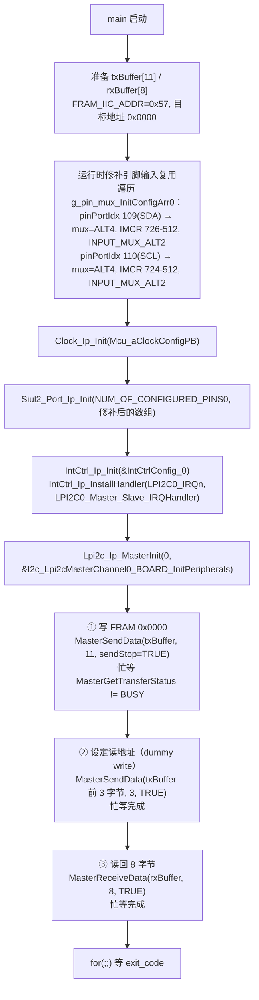

# IIC（LPI2C）— S32K344 RTD 0.9.0 实战教学

> 源工程: `D:\wnagjin\S32K3_mydetail\详细教学(1)\详细教学\S32K3 Training-RTD\S32DSv3p4_RTDv090\S32K344_IIC_Example_090_34`（LPI2C 主机读写板载 FRAM）
> 源文件: `D:\wnagjin\S32K3_mydetail\详细教学(1)\详细教学\S32K3 Training-RTD\S32DSv3p4_RTDv090\S32K344_IIC_Example_090_34\src\main.c`（共 112 行，代码原样摘录，未经任何修改）

> 注：该工程根目录无 ReadMe.txt，工程信息以 `.mex`、生成代码与 main.c 注释为准。

## 1. 外设概述

S32K344 有多个 LPI2C 实例，本工程使用 **LPI2C0 作主机**，对板载 FRAM（7 位从机地址 `0x57`）做"写一页 → 回设地址 → 读回"的完整读写流程。RTD 0.9.0（`S32K3_RTD_0_9_0__ASR_REL_4_4_REV_0000_20210326`）驱动层为 `Lpi2c_Ip`（裸 IP 驱动），主机相关 API 前缀 `Lpi2c_Ip_Master*`。

生成配置（`generate/src/Lpi2c_Ip_BOARD_InitPeripherals_PBcfg.c`）要点：

- 传输类型 `LPI2C_USING_INTERRUPTS`（中断驱动，但例程用轮询状态字等待完成）；
- 波特率参数 `baudrateParams0`：`LPI2C_MASTER_PRESC_DIV_1`、CLKHI=29、CLKLO=62、SETUP=29、DATAVD=15；
- 操作模式 `LPI2C_FAST_MODE`；
- DMA 通道未用（Tx/Rx channel 均为 0）。

本工程最大特点是 **main 里运行时补丁修引脚输入复用**：RTD 0.9.0 的 S32_CT 对 LPI2C 引脚只生成了输出方向的复用，输入方向（IMCR）需要代码里手动改 `g_pin_mux_InitConfigArr0` 再调 `Siul2_Port_Ip_Init`，否则读不到从机 ACK（详见第 6 节）。

## 2. 初始化与使用时序（mermaid flowchart 源码）



## 3. main.c 原样代码（按逻辑段落分块，标注来源工程与行号范围）

**文件头与说明注释（第 1–30 行，来源：S32K344_IIC_Example_090_34）：**

```c
/*==================================================================================================
*   Project              : RTD AUTOSAR 4.4
*   Platform             : CORTEXM
*   Peripheral           : S32K3XX
*   Dependencies         : none
*
*   Autosar Version      : 4.4.0
*   Autosar Revision     : ASR_REL_4_4_REV_0000
*   Autosar Conf.Variant :
*   SW Version           : 0.9.0
*   Build Version        : S32K3_RTD_0_9_0__ASR_REL_4_4_REV_0000_20210326
*
*   (c) Copyright 2020 - 2021 NXP Semiconductors
*   All Rights Reserved.
*
*   NXP Confidential. This software is owned or controlled by NXP and may only be
*   used strictly in accordance with the applicable license terms. By expressly
*   accepting such terms or by downloading, installing, activating and/or otherwise
*   using the software, you are agreeing that you have read, and that you agree to
*   comply with and are bound by, such license terms. If you do not agree to be
*   bound by the applicable license terms, then you may not retain, install,
*   activate or otherwise use the software.
==================================================================================================*/

/**
*   @file main.c
*
*   @addtogroup main_module main module documentation
*   @{
*/
```

**头文件与宏定义（第 32–50 行，来源：S32K344_IIC_Example_090_34）：**

```c
/* Including necessary configuration files. */
#include "Mcal.h"

volatile int exit_code = 0;
/* User includes */
#include "Lpi2c_Ip.h"
#include "Lpi2c_Ip_BOARD_InitPeripherals_PBcfg.h"
#include "Clock_Ip.h"
#include "IntCtrl_Ip.h"
#include "Siul2_Port_Ip.h"
#include "Siul2_Dio_Ip.h"
#include "Lpi2c_Ip_Irq.h"

/* LPI2C instance used - 0 */
#define LPI2C0_INST 0U

#define FRAM_IIC_ADDR (0x57u)
#define FRAM_ADDR_HI  (0x00u)
#define FRAM_ADDR_LO  (0x00u)
```

**main 函数（第 51–112 行，来源：S32K344_IIC_Example_090_34）：**

```c
/*!
  \brief The main function for the project.
  \details The startup initialization sequence is the following:
 * - startup asm routine
 * - main()
*/
int main(void)
{
    /* Write your code here */

    uint8 txBuffer[11u]={FRAM_IIC_ADDR,FRAM_IIC_ADDR,FRAM_ADDR_LO,0x11u,0x22u,0x33u,0x44u,0x55u,0x66u,0x77u,0x88u};
    uint8 rxBuffer[8u]={0u};
    Lpi2c_Ip_StatusType Status;
    uint32_t i = 0u;

    /* Init the Lpi2c pins input alternate configuration due to only output alternate is configured by CT. */
    for(i=0u; i<NUM_OF_CONFIGURED_PINS0; i++)
	{
		/* the LPI2C0 SDA pin configuration fix */
		if(109u == g_pin_mux_InitConfigArr0[i].pinPortIdx)
		{
			g_pin_mux_InitConfigArr0[i].mux = PORT_MUX_ALT4;
			g_pin_mux_InitConfigArr0[i].inputMuxReg[0u] = 726u - 512u;
			g_pin_mux_InitConfigArr0[i].inputMux[0u] = PORT_INPUT_MUX_ALT2;
		}
		/* the LPI2C0 SCK pin configuration fix */
		if(110 == g_pin_mux_InitConfigArr0[i].pinPortIdx)
		{
			g_pin_mux_InitConfigArr0[i].mux = PORT_MUX_ALT4;
			g_pin_mux_InitConfigArr0[i].inputMuxReg[0u] = 724u - 512u;
			g_pin_mux_InitConfigArr0[i].inputMux[0u] = PORT_INPUT_MUX_ALT2;
		}
	}
    /* initialize MCU system clock */
    Clock_Ip_Init(Mcu_aClockConfigPB);
    /* initialize used pins */
    Siul2_Port_Ip_Init(NUM_OF_CONFIGURED_PINS0,g_pin_mux_InitConfigArr0);
    /* Initialize the Interrupt vector, and install corresponding ISR */
    IntCtrl_Ip_Init(&IntCtrlConfig_0);
    IntCtrl_Ip_InstallHandler(LPI2C0_IRQn, LPI2C0_Master_Slave_IRQHandler, NULL_PTR);
    /* Initialize the LPI2C0*/
    Lpi2c_Ip_MasterInit(LPI2C0_INST, &I2c_Lpi2cMasterChannel0_BOARD_InitPeripherals);
    /* Write data to FRAM address 0x0000 */
	Status = Lpi2c_Ip_MasterSendData(LPI2C0_INST, txBuffer, 11u, TRUE);
    while((Lpi2c_Ip_MasterGetTransferStatus(LPI2C0_INST, NULL_PTR)) == STATUS_LPI2C_IP_BUSY){};
    /* Read data from FRAM address 0x0000 */
    Status = Lpi2c_Ip_MasterSendData(LPI2C0_INST, txBuffer, 3u, TRUE);
    while((Lpi2c_Ip_MasterGetTransferStatus(LPI2C0_INST, NULL_PTR)) == STATUS_LPI2C_IP_BUSY){};
    Status = Lpi2c_Ip_MasterReceiveData(LPI2C0_INST,rxBuffer,8u,TRUE);
    while((Lpi2c_Ip_MasterGetTransferStatus(LPI2C0_INST, NULL_PTR)) == STATUS_LPI2C_IP_BUSY){};

    for(;;)
    {
        if(exit_code != 0)
        {
            break;
        }
    }
    return exit_code;
}

/** @} */
```

## 4. API 速查

| API | 作用 | 关键参数 |
|---|---|---|
| `Lpi2c_Ip_MasterInit(inst, cfg)` | 初始化 LPI2C 主机通道 | inst=0；cfg=`I2c_Lpi2cMasterChannel0_BOARD_InitPeripherals`（含从机地址 87U=0x57、FAST_MODE、波特率参数、中断传输类型） |
| `Lpi2c_Ip_MasterSendData(inst, buf, len, sendStop)` | 主机发送（START+ADDR+W+数据） | sendStop=TRUE 发 STOP；本例先发 11 字节写页，再发 3 字节设地址 |
| `Lpi2c_Ip_MasterReceiveData(inst, buf, len, sendStop)` | 主机接收（重复 START+ADDR+R+数据） | 典型"写地址→读数据"的第二拍 |
| `Lpi2c_Ip_MasterGetTransferStatus(inst, &remaining)` | 查询传输状态/剩余字节 | 返回 `STATUS_LPI2C_IP_BUSY` 表示仍在传输；第二个参数可为 NULL_PTR |
| `IntCtrl_Ip_Init(&IntCtrlConfig_0)` | 整表初始化中断 | generate 生成 |
| `IntCtrl_Ip_InstallHandler(LPI2C0_IRQn, LPI2C0_Master_Slave_IRQHandler, NULL_PTR)` | 安装 LPI2C0 中断入口 | ISR 名来自 `Lpi2c_Ip_Irq.h` |
| `Siul2_Port_Ip_Init(count, arr)` | 引脚复用初始化 | 修补后的 `g_pin_mux_InitConfigArr0` |
| `Clock_Ip_Init(Mcu_aClockConfigPB)` | 时钟初始化 | board 生成 PB 配置 |

## 5. 配置生成物（board/generate）

| 文件 | 内容要点 |
|---|---|
| `generate/src/Lpi2c_Ip_BOARD_InitPeripherals_PBcfg.c` | `baudrateParams0_BOARD_InitPeripherals`（PRESC_DIV_1 / CLKHI 29 / CLKLO 62 / SETUP 29 / DATAVD 15）；`I2c_Lpi2cMasterChannel0_BOARD_InitPeripherals`：从机地址 87U(0x57)、7 位地址、`LPI2C_FAST_MODE`、`LPI2C_USING_INTERRUPTS`、DMA 通道 0/0、回调 NULL_PTR、状态结构 `&Lpi2c_Ip_MasterState[0]` |
| `generate/include/Lpi2c_Ip_BOARD_InitPeripherals_PBcfg.h` | 上述配置的对外声明（main.c 直接 include） |
| `generate/src/IntCtrl_Ip_Cfg.c` | 中断向量配置表 `IntCtrlConfig_0` |
| `board/Siul2_Port_Ip_Cfg.c|h` | 引脚数组 `g_pin_mux_InitConfigArr0`（仅输出复用，输入复用由 main 运行时补） |
| `board/Clock_Ip_Cfg.c|h`、`board/Clock_Ip_PBcfg.c|h` | 时钟树 |

## 6. 常见坑（仅实证的）

1. **S32_CT 0.9.0 对 LPI2C 引脚只生成输出复用，输入复用要手补**。main.c 66–83 行原注释："Init the Lpi2c pins input alternate configuration due to only output alternate is configured by CT."。做法：遍历 `g_pin_mux_InitConfigArr0`，对 SDA（pinPortIdx 109）与 SCL（pinPortIdx 110）补 `mux=PORT_MUX_ALT4`、`inputMuxReg[0]=726u-512u / 724u-512u`（IMCR 编号减基址 512）、`inputMux[0]=PORT_INPUT_MUX_ALT2`，且必须在 `Siul2_Port_Ip_Init` **之前**改。迁移到别的 LPI2C 实例/引脚时 IMCR 编号要查芯片参考手册，不能照抄。
2. **`Lpi2c_Ip_USING_INTERRUPTS` 但例程靠轮询状态字**：配置里选了中断传输类型，就必须装好 `LPI2C0_Master_Slave_IRQHandler` 并 `IntCtrl_Ip_Init`（main.c 89–90 行）；完成判断则是忙等 `MasterGetTransferStatus != STATUS_LPI2C_IP_BUSY`。漏装 ISR 会导致状态永远停在 BUSY（看门狗/死等）。
3. **读 FRAM 必须先"dummy write"设地址**：随机读流程 = `MasterSendData(前 3 字节: 设备地址命令+内部地址, TRUE)` → `MasterReceiveData(8 字节, TRUE)`（main.c 97–100 行）。直接 Receive 会从 FRAM 当前内部指针读，结果不对。
4. **sendStop 参数语义**：第三个传参 TRUE 表示本次传输结束发 STOP。要拼"写地址 + 重复 START 读"以外的组合传输（如连续多次写中间不发 STOP）才需要 FALSE，本例三步全 TRUE。
5. **txBuffer 前 3 字节的构成**：`{FRAM_IIC_ADDR, FRAM_IIC_ADDR, FRAM_ADDR_LO}`——第 1 个 0x57 是命令字（本 FRAM 的写命令/设备标识），第 2 个 0x57 才是数据首字节，第 3 字节为内部地址低 8 位；这是该 FRAM 器件协议，不是 I2C 通用格式，换器件要按其手册重排。
