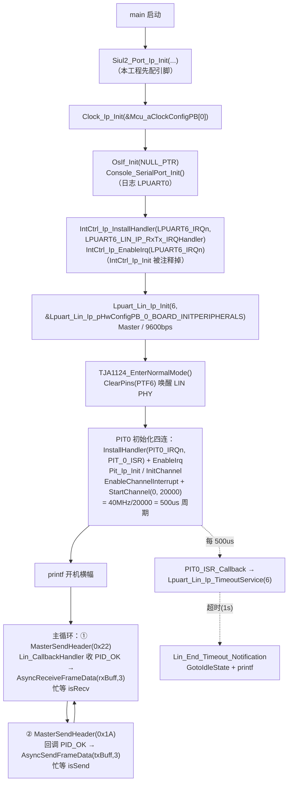

# LIN（LPUART_LIN 主节点）— S32K344 RTD 0.9.0 实战教学

> 源工程: `D:\wnagjin\S32K3_mydetail\详细教学(1)\详细教学\S32K3 Training-RTD\S32DSv3p4_RTDv090\S32K344_LIN_Master_Example_090_34\S32K344_LIN_Master_Example_090_34`（LPUART6 作 LIN Master，PIT 超时服务）
> 源文件（代码原样摘录，未经任何修改）:
> - `...\src\main.c`（共 203 行）
> - `...\src\retarget.c` / `...\include\retarget.h`（日志 printf 重定向，与 UART 工程同款，本文不重复摘录）

> 注：ReadMe.txt 标注 RTD 0.8.1，代码与生成物实际为 `S32K3_RTD_0_9_0__ASR_REL_4_4_REV_0000_20210326`，以代码为准。

## 1. 外设概述

S32K3 系列**没有独立 LIN 外设**，LIN 协议由 LPUART 外加驱动状态机实现：RTD 0.9.0 的 `Lpuart_Lin_Ip` 驱动把 LPUART6 配成 LIN 模式（主节点），Break 检测/发送、PID 校验、帧头/响应分层都由驱动管理。本工程演示 LIN 主节点完整闭环：

- **发帧**：ID `0x1A`，数据 `0x01,0x02,0x03`（主发从收）；
- **收帧**：ID `0x22`，3 字节（从机 PLIN-View 作 publisher 回发）；
- **超时**：PIT0 每 500us 调 `Lpuart_Lin_Ip_TimeoutService`，1 秒（2000×500us）无响应则超时复位总线状态；
- **PHY 使能**：板上 TJA1124 LIN 收发器默认休眠，须用 PTF6（`TJA1124_SLP`，高=睡眠）唤醒后再通信；
- **日志**：复用 retarget 方案 printf 到 LPUART0。

关键生成配置 `Lpuart_Lin_Ip_pHwConfigPB_0_BOARD_INITPERIPHERALS`：baud 分频 0x104 @ 通道时钟 80MHz（9600bps）、`LPUART_LIN_IP_MASTER`、Break 收/发长度 1、无自动波特率、header 超时 4583us / 响应超时 1458us、事件回调 `Lin_CallbackHandler`、时间间隔回调 `Lin_CallbackTimerInterval`。

ReadMe 硬件连接（S32K3-WB → LIN 适配器 PLIN-View）：J31.7(LIN5) ↔ 4(LIN)；J33.5(VBAT) ↔ 9(Vbat_Lin)；J31.2(GND) ↔ 5(LIN_GND)。PC 端 PLIN-View 设 Slave / 9600，新建 ID 0x22、publisher、长度 3 并 Send。

## 2. 初始化与使用时序（mermaid flowchart 源码）



## 3. main.c 原样代码（按逻辑段落分块，标注来源工程与行号范围）

**文件头注释（第 1–30 行，来源：S32K344_LIN_Master_Example_090_34）：**

```c
/*==================================================================================================
*   Project              : RTD AUTOSAR 4.4
*   Platform             : CORTEXM
*   Peripheral           : S32K3XX
*   Dependencies         : none
*
*   Autosar Version      : 4.4.0
*   Autosar Revision     : ASR_REL_4_4_REV_0000
*   Autosar Conf.Variant :
*   SW Version           : 0.9.0
*   Build Version        : S32K3_RTD_0_9_0__ASR_REL_4_4_REV_0000_20210326
*
*   (c) Copyright 2020 - 2021 NXP Semiconductors
*   All Rights Reserved.
*
*   NXP Confidential. This software is owned or controlled by NXP and may only be
*   used strictly in accordance with the applicable license terms. By expressly
*   accepting such terms or by downloading, installing, activating and/or otherwise
*   using the software, you are agreeing that you have read, and that you agree to
*   comply with and are bound by, such license terms. If you do not agree to be
*   bound by the applicable license terms, then you may not retain, install,
*   activate or otherwise use the software.
==================================================================================================*/

/**
*   @file main.c
*
*   @addtogroup main_module main module documentation
*   @{
*/
```

**头文件与外部声明（第 32–45 行，来源：S32K344_LIN_Master_Example_090_34）：**

```c
/* Including necessary configuration files. */
#include "Mcal.h"
#include "Siul2_Port_Ip.h"
#include "OsIf.h"
#include "Clock_Ip.h"
#include "Lpuart_Lin_Ip.h"
#include "IntCtrl_Ip.h"
#include "Siul2_Dio_Ip.h"
#include "retarget.h"
#include "stdio.h"
#include "Pit_Ip.h"

extern ISR(LPUART6_LIN_IP_RxTx_IRQHandler);
extern ISR(PIT_0_ISR);
```

**宏定义与全局变量（第 47–77 行，来源：S32K344_LIN_Master_Example_090_34）：**

```c
/*PTF6 is used for TJA1124 LIN transceiver sleep mode, active high*/
#define TJA1124_SLP_GPIO_PORT TJA1124_SLP_PORT
#define TJA1124_SLP_GPIO_PIN  TJA1124_SLP_PIN

#define TJA1124_EnterSleepMode()   Siul2_Dio_Ip_SetPins(TJA1124_SLP_GPIO_PORT,(1<<TJA1124_SLP_GPIO_PIN))
#define TJA1124_EnterNormalMode()  Siul2_Dio_Ip_ClearPins(TJA1124_SLP_GPIO_PORT,(1<<TJA1124_SLP_GPIO_PIN))

#define LPUART_LIN_INSTANCE 6U
#define BUFFER_SIZE         3U
#define T_LIN_TIME_OUT      400000
#define SEND_ID             0x1A
#define RECV_ID             0x22


#define TEST_LIN_SEND 1
#define TEST_LIN_RECV 1

/* PIT instance used - 0 */
#define PIT_INST 0U
/* PIT timeout period - 40MHZ / 20000 = 500us */
#define PIT_PERIOD 20000
#define LIN_TIMEOUT     (2000U) /*2000 x 500US = 1s*/
/*buffer size for LIN TX.*/
uint8 txBuff[BUFFER_SIZE] = {0x01, 0x02, 0x03};
/*buffer size for LIN RX.*/
uint8 rxBuff[BUFFER_SIZE] = {0,0,0};

volatile boolean isSend = FALSE;
volatile boolean isRecv = FALSE;
volatile boolean isTimeOut = FALSE;
```

**回调函数组（第 80–149 行，来源：S32K344_LIN_Master_Example_090_34）：**

```c
/*@brief:Pit notification called by the configured channel 500us periodically.Used to handle LIN timeout.*/
void PIT0_ISR_Callback(uint8 channel)
{
    if(0U == channel)
    {
    	Lpuart_Lin_Ip_TimeoutService(LPUART_LIN_INSTANCE);
    }
}

/*@brief:the callback will be called each time reset the timeout counter.*/
void Lin_Start_Timeout_Notification(uint32 instance)
{

}

/*@brief:the callback will be called after timeout is occured..*/
void Lin_End_Timeout_Notification(uint32 instance)
{
	if(LPUART_LIN_INSTANCE == instance)
	{
        printf("LIN timeout occurred.\n");
        Lpuart_Lin_Ip_GotoIdleState(LPUART_LIN_INSTANCE);
        isTimeOut = TRUE;
	}
}

/*@brief:this callback is to calculate whether the dominate time period is long enough to wake up the LIN bus.*/
uint32  Lin_CallbackTimerInterval(uint32 instance, uint32 *ns)
{

}

/*@brief:this callback is to handle the LIN event.*/
void Lin_CallbackHandler(uint32 instance, Lpuart_Lin_Ip_StateStructType *lpuartStateStruct)
{

    switch (lpuartStateStruct->currentEventId)
    {
        /* Header transmission OK */
        case LPUART_LIN_IP_PID_OK:
        	Lpuart_Lin_Ip_SetTimeoutCounter(LPUART_LIN_INSTANCE,LIN_TIMEOUT);
        	isTimeOut = FALSE;
            if (lpuartStateStruct->currentId == SEND_ID)
            {
                Lpuart_Lin_Ip_AsyncSendFrameData(instance, txBuff, BUFFER_SIZE);
            }

        	if (lpuartStateStruct->currentId == RECV_ID)
        	{
         		Lpuart_Lin_Ip_AsyncReceiveFrameData(LPUART_LIN_INSTANCE,rxBuff,BUFFER_SIZE);
        	}
            break;
        case LPUART_LIN_IP_TX_COMPLETED:
        	isSend = TRUE;
        	printf("LIN Frame send successfully.\n");
        	break;
        case LPUART_LIN_IP_RX_COMPLETED:
        	isRecv = TRUE;
        	Lpuart_Lin_Ip_GotoIdleState(LPUART_LIN_INSTANCE);
        	printf("LIN Frame received OK.\n");
        	break;
        case LPUART_LIN_IP_TIMEOUT_ERROR:
        	printf("LIN timeout.\n");
        	break;

        default:
        /* do nothing */
        break;
    }
}
```

**main 函数（第 150–203 行，来源：S32K344_LIN_Master_Example_090_34）：**

```c
/*!
  \brief The main function for the project.
  \details The startup initialization sequence is the following:
 * - startup asm routine
 * - main()
*/
int main(void)
{
    /* Write your code here */
    uint32 i;
    uint8 bytesRemaining[BUFFER_SIZE];

    Siul2_Port_Ip_Init(NUM_OF_CONFIGURED_PINS0, g_pin_mux_InitConfigArr0);
    Clock_Ip_Init(&Mcu_aClockConfigPB[0]);
    OsIf_Init(NULL_PTR);                                                               /* Init the systick for system timeout counting*/
    Console_SerialPort_Init();                                                         /* Init UART for log print. */

    /* Initialize IRQs */
 //   IntCtrl_Ip_Init(&IntCtrlConfig_0);
    /* Install the LPUART6_LIN interrupt ISR */
    IntCtrl_Ip_InstallHandler(LPUART6_IRQn, LPUART6_LIN_IP_RxTx_IRQHandler, NULL_PTR);
    /* Enable the PIT IRQ interrupt in NVIC */
    IntCtrl_Ip_EnableIrq(LPUART6_IRQn);

    /* Init the LPUART6 Lin */
    Lpuart_Lin_Ip_Init(LPUART_LIN_INSTANCE, &Lpuart_Lin_Ip_pHwConfigPB_0_BOARD_INITPERIPHERALS);
    /*Enable the LIN phy TJA1124. It is in sleep mode by default in S32K344-WB HW design.*/
    TJA1124_EnterNormalMode();


	IntCtrl_Ip_InstallHandler(PIT0_IRQn, PIT_0_ISR, NULL_PTR);/* install the PIT0 interrupt ISR */
	IntCtrl_Ip_EnableIrq(PIT0_IRQn);                          /* enable the PIT IRQ interrupt in NVIC */
	Pit_Ip_Init(PIT_INST, &PIT_0_InitConfig_PB);       /* initialize the PIT0 module */

	Pit_Ip_InitChannel(PIT_INST, PitChannel_0);        /* initialize PIT channel 0 */
	Pit_Ip_EnableChannelInterrupt(PIT_INST, 0U);     /* enable the PIT channel 0 interrupt */
	Pit_Ip_StartChannel(PIT_INST, 0U, PIT_PERIOD);   /* start the PIT channel 0 with expected period in PIT counter count*/

    printf("S32K344 LPUART LIN Master Demo.\n");

    while(1)
    {
        Lpuart_Lin_Ip_MasterSendHeader(LPUART_LIN_INSTANCE, RECV_ID);/*Start a Lin Frame recv transfer.*/
        while (isRecv == FALSE);
        isRecv = FALSE;

        Lpuart_Lin_Ip_MasterSendHeader(LPUART_LIN_INSTANCE, SEND_ID);/*Start a Lin Frame send transfer.*/
        while (isSend == FALSE);
        isSend = FALSE;
    }

}

/** @} */
```

## 4. API 速查

| API | 作用 | 关键参数 |
|---|---|---|
| `Lpuart_Lin_Ip_Init(inst, cfg)` | 初始化 LIN 节点（LPUART6） | cfg=`Lpuart_Lin_Ip_pHwConfigPB_0_BOARD_INITPERIPHERALS`（Master/9600/回调） |
| `Lpuart_Lin_Ip_MasterSendHeader(inst, id)` | 主节点发起帧头（Break+Sync+PID） | id 为帧 ID（0x22/0x1A），后续在回调里按 PID 分派收/发 |
| `Lpuart_Lin_Ip_AsyncSendFrameData(inst, buf, len)` | PID_OK 后异步发响应段数据 | txBuff 3 字节 |
| `Lpuart_Lin_Ip_AsyncReceiveFrameData(inst, buf, len)` | PID_OK 后异步收响应段数据 | rxBuff 3 字节 |
| `Lpuart_Lin_Ip_TimeoutService(inst)` | 超时计数服务，周期调用 | 本例由 PIT0 每 500us 调一次 |
| `Lpuart_Lin_Ip_SetTimeoutCounter(inst, cnt)` | 重置/装载超时计数 | LIN_TIMEOUT=2000（即 1s） |
| `Lpuart_Lin_Ip_GotoIdleState(inst)` | 强制回到总线空闲态 | 超时/收完帧后复位驱动状态机 |
| `Pit_Ip_Init` / `Pit_Ip_InitChannel` / `Pit_Ip_EnableChannelInterrupt` / `Pit_Ip_StartChannel` | PIT 定时器初始化与启动 | 通道 0，周期 20000 计数 = 500us |
| `IntCtrl_Ip_InstallHandler` + `IntCtrl_Ip_EnableIrq` | 手动装 LPUART6/PIT0 中断 | `LPUART6_LIN_IP_RxTx_IRQHandler`、`PIT_0_ISR` |

## 5. 配置生成物（board/generate）

| 文件 | 内容要点 |
|---|---|
| `generate/src/Lpuart_Lin_Ip_BOARD_InitPeripherals_PBcfg.c` | `Lpuart_Lin_Ip_pHwConfigPB_0_BOARD_INITPERIPHERALS`：baud 分频 0x104、过采样 16、`LPUART_LIN_IP_MASTER`、Break 发/检长度 1、自动波特率 FALSE、经典校验 PID 列表空、唤醒信号 0xF8、事件回调 `Lin_CallbackHandler`、header 超时 4583us、响应超时 1458us、通道时钟 80000000U |
| `generate/src/Pit_Ip_BOARD_InitPeripherals_PBcfg.c` | `PIT_0_InitConfig_PB`（标准定时器使能）+ `PIT_0_ChannelConfig_PB[1]`：通道 0、中断使能、回调 `&PIT0_ISR_Callback` |
| `generate/src/Lpuart_Uart_Ip_BOARD_InitPeripherals_PBcfg.c` | 日志用 LPUART0 配置（retarget printf） |
| `generate/src/IntCtrl_Ip_Cfg.c` | 中断配置表（main 中被注释，改手动装配） |
| `board/Siul2_Port_Ip_Cfg.h` | 第 55–56 行：`#define TJA1124_SLP_PIN 6u`、`#define TJA1124_SLP_PORT PTF_L_HALF` |
| `board/Clock_Ip_Cfg.c|h`、`board/Clock_Ip_PBcfg.c|h` | 时钟树 |

## 6. 常见坑（仅实证的）

1. **TJA1124 PHY 默认休眠，不唤醒则无波形**。main.c 第 47 行注释"active high"（高=睡眠），第 52 行 `TJA1124_EnterNormalMode()` 实际是 `Siul2_Dio_Ip_ClearPins`（拉低唤醒）。ReadMe 第 5 行写"set SCSN_SLP(PTF6) high to set it to normal mode"与代码相反——**以 main.c 为准：拉低 PTF6 进正常模式**。忘这一步总线上什么都看不到。
2. **LIN 超时依赖外部周期喂 `TimeoutService`**：驱动不自带定时，必须由 PIT（500us）持续调 `Lpuart_Lin_Ip_TimeoutService(6)`（main.c 第 81–87 行）；漏了 PIT 或忘了开 `Pit_Ip_EnableChannelInterrupt`，帧超时永远不触发，`while(isRecv == FALSE)` 死等。
3. **收/发不是 `MasterSendHeader` 的参数，而是回调里按 PID 分派**：主循环只发帧头，`Lin_CallbackHandler` 里 `PID_OK` 事件按 `lpuartStateStruct->currentId == SEND_ID/RECV_ID` 决定 `AsyncSendFrameData` 还是 `AsyncReceiveFrameData`（main.c 第 119–130 行）。新手常在 SendHeader 后直接读缓冲，读到 0。
4. **收到帧后要主动 `GotoIdleState`**：`LPUART_LIN_IP_RX_COMPLETED` 分支里手动回空闲（main.c 第 138 行），否则状态机滞留，下一帧头发不出去。发送完成分支没有调，靠下一轮 Header 重入。
5. **手动装中断时 `IntCtrl_Ip_Init` 被注释掉**（main.c 第 167–168 行 `//   IntCtrl_Ip_Init(&IntCtrlConfig_0);`）：本工程用 `InstallHandler + EnableIrq` 逐个装 LPUART6 与 PIT0。照抄时两个 IRQ 都要装全，只装 LIN 不装 PIT 同样死等（见坑 2）。
6. **测试收帧需要从机先动**：ID 0x22 是"主收从发"，PC 端 PLIN-View 必须配置为 Slave、9600、建 ID 0x22 publisher 3 字节并点 Send（ReadMe 步骤 2），否则主节点 1 秒超时打印 `LIN timeout occurred.` 后继续循环。
7. **`Lin_CallbackTimerInterval` 是空实现但有返回值**（main.c 第 107–110 行，函数体内无 return）：这是唤醒脉宽测量用的占位回调，编译会有缺返回值告警；不用唤醒功能可保持空实现，别顺手"修复"成返回 0 以外的语义而不看驱动用法。
