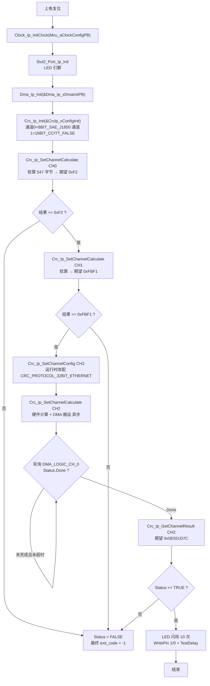
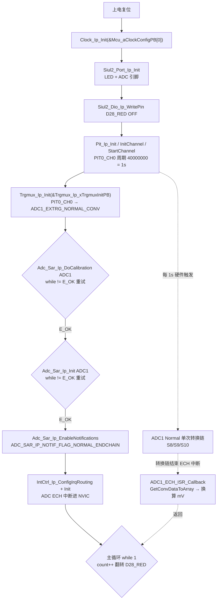
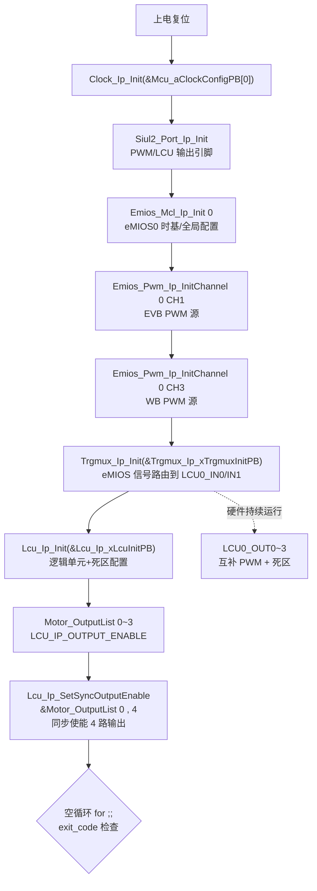
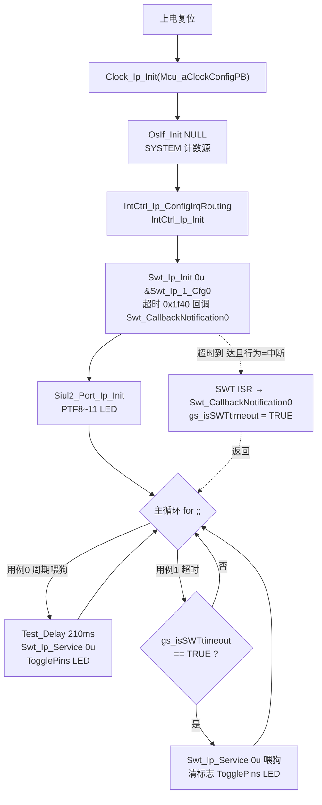

# CRC / TRGMUX / LCU / SWT 小外设 — S32K344 RTD 0.9.0 实战教学

> 源工程:
> - `D:\wnagjin\S32K3_mydetail\详细教学(1)\详细教学\S32K3 Training-RTD\S32DSv3p4_RTDv090\S32K344_CRC_Example_090_34`
> - `D:\wnagjin\S32K3_mydetail\详细教学(1)\详细教学\S32K3 Training-RTD\S32DSv3p4_RTDv090\S32K344_TRGMUX_Example_090_34`
> - `D:\wnagjin\S32K3_mydetail\详细教学(1)\详细教学\S32K3 Training-RTD\S32DSv3p4_RTDv090\S32K344_LCU_Example_090_34`
> - `D:\wnagjin\S32K3_mydetail\详细教学(1)\详细教学\S32K3 Training-RTD\S32DSv3p4_RTDv090\S32K344_SWT_Example_090_34`
>
> 源文件（代码原样摘录，未经任何修改）:
> - `...\S32K344_CRC_Example_090_34\src\main.c`（全文 231 行）
> - `...\S32K344_TRGMUX_Example_090_34\src\main.c`（全文 196 行）
> - `...\S32K344_LCU_Example_090_34\src\main.c`（全文 99 行）
> - `...\S32K344_SWT_Example_090_34\src\main.c`（全文 140 行）

## 1. 概述

本篇合并 4 个"小而关键"的外设示例：

| 工程 | 外设 | 一句话功能 |
| --- | --- | --- |
| S32K344_CRC_Example_090_34 | Crc_Ip + Dma_Ip | 对同一段 547 字节数据分别用软件/查表/硬件（DMA 搬运）算 3 种协议 CRC，全对则 LED 闪 10 次，否则 `exit_code=-1` |
| S32K344_TRGMUX_Example_090_34 | Trgmux_Ip + Adc_Sar_Ip + Pit_Ip | PIT0_CH0 每 1s 硬件触发 ADC1 Normal 单次转换链（S8/S9/S10），转换结束 ECH 中断回调读数转 mV |
| S32K344_LCU_Example_090_34 | Lcu_Ip + Emios_Pwm/Trgmux | eMIOS0_CH1/CH3 出 PWM，经 TRGMUX 送入 LCU，产生 4 路带死区的互补 PWM |
| S32K344_SWT_Example_090_34 | Swt_Ip + OsIf | 两个测试用例：周期喂狗 LED 闪烁；或让 SWT 超时（中断方式）在回调里置标志后再喂狗 |

---

## 2. CRC — S32K344_CRC_Example_090_34

### 2.1 概述

- 三条逻辑通道：`CRC_LOGIC_CHANNEL_0` = `CRC_PROTOCOL_8BIT_SAE_J1850`（期望 0xF2）、`CRC_LOGIC_CHANNEL_1` = `CRC_PROTOCOL_16BIT_CCITT_FALSE`（期望 0xFBF1）、`CRC_LOGIC_CHANNEL_2` 运行时重配为 `CRC_PROTOCOL_32BIT_ETHERNET`（期望 0x0E551D7C，硬件计算走 DMA）。
- 通道 0/1 为软件/查表计算，`Crc_Ip_SetChannelCalculate` 返回值即结果，同步比对；通道 2 硬件计算是异步的，要轮询 `Dma_Ip_GetLogicChannelStatus(DMA_LOGIC_CH_0).Done` 后再 `Crc_Ip_GetChannelResult`。
- 全部通过则 LED 闪烁 10 次；任一不对 `exit_code = -1` 并停在死循环。

### 2.2 初始化与使用时序



### 2.3 main.c 原样代码

来源：`S32K344_CRC_Example_090_34\src\main.c`，全文 231 行，按逻辑分块，块间行号连续无缝隙。

**[L1-L29] 文件头与头文件**

```c
/*
*   (c) Copyright 2020 NXP
*
*   NXP Confidential. This software is owned or controlled by NXP and may only be used strictly
*   in accordance with the applicable license terms.  By expressly accepting
*   such terms or by downloading, installing, activating and/or otherwise using
*   the software, you are agreeing that you have read, and that you agree to
*   comply with and are bound by, such license terms.  If you do not agree to
*   be bound by the applicable license terms, then you may not retain,
*   install, activate or otherwise use the software.
*
*   This file contains sample code only. It is not part of the production code deliverables.
*/

#ifdef __cplusplus
extern "C" {
#endif

/*==================================================================================================
*                                        INCLUDE FILES
* 1) system and project includes
* 2) needed interfaces from external units
* 3) internal and external interfaces from this unit
==================================================================================================*/
#include "Clock_Ip.h"
#include "Siul2_Port_Ip.h"
#include "Siul2_Dio_Ip.h"
#include "Dma_Ip.h"
#include "Crc_Ip.h"
```

**[L31-L42] 宏定义**

```c
/*==================================================================================================
*                          LOCAL TYPEDEFS (STRUCTURES, UNIONS, ENUMS)
==================================================================================================*/


/*==================================================================================================
*                                       LOCAL MACROS
==================================================================================================*/
#define CRC_DATA_SIZE                 (547U)        /* Define CRC data size */
#define RESULT_CRC_8BIT_SAE_J1850     (0xF2U)       /* Define result CRC calculator with protocol CRC_PROTOCOL_8BIT_SAE_J1850 */
#define RESULT_CRC_16BIT_CCITT_FALSE  (0xFBF1U)     /* Define result CRC calculator with protocol CRC_PROTOCOL_16BIT_CCITT_FALSE */
#define RESULT_CRC_32BIT_ETHERNET     (0x0E551D7CU) /* Define result CRC calculator with protocol CRC_PROTOCOL_32BIT_ETHERNET */
```

**[L44-L96] 测试数据与局部变量**

```c
/*==================================================================================================
*                                      LOCAL CONSTANTS
==================================================================================================*/
const uint8_t CRC_data[] = {
    0x94U, 0x21U, 0xFFU, 0xE0U, 0x7CU, 0x08U, 0x02U, 0xA6U, 0xBFU, 0xC1U, 0x00U, 0x18U, 0x90U,
    0x01U, 0x00U, 0x24U, 0x3BU, 0xE0U, 0x00U, 0x00U, 0x93U, 0xE1U, 0x00U, 0x0CU, 0x88U, 0x03U,
    0x00U, 0x34U, 0x2CU, 0x00U, 0x00U, 0x00U, 0x41U, 0x82U, 0x00U, 0x4CU, 0x80U, 0x03U, 0x00U,
    0x00U, 0x90U, 0x01U, 0x00U, 0x08U, 0x80U, 0x03U, 0x00U, 0x38U, 0x54U, 0x00U, 0x00U, 0x01U,
    0x41U, 0x82U, 0x00U, 0x44U, 0x81U, 0x63U, 0x00U, 0x00U, 0x54U, 0x80U, 0x06U, 0x3EU, 0x2CU,
    0x00U, 0x00U, 0x01U, 0x80U, 0x0BU, 0x00U, 0x0CU, 0x54U, 0x00U, 0x00U, 0x3AU, 0x90U, 0x0BU,
    0x00U, 0x0CU, 0x40U, 0x82U, 0x00U, 0x28U, 0x81U, 0x63U, 0x00U, 0x00U, 0x80U, 0x0BU, 0x00U,
    0x0CU, 0x54U, 0x00U, 0x07U, 0xBFU, 0x41U, 0x82U, 0x01U, 0x84U, 0x3FU, 0xE0U, 0x00U, 0x20U,
    0x48U, 0x00U, 0x01U, 0x7CU, 0x81U, 0x63U, 0x00U, 0x00U, 0x38U, 0x0BU, 0x00U, 0x04U, 0x90U,
    0x01U, 0x00U, 0x08U, 0x81U, 0x61U, 0x00U, 0x08U, 0x80U, 0x0BU, 0x00U, 0x00U, 0x54U, 0x0BU,
    0x07U, 0xBDU, 0x41U, 0x82U, 0x00U, 0x14U, 0x54U, 0x0BU, 0xEFU, 0xFEU, 0x38U, 0x0BU, 0x00U,
    0x02U, 0x90U, 0x01U, 0x00U, 0x0CU, 0x48U, 0x00U, 0x00U, 0x14U, 0x54U, 0x00U, 0x07U, 0x39U,
    0x41U, 0x82U, 0x00U, 0x0CU, 0x38U, 0x00U, 0x00U, 0x01U, 0x90U, 0x01U, 0x00U, 0x0CU, 0x80U,
    0x01U, 0x00U, 0x0CU, 0x54U, 0x00U, 0x07U, 0xFFU, 0x41U, 0x82U, 0x00U, 0x48U, 0x81U, 0x61U,
    0x00U, 0x08U, 0x80U, 0x0BU, 0x00U, 0x00U, 0x54U, 0x00U, 0x05U, 0x6BU, 0x41U, 0x82U, 0xFFU,
    0xF4U, 0x81U, 0x61U, 0x00U, 0x08U, 0x3CU, 0x00U, 0xFFU, 0xFFU, 0x60U, 0x00U, 0x1FU, 0xF7U,
    0x81U, 0x81U, 0x00U, 0x08U, 0x81U, 0x8CU, 0x00U, 0x00U, 0x61U, 0x8CU, 0x00U, 0x01U, 0x7DU,
    0x8CU, 0x00U, 0x38U, 0x91U, 0x8BU, 0x00U, 0x00U, 0x81U, 0x81U, 0x00U, 0x08U, 0x81U, 0x61U,
    0x00U, 0x08U, 0x81U, 0x6BU, 0x00U, 0x00U, 0x7CU, 0x00U, 0x58U, 0x38U, 0x90U, 0x0CU, 0x00U,
    0x00U, 0x80U, 0x01U, 0x00U, 0x0CU, 0x54U, 0x00U, 0x07U, 0xBDU, 0x41U, 0x82U, 0x00U, 0x80U,
    0x81U, 0x61U, 0x00U, 0x08U, 0x3CU, 0x00U, 0xFFU, 0xFFU, 0x60U, 0x00U, 0x1FU, 0xFEU, 0x81U,
    0x81U, 0x00U, 0x08U, 0x81U, 0x8CU, 0x00U, 0x00U, 0x7CU, 0x00U, 0x60U, 0x38U, 0x90U, 0x0BU,
    0x00U, 0x00U, 0x81U, 0x61U, 0x00U, 0x08U, 0x80U, 0x0BU, 0x00U, 0x00U, 0x54U, 0x00U, 0x05U,
    0x6BU, 0x41U, 0x82U, 0xFFU, 0xF4U, 0x81U, 0x61U, 0x00U, 0x08U, 0x3CU, 0x00U, 0xFFU, 0xFFU,
    0x60U, 0x00U, 0x1FU, 0xEFU, 0x3FU, 0xC0U, 0xFFU, 0xFFU, 0x63U, 0xDEU, 0x1FU, 0xFDU, 0x81U,
    0x81U, 0x00U, 0x08U, 0x81U, 0x8CU, 0x00U, 0x00U, 0x7CU, 0x00U, 0x60U, 0x38U, 0x90U, 0x0BU,
    0x00U, 0x00U, 0x81U, 0x81U, 0x00U, 0x08U, 0x81U, 0x61U, 0x00U, 0x08U, 0x80U, 0x0BU, 0x00U,
    0x00U, 0x60U, 0x00U, 0x00U, 0x01U, 0x7CU, 0x00U, 0xF0U, 0x38U, 0x90U, 0x0CU, 0x00U, 0x00U,
    0x81U, 0x81U, 0x00U, 0x08U, 0x81U, 0x61U, 0x00U, 0x08U, 0x80U, 0x0BU, 0x00U, 0x00U, 0x7CU,
    0x00U, 0xF0U, 0x38U, 0x90U, 0x0CU, 0x00U, 0x00U, 0x81U, 0x61U, 0x00U, 0x08U, 0x3CU, 0x00U,
    0xFFU, 0xFFU, 0x60U, 0x00U, 0x1FU, 0xFEU, 0x81U, 0x81U, 0x00U, 0x08U, 0x81U, 0x8CU, 0x00U,
    0x00U, 0x7CU, 0x00U, 0x60U, 0x38U, 0x90U, 0x0BU, 0x00U, 0x00U, 0x81U, 0x61U, 0x00U, 0x08U,
    0x80U, 0x0BU, 0x00U, 0x00U, 0x54U, 0x00U, 0x05U, 0x6BU, 0x41U, 0x82U, 0xFFU, 0xF4U, 0x81U,
    0x61U, 0x00U, 0x08U, 0x3FU, 0xC0U, 0xFFU, 0xFFU, 0x63U, 0xDEU, 0x1FU, 0xEFU, 0x3CU, 0x00U,
    0xFFU, 0xFFU, 0x60U, 0x00U, 0x1FU, 0xFBU, 0x81U, 0x81U, 0x00U, 0x08U, 0x81U, 0x8CU, 0x00U,
    0x00U, 0x7DU, 0x8CU, 0xF0U, 0x38U, 0x91U, 0x8BU, 0x00U, 0x00U, 0x81U, 0x81U, 0x00U, 0x08U,
    0x81U, 0x61U, 0x00U, 0x08U, 0x81U, 0x6BU, 0x00U, 0x00U, 0x7CU, 0x00U, 0x58U, 0x38U, 0x90U,
    0x0CU, 0x00U, 0x00U, 0x88U, 0x03U, 0x00U, 0x3CU, 0x2CU, 0x00U, 0x00U, 0x00U, 0x41U, 0x82U,
    0x00U, 0x14U, 0x7FU, 0xE3U, 0xFBU, 0x78U, 0x60U, 0x00U, 0x00U, 0x00U, 0x00U, 0x00U, 0x00U,
    0x00U, 0x60U, 0x00U, 0x00U, 0x00U, 0x7FU, 0xE3U, 0xFBU, 0x78U, 0x80U, 0x01U, 0x00U, 0x24U,
    0xBBU, 0xC1U, 0x00U, 0x18U, 0x7CU, 0x08U, 0x03U, 0xA6U, 0x38U, 0x21U, 0x00U, 0x20U, 0x4EU,
    0x80U, 0x00U, 0x20U, 0x4DU, 0x50U, 0x43U, 0x35U, 0x35U, 0x46U, 0x41U, 0x31U, 0x31U, 0x30U,
    0x00U,
};

/*==================================================================================================
*                                      LOCAL VARIABLES
==================================================================================================*/
volatile int exit_code = 0U;
```

**[L98-L124] TestDelay 软件延时**

```c
/*==================================================================================================
*                                      GLOBAL CONSTANTS
==================================================================================================*/


/*==================================================================================================
*                                      GLOBAL VARIABLES
==================================================================================================*/


/*==================================================================================================
*                                   LOCAL FUNCTION PROTOTYPES
==================================================================================================*/
static void TestDelay(uint32 delay);

/*==================================================================================================
*                                       LOCAL FUNCTIONS
==================================================================================================*/
static void TestDelay(uint32 delay)
{
    static volatile uint32 DelayTimer = 0U;
    while(DelayTimer < delay)
    {
        DelayTimer++;
    }
    DelayTimer = 0U;
}
```

**[L126-L231] main 函数**

```c
/*==================================================================================================
*                                       GLOBAL FUNCTIONS
==================================================================================================*/
/*!
  \brief The main function for the project.
  \details The startup initialization sequence is the following:
 * - startup asm routine
 * - main()
*/
int main(void)
{
    boolean Status     = TRUE;
    uint8 BlinkCounter = 0U;
    uint32 TimeOut     = 4800000U;
    uint32 Index       = 0U;
    volatile uint32_t CrcResult;
    Dma_Ip_LogicChannelStatusType DmaChannelStatus;
    Crc_Ip_LogicChannelConfigType LogicChannelCfg_32bit_Ethernet = {
        /* Crc_Ip_ProtocolType Protocol */ CRC_PROTOCOL_32BIT_ETHERNET,
        /* uint32  PolynomialValue      */ 0U,    /* For non-custom protocol, this value doesn't need initialization */
        /* boolean WriteBitSwap         */ FALSE, /* For non-custom protocol, this value doesn't need initialization */
        /* boolean WriteByteSwap        */ FALSE, /* For non-custom protocol, this value doesn't need initialization */
        /* boolean ReadBitSwap          */ FALSE, /* For non-custom protocol, this value doesn't need initialization */
        /* boolean ReadByteSwap         */ FALSE, /* For non-custom protocol, this value doesn't need initialization */
        /* boolean InverseEnable        */ FALSE  /* For non-custom protocol, this value doesn't need initialization */
    };

    /* Initialize the clock driver */
    Clock_Ip_InitClock(Mcu_aClockConfigPB);

    /* Initialize all pins using the Port driver */
    Siul2_Port_Ip_Init(NUM_OF_CONFIGURED_PINS0, g_pin_mux_InitConfigArr0);

    /* Initialize Dma driver */
    Dma_Ip_Init(&Dma_Ip_xDmaInitPB);

    /* Initialize CRC driver */
    Crc_Ip_Init(&CrcIp_xConfigInit);

    /* Start calculate with CRC_PROTOCOL_8BIT_SAE_J1850 then get CrcResult */
    CrcResult = Crc_Ip_SetChannelCalculate(CRC_LOGIC_CHANNEL_0, &CRC_data[0], CRC_DATA_SIZE, 0U, TRUE);
    if (CrcResult != RESULT_CRC_8BIT_SAE_J1850)
    {
        Status = FALSE;
    }

    /* Start calculate with CRC_PROTOCOL_16BIT_CCITT_FALSE then get CrcResult */
    CrcResult = Crc_Ip_SetChannelCalculate(CRC_LOGIC_CHANNEL_1, &CRC_data[0], CRC_DATA_SIZE, 0U, TRUE);
    if (CrcResult != RESULT_CRC_16BIT_CCITT_FALSE)
    {
        Status = FALSE;
    }

    /* Config HARDWARE_CALCULATION with CRC_PROTOCOL_32BIT_ETHERNET */
    Crc_Ip_SetChannelConfig(CRC_LOGIC_CHANNEL_2, &LogicChannelCfg_32bit_Ethernet);
    /* Start calculate with CRC_PROTOCOL_32BIT_ETHERNET with HARDWARE_CALCULATION */
    CrcResult = Crc_Ip_SetChannelCalculate(CRC_LOGIC_CHANNEL_2, &CRC_data[0], CRC_DATA_SIZE, 0U, TRUE);
    /* Wait DMA transfer Done */
    while (Index++ < TimeOut)
    {
        Dma_Ip_GetLogicChannelStatus(DMA_LOGIC_CH_0, &DmaChannelStatus);
        if (TRUE == DmaChannelStatus.Done)
        {
            /* Get CRC result */
            CrcResult = Crc_Ip_GetChannelResult(CRC_LOGIC_CHANNEL_2);
            if (CrcResult != RESULT_CRC_32BIT_ETHERNET)
            {
                Status = FALSE;
            }
            break;
        }
    }

    if((Status == TRUE) && (Index < TimeOut))
    {
        while (BlinkCounter++ < 10U)
        {
            /* TURN ON LED */
            Siul2_Dio_Ip_WritePin(LED_PORT, LED_PIN, 1U);
            TestDelay(TimeOut);

            /* TURN OFF LED */
            Siul2_Dio_Ip_WritePin(LED_PORT, LED_PIN, 0U);
            TestDelay(TimeOut);
        }
    }
    else
    {
        exit_code = -1;
    }

    for(;;)
    {
        if(exit_code != 0U)
        {
            break;
        }
    }
    return exit_code;
}

#ifdef __cplusplus
}
#endif

/** @} */
```

### 2.4 API 速查

| API | 作用 | 关键参数 |
| --- | --- | --- |
| `Crc_Ip_Init(const Crc_Ip_InitType * config)` | 按生成表初始化 CRC 逻辑通道 | `&CrcIp_xConfigInit`（引用 `paxLogicChannelConfig`，Cfg.c L193） |
| `Crc_Ip_SetChannelConfig(uint8 channel, const Crc_Ip_LogicChannelConfigType * config)` | 运行时改配某逻辑通道协议 | 本例把 CH2 改为 `CRC_PROTOCOL_32BIT_ETHERNET`（main.c L180） |
| `Crc_Ip_SetChannelCalculate(uint8 channel, const uint8 * dataPtr, uint32 length, uint32 seedValue, boolean start)` | 触发一次 CRC 计算 | 软件通道返回值即结果；硬件通道走 DMA，返回值不可直接比 |
| `Crc_Ip_GetChannelResult(uint8 channel)` | 读硬件通道计算结果 | 须在 DMA Done 之后调用（main.c L190） |
| `Dma_Ip_Init(const Dma_Ip_ConfigType * config)` | 初始化 DMA 控制器 | `&Dma_Ip_xDmaInitPB`（硬件 CRC 的数据搬运通道） |
| `Dma_Ip_GetLogicChannelStatus(uint8 channel, Dma_Ip_LogicChannelStatusType * status)` | 查询逻辑通道状态 | 查 `Status.Done == TRUE` 判定搬完（main.c L186~L188） |
| `Siul2_Dio_Ip_WritePin(GPIO_port_t port, uint8 pin, uint8 value)` | LED 亮/灭 | `LED_PORT`/`LED_PIN` 来自 `Siul2_Dio_Ip_Cfg.h` |

---

## 3. TRGMUX — S32K344_TRGMUX_Example_090_34

### 3.1 概述

- 触发链路（PBcfg 实证）：`PIT0_CH0`（1s 周期，`PIT_PERIOD 40000000` @40MHz）→ TRGMUX 逻辑组 0 → `TRGMUX_IP_OUTPUT_ADC12_1_EXTRG_NORMAL_CONV`（ADC1 Normal 转换链硬件触发）。
- ADC1 转换 S8(VREFH)/S9(VREFH)/S10(POT0) 三通道，转换链结束产生 ECH 中断，`ADC1_ECH_ISR_Callback` 用 `Adc_Sar_Ip_GetConvDataToArray` 一次取 3 个结果并换算 mV（`SARADC_VREF*raw/0xFFF`）。
- ADC 初始化前必须校准：`Adc_Sar_Ip_DoCalibration` 与 `Adc_Sar_Ip_Init` 都带 `while (status != E_OK)` 重试循环（main.c L155~L166）。
- 主循环纯计数翻转红色 LED 指示程序存活，`count` 未初始化即自增（示例原样，见坑 4）。

### 3.2 初始化与使用时序



### 3.3 main.c 原样代码

来源：`S32K344_TRGMUX_Example_090_34\src\main.c`，全文 196 行，按逻辑分块，块间行号连续无缝隙。

**[L1-L47] 文件头与头文件**

```c
/*==================================================================================================
*   Project              : RTD AUTOSAR 4.4
*   Platform             : CORTEXM
*   Peripheral           : S32K3XX
*   Dependencies         : none
*
*   Autosar Version      : 4.4.0
*   Autosar Revision     : ASR_REL_4_4_REV_0000
*   Autosar Conf.Variant :
*   SW Version           : 0.9.0
*   Build Version        : S32K3_RTD_0_9_0__ASR_REL_4_4_REV_0000_20210326
*
*   (c) Copyright 2020 - 2021 NXP Semiconductors
*   All Rights Reserved.
*
*   NXP Confidential. This software is owned or controlled by NXP and may only be
*   used strictly in accordance with the applicable license terms. By expressly
*   accepting such terms or by downloading, installing, activating and/or otherwise
*   using the software, you are agreeing that you have read, and that you agree to
*   comply with and are bound by, such license terms. If you do not agree to be
*   bound by the applicable license terms, then you may not retain, install,
*   activate or otherwise use the software.
==================================================================================================*/

/**
*   @file main.c
*
*   @addtogroup main_module main module documentation
*   @{
*/

/* Including necessary configuration files. */
#include "Mcal.h"

/*==================================================================================================
*                                        INCLUDE FILES
* 1) system and project includes
* 2) needed interfaces from external units
* 3) internal and external interfaces from this unit
==================================================================================================*/
#include "Siul2_Port_Ip.h"
#include "Siul2_Dio_Ip.h"
#include "Clock_Ip.h"
#include "IntCtrl_Ip.h"
#include "Adc_Sar_Ip.h"
#include "Pit_Ip.h"
#include "Trgmux_Ip.h"
```

**[L49-L86] 宏定义与全局变量**

```c
/*==================================================================================================
*                          LOCAL TYPEDEFS (STRUCTURES, UNIONS, ENUMS)
==================================================================================================*/


/*==================================================================================================
*                                       LOCAL MACROS
==================================================================================================*/
#define TURN_ON_LED                  1U
#define TURN_OFF_LED                 0U
#define LIMIT_VALUE                  100000000U
#define SARADC_VREF                  5000U                                /* 5v reference voltage */
#define SAR_ADC_INST1                1U                                   /* ADC1 instance used   */
#define SAR_ADC_INST1_CH_NUM         3U                                   /* ADC1 channel number  */
#define PIT_INST0                    0U
#define PIT0_CH0                     0U
#define PIT_PERIOD                   40000000U                            /* PIT0(40M)-1s period  */

/*==================================================================================================
*                                      LOCAL CONSTANTS
==================================================================================================*/


/*==================================================================================================
*                                      LOCAL VARIABLES
==================================================================================================*/


/*==================================================================================================
*                                      GLOBAL CONSTANTS
==================================================================================================*/


/*==================================================================================================
*                                      GLOBAL VARIABLES
==================================================================================================*/
uint16 g_Result_Adc1[3];                                 /* ADC1 channel conversion results       */
uint16 g_ResultInMv_Adc1[3];                             /* ADC1 channel conversion results in mv */
```

**[L88-L126] ECH 回调与 ISR 声明**

```c
/*==================================================================================================
*                                   LOCAL FUNCTION PROTOTYPES
==================================================================================================*/


/*==================================================================================================
*                                       LOCAL FUNCTIONS
==================================================================================================*/


/*==================================================================================================
*                                       GLOBAL FUNCTIONS
==================================================================================================*/

/**
* @brief        Adc notification called by the end of Normal chain conversion periodically
* @details      Used to read the conversion results of ADC1_S8(VREFH)|S9(VREFH)|S10(POT0) channels
*/
void ADC1_ECH_ISR_Callback(void)
{
	uint32 i;

	Adc_Sar_Ip_GetConvDataToArray(SAR_ADC_INST1, ADC_SAR_IP_CONV_CHAIN_NORMAL, SAR_ADC_INST1_CH_NUM, g_Result_Adc1);

    for(i = 0; i < SAR_ADC_INST1_CH_NUM; i++)
	{
	    g_ResultInMv_Adc1[i] =  (uint16) (SARADC_VREF * g_Result_Adc1[i] / (0xFFF));
	}
}

/**
* @brief        ADC_1 Interrupt handler
* @details      Defined in Adc_Sar_Ip_Isr.c
*/
extern ISR(Adc_Sar_1_Isr);


volatile int exit_code = 0;
/* User includes */
```

**[L128-L196] main 函数**

```c
/*!
  \brief The main function for the project.
  \details The startup initialization sequence is the following:
 * - startup asm routine
 * - main()
*/
int main(void)
{
    /* Write your code here */

	uint32 count;
	StatusType status;

	Clock_Ip_Init(&Mcu_aClockConfigPB[0]);
	Siul2_Port_Ip_Init(NUM_OF_CONFIGURED_PINS0, g_pin_mux_InitConfigArr0);

	Siul2_Dio_Ip_WritePin(D28_RED_PORT, D28_RED_PIN, TURN_OFF_LED);

	/************************************************* Initialize PIT ************************************************/
	Pit_Ip_Init(PIT_INST0, &PIT_0_InitConfig_PB);                                                    /* Initial PIT0 */
	Pit_Ip_InitChannel(PIT_INST0, PIT_0_ChannelConfig_PB);                                           /* Initial CH_0 */
	Pit_Ip_StartChannel(PIT_INST0, PIT0_CH0, PIT_PERIOD);                                            /* Start   CH_0 */

	/*********************************************** Initialize TRGMUX ***********************************************/
	Trgmux_Ip_Init(&Trgmux_Ip_xTrgmuxInitPB);

    /************************************************** Calibrate ADC ************************************************/
    status = (StatusType) Adc_Sar_Ip_DoCalibration(SAR_ADC_INST1);
    while (status != E_OK)
    {
    	status = (StatusType) Adc_Sar_Ip_DoCalibration(SAR_ADC_INST1);
    }

	/************************************************* Initialize ADC ************************************************/
	status = (StatusType) Adc_Sar_Ip_Init(SAR_ADC_INST1, &AdcHwUnit_1_BOARD_INITPERIPHERALS);
    while(status != E_OK)
	{
    	status = (StatusType) Adc_Sar_Ip_Init(SAR_ADC_INST1, &AdcHwUnit_1_BOARD_INITPERIPHERALS);
	}

    /*************************************** Enable ADC1 ECH Callback Function ***************************************/
	Adc_Sar_Ip_EnableNotifications(SAR_ADC_INST1, ADC_SAR_IP_NOTIF_FLAG_NORMAL_ENDCHAIN);

    /********************************** Install and enable ADC1 ECH interrupt ISRs. **********************************/
	IntCtrl_Ip_ConfigIrqRouting(&intRouteConfig); 
	IntCtrl_Ip_Init(&IntCtrlConfig_0);

	while(1)
	{
		count++;

		if(count > LIMIT_VALUE)
		{
			Siul2_Dio_Ip_TogglePins(D28_RED_PORT, 1<<D28_RED_PIN);
			count = 0;
		}
	}

    for(;;)
    {
        if(exit_code != 0)
        {
            break;
        }
    }
    return exit_code;
}

/** @} */
```

### 3.4 API 速查

| API | 作用 | 关键参数 |
| --- | --- | --- |
| `Trgmux_Ip_Init(const Trgmux_Ip_InitType * config)` | 按生成表写入全部触发路由 | `&Trgmux_Ip_xTrgmuxInitPB`：PIT0_CH0 → ADC12_1_EXTRG_NORMAL_CONV（PBcfg 实证） |
| `Adc_Sar_Ip_DoCalibration(uint8 instance)` | SAR ADC 自校准（Init 前必做） | 返回 `E_OK` 才继续，否则重试（main.c L155~L159） |
| `Adc_Sar_Ip_Init(uint8 instance, const Adc_Sar_Ip_ConfigType * config)` | 初始化 ADC 硬件单元 | `&AdcHwUnit_1_BOARD_INITPERIPHERALS`（含 Normal 链 S8/S9/S10 与硬件触发源） |
| `Adc_Sar_Ip_EnableNotifications(uint8 instance, uint32 notificationMask)` | 使能转换结束通知 | `ADC_SAR_IP_NOTIF_FLAG_NORMAL_ENDCHAIN` 触发 ECH 回调 |
| `Adc_Sar_Ip_GetConvDataToArray(uint8 instance, uint8 chain, uint8 numChannels, uint16 * dataPtr)` | 一次取整条链结果 | `ADC_SAR_IP_CONV_CHAIN_NORMAL`、3 通道、目标 `g_Result_Adc1` |
| `Pit_Ip_StartChannel(uint8 instance, uint8 channel, uint32 ticks)` | 启动触发源 | `PIT_PERIOD`=40000000 tick=1s @40MHz |
| `IntCtrl_Ip_ConfigIrqRouting` / `IntCtrl_Ip_Init` | ADC 中断进 NVIC（静态路径） | 注意在本工程中放在 ADC Init/EnableNotifications **之后**（L172~L173） |

---

## 4. LCU — S32K344_LCU_Example_090_34

### 4.1 概述

- 信号链：eMIOS0_CH1（EVB，PTB13）与 eMIOS0_CH3（WB，PTB0）输出 PWM → TRGMUX 路由进 LCU0_IN0 / LCU0_IN1 → LCU 输出 4 路**带死区的互补 PWM**：LCU0_OUT0/OUT1（EVB：PTD3/PTD2）、LCU0_OUT2/OUT3（WB：PTB12/PTD29）。
- main 只做初始化：时钟 → 引脚 → eMIOS MCL（基础时钟/时基）→ 两路 PWM 通道 → TRGMUX → LCU → 把 4 个输出从 `LCU_IP_OUTPUT_DISABLE` 改 `LCU_IP_OUTPUT_ENABLE` 并 `Lcu_Ip_SetSyncOutputEnable` 一次性应用，之后空循环。
- 互补/死区逻辑本身全部在 TRGMUX+LCU 硬件里完成（ReadMe 实证描述），CPU 初始化后零开销。

### 4.2 初始化与使用时序



### 4.3 main.c 原样代码

来源：`S32K344_LCU_Example_090_34\src\main.c`，全文 99 行，按逻辑分块，块间行号连续无缝隙。

**[L1-L62] 文件头、头文件、引脚说明与输出列表**

```c
/*==================================================================================================
*   Project              : RTD AUTOSAR 4.4
*   Platform             : CORTEXM
*   Peripheral           : S32K3XX
*   Dependencies         : none
*
*   Autosar Version      : 4.4.0
*   Autosar Revision     : ASR_REL_4_4_REV_0000
*   Autosar Conf.Variant :
*   SW Version           : 0.9.0
*   Build Version        : S32K3_RTD_0_9_0__ASR_REL_4_4_REV_0000_20210326
*
*   (c) Copyright 2020 - 2021 NXP Semiconductors
*   All Rights Reserved.
*
*   NXP Confidential. This software is owned or controlled by NXP and may only be
*   used strictly in accordance with the applicable license terms. By expressly
*   accepting such terms or by downloading, installing, activating and/or otherwise
*   using the software, you are agreeing that you have read, and that you agree to
*   comply with and are bound by, such license terms. If you do not agree to be
*   bound by the applicable license terms, then you may not retain, install,
*   activate or otherwise use the software.
==================================================================================================*/

/**
*   @file main.c
*
*   @addtogroup main_module main module documentation
*   @{
*/

/* Including necessary configuration files. */
#include "Mcal.h"
#include "Siul2_Dio_Ip.h"
#include "Siul2_Port_Ip.h"
#include "Clock_Ip.h"
#include "Emios_Pwm_Ip.h"
#include "Emios_Mcl_Ip.h"
#include "Trgmux_Ip.h"
#include "Lcu_Ip.h"

/*********************************
 ******** For EVB user ***********
 *  PTB13---->eMIOS0_CH1 EVB------->PWM signal generation
 *  PTD3----->LCU0_OUT0  EVB------->Reverse PWM signal with dead-time inserted
 *  PTD2----->LCU0_OUT1  EVB------->PWM signal with dead-time inserted
 *********************************
 *********************************
 ********For WB user**************
 *  PTB0----->eMIOS0_CH3 WB------->PWM signal generation
 *  PTB12---->LCU0_OUT2  WB------->Reverse PWM signal with dead-time inserted
 *  PTD29---->LCU0_OUT3  WB------->PWM signal with dead-time inserted
 *********************************
 **/

Lcu_Ip_SyncOutputValueType Motor_OutputList[4] =
{
    {0, LCU_IP_OUTPUT_DISABLE},
    {1, LCU_IP_OUTPUT_DISABLE},
    {2, LCU_IP_OUTPUT_DISABLE},
    {3, LCU_IP_OUTPUT_DISABLE},
};
```

**[L64-L99] main 函数**

```c
volatile int exit_code = 0;
/* User includes */

/*!
  \brief The main function for the project.
  \details The startup initialization sequence is the following:
 * - startup asm routine
 * - main()
*/
int main(void)
{
    /* Write your code here */
    Clock_Ip_Init(&Mcu_aClockConfigPB[0]);                                     /* Initialize the Clock */
    Siul2_Port_Ip_Init(NUM_OF_CONFIGURED_PINS0, g_pin_mux_InitConfigArr0);     /* Initialize the Port */
    Emios_Mcl_Ip_Init(0, &Emios_Mcl_Ip_0_Config_BOARD_INITPERIPHERALS);        /* Initialize eMIOS foundation configuration */
    Emios_Pwm_Ip_InitChannel(0, &Emios_Pwm_Ip_BOARD_InitPeripherals_I0_Ch1);   /* Output a PWM signal which will be routed to LCU --EVB*/
    Emios_Pwm_Ip_InitChannel(0, &Emios_Pwm_Ip_BOARD_InitPeripherals_I0_Ch3);   /* Output a PWM signal which will be routed to LCU --WB*/
    Trgmux_Ip_Init(&Trgmux_Ip_xTrgmuxInitPB);                                  /* TRGMUX initialization */
    Lcu_Ip_Init(&Lcu_Ip_xLcuInitPB);                                           /* initialize the LCU module */
    Motor_OutputList[0U].Value = LCU_IP_OUTPUT_ENABLE;                         /* LCU_Output_0 enable */
    Motor_OutputList[1U].Value = LCU_IP_OUTPUT_ENABLE;                         /* LCU_Output_1 enable */
    Motor_OutputList[2U].Value = LCU_IP_OUTPUT_ENABLE;                         /* LCU_Output_2 enable */
    Motor_OutputList[3U].Value = LCU_IP_OUTPUT_ENABLE;                         /* LCU_Output_3 enable */
    Lcu_Ip_SetSyncOutputEnable(&Motor_OutputList[0U], 4);                      /* Apply LCU output configuration */

    for(;;)
    {
        if(exit_code != 0)
        {
            break;
        }
    }
    return exit_code;
}

/** @} */
```

### 4.4 API 速查

| API | 作用 | 关键参数 |
| --- | --- | --- |
| `Emios_Mcl_Ip_Init(uint8 instance, const Emios_Mcl_Ip_ConfigType * config)` | eMIOS 全局/时基初始化 | `&Emios_Mcl_Ip_0_Config_BOARD_INITPERIPHERALS`（先于 PWM 通道） |
| `Emios_Pwm_Ip_InitChannel(uint8 instance, const Emios_Pwm_Ip_ChannelConfigType * config)` | 初始化 PWM 输出通道 | CH1（EVB）/CH3（WB）两路都初始化 |
| `Trgmux_Ip_Init(const Trgmux_Ip_InitType * config)` | 把 eMIOS 信号路由到 LCU 输入 | `&Trgmux_Ip_xTrgmuxInitPB` |
| `Lcu_Ip_Init(const Lcu_Ip_InitType * config)` | 初始化 LCU 逻辑单元（LUT/死区/极性） | `&Lcu_Ip_xLcuInitPB`（细节在 PBcfg/Cfg 生成物） |
| `Lcu_Ip_SetSyncOutputEnable(Lcu_Ip_SyncOutputValueType * outputList, uint8 numOfOutputs)` | 同步使能/关闭一批 LCU 输出 | 数组元素 `{index, LCU_IP_OUTPUT_ENABLE/DISABLE}`，数量 4 |

---

## 5. SWT — S32K344_SWT_Example_090_34

### 5.1 概述

- 两个编译期测试用例（`EN_SWT_TESTCASE` 选择，默认 `EN_PERIOD_SERVICE_SWT`=0）：
  - **周期喂狗**：`Test_Delay(210)`（OsIf SYSTEM 计数源阻塞 210ms）→ `Swt_Ip_Service(0u)` 喂狗 → 翻 LED，狗永不超时；
  - **超时用例**（`EN_SWT_TIMEOUT`=1）：故意不按周期喂，超时进 `Swt_CallbackNotification0` 置 `gs_isSWTtimeout=TRUE`，主循环发现标志后才喂狗并翻 LED——ReadMe 原文：超时行为配置为中断时系统仍正常运行。
- `Swt_Ip_1_Cfg0`（PBcfg 实证）：MAP0~MAP7 全部映射使能、超时计数值 `0x1f40`（8000）、开窗值 `0x0`、`SWT_IP_UNLOCK`、回调 `Swt_CallbackNotification0`。
- 初始化顺序：Clock → `OsIf_Init` → IntCtrl（ConfigIrqRouting + Init）→ `Swt_Ip_Init(0u, &Swt_Ip_1_Cfg0)` → Port。

### 5.2 初始化与使用时序



### 5.3 main.c 原样代码

来源：`S32K344_SWT_Example_090_34\src\main.c`，全文 140 行，按逻辑分块，块间行号连续无缝隙。

**[L1-L58] 文件头、头文件与用例宏**

```c
/*==================================================================================================
*   Project              : RTD AUTOSAR 4.4
*   Platform             : CORTEXM
*   Peripheral           : S32K3XX
*   Dependencies         : none
*
*   Autosar Version      : 4.4.0
*   Autosar Revision     : ASR_REL_4_4_REV_0000
*   Autosar Conf.Variant :
*   SW Version           : 0.9.0
*   Build Version        : S32K3_RTD_0_9_0__ASR_REL_4_4_REV_0000_20210326
*
*   (c) Copyright 2020 - 2021 NXP Semiconductors
*   All Rights Reserved.
*
*   NXP Confidential. This software is owned or controlled by NXP and may only be
*   used strictly in accordance with the applicable license terms. By expressly
*   accepting such terms or by downloading, installing, activating and/or otherwise
*   using the software, you are agreeing that you have read, and that you agree to
*   comply with and are bound by, such license terms. If you do not agree to be
*   bound by the applicable license terms, then you may not retain, install,
*   activate or otherwise use the software.
==================================================================================================*/

/**
*   @file main.c
*
*   @addtogroup main_module main module documentation
*   @{
*/

/* Including necessary configuration files. */
#include "Mcal.h"

#include "OSIF.h"
#include "clock_IP.h"
#include "Siul2_Port_Ip.h"
#include "Siul2_Dio_Ip.h"

#include "Swt_Ip.h"
#include "Swt_Ip_BOARD_INITPERIPHERALS_PBcfg.h"

#include "IntCtrl_Ip.h"
#include "IntCtrl_Ip_Cfg.h"


/*
 *  EN_PERIOD_SERVICE_SWT: period service SWT
 *  EN_SWT_TIMEOUT: SWT will timeout, if timeout behavior is interrupt, the system will working normal
*/
#define EN_PERIOD_SERVICE_SWT (0u)
#define EN_SWT_TIMEOUT (1u)

/*Select test case*/
#define EN_SWT_TESTCASE (EN_PERIOD_SERVICE_SWT)

#define LED_PORT (PTF_L_HALF)
#define LED_PIN ((1 << 8u) | (1u << 9u) | (1 << 10u) | (1 << 11u))
```

**[L60-L88] Test_Delay 与超时回调**

```c
volatile int exit_code = 0;
/* User includes */
#define TIME_TYPE OSIF_COUNTER_SYSTEM//(OSIF_USE_CUSTOM_TIMER)//OSIF_COUNTER_SYSTEM)
void Test_Delay(uint32_t timeoutMs)
{
	uint32_t curTime = 0u;
	uint32_t deltaTime = 0u;
	uint32_t timeoutCnt = 0u;

	curTime = OsIf_GetCounter(TIME_TYPE);
	timeoutCnt = OsIf_MicrosToTicks(timeoutMs * 1000u, TIME_TYPE);

	while(1)
	{
		deltaTime += OsIf_GetElapsed(&curTime, TIME_TYPE);

		if(timeoutCnt <= deltaTime)
		{
			break;
		}
	}
}

volatile bool gs_isSWTtimeout = false;

void Swt_CallbackNotification0(void)
{
	gs_isSWTtimeout = TRUE;
}
```

**[L90-L140] main 函数**

```c

/*!
  \brief The main function for the project.
  \details The startup initialization sequence is the following:
 * - startup asm routine
 * - main()
*/
int main(void)
{
	Clock_Ip_Init(Mcu_aClockConfigPB);
	OsIf_Init(NULL);

	IntCtrl_Ip_ConfigIrqRouting(&intRouteConfig);
	IntCtrl_Ip_Init(&IntCtrlConfig_0);


	Swt_Ip_Init(0u, &Swt_Ip_1_Cfg0);
	Siul2_Port_Ip_Init(NUM_OF_CONFIGURED_PINS0, g_pin_mux_InitConfigArr0);


    for(;;)
    {

#if EN_SWT_TESTCASE == EN_PERIOD_SERVICE_SWT
		Test_Delay(210);

		Swt_Ip_Service(0u);

    	Siul2_Dio_Ip_TogglePins(LED_PORT, LED_PIN);
#endif

#if EN_SWT_TESTCASE == EN_SWT_TIMEOUT
		if(TRUE == gs_isSWTtimeout)
		{
			Swt_Ip_Service(0u);

			gs_isSWTtimeout = FALSE;

			Siul2_Dio_Ip_TogglePins(LED_PORT, LED_PIN);
		}
#endif

        if(exit_code != 0)
        {
            break;
        }
    }
    return exit_code;
}

/** @} */
```

### 5.4 API 速查

| API | 作用 | 关键参数 |
| --- | --- | --- |
| `Swt_Ip_Init(uint8 instance, const Swt_Ip_ConfigType * config)` | 初始化看门狗（超时值/映射/锁/回调） | `&Swt_Ip_1_Cfg0`：MAP0~7、超时 0x1f40、`SWT_IP_UNLOCK`、回调 `Swt_CallbackNotification0` |
| `Swt_Ip_Service(uint8 instance)` | 喂狗（写服务序列） | 周期必须短于超时周期；本例周期模式 210ms 一喂 |
| `OsIf_GetCounter / OsIf_GetElapsed / OsIf_MicrosToTicks` | 喂狗间隔的时基 | `OSIF_COUNTER_SYSTEM`（SysTick） |
| `IntCtrl_Ip_ConfigIrqRouting` / `IntCtrl_Ip_Init` | 超时中断进 NVIC | 必须在 `Swt_Ip_Init` 之前完成（main.c L102~L106） |

---

## 6. 配置生成物（board/generate 下 Cfg/PBcfg）

### 6.1 S32K344_CRC_Example_090_34

| 文件 | 关键内容（实证行号） |
| --- | --- |
| `generate\src\Crc_Ip_Cfg.c` | `LogicChannelCfg_0`=CRC_PROTOCOL_8BIT_SAE_J1850(L101)、`LogicChannelCfg_1`=CRC_PROTOCOL_16BIT_CCITT_FALSE(L129)、`LogicChannelCfg_2`=**CRC_PROTOCOL_32BIT_CUSTOM**(L157)；`CrcIp_xConfigInit`(L193) 引用三通道表 |
| `generate\include\Crc_Ip_Cfg.h` / `Crc_Ip_CfgDefines.h` | `CRC_LOGIC_CHANNEL_0/1/2` 等宏 |
| `generate\src\Dma_Ip_BOARD_InitPeripherals_PBcfg.c`、`generate\src\Dma_Ip_Cfg.c`、对应 include | DMA 逻辑通道（`DMA_LOGIC_CH_0`）与 CRC 硬件搬运配置 |
| `board\Clock_Ip_Cfg.c/h`、`board\Clock_Ip_PBcfg.c/h` | 时钟树（`Mcu_aClockConfigPB`） |
| `board\Siul2_Port_Ip_Cfg.c/h` | 引脚复用 |

### 6.2 S32K344_TRGMUX_Example_090_34

| 文件 | 关键内容（实证行号） |
| --- | --- |
| `generate\src\Trgmux_Ip_BOARD_InitPeripherals_PBcfg.c` | `Trgmux_Ip_LogicTrigger0ConfigPB`：Input=`TRGMUX_IP_INPUT_PIT0_CH0`、Output=`TRGMUX_IP_OUTPUT_ADC12_1_EXTRG_NORMAL_CONV`、Lock=FALSE；`Trgmux_Ip_xTrgmuxInitPB` 汇总 |
| `generate\src\Trgmux_Ip_Cfg.c`、`generate\include\Trgmux_Ip_Cfg.h` 等 | 触发组宏定义 |
| `generate\src\Adc_Sar_Ip_BOARD_InitPeripherals_PBcfg.c`、对应 include | ADC1 Normal 链（S8/S9/S10）与硬件触发配置 `AdcHwUnit_1_BOARD_INITPERIPHERALS` |
| `generate\src\Pit_Ip_BOARD_InitPeripherals_PBcfg.c` | `PIT_0_InitConfig_PB`、`PIT_0_ChannelConfig_PB`（触发源） |
| `generate\src\IntCtrl_Ip_Cfg.c` | `IntCtrlConfig_0` / `intRouteConfig`（ADC ECH 中断路由） |
| `board\Clock_Ip_Cfg.c/h`、`board\Clock_Ip_PBcfg.c/h` | 时钟树 |

### 6.3 S32K344_LCU_Example_090_34

| 文件 | 关键内容（实证行号） |
| --- | --- |
| `generate\src\Lcu_Ip_Cfg.c` | `Lcu_Ip_xLogicInputResetConfig`(L40)、`Lcu_Ip_xLogicOutputResetConfig`(L47) 等复位默认配置 |
| `generate\src\Lcu_Ip_BOARD_InitPeripherals_PBcfg.c` | `LogicInput0CfgPB`/`LogicInput1CfgPB`：MuxSel=`LCU_IP_MUX_SEL_LU_IN_0/1`；`Lcu_Ip_ppxHwOutputStateArrayPB[4]`（OUT0~3 状态）；`Lcu_Ip_xLcuInitPB` 汇总 |
| `generate\src\Trgmux_Ip_BOARD_InitPeripherals_PBcfg.c`、`generate\src\Trgmux_Ip_Cfg.c` | eMIOS → LCU 输入的路由 |
| `generate\src\Emios_Mcl_Ip_BOARD_InitPeripherals_PBcfg.c`、`generate\src\Emios_Pwm_Ip_BOARD_InitPeripherals_PBcfg.c` | eMIOS0 时基与 CH1/CH3 PWM（`Emios_Pwm_Ip_BOARD_InitPeripherals_I0_Ch1/Ch3`） |
| `board\Clock_Ip_Cfg.c/h`、`board\Clock_Ip_PBcfg.c/h` | 时钟树 |

### 6.4 S32K344_SWT_Example_090_34

| 文件 | 关键内容（实证行号） |
| --- | --- |
| `generate\src\Swt_Ip_BOARD_InitPeripherals_PBcfg.c` | `Swt_Ip_1_Cfg0`(L113)：MAP0~7 使能、超时值 `0x1f40`、开窗 `0x0`、`SWT_IP_UNLOCK`、回调 `&Swt_CallbackNotification0`(L126) |
| `generate\include\Swt_Ip_BOARD_InitPERIPHERALS_PBcfg.h` | 上述结构 extern 声明（main.c 直接 include 它） |
| `generate\src\IntCtrl_Ip_Cfg.c`、`generate\include\IntCtrl_Ip_Cfg.h` / `IntCtrl_Ip_CfgDefines.h` | 超时中断的静态路由 |
| `generate\src\OsIf_Cfg.c`、`generate\include\OsIf_Cfg.h` | OsIf 编译开关 |
| `board\Clock_Ip_Cfg.c/h`、`board\Clock_Ip_PBcfg.c/h` | 时钟树（SWT 计数时钟来源） |

## 7. 常见坑（仅实证的）

1. **CRC 硬件通道协议要运行时重配**：生成物里 `LogicChannelCfg_2` 静态生成的是 `CRC_PROTOCOL_32BIT_CUSTOM`（`Crc_Ip_Cfg.c` L157），main.c L180 用 `Crc_Ip_SetChannelConfig` 改成 `CRC_PROTOCOL_32BIT_ETHERNET` 后结果才等于期望值 `0x0E551D7C`——不重配直接算会对不上。
2. **硬件 CRC 是异步的**：`Crc_Ip_SetChannelCalculate` 返回值对硬件通道不代表最终结果，必须轮询 `Dma_Ip_GetLogicChannelStatus(...).Done` 再 `Crc_Ip_GetChannelResult`（main.c L183~L197）；软件通道（CH0/CH1）返回值可直接比对。
3. **ADC 校准失败会原地死循环**：`while (status != E_OK)` 重试（TRGMUX 工程 L156~L159、L163~L166），校准始终不过则程序卡死在此，排障时先看是否卡在这两个循环。
4. **TRGMUX 工程的 `count` 未初始化**：`uint32 count;` 声明后直接 `count++`（L138/L177），初值未定义——示例原样保留，自写代码务必初始化。
5. **LCU 输出默认是 DISABLE**：`Lcu_Ip_Init` 之后 4 路输出仍关闭，必须逐个置 `LCU_IP_OUTPUT_ENABLE` 并调用 `Lcu_Ip_SetSyncOutputEnable(&Motor_OutputList[0U], 4)` 才真正出波形（main.c L83~L87）。
6. **LCU 的互补/死区不占 CPU**：eMIOS→TRGMUX→LCU 全硬件链路，初始化完主循环空转即可；调死区时间改的是生成物里的 LCU 配置，不在 main.c。
7. **SWT 超时行为决定生死**：`Swt_Ip_1_Cfg0` 超时计数值 `0x1f40`=8000（PBcfg 实证，换算成秒需结合 SWT 时钟配置）；ReadMe 原文明确"timeout behavior 为 interrupt 时系统继续正常工作"，配置成复位行为则超时直接复位，超时用例的"回调置标志再喂狗"玩法只在 interrupt 行为下成立。
8. **SWT/RTC 类中断工程都要先配 IntCtrl 再 Init 外设**：SWT 工程顺序是 `ConfigIrqRouting`+`Init`（L102~L103）在前、`Swt_Ip_Init`（L106）在后，保证初始化期间中断已有归宿。
