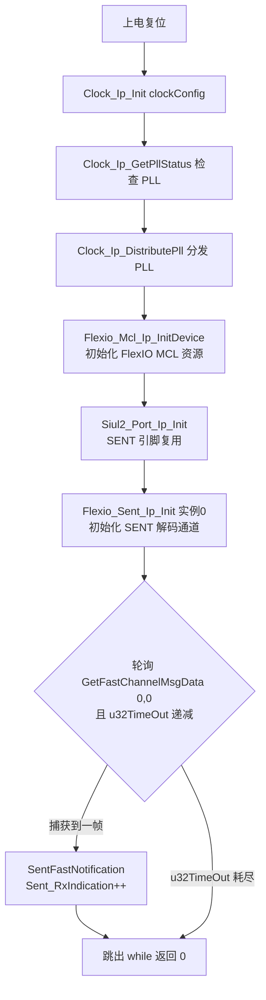
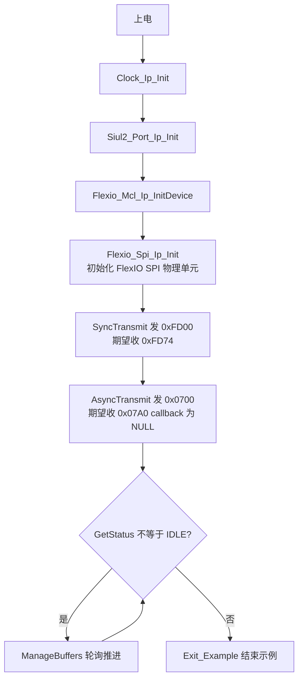
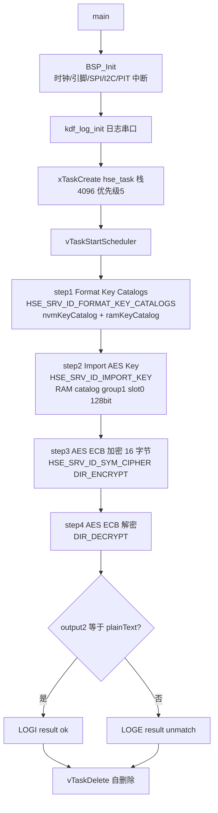
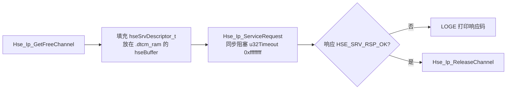
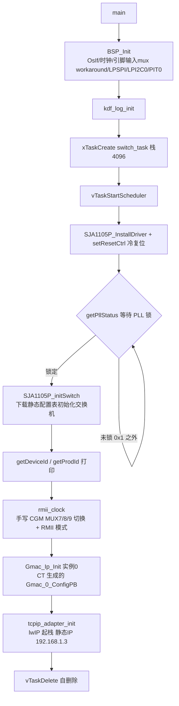
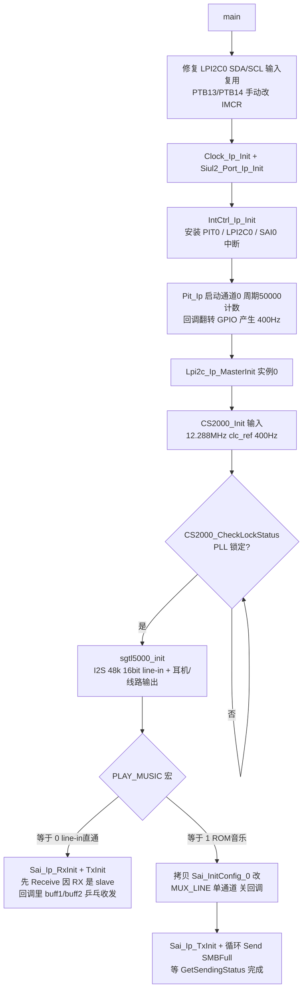
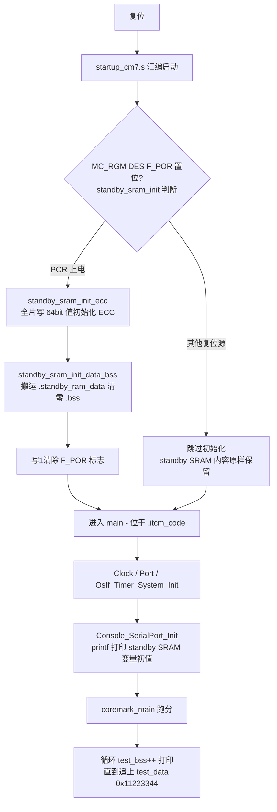

# SENT/FlexIO/HSE/GMAC/SAI/启动定制 — S32K344 RTD 0.9.0 实战教学

> 本文合并 6 个小众外设/主题工程。代码均原样摘录自各工程 src/main.c，未经任何修改。

6 个工程一览：

| # | 工程 | 主题 | main.c 行数 | 备注 |
|---|------|------|------------|------|
| 1 | S32K344_SENT_Example_090_34 | FlexIO 实现 SENT 解码 | 111 | 裸机轮询 |
| 2 | S32K344_FlexioSpi_Example_090_34 | FlexIO 模拟 SPI 主机 | 72 | 与 TJA1145 通信 |
| 3 | S32K344_HSE_Example_090_34 | HSE 安全引擎 AES | 24 | FreeRTOS，逻辑在 hse_task.c |
| 4 | S32K344_GMAC_Example_090_34 | 以太网 MAC + lwIP + SJA1105 | 33 | FreeRTOS，逻辑在 switch_task.c |
| 5 | S32K344_SAI_Example_090_34 | SAI I2S 音频 | 230 | sgtl5000 + cs2100 |
| 6 | S32K344_RTD_StartupCustomization_Example_090_34 | 启动流程/内存段定制 | 114 | ITCM + standby SRAM + CoreMark |

---

## 1. SENT 传感器接口
> 源工程: D:\wnagjin\S32K3_mydetail\详细教学(1)\详细教学\S32K3 Training-RTD\S32DSv3p4_RTDv090\S32K344_SENT_Example_090_34

### 概述
SENT（Single Edge Nibble Transmission）是车载传感器常用的单线串行协议。S32K3 没有硬件 SENT 外设，RTD 用 FlexIO 定时器输入捕获解码 SENT：本工程轮询调用 `Flexio_Sent_Ip_GetFastChannelMsgData(0,0)` 接收 FlexIO 实例 0、通道 0 上的 Fast Channel 报文，收到一帧后 `Sent_RxIndication` 置位、main 退出。引脚/FlexIO 资源均由 S32 Config Tools 生成（`Flexio_example_DS.mex`）。

### 时序


### main.c 原样代码

**L1–L17：版权头 + C++ 保护**

```c
/*
*   (c) Copyright 2020 NXP
*
*   NXP Confidential. This software is owned or controlled by NXP and may only be used strictly
*   in accordance with the applicable license terms.  By expressly accepting
*   such terms or by downloading, installing, activating and/or otherwise using
*   the software, you are agreeing that you have read, and that you agree to
*   comply with and are bound by, such license terms.  If you do not agree to
*   be bound by the applicable license terms, then you may not retain,
*   install, activate or otherwise use the software.
*
*   This file contains sample code only. It is not part of the production code deliverables.
*/

#ifdef __cplusplus
extern "C" {
#endif
```

**L19–L30：包含文件**

```c


/*==================================================================================================
*                                        INCLUDE FILES
* 1) system and project includes
* 2) needed interfaces from external units
* 3) internal and external interfaces from this unit
==================================================================================================*/
#include "Mcal.h"
#include "Siul2_Port_Ip.h"
#include "Clock_Ip.h"
#include "Flexio_Sent_Ip.h"
#include "Flexio_Mcl_Ip.h"
```

**L31–L69：本地宏 / 全局变量 / 外部配置声明**

```c
/*==================================================================================================
*                          LOCAL TYPEDEFS (STRUCTURES, UNIONS, ENUMS)
==================================================================================================*/


/*==================================================================================================
*                                       LOCAL MACROS
==================================================================================================*/
#define clockConfig &Mcu_aClockConfigPB[0]

/*==================================================================================================
*                                      LOCAL CONSTANTS
==================================================================================================*/


/*==================================================================================================
*                                      LOCAL VARIABLES
==================================================================================================*/


/*==================================================================================================
*                                      GLOBAL CONSTANTS
==================================================================================================*/


/*==================================================================================================
*                                      GLOBAL VARIABLES
==================================================================================================*/
uint8 Sent_RxIndication = 0U;

/*==================================================================================================
*                                   LOCAL FUNCTION PROTOTYPES
==================================================================================================*/
FLEXIO_IP_CONFIG_EXT
extern const Flexio_Ip_InstanceConfigType Flexio_Ip_xFlexioInit;

/*==================================================================================================
*                                       LOCAL FUNCTIONS
==================================================================================================*/

```

**L71–L105：通知回调 + main**

```c
/*==================================================================================================
*                                       GLOBAL FUNCTIONS
==================================================================================================*/
void SentFastNotification(Flexio_Sent_Ip_StatusType status, Flexio_Sent_FastMsgType *pSent_FastMsg)
{
    Sent_RxIndication++;
    (void)status;
    (void)pSent_FastMsg;
}

int main(void)
{
	uint32 u32TimeOut = 0xFFFF;

	Clock_Ip_Init(clockConfig);
	Clock_Ip_GetPllStatus();
	/* Distribute clock */
	Clock_Ip_DistributePll();

	/* Init Mcl */
    Flexio_Mcl_Ip_InitDevice(&Flexio_Ip_xFlexioInit);
    /* Initialize Port driver */
    Siul2_Port_Ip_Init(NUM_OF_CONFIGURED_PINS0, g_pin_mux_InitConfigArr0);
    /* Initialize Sent driver */
    Flexio_Sent_Ip_Init(0, Flexio_aCtrlConfigPB_BOARD_INITPERIPHERALS);

    while((!Sent_RxIndication) && (--u32TimeOut))
    {
        /* Call Flexio_Sent_Ip_GetFastChannelMsgData to get Fast message on FLEXIO instance 0, channel 0 */
    	Flexio_Sent_Ip_GetFastChannelMsgData(0U,0U);
    }

    return (0U);
}
```

**L107–L111：C++ 结尾**

```c

#ifdef __cplusplus
}
#endif

/** @} */
```

### API 速查

| API | 作用 | 关键参数 |
|-----|------|---------|
| `Clock_Ip_Init(clockConfig)` | 初始化系统时钟 | `&Mcu_aClockConfigPB[0]`（CT 生成的时钟配置） |
| `Clock_Ip_GetPllStatus()` | 查询 PLL 锁定状态 | 无 |
| `Clock_Ip_DistributePll()` | 把 PLL 时钟分发到内核/外设 | 无 |
| `Flexio_Mcl_Ip_InitDevice(&Flexio_Ip_xFlexioInit)` | 初始化 FlexIO MCL（定时器/移位器资源池） | CT 生成的实例配置结构体 |
| `Siul2_Port_Ip_Init(...)` | 引脚复用初始化 | 引脚数量 + 引脚配置数组 |
| `Flexio_Sent_Ip_Init(0, ...)` | 初始化 SENT 解码通道 | FlexIO 实例 0；`Flexio_aCtrlConfigPB_BOARD_INITPERIPHERALS` |
| `Flexio_Sent_Ip_GetFastChannelMsgData(0U,0U)` | 轮询获取 Fast Channel 一帧报文 | FlexIO 实例 0，SENT 通道 0 |

---

## 2. FlexIO 模拟 SPI
> 源工程: D:\wnagjin\S32K3_mydetail\详细教学(1)\详细教学\S32K3 Training-RTD\S32DSv3p4_RTDv090\S32K344_FlexioSpi_Example_090_34

### 概述
S32K3 的 FlexIO 可以拼出一个 SPI 主机，用于 SPI 外设不够用或引脚被占的场景。本工程用 FlexIO SPI 作主机、TJA1145（高速 CAN SBC）作从机，从 TJA1145 读 ID：第一次 `Flexio_Spi_Ip_SyncTransmit` 同步收发（期望回 0xFD74），第二次 `Flexio_Spi_Ip_AsyncTransmit` 异步轮询收发（期望回 0x07A0）。main.c 仅 72 行，属短小工程，以下全量摘录。

### 时序


### main.c 原样代码

**L1–L12：模块注释头**

```c
/*!
** Copyright 2019 NXP
** @file main.c
** @brief
**         Main module.
**         This module contains user's application code.
*/
/*!
**  @addtogroup main_module main module documentation
**  @{
*/
/* MODULE main */
```

**L14–L31：包含文件 + 收发缓冲**

```c
/* Including necessary configuration files. */
#include "Mcal.h"
#include "Clock_Ip.h"
#include "Siul2_Port_Ip.h"
#include "Siul2_Port_Ip_Cfg.h"
#include "Flexio_Mcl_Ip.h"
#include "Flexio_Mcl_Ip_Cfg.h"
#include "Flexio_Spi_Ip.h"
#include "check_example.h"

volatile int exit_code = 0;
/* User includes */

uint16 txBuffer[2] = {0xFD00, 0x0700};
uint16 rxBuffer[2][2]={{0}, {0}};
uint16 numberOfBytes = 2u;

uint32 timeOut = 1000000u;
```

**L33–L67：main 函数**

```c
/*!
  \brief The main function for the project.
  \details The startup initialization sequence is the following:
 * - startup asm routine
 * - main()
*/
int main(void)
{
    /* Write your code here */
    uint8 count = 0;
    boolean passed = true;


    Clock_Ip_Init(&Mcu_aClockConfigPB[0]);
    Siul2_Port_Ip_Init(NUM_OF_CONFIGURED_PINS0, g_pin_mux_InitConfigArr0);
    Flexio_Mcl_Ip_InitDevice(&Flexio_Ip_xFlexioInit);

    Flexio_Spi_Ip_Init(&Flexio_Spi_Ip_PhyUnitConfig_SpiPhyUnit_0_BOARD_InitPeripherals);

    /* The first transmit: Synchronous transmission, the expected received data is 0xFD74.*/
    Flexio_Spi_Ip_SyncTransmit(&Flexio_Spi_Ip_DeviceAttributes_SpiExternalDevice_0_BOARD_InitPeripherals, (uint8*)txBuffer, rxBuffer[0], numberOfBytes, timeOut);

    /* The second transmit: Asynchronous transmission in polling model, the expected received data is 0x07A0. */
    Flexio_Spi_Ip_AsyncTransmit(&Flexio_Spi_Ip_DeviceAttributes_SpiExternalDevice_0_BOARD_InitPeripherals, (uint8*)&txBuffer[1], rxBuffer[1], numberOfBytes, NULL);

   while(Flexio_Spi_Ip_GetStatus(0) != FLEXIO_SPI_IP_IDLE)
   {
	   Flexio_Spi_Ip_ManageBuffers(0);
   }


    Exit_Example(passed);

    return exit_code;
}
```

**L69–L72：模块结尾**

```c
/* END main */
/*!
** @}
*/
```

### API 速查

| API | 作用 | 关键参数 |
|-----|------|---------|
| `Clock_Ip_Init(&Mcu_aClockConfigPB[0])` | 初始化系统时钟 | CT 生成时钟配置 |
| `Siul2_Port_Ip_Init(...)` | 引脚复用初始化 | 引脚数量 + 配置数组 |
| `Flexio_Mcl_Ip_InitDevice(&Flexio_Ip_xFlexioInit)` | 初始化 FlexIO MCL 资源池 | CT 生成的实例配置 |
| `Flexio_Spi_Ip_Init(&Flexio_Spi_Ip_PhyUnitConfig_...)` | 初始化 FlexIO 模拟 SPI 物理单元 | CT 生成的 PhyUnit 配置 |
| `Flexio_Spi_Ip_SyncTransmit(dev, tx, rx, 2, timeOut)` | 同步阻塞收发一帧 | 外部设备属性（片选/波特率/相位）、收发缓冲、字节数、超时 |
| `Flexio_Spi_Ip_AsyncTransmit(dev, tx, rx, 2, NULL)` | 异步收发（此处无回调、轮询模式） | 同上；callback 传 NULL |
| `Flexio_Spi_Ip_GetStatus(0)` | 查询物理单元状态 | 物理单元实例 0；返回 `FLEXIO_SPI_IP_IDLE` 等 |
| `Flexio_Spi_Ip_ManageBuffers(0)` | 轮询模式下推进收发搬运 | 物理单元实例 0 |
| `Exit_Example(passed)` | 结束示例（打印并停机） | 检查结果标志 |

---

## 3. HSE 安全引擎
> 源工程: D:\wnagjin\S32K3_mydetail\详细教学(1)\详细教学\S32K3 Training-RTD\S32DSv3p4_RTDv090\S32K344_HSE_Example_090_34

### 概述
HSE（Hardware Security Engine）是 S32K3 内置的独立安全核，主机通过 MU（Messaging Unit）通道提交服务描述符请求加解密/密钥管理服务。本工程演示完整四步：格式化密钥目录（Format Key Catalogs）→ 导入 128bit AES 密钥到 RAM catalog → ECB 加密 → ECB 解密并比对结果。main.c 仅 24 行（只建 FreeRTOS 任务），真正的 HSE 调用序列在同目录 `src/hse_task.c`（`hse_step1~4`，见下方时序与 API 表）。

### 时序


每次 HSE 服务调用的固定套路（hse_task.c 中四个 step 完全一致）：



### main.c 原样代码

**L1–L16：包含文件 + TAG 宏（L9–L16 为 8 个空行）**

```c
#include "stdint.h"
#include "FreeRTOS.h"
#include "task.h"
#include "tasks.h"
#include "bsp.h"
#include "kdf_log.h"
#include "s32k3_tcd.h"
#define TAG "main"


```

**L17–L24：main 函数（全量，仅 8 行）**

```c
int main() {
    BSP_Init();
    kdf_log_init(0);
    xTaskCreate(hse_task, "hse",4096, NULL,5, NULL);
    vTaskStartScheduler();

    return 0;
}
```

### API 速查

main.c 用到的：

| API | 作用 | 关键参数 |
|-----|------|---------|
| `BSP_Init()` | 板级初始化：时钟、引脚 workaround、LPSPI、LPI2C0、PIT0 中断（见工程 `src/bsp.c`） | 无 |
| `kdf_log_init(0)` | 初始化日志输出（LPUART 重定向 printf） | 0 = 默认实例 |
| `xTaskCreate(hse_task, "hse", 4096, NULL, 5, NULL)` | 创建 HSE 演示任务 | 入口 hse_task、栈 4096、优先级 5 |
| `vTaskStartScheduler()` | 启动 FreeRTOS 调度器，不再返回 | 无 |

hse_task.c 中 HSE 核心用法：

| API | 作用 | 关键参数 |
|-----|------|---------|
| `Hse_Ip_GetFreeChannel(HSE_DEFAULT_INST)` | 获取一个空闲 MU 通道 | HSE 实例 0；返回 `HSE_IP_INVALID_MU_CHANNEL_U8` 表示无空闲 |
| `Hse_Ip_ServiceRequest(inst, channel, &req, HSE_TXDES(pHseSrvDesc))` | 向 HSE 提交服务请求 | req 为同步 `HSE_IP_REQTYPE_SYNC`、超时 0xffffffff；描述符地址加 `0x1000000` TCM 偏移 |
| `Hse_Ip_ReleaseChannel(inst, channel)` | 归还 MU 通道 | 实例 + 通道号 |
| `HSE_SRV_ID_FORMAT_KEY_CATALOGS` | 格式化 NVM/RAM 密钥目录 | `pNvmKeyCatalogCfg` / `pRamKeyCatalogCfg` 指向 `hseKeyGroupCfgEntry_t` 数组 |
| `HSE_SRV_ID_IMPORT_KEY` | 导入明文密钥 | `targetKeyHandle`、`keyInfo`（类型/长度/用途标志）、`pKey[2]` 明文地址 |
| `HSE_SRV_ID_SYM_CIPHER` | 对称加解密 | AES + ECB + ONE_PASS、`keyHandle`、输入输出缓冲、`inputLength=16` |
| `GET_KEY_HANDLE(HSE_KEY_CATALOG_ID_RAM, 1, 0)` | 构造密钥句柄 | catalog ID + group + slot |
| `HSE_KF_USAGE_ENCRYPT / HSE_KF_USAGE_DECRYPT` | 密钥用途标志（导入时置位） | keyInfo.keyFlags |

---

## 4. GMAC 以太网 MAC
> 源工程: D:\wnagjin\S32K3_mydetail\详细教学(1)\详细教学\S32K3 Training-RTD\S32DSv3p4_RTDv090\S32K344_GMAC_Example_090_34

### 概述
本工程演示 RTD Gmac 驱动 + lwIP（静态 IP 192.168.1.3）跑 TCP/IP，底层还带一片 SJA1105 以太网交换机（经 LPSPI 配置）。main.c 仅 33 行：BSP 初始化后只创建 `switch_task`；交换机复位/初始化、RMII 时钟切换、`Gmac_Ip_Init` 和 `tcpip_adapter_init` 都在 `src/switch_task.c` 里完成。`examplePQRS_SJA1105QS.c` 提供交换机的静态配置表。

### 时序


### main.c 原样代码

**L1–L16：包含文件 + TAG 宏（L9–L16 为 8 个空行）**

```c
#include "stdint.h"
#include "FreeRTOS.h"
#include "task.h"
#include "tasks.h"
#include "bsp.h"
#include "kdf_log.h"
#include "s32k3_tcd.h"
#define TAG "main"


```

**L17–L33：main 函数（全量）**

```c
int main() {
    /* SET PORT priority ETH->DMA->CPU*/
     
    // AXBS->PRS0=
    BSP_Init();
    kdf_log_init(0);
    xTaskCreate(switch_task, "switch",4096, NULL,5, NULL);
    //xTaskCreate(phy_task, "phy",1024, NULL,2, NULL);
    // xTaskCreate(ethersync_task, "ether_sync",2048, NULL,2, NULL);
    //xTaskCreate(wavesync_task, "waye_sync",2048, NULL,2, NULL);
    // xTaskCreate(class_a_task, "class_a",2048, NULL,2, NULL);
    //xTaskCreate(class_c_task, "class_c",2048, NULL,2, NULL);
    //xTaskCreate(class_be_task, "class_be",2048, NULL,2, NULL);
    vTaskStartScheduler();

    return 0;
}
```

### API 速查

main.c / switch_task.c 用到的：

| API | 作用 | 关键参数 |
|-----|------|---------|
| `BSP_Init()` | 板级初始化（含 QSPI/MDIO 引脚输入复用 workaround，见 `src/bsp.c`） | 无 |
| `SJA1105P_InstallDriver(0, 2)` | 注册 SJA1105 底层驱动 | SPI 实例 0、片选 2 |
| `SJA1105P_setResetCtrl(4, 0)` | 交换机冷复位 | 复位控制字 |
| `SJA1105P_getPllStatus(&pllStatus, 0, 0)` | 轮询交换机 PLL 状态 | 锁定为 `0x00000001` |
| `SJA1105P_initSwitch()` | 按静态配置表初始化交换机 | 无（表在 examplePQRS_SJA1105QS.c） |
| `SJA1105P_getDeviceId / getProdId` | 读芯片 ID/型号打印 | 输出指针 |
| `rmii_clock()` | 直接写 CGM 寄存器配 MUX7/8/9（DIV=1，SELCTL 24/24/8）并置 RMII 模式 | 返回 0 成功 |
| `Gmac_Ip_Init(0, &Gmac_0_ConfigPB_BOARD_INITPERIPHERALS)` | 初始化 GMAC 外设 | 实例 0 + CT 生成的配置 |
| `tcpip_adapter_init()` | 启动 lwIP 协议栈（静态 IP 192.168.1.3） | 无 |
| `IntCtrl_Ip_SetPriority / EnableIrq` | PIT0 中断优先级与使能 | `PIT0_IRQn`、优先级 1 |
| `xTaskCreate / vTaskStartScheduler` | FreeRTOS 建任务/启调度 | switch_task、栈 4096、优先级 5 |

---

## 5. SAI 音频接口
> 源工程: D:\wnagjin\S32K3_mydetail\详细教学(1)\详细教学\S32K3 Training-RTD\S32DSv3p4_RTDv090\S32K344_SAI_Example_090_34

### 概述
SAI（SAI/I2S）驱动板载音频 codec sgtl5000 完成音频收发。时钟链路是本例精华：PIT 周期中断翻转 GPIO 产生 400Hz 参考时钟喂给 CS2100 时钟恢复芯片，CS2100 输出 12.288MHz 作为 codec MCLK，sgtl5000 以 I2S/48kHz/16bit 工作，LPI2C0 负责配置 CS2100 与 sgtl5000。`PLAY_MUSIC` 宏切换两种模式：0 = line-in 直通耳机/线路输出（RX/TX 乒乓缓冲），1 = 循环播放内置超级马里奥 ROM 音乐（`supermario.h` 的 `SMBFull`）。

### 时序


### main.c 原样代码

**L1–L30：版权头 + 文件注释**

```c
/*==================================================================================================
*   Project              : RTD AUTOSAR 4.4
*   Platform             : CORTEXM
*   Peripheral           : S32K3XX
*   Dependencies         : none
*
*   Autosar Version      : 4.4.0
*   Autosar Revision     : ASR_REL_4_4_REV_0000
*   Autosar Conf.Variant :
*   SW Version           : 0.9.0
*   Build Version        : S32K3_RTD_0_9_0__ASR_REL_4_4_REV_0000_20210326
*
*   (c) Copyright 2020 - 2021 NXP Semiconductors
*   All Rights Reserved.
*
*   NXP Confidential. This software is owned or controlled by NXP and may only be
*   used strictly in accordance with the applicable license terms.  By expressly
*   accepting such terms or by downloading, installing, activating and/or otherwise
*   using the software, you are agreeing that you have read, and that you agree to
*   be bound by, such license terms.  If you do not agree to
*   be bound by the applicable license terms, then you may not retain,
*   install, activate or otherwise use the software.
==================================================================================================*/

/**
*   @file main.c
*
*   @addtogroup main_module main module documentation
*   @{
*/
```

**L32–L46：包含文件**

```c
/* Including necessary configuration files. */
#include "Mcal.h"
#include "Pit_Ip.h"
#include "Lpi2c_Ip.h"
#include "Lpi2c_Ip_BOARD_InitPeripherals_PBcfg.h"
#include "Sai_Ip.h"
#include "Clock_Ip.h"
#include "IntCtrl_Ip.h"
#include "Siul2_Port_Ip.h"
#include "Siul2_Dio_Ip.h"
#include "cs2000.h"
#include "cs2000_cfg.h"
#include "sgtl5000.h"
#include "sgtl5000_cfg.h"
#include "supermario.h"
```

**L48–L71：本地类型/宏/常量区**

```c
/*==================================================================================================
*                          LOCAL TYPEDEFS (STRUCTURES, UNIONS, ENUMS)
==================================================================================================*/


/*==================================================================================================
*                                       LOCAL MACROS
==================================================================================================*/
/* PIT instance used - 0 */
#define PIT_INST 0U
/* LPI2C instance used - 0 */
#define LPI2C0_INST 0U
/* SAI instance used - 0 */
#define SAI0_INST 0U
/* PIT timeout period - equivalent to 0.0025 s, CS2100 ref clock 400Hz */
#define PIT_PERIOD 50000
#define CS2100_CLC_REF 400
/* SAI data receive buff size */
#define BUFF_SIZE 256
/* Play the embedded ROM music or line-in */
#define PLAY_MUSIC 1
/*==================================================================================================
*                                      LOCAL CONSTANTS
==================================================================================================*/
```

**L73–L99：本地/全局变量区**

```c


/*==================================================================================================
*                                      LOCAL VARIABLES
==================================================================================================*/
static uint32_t slice1[BUFF_SIZE];
static uint32_t* buff1[1]={slice1};
static uint32_t slice2[BUFF_SIZE];
static uint32_t* buff2[1]={slice2};

/*==================================================================================================
*                                      GLOBAL CONSTANTS
==================================================================================================*/


/*==================================================================================================
*                                      GLOBAL VARIABLES
==================================================================================================*/
volatile int exit_code = 0;

/*==================================================================================================
*                                   LOCAL FUNCTION PROTOTYPES
==================================================================================================*/


/*==================================================================================================
*                                       LOCAL FUNCTIONS
==================================================================================================*/
```

**L100–L130：PIT 回调 + SAI 接收回调**

```c
/**
* @brief        Pit notification called by the configured channel periodically
* @details      Used to toggle GPIO for cs2100 ref_clk, a 400Hz wave.
*/
void PIT0_Callback(uint8 channel)
{
	(void)channel;
	Siul2_Dio_Ip_TogglePins(CLK_REF_PORT, (1 << CLK_REF_PIN));
}
/**
* @brief        Sai Callback function called by the configured Sai instance after each transfer complete
* @details      Used to forward the last received audio data and alternate the storage memory block for next receive.
*/
void Sai0_Rec_Callback(Sai_Ip_ReportType event)
{
	static uint8_t cnt_recv = 0;
	if(SAI_IP_RX_COMPLETE == event)
	{
		if(cnt_recv%2==0)
		{
			Sai_Ip_Receive(SAI0_INST,(uint8_t**)(buff1),BUFF_SIZE);
			Sai_Ip_Send(SAI0_INST,(const uint8_t**)(buff2),BUFF_SIZE);
		}
		else
		{
			Sai_Ip_Receive(SAI0_INST,(uint8_t**)(buff2),BUFF_SIZE);
			Sai_Ip_Send(SAI0_INST,(const uint8_t**)(buff1),BUFF_SIZE);
		}
		cnt_recv++;
	}
}
```

**L131–L136：全局函数区 + 外部 ISR 声明**

```c
/*==================================================================================================
*                                       GLOBAL FUNCTIONS
==================================================================================================*/
extern ISR(PIT_0_ISR);
extern void LPI2C0_Master_Slave_IRQHandler(void);
extern void SAI0_IRQHandler(void);
```

**L138–L228：main 函数**

```c
/*!
  \brief The main function for the project.
  \details The startup initialization sequence is the following:
 * - startup asm routine
 * - main()
*/
int main(void)
{
    /* Init the Lpi2c pins input alternate configuration due to only output alternate is configured by CT. */
    uint32_t i = 0;
	for(i=0; i<NUM_OF_CONFIGURED_PINS0; i++)
	{
		/* the LPI2C0 SDA pin configuration fix */
		if(109 == g_pin_mux_InitConfigArr0[i].pinPortIdx)
		{
			g_pin_mux_InitConfigArr0[i].mux = PORT_MUX_ALT4;
			g_pin_mux_InitConfigArr0[i].inputMuxReg[0] = 726 - 512;
			g_pin_mux_InitConfigArr0[i].inputMux[0] = PORT_INPUT_MUX_ALT2;
		}
		/* the LPI2C0 SCK pin configuration fix */
		if(110 == g_pin_mux_InitConfigArr0[i].pinPortIdx)
		{
			g_pin_mux_InitConfigArr0[i].mux = PORT_MUX_ALT4;
			g_pin_mux_InitConfigArr0[i].inputMuxReg[0] = 724 - 512;
			g_pin_mux_InitConfigArr0[i].inputMux[0] = PORT_INPUT_MUX_ALT2;
		}
	}
	/* initialize MCU system clock */
	Clock_Ip_Init(&Mcu_aClockConfigPB[0]);
	/* initialize used pins */
	Siul2_Port_Ip_Init(NUM_OF_CONFIGURED_PINS0,g_pin_mux_InitConfigArr0);
	/* Initialize the Interrupt vector, and install corresponding ISR */
	IntCtrl_Ip_Init(&IntCtrlConfig_0);
	IntCtrl_Ip_InstallHandler(PIT0_IRQn, PIT_0_ISR, NULL_PTR);
	IntCtrl_Ip_InstallHandler(LPI2C0_IRQn, LPI2C0_Master_Slave_IRQHandler, NULL_PTR);
	IntCtrl_Ip_InstallHandler(SAI0_IRQn, SAI0_IRQHandler, NULL_PTR);
    /* Initialize the PIT timer for cs2100 ref_clk, toggle GPIO to get a 400Hz wave */
	Pit_Ip_Init(PIT_INST, &PIT_0_InitConfig_PB);       /* initialize the PIT0 module */
	Pit_Ip_InitChannel(PIT_INST, PitChannel_0);        /* initialize PIT channel 0 */
	Pit_Ip_EnableChannelInterrupt(PIT_INST, 0U);     /* enable the PIT channel 0 interrupt */
	Pit_Ip_StartChannel(PIT_INST, 0U, PIT_PERIOD);   /* start the PIT channel 0 with expected period in PIT counter count*/
	/* Initialize the LPI2C0 for cs2100 and sgtl5000 driver */
	Lpi2c_Ip_MasterInit(LPI2C0_INST, &I2c_Lpi2cMasterChannel0_BOARD_InitPeripherals);
    /* configure the cs2000, input 12.288MHz, clc_ref 400Hz, output 12.288MHz */
	CS2000_Init(CS2000_I2C_DEVICE_ADDRESS, 12U, true);
	uint32_t clockRatio = CS2000_ComputeClockRatio(CS2100_CLC_REF, 12288000U, 12U);
	CS2000_SetClockRatio(CS2000_I2C_DEVICE_ADDRESS, 0U, clockRatio);
	while (!CS2000_CheckLockStatus(CS2000_I2C_DEVICE_ADDRESS))
	{
		/* wait until pll locked. */
	}
	/* configure the audio codec sgtl5000, MCLK 12.288MHz, I2S, 48K, 16bits, line-in, header-out & line-out */
	sgtl5000_init(&myInitStruct);

#if PLAY_MUSIC==0	/* Play back, line-in -> header-out & line-out */
	/* Initialize SAI module */
	Sai_Ip_RxInit(SAI0_INST, &Sai_InitConfig_0_BOARD_INITPERIPHERALS);
	Sai_Ip_TxInit(SAI0_INST, &Sai_InitConfig_1_BOARD_INITPERIPHERALS);
	/* Call receive data first because rx is slave */
	Sai_Ip_Receive(SAI0_INST, (uint8_t**) buff2, BUFF_SIZE);
    while(1);

#else	/* Play the embedded ROM music, supermario */
	/* both left and right channel use the same source(SMBFull) single channel data */
    uint8_t* music[2] = {(uint8_t *)SMBFull, (uint8_t *)SMBFull};
    uint32_t length = sizeof(SMBFull)/2;;
    uint32_t countremain;
    /* manually modify some configuration in PLAY_MUSIC mode */
    Sai_Ip_ConfigType SaiHwUnit_tx = Sai_InitConfig_0_BOARD_INITPERIPHERALS;
    /* use line_mux mode, left and right channel data store in separate memory */
    SaiHwUnit_tx.eMuxMode = SAI_IP_MUX_LINE;
    SaiHwUnit_tx.pCallback = NULL;
    SaiHwUnit_tx.u8ChannelEnable = 1;
	/* Initialize SAI module */
	Sai_Ip_TxInit(SAI0_INST, &SaiHwUnit_tx);
	while(1)
	{
		Sai_Ip_Send(SAI0_INST,(const uint8_t**)music,length);
		while (Sai_Ip_GetSendingStatus(SAI0_INST, &countremain) == SAI_IP_STATUS_BUSY){;}
	}
#endif

    for(;;)
    {
        if(exit_code != 0)
        {
            break;
        }
    }
    return exit_code;
}
```

**L230：模块结尾**

```c

/** @} */
```

### API 速查

| API | 作用 | 关键参数 |
|-----|------|---------|
| `Clock_Ip_Init(&Mcu_aClockConfigPB[0])` | 初始化系统时钟 | CT 生成时钟配置 |
| `Siul2_Port_Ip_Init(...)` | 引脚复用（注意运行时再修补 LPI2C 输入 mux） | 引脚数 + 配置数组 |
| `IntCtrl_Ip_Init(&IntCtrlConfig_0)` | 初始化中断控制器 | CT 生成配置 |
| `IntCtrl_Ip_InstallHandler(IRQn, ISR, NULL_PTR)` | 安装 ISR | PIT0/LPI2C0/SAI0 三个中断 |
| `Pit_Ip_Init / InitChannel / EnableChannelInterrupt / StartChannel` | PIT 定时器四步初始化 | 实例 0、通道 0、周期 `PIT_PERIOD`=50000 计数 |
| `Siul2_Dio_Ip_TogglePins(CLK_REF_PORT, 1<<CLK_REF_PIN)` | PIT 回调里翻转 GPIO 产生 400Hz CLK_REF | 端口 + 掩码 |
| `Lpi2c_Ip_MasterInit(0, &I2c_Lpi2cMasterChannel0_...)` | LPI2C0 主机初始化（配置 CS2100/sgtl5000） | CT 生成通道配置 |
| `CS2000_Init(addr, 12U, true)` | 配置 CS2100 时钟芯片 | I2C 地址、12.288MHz、使能 |
| `CS2000_ComputeClockRatio / SetClockRatio` | 计算并写入时钟比率 | clc_ref 400Hz、12288000Hz、12 |
| `CS2000_CheckLockStatus(addr)` | 查询 PLL 锁定 | 循环等待 |
| `sgtl5000_init(&myInitStruct)` | 配置音频 codec | I2S/48k/16bit/line-in/双输出 |
| `Sai_Ip_RxInit / Sai_Ip_TxInit(0, ...)` | SAI 收/发方向初始化 | CT 生成的 `Sai_InitConfig_0/1` 或运行时改写副本 |
| `Sai_Ip_Receive(0, buff, BUFF_SIZE)` | 启动一次接收（乒乓缓冲） | 缓冲指针数组 + 长度 |
| `Sai_Ip_Send(0, music, length)` | 启动一次发送 | 同上 |
| `Sai_Ip_GetSendingStatus(0, &countremain)` | 查询发送状态/剩余 | 返回 `SAI_IP_STATUS_BUSY` 等 |

---

## 6. 启动流程定制
> 源工程: D:\wnagjin\S32K3_mydetail\详细教学(1)\详细教学\S32K3 Training-RTD\S32DSv3p4_RTDv090\S32K344_RTD_StartupCustomization_Example_090_34\S32K344_RTD_StartupCustomization_Sample_090_34

### 概述
演示三件事：① 把 `main` 整体放进 `.itcm_code` 段（指令 TCM，零等待取指）；② 把变量放进 standby SRAM 自定义段 `.standby_ram_data` / `.standby_ram_bss`——standby 模式下内容保持、唤醒后不清零；③ 在启动汇编里（`startup_cm7.s` 第 343 行 `bl standby_sram_init`）按复位源区分：仅 POR 复位时才做 standby SRAM 的 ECC 初始化和 data/bss 搬运（`src/Standby_SRAM_Init.c`），其余复位源跳过以保留数据。main 里跑 CoreMark 基准并验证 standby SRAM 变量。

### 时序


### main.c 原样代码

**L1–L30：版权头 + 文件注释**

```c
/*==================================================================================================
*   Project              : RTD AUTOSAR 4.4
*   Platform             : CORTEXM
*   Peripheral           : S32K3XX
*   Dependencies         : none
*
*   Autosar Version      : 4.4.0
*   Autosar Revision     : ASR_REL_4_4_REV_0000
*   Autosar Conf.Variant :
*   SW Version           : 0.9.0
*   Build Version        : S32K3_RTD_0_9_0__ASR_REL_4_4_REV_0000_20210326
*
*   (c) Copyright 2020 - 2021 NXP Semiconductors
*   All Rights Reserved.
*
*   NXP Confidential. This software is owned or controlled by NXP and may only be
*   used strictly in accordance with the applicable license terms.  By expressly
*   accepting such terms or by downloading, installing, activating and/or otherwise
*   using the software, you are agreeing that you have read, and that you agree to
*   be bound by, such license terms.  If you do not agree to
*   be bound by the applicable license terms, then you may not retain,
*   install, activate or otherwise use the software.
==================================================================================================*/

/**
*   @file main.c
*
*   @addtogroup main_module main module documentation
*   @{
*/
```

**L32–L49：包含文件 + 外部声明**

```c
/* Including necessary configuration files. */
#include "Mcal.h"

volatile int exit_code = 0;
/* User includes */

#include "Clock_Ip.h"
#include "IntCtrl_Ip.h"
#include "Siul2_Port_Ip.h"
#include "Siul2_Dio_Ip.h"
#include "Osif.h"
#include "OsIf_Timer_System.h"

#include "stdio.h"

extern void Console_SerialPort_Init(void);

extern int coremark_main(void);
```

**L51–L62：main 注释 + standby 段宏与变量**

```c
/*!
  \brief The main function for the project.
  \details The startup initialization sequence is the following:
 * - startup asm routine
 * - main()
*/

#define STANDBY_RAM_DATA_SEG __attribute__ ((section (".standby_ram_data")))
#define STANDBY_RAM_BSS_SEG  __attribute__ ((section (".standby_ram_bss")))

STANDBY_RAM_DATA_SEG uint32_t test_data_in_standby_sram = 0x11223344;
STANDBY_RAM_BSS_SEG  uint32_t test_bss_in_standby_sram  = 0;
```

**L64–L112：main 函数（位于 .itcm_code 段）**

```c
__attribute__ ((section (".itcm_code")))
int main(void)
{
    /* Write your code here */

	/*
	 * initialize MCU system clock
	 */
	Clock_Ip_Init(&Mcu_aClockConfigPB[0]);
	/*
	 * initialize used pins
	 */
	Siul2_Port_Ip_Init(NUM_OF_CONFIGURED_PINS0,g_pin_mux_InitConfigArr0);

	/* initialize osif timer for peripheral use */
	OsIf_Timer_System_Init();


	/* ITM initialization */
	Console_SerialPort_Init();

	printf("test data in standby SRAM is 0x%x, and bss in standby SRAM is 0x%x at beginning of main()\r\n",\
			test_data_in_standby_sram,\
			test_bss_in_standby_sram);

	printf("The coremark benchmark routes are starting to run and result log will be printed !\r\n");

	coremark_main();/* call the coremark test codes */

    for(;;)
    {
    	test_bss_in_standby_sram++;

    	if(test_data_in_standby_sram == test_bss_in_standby_sram)
    	{
    		break;
    	}
    	else
    	{
    		printf("current test_bss_in_standby_sram = 0x%x\r\n",test_bss_in_standby_sram);
    	}

        if(exit_code != 0)
        {
            break;
        }
    }
    return exit_code;
}
```

**L114：模块结尾**

```c

/** @} */
```

### API 速查

| API | 作用 | 关键参数 |
|-----|------|---------|
| `__attribute__ ((section (".itcm_code")))` | 把函数放入指令 TCM 段，零等待取指 | 修饰 `main`（链接脚本需有该段） |
| `__attribute__ ((section (".standby_ram_data")))` / `(".standby_ram_bss")` | 把变量放入 standby SRAM 自定义段 | 待机模式内容保持 |
| `standby_sram_init()`（由 `startup_cm7.s:343` 调用） | 按复位源决定是否初始化 standby SRAM | 判断 `MC_RGM->DES & MC_RGM_DES_F_POR_MASK` |
| `standby_sram_init_ecc()` | 全片写 64bit 值初始化 ECC | 写 `0xDEADBEEFCAFEFEEDULL` |
| `standby_sram_init_data_bss()` | 搬运 .standby_ram_data、清零 .bss | 用链接器导出符号 `__RAM_DATA_STANDBY_START` 等 |
| `Clock_Ip_Init(&Mcu_aClockConfigPB[0])` | 初始化系统时钟 | CT 生成配置 |
| `Siul2_Port_Ip_Init(...)` | 引脚复用初始化 | 引脚数 + 配置数组 |
| `OsIf_Timer_System_Init()` | 初始化 OSIF 系统计时器（延时基准） | 无 |
| `Console_SerialPort_Init()` | 初始化控制台串口，重定向 printf | 见 `src/retarget.c` |
| `coremark_main()` | 运行 CoreMark 基准测试 | 见 `CoreMark/` 目录 |
