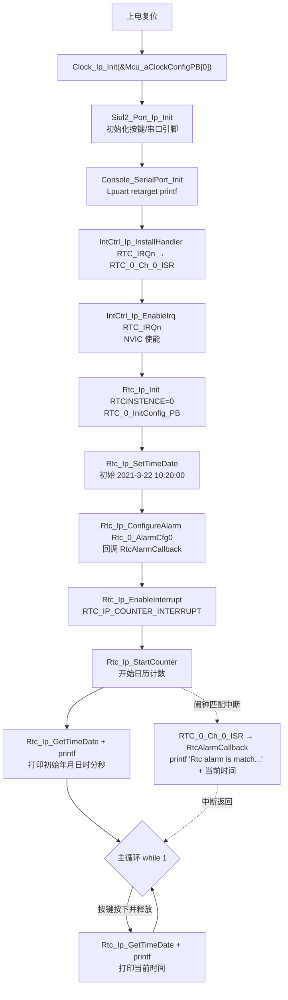

# RTC 时钟日历 — S32K344 RTD 0.9.0 实战教学

> 源工程: `D:\wnagjin\S32K3_mydetail\详细教学(1)\详细教学\S32K3 Training-RTD\S32DSv3p4_RTDv090\S32K344_RTC_Example_090_34`
> 源文件: `...\S32K344_RTC_Example_090_34\src\main.c`（全文 130 行，代码原样摘录，未经任何修改）

## 1. 概述

S32K344 片内 RTC 是带日历计数（年/月/日/时/分/秒）的实时时钟，掉电由 VBATT 维持（本示例不做掉电演示）。本工程演示：

- `Rtc_Ip_Init` 初始化 RTC0（时钟源 `RTC_IP_CLOCK_SOURCE_0`，不开 DivBy32/DivBy512 预分频，PBcfg 实证）；
- `Rtc_Ip_SetTimeDate` 写入初始时间 `Rtc_TimeDate_0` = 2021-3-22 10:20:00（PBcfg L126 实证）；
- `Rtc_Ip_ConfigureAlarm` 配置闹钟 `Rtc_0_AlarmCfg0`（匹配时刻 2021-3-19 11:19:00，回调 `RtcAlarmCallback`）；
- 使能 `RTC_IP_COUNTER_INTERRUPT` 计数中断并启动计数，闹钟匹配时在中断回调里 printf 当前时间；
- 主循环轮询按键（WB 板 SW3=PTC20 GPDI85 / EVB 板 SW4=PTB26 GPDI58，`S32K344_EVB_EN` 编译开关二选一），按下经 Lpuart printf 当前日期时间。

打印依赖 `Console_SerialPort_Init()`（Lpuart_Uart_Ip retarget 到 printf）。

## 2. 初始化与使用时序（mermaid flowchart 源码）



## 3. main.c 原样代码（按逻辑段落分块，标注来源工程与行号范围）

来源：`S32K344_RTC_Example_090_34\src\main.c`，全文 130 行，块间行号连续无缝隙。

**[L1-L41] 文件头与头文件**

```c
/*==================================================================================================
*   Project              : RTD AUTOSAR 4.4
*   Platform             : CORTEXM
*   Peripheral           : S32K3XX
*   Dependencies         : none
*
*   Autosar Version      : 4.4.0
*   Autosar Revision     : ASR_REL_4_4_REV_0000
*   Autosar Conf.Variant :
*   SW Version           : 0.9.0
*   Build Version        : S32K3_RTD_0_9_0__ASR_REL_4_4_REV_0000_20210326
*
*   (c) Copyright 2020 - 2021 NXP Semiconductors
*   All Rights Reserved.
*
*   NXP Confidential. This software is owned or controlled by NXP and may only be
*   used strictly in accordance with the applicable license terms. By expressly
*   accepting such terms or by downloading, installing, activating and/or otherwise
*   using the software, you are agreeing that you have read, and that you agree to
*   comply with and are bound by, such license terms. If you do not agree to be
*   bound by the applicable license terms, then you may not retain, install,
*   activate or otherwise use the software.
==================================================================================================*/

/**
*   @file main.c
*
*   @addtogroup main_module main module documentation
*   @{
*/

/* Including necessary configuration files. */
#include "Mcal.h"
#include "Rtc_Ip.h"
#include "Clock_Ip.h"
#include "Siul2_Port_Ip.h"
#include "stdio.h"
#include "retarget.h"
#include "Siul2_Dio_Ip.h"
#include "Siul2_Port_Ip.h"
#include "IntCtrl_Ip.h"
```

**[L43-L65] 宏、ISR 声明与闹钟回调**

```c

#define SIUL_INST      	0U      /*!< SIUL2 instance used - 0                */
#if (0 == S32K344_EVB_EN)
#define SIUL_GPDI_SW3  	85U     /*!< SIUL2 GPDI offset for PTC20 (USER_SW3) */
#else
#define SIUL_GPDI_SW4  	58U     /*!< SIUL2 GPDI offset for PTB26 (USER_SW4) */
#endif

extern ISR(RTC_0_Ch_0_ISR);
#define RTCINSTENCE		(0U)
Rtc_Ip_TimedateType currentData;

/**
 * @brief   RTC alarm callback
 * @details Used to printf current date.
 */
void RtcAlarmCallback(uint8 channel)
{
	printf("Rtc alarm is match...\n");
	Rtc_Ip_GetTimeDate(RTCINSTENCE, &currentData);
	printf("Current time is %d/%d/%d  %d:%d:%d \n", currentData.year, currentData.month,
			currentData.day, currentData.hour, currentData.minutes, currentData.seconds);
}
```

**[L67-L130] main 函数（初始化 + 按键打印循环）**

```c
volatile int exit_code = 0;
/* User includes */

/*!
  \brief The main function for the project.
  \details The startup initialization sequence is the following:
 * - startup asm routine
 * - main()
*/
int main(void)
{
    /* Write your code here */

    /* Init clock  */
    Clock_Ip_Init(&Mcu_aClockConfigPB[0]);
    /* Initialize all pins */
    Siul2_Port_Ip_Init(NUM_OF_CONFIGURED_PINS0, g_pin_mux_InitConfigArr0);

	Console_SerialPort_Init();

	IntCtrl_Ip_InstallHandler(RTC_IRQn, RTC_0_Ch_0_ISR, NULL_PTR);/* install the RTC interrupt ISR */
	IntCtrl_Ip_EnableIrq(RTC_IRQn);/* enable the RTC IRQ interrupt in NVIC */

	Rtc_Ip_Init(RTCINSTENCE, &RTC_0_InitConfig_PB);/* initialize the RTC module */

	Rtc_Ip_SetTimeDate(RTCINSTENCE, &Rtc_TimeDate_0);/* set time and date */
	Rtc_Ip_ConfigureAlarm(RTCINSTENCE, &Rtc_0_AlarmCfg0);/* configure alarm  */
	Rtc_Ip_EnableInterrupt(RTCINSTENCE, RTC_IP_COUNTER_INTERRUPT);/* enable the RTC counter interrupt */
	Rtc_Ip_StartCounter(RTCINSTENCE);/* start the RTC timer counter */

	Rtc_Ip_GetTimeDate(RTCINSTENCE, &currentData);
	printf("This is a RTC demo for S32K3.\n");
	printf("Current year is %d.\n", currentData.year);
	printf("Current month is %d.\n", currentData.month);
	printf("Current day is %d.\n", currentData.day);
	printf("Current hour is %d.\n", currentData.hour);
	printf("Current minutes is %d.\n", currentData.minutes);
	printf("Current seconds is %d.\n", currentData.seconds);

	while(1)
	{
#if (0 == S32K344_EVB_EN)
		/* Wait the button SW3 to be pressed... */
		if(Siul2_Dio_Ip_ReadChannel(SIUL_INST, SIUL_GPDI_SW3))
		{
			/* Wait the button SW3 to be released... */
			while(Siul2_Dio_Ip_ReadChannel(SIUL_INST, SIUL_GPDI_SW3));
#else
		/* Wait the button SW4 to be pressed... */
		if(Siul2_Dio_Ip_ReadChannel(SIUL_INST, SIUL_GPDI_SW4))
		{
			/* Wait the button SW4 to be released... */
			while(Siul2_Dio_Ip_ReadChannel(SIUL_INST, SIUL_GPDI_SW4));
#endif

			Rtc_Ip_GetTimeDate(RTCINSTENCE, &currentData);
			printf("Current time is %d/%d/%d  %d:%d:%d \n", currentData.year, currentData.month,
					currentData.day, currentData.hour, currentData.minutes, currentData.seconds);
		}
	}

}

/** @} */
```

## 4. API 速查

| API | 作用 | 关键参数 |
| --- | --- | --- |
| `IntCtrl_Ip_InstallHandler(IRQn_Type irqId, IntCtrl_Ip_HandlerType handler, void * parameter)` | 安装 RTC 中断 ISR | `RTC_IRQn` + `RTC_0_Ch_0_ISR`（驱动内定义，最终分发到闹钟回调） |
| `IntCtrl_Ip_EnableIrq(IRQn_Type irqId)` | NVIC 使能 RTC 中断 | `RTC_IRQn`，须在 RTC 初始化前装好（main.c L87~L88） |
| `Rtc_Ip_Init(uint8 instance, const Rtc_Ip_ConfigType * config)` | 初始化 RTC 实例 | `RTC_0_InitConfig_PB`：Freeze=FALSE、DivBy512=FALSE、DivBy32=FALSE、`RTC_IP_CLOCK_SOURCE_0`（PBcfg L94 实证） |
| `Rtc_Ip_SetTimeDate(uint8 instance, const Rtc_Ip_TimedateType * timeDate)` | 写入日历初值 | `Rtc_TimeDate_0` = 2021-3-22 10:20:00（PBcfg L126 实证） |
| `Rtc_Ip_ConfigureAlarm(uint8 instance, const Rtc_Ip_AlarmConfigType * alarmCfg)` | 配置闹钟匹配与回调 | `Rtc_0_AlarmCfg0`：匹配 2021-3-19 11:19:00、interrupPeriod=2、回调 `RtcAlarmCallback`（PBcfg L109/L123 实证） |
| `Rtc_Ip_EnableInterrupt(uint8 instance, uint32 interruption)` | 使能 RTC 内部中断源 | 本例 `RTC_IP_COUNTER_INTERRUPT`（计数中断，闹钟匹配经此进入） |
| `Rtc_Ip_StartCounter(uint8 instance)` | 启动日历计数 | 之后秒/分/时/日自动进位 |
| `Rtc_Ip_GetTimeDate(uint8 instance, Rtc_Ip_TimedateType * timeDate)` | 读当前日历 | 填入 year/month/day/hour/minutes/seconds 六字段 |
| `Siul2_Dio_Ip_ReadChannel(uint8 instance, uint8 channel)` | 读按键 GPIO | WB：GPDI 85（PTC20/SW3）；EVB：GPDI 58（PTB26/SW4） |
| `printf`（retarget） | 串口打印 | 依赖 `Console_SerialPort_Init()` 完成 Lpuart 重定向 |

## 5. 配置生成物（board/generate 下 Cfg/PBcfg）

| 文件 | 关键内容（实证行号） |
| --- | --- |
| `generate\src\Rtc_Ip_BOARD_InitPeripherals_PBcfg.c` | `RTC_0_InitConfig_PB`(L94)：Freeze=FALSE、DivBy512=FALSE、DivBy32=FALSE、`RTC_IP_CLOCK_SOURCE_0`；`Rtc_0_AlarmCfg0`(L109)：匹配 {2021,3,19,11,19,0}、interrupPeriod=2、清标志 TRUE、回调 `&RtcAlarmCallback`(L123)；`Rtc_TimeDate_0`(L126)：{2021,3,22,10,20,0} |
| `generate\include\Rtc_Ip_BOARD_InitPeripherals_PBcfg.h` | 上述结构 extern 声明 |
| `generate\include\Rtc_Ip_Cfg.h` / `Rtc_Ip_Cfg_Defines.h` | RTC 编译配置宏 |
| `generate\src\Lpuart_Uart_Ip_BOARD_InitPeripherals_PBcfg.c`、`generate\include\Lpuart_Uart_Ip_BOARD_InitPeripherals_PBcfg.h` | printf 所用 Lpuart 通道波特率等（`Console_SerialPort_Init` 底层） |
| `generate\src\IntCtrl_Ip_Cfg.c`、`generate\include\IntCtrl_Ip_Cfg.h` / `IntCtrl_Ip_CfgDefines.h` | 静态中断表（本工程实际用动态 InstallHandler 路径） |
| `generate\src\OsIf_Cfg.c`、`generate\include\OsIf_Cfg.h` | OsIf 编译开关 |
| `board\Clock_Ip_Cfg.c/h`、`board\Clock_Ip_PBcfg.c/h` | 时钟树（`Mcu_aClockConfigPB`） |
| `board\Siul2_Port_Ip_Cfg.c/h` | 引脚复用（`g_pin_mux_InitConfigArr0`、`NUM_OF_CONFIGURED_PINS0`） |

## 6. 常见坑（仅实证的）

1. **先装 ISR 再 Init RTC**：main.c 顺序是 `InstallHandler(RTC_IRQn,...)` + `EnableIrq`（L87~L88）在前，`Rtc_Ip_Init`（L90）在后；反过来若初始化过程中产生中断会跳到空 handler。
2. **`RTC_IP_COUNTER_INTERRUPT` 必须单独使能**：只 `ConfigureAlarm` 不 `EnableInterrupt(..., RTC_IP_COUNTER_INTERRUPT)`（L94）闹钟中断进不来——RTC 的中断使能分外设级与 NVIC 级两层，缺一不可。
3. **闹钟匹配时刻早于初始时间**：`Rtc_0_AlarmCfg0` 匹配 2021-3-19 11:19:00，而初值是 2021-3-22 10:20:00（PBcfg 实证），闹钟靠 interrupPeriod=2 的周期性匹配触发，不是"当天一次性"；改需求时要核对该字段。
4. **printf 无输出先查 `Console_SerialPort_Init()`**：L85 必须在首次 printf 前调用，且 Lpuart PBcfg、retarget、引脚复用三者都要生成到位。
5. **EVB/WB 按键不同且靠编译开关切换**：`S32K344_EVB_EN` 决定用 GPDI 85（PTC20/SW3，WB）还是 GPDI 58（PTB26/SW4，EVB）（L45~L49、L108~L120），换板子不改宏就"按键没反应"。
6. **按键等待释放是死等**：`while(Siul2_Dio_Ip_ReadChannel(...));`（L113/L119）阻塞式消抖等待，按下期间主循环停转，RTC 中断不受影响但其它低优先级任务会被卡住。
