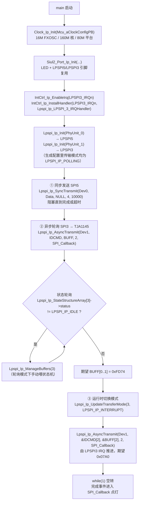
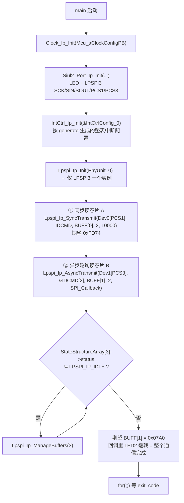

# SPI（LPSPI）— S32K344 RTD 0.9.0 实战教学

> 源工程（3 个）:
> - `D:\wnagjin\S32K3_mydetail\详细教学(1)\详细教学\S32K3 Training-RTD\S32DSv3p4_RTDv090\S32K344_LPSPI_Example_090_34`（LPSPI 基础收发：同步 + 异步轮询/中断 + 模式切换）
> - `D:\wnagjin\S32K3_mydetail\详细教学(1)\详细教学\S32K3 Training-RTD\S32DSv3p4_RTDv090\S32K344_LPSPI_Multiple_CS_090_34`（单 LPSPI 实例多片选 PCS1/PCS3）
> - `D:\wnagjin\S32K3_mydetail\详细教学(1)\详细教学\S32K3 Training-RTD\S32DSv3p4_RTDv090\S32K344_LPSPI_WithDMA_090_34`（DMA 搬运 + FastTransfer 散列传输）
>
> 源文件（代码原样摘录，未经任何修改）:
> - `...\S32K344_LPSPI_Example_090_34\src\main.c`（共 125 行）
> - `...\S32K344_LPSPI_Multiple_CS_090_34\src\main.c`（共 114 行）
> - `...\S32K344_LPSPI_WithDMA_090_34\src\main.c`（共 175 行）

## 1. 外设概述

S32K344 片上有 6 个 LPSPI（Low-Power SPI）实例，支持主/从模式、1~16 位帧、连续传输（CONT）、多片选（PCS0~PCS3）以及 DMA 触发。RTD 0.9.0（`S32K3_RTD_0_9_0__ASR_REL_4_4_REV_0000_20210326`）的驱动层为 `Lpspi_Ip`（裸 IP 驱动，非 AUTOSAR MCAL 的 `Spi` 抽象层），配置由 S32 Configuration Tool（S32_CT）生成到 `generate/src/Lpspi_Ip_BOARD_InitPeripherals_PBcfg.c`。

驱动核心配置分两层：

| 概念 | 结构体 | 说明 |
|---|---|---|
| 物理单元 | `Lpspi_Ip_ConfigType`（`Lpspi_Ip_PhyUnitConfig_SpiPhyUnit_x_BOARD_InitPeripherals`） | 一个 LPSPI 硬件实例一份：主从、PCSPOL、传输模式（轮询/中断）、DMA 通道绑定 |
| 外部设备 | `Lpspi_Ip_ExternalDeviceType`（`Lpspi_Ip_DeviceAttributes_SpiExternalDevice_x_BOARD_InitPeripherals`） | 挂在同一实例上的每颗芯片一份：波特率 CCR、CPOL/CPHA/PCS/CONT（TCR）、帧长/LSB |

三工程均运行在 S32K344-WB 板（16M FXOSC、160MHz 核心时钟、80MHz 平台时钟），SPI 功能时钟 80MHz。SCK 频率换算：`SCK = 功能时钟 / ((SCKDIV+2) × 2)`，例 SCKDIV=38 → 80M/80 = 1MHz。

三工程演示递进关系：**基础收发（同步/异步/模式切换）→ 一主多从（多 CS）→ DMA 卸载 CPU（含 FastTransfer 散列）**。

## 2. 工程一：S32K344_LPSPI_Example_090_34（基础收发）

- LPSPI5（PhyUnit_0 / Device_0）：PCS0、SCKDIV=38（1MHz）、CPOL=0/CPHA=1、CONT=0、Polling 模式，只发不收（`SyncTransmit`）。
- LPSPI3（PhyUnit_1 / Device_1）：PCS3、SCKDIV=18（2MHz）、CONT=1，接 TJA1145 CAN PHY，异步读 ID：先轮询模式收 `0xFD74`，再 `Lpspi_Ip_UpdateTransferMode` 切到中断模式收 `0x07A0`。
- 回调 `SPI_Callback` 按实例号点灯：instance 5 → LED1（PTF8）常亮，instance 3 → LED2（PTF9）翻转。

### 2.1 初始化与使用时序



### 2.2 main.c 原样代码

**文件头注释（第 1–33 行，来源：S32K344_LPSPI_Example_090_34）：**

```c
/*==================================================================================================
*   Project              : RTD AUTOSAR 4.4
*   Platform             : CORTEXM
*   Peripheral           : S32K3XX
*   Dependencies         : none
*
*   Autosar Version      : 4.4.0
*   Autosar Revision     : ASR_REL_4_4_REV_0000
*   Autosar Conf.Variant :
*   SW Version           : 0.9.0
*   Build Version        : S32K3_RTD_0_9_0__ASR_REL_4_4_REV_0000_20210326
*
*   (c) Copyright 2020 - 2021 NXP Semiconductors
*   All Rights Reserved.
*
*   NXP Confidential. This software is owned or controlled by NXP and may only be
*   used strictly in accordance with the applicable license terms. By expressly
*   accepting such terms or by downloading, installing, activating and/or otherwise
*   using the software, you are agreeing that you have read, and that you agree to
*   comply with and are bound by, such license terms. If you do not agree to be
*   bound by the applicable license terms, then you may not retain, install,
*   activate or otherwise use the software.
==================================================================================================*/


/*************************************************************************
 * S32K344-WB( schematic: SPF-47478 Rev.A ) SPI sample:sync/async transfer and SPI mode demo.
 * This example initialize the MCU clock: 16M FXOSC, 160MHz PLL for core and 80 MHz for platform.
 * The SPI5 is enable to realize a SPI synchronous transmission.(1Mhz,CPOL=0,CPHA=1,MSB)
 * The SPI3 is used to implement a SPI asynchronous transmission and provide a demo for mode switch function
 * (from polling to interrupt mode).
 * SPI3 connects TJA1145 CAN PHY.It could get data back from PHY.
 *************************************************************************/
```

**头文件与全局变量（第 35–58 行，来源：S32K344_LPSPI_Example_090_34）：**

```c
/* Including necessary configuration files. */
#include "Mcal.h"

/* User includes */
#include "Clock_Ip.h"
#include "Siul2_Port_Ip.h"
#include "Siul2_Dio_Ip.h"
#include "Siul2_Port_Ip_Cfg.h"
#include "IntCtrl_Ip_Cfg.h"
#include "IntCtrl_Ip.h"
#include "Lpspi_Ip.h"

volatile int exit_code = 0;
uint8_t times = 0,count = 0;
uint8_t IDCMD[4] = {0,0XFD,0,0X07};
uint16_t Data[4]={0x0011,0x0022,0x0033,0x0044};
uint8_t BUFF[8]={0};
uint8_t numberOfBytes = 4;
#define SPI_TIME_OUT 10000

extern Lpspi_Ip_StateStructureType* Lpspi_Ip_StateStructureArray[LPSPI_INSTANCE_COUNT];
extern void Lpspi_Ip_LPSPI_3_IRQHandler(void);
void SPI_Callback(uint8 u8Instance, Lpspi_Ip_EventType event);
Lpspi_Ip_StatusType Spi_Status;
```

**main 函数（第 59–101 行，来源：S32K344_LPSPI_Example_090_34）：**

```c
/*!
  \brief The main function for the project.
  \details The startup initialization sequence is the following:
 * - startup asm routine
 * - main()
*/
int main(void)
{
    /* Write your code here */
	Clock_Ip_Init(Mcu_aClockConfigPB); 	/*Initialize system clock and peripheral clock configuration*/
	Siul2_Port_Ip_Init(NUM_OF_CONFIGURED_PINS0, g_pin_mux_InitConfigArr0);

	IntCtrl_Ip_EnableIrq(LPSPI3_IRQn);												/* Enable IRQ*/
	IntCtrl_Ip_InstallHandler(LPSPI3_IRQn,Lpspi_Ip_LPSPI_3_IRQHandler, NULL_PTR);	/* Install ISR */

	Lpspi_Ip_Init(&Lpspi_Ip_PhyUnitConfig_SpiPhyUnit_0_BOARD_InitPeripherals);	 	/* Initialization SPI module 5 */
	Lpspi_Ip_Init(&Lpspi_Ip_PhyUnitConfig_SpiPhyUnit_1_BOARD_InitPeripherals);	 	/* Initialization SPI module 3 */

	/* 1.Synchronous transmission with SPI5. Don`t accept data */
	Lpspi_Ip_SyncTransmit(&Lpspi_Ip_DeviceAttributes_SpiExternalDevice_0_BOARD_InitPeripherals,(uint8*)Data, NULL, numberOfBytes, SPI_TIME_OUT);

	numberOfBytes = 2;
	/* 2.1 Asynchronous transmission in polling mode with SPI3 which is connected to TJA1145 PHY.Continuous transmission mode*/
	Lpspi_Ip_AsyncTransmit(&Lpspi_Ip_DeviceAttributes_SpiExternalDevice_1_BOARD_InitPeripherals,
							(uint8*)&IDCMD[0], &BUFF[0], numberOfBytes, SPI_Callback);		/* Start a SPI data transfer.
																					The expected data is 0xFD74. */

	/* 2.2 Handle asynchronous transfer event in polling mode */
	while(Lpspi_Ip_StateStructureArray[Lpspi_Ip_DeviceAttributes_SpiExternalDevice_1_BOARD_InitPeripherals.u8Instance]->status != LPSPI_IP_IDLE )
	{
		Lpspi_Ip_ManageBuffers(3);
	}

	/* 3.Asynchronous transmission in interrupt mode with the same SPI instance: SPI3 */
	Lpspi_Ip_UpdateTransferMode(3, LPSPI_IP_INTERRUPT);
	Spi_Status = Lpspi_Ip_AsyncTransmit(&Lpspi_Ip_DeviceAttributes_SpiExternalDevice_1_BOARD_InitPeripherals,
								(uint8*)&IDCMD[2], &BUFF[2], numberOfBytes, SPI_Callback);  /* Start a SPI data transfer
																					The expected data is 0X07A0 */

    while(1);

    return exit_code;
}
```

**传输完成回调（第 103–125 行，来源：S32K344_LPSPI_Example_090_34）：**

```c
/*********************************************************************************************/
/**
* @brief   SPI transfer event callback.
* @details It is only a demo.Registered in Lpspi_Ip_AsyncTransmit();
*
* @param[in]      u8Instance  	SPI instance
* @return         event         SPI transfer event type
* @implements  SPI_transfer_event_callback_function
*/
/*********************************************************************************************/
void SPI_Callback(uint8 u8Instance, Lpspi_Ip_EventType event)
{
	if(event == LPSPI_IP_EVENT_END_TRANSFER)
	{
		if(u8Instance == 5)
			Siul2_Dio_Ip_WritePin(LED1_PORT, LED1_PIN , 1U);  					/*Open LED1,LED1_PIN=PTF8*/
		else if (u8Instance == 3)
			Siul2_Dio_Ip_TogglePins(LED2_PORT, 1<<LED2_PIN);
	}

}

/** @} */
```

### 2.3 API 速查（工程一）

| API | 作用 | 关键参数 |
|---|---|---|
| `Clock_Ip_Init(Mcu_aClockConfigPB)` | 初始化系统/外设时钟 | PB 配置数组（board 目录生成） |
| `Siul2_Port_Ip_Init(count, arr)` | 引脚复用初始化 | 引脚数 + `g_pin_mux_InitConfigArr0` |
| `IntCtrl_Ip_EnableIrq(LPSPI3_IRQn)` | NVIC 使能 SPI3 中断 | IRQn 枚举 |
| `IntCtrl_Ip_InstallHandler(irq, isr, param)` | 安装 ISR | `Lpspi_Ip_LPSPI_3_IRQHandler` 为驱动内部中断入口 |
| `Lpspi_Ip_Init(cfg)` | 初始化一个 LPSPI 物理单元 | `Lpspi_Ip_PhyUnitConfig_SpiPhyUnit_x_BOARD_InitPeripherals` |
| `Lpspi_Ip_SyncTransmit(dev, tx, rx, len, timeout)` | 同步阻塞收发（发完/超时才返回） | rx 可为 NULL 只发；timeout=10000 |
| `Lpspi_Ip_AsyncTransmit(dev, tx, rx, len, cb)` | 异步启动一次传输 | dev 决定 PCS/波特率；cb 为完成回调 |
| `Lpspi_Ip_ManageBuffers(instance)` | 轮询模式下手动推进驱动状态机 | 实例号（此处硬编码 3） |
| `Lpspi_Ip_UpdateTransferMode(instance, mode)` | 运行时切换轮询/中断模式 | `LPSPI_IP_POLLING` / `LPSPI_IP_INTERRUPT` |

## 3. 工程二：S32K344_LPSPI_Multiple_CS_090_34（多片选）

一个 LPSPI3 实例挂两颗 TJA1145，用 PCS1 和 PCS3 分别选通。要点：**同一个物理单元只 Init 一次，片选归属放在 `Lpspi_Ip_ExternalDeviceType` 里**——Device_0 的 TCR 写 `LPSPI_TCR_PCS(1U)`，Device_1 写 `LPSPI_TCR_PCS(3U)`，收发时传入哪个 Device 结构体就自动拉哪个 CS。

- Device_0（PCS1）：`SyncTransmit` 同步读，期望 `0xFD74`。
- Device_1（PCS3）：`AsyncTransmit` 轮询模式读，期望 `0x07A0`，完成后 LED2（PTF9）翻转。
- 两设备波特率同 SCKDIV=38（1MHz）、CPOL=0/CPHA=1、帧长 16bit。
- 中断改用 `IntCtrl_Ip_Init(&IntCtrlConfig_0)` 整表初始化（对比工程一的手动单条安装）。

### 3.1 初始化与使用时序



### 3.2 main.c 原样代码

**文件头注释（第 1–31 行，来源：S32K344_LPSPI_Multiple_CS_090_34）：**

```c
/*==================================================================================================
*   Project              : RTD AUTOSAR 4.4
*   Platform             : CORTEXM
*   Peripheral           : S32K3XX
*   Dependencies         : none
*
*   Autosar Version      : 4.4.0
*   Autosar Revision     : ASR_REL_4_4_REV_0000
*   Autosar Conf.Variant :
*   SW Version           : 0.9.0
*   Build Version        : S32K3_RTD_0_9_0__ASR_REL_4_4_REV_0000_20210326
*
*   (c) Copyright 2020 - 2021 NXP Semiconductors
*   All Rights Reserved.
*
*   NXP Confidential. This software is owned or controlled by NXP and may only be
*   used strictly in accordance with the applicable license terms. By expressly
*   accepting such terms or by downloading, installing, activating and/or otherwise
*   using the software, you are agreeing that you have read, and that you agree to
*   comply with and are bound by, such license terms. If you do not agree to be
*   bound by the applicable license terms, then you may not retain, install,
*   activate or otherwise use the software.
==================================================================================================*/

/*************************************************************************
 * S32K344-WB( schematic: SPF-47478 Rev.A ) SPI use case:One SPI with multiple CS.
 * This example initialize the MCU clock: 16M FXOSC, 160MHz PLL for core and 80 MHz for platform.
 * On S32K344-WB,SPI3 connects two TJA1145 PHY chips.PCS1 and PCS3 are used to select the respective chips.
 * SPI parameters:CPOL=0,CPHA=1,PCSPOL=0,freq_SCK=1MHz,frame size=16.
 * PCS identification is depend on "Lpspi_Ip_ExternalDeviceType" structure.
 *************************************************************************/
```

**头文件与全局变量（第 33–54 行，来源：S32K344_LPSPI_Multiple_CS_090_34）：**

```c
/* Including necessary configuration files. */
#include "Mcal.h"

#include "Clock_Ip.h"
#include "Siul2_Port_Ip.h"
#include "Siul2_Dio_Ip.h"
#include "Siul2_Port_Ip_Cfg.h"
#include "IntCtrl_Ip_Cfg.h"
#include "IntCtrl_Ip.h"
#include "Lpspi_Ip.h"

volatile int exit_code = 0;
uint8 IDCMD[4]={0,0xFD,0,0x07};
uint8 BUFF[2][4]={{0},{0}};
uint8_t numberOfBytes =2;
#define SPI_TIME_OUT 10000

extern Lpspi_Ip_StateStructureType* Lpspi_Ip_StateStructureArray[LPSPI_INSTANCE_COUNT];
extern void Lpspi_Ip_LPSPI_3_IRQHandler(void);
void SPI_Callback(uint8 u8Instance, Lpspi_Ip_EventType event);

/* User includes */
```

**main 函数（第 56–93 行，来源：S32K344_LPSPI_Multiple_CS_090_34）：**

```c
/*!
  \brief The main function for the project.
  \details The startup initialization sequence is the following:
 * - startup asm routine
 * - main()
*/
int main(void)
{
    /* Write your code here */
	Clock_Ip_Init(Mcu_aClockConfigPB); 	/*Initialize system clock and peripheral clock configuration*/
	Siul2_Port_Ip_Init(NUM_OF_CONFIGURED_PINS0, g_pin_mux_InitConfigArr0);
	IntCtrl_Ip_Init(&IntCtrlConfig_0);	/* Set interrupt configuration */

	Lpspi_Ip_Init(&Lpspi_Ip_PhyUnitConfig_SpiPhyUnit_0_BOARD_InitPeripherals);	 	/* Initialization SPI module 3 */

	/* Synchronous transmission with SPI3_PCS1.The expected received data is 0xFD74.*/
	Lpspi_Ip_SyncTransmit(&Lpspi_Ip_DeviceAttributes_SpiExternalDevice_0_BOARD_InitPeripherals,
							(uint8*)IDCMD, BUFF[0], numberOfBytes, SPI_TIME_OUT);

	/* Asynchronous transmission in polling mode with SPI3_PCS3.The expected received data is 0x07A0. */
	Lpspi_Ip_AsyncTransmit(&Lpspi_Ip_DeviceAttributes_SpiExternalDevice_1_BOARD_InitPeripherals,
							(uint8*)&IDCMD[2], BUFF[1], numberOfBytes, SPI_Callback);		/* Start a SPI data transfer */

	/* Handle asynchronous transfer event in polling mode */
	while(Lpspi_Ip_StateStructureArray[Lpspi_Ip_DeviceAttributes_SpiExternalDevice_1_BOARD_InitPeripherals.u8Instance]->status != LPSPI_IP_IDLE )
	{
		Lpspi_Ip_ManageBuffers(3);
	}

    for(;;)
    {
        if(exit_code != 0)
        {
            break;
        }
    }
    return exit_code;
}
```

**传输完成回调（第 95–114 行，来源：S32K344_LPSPI_Multiple_CS_090_34）：**

```c
/*********************************************************************************************/
/**
* @brief   SPI transfer event callback.
* @details It is only a demo.Registered in Lpspi_Ip_AsyncTransmit();
*
* @param[in]      u8Instance  	SPI instance
* @return         event         SPI transfer event type
* @implements  SPI_transfer_event_callback_function
*/
/*********************************************************************************************/
void SPI_Callback(uint8 u8Instance, Lpspi_Ip_EventType event)
{
	(void)u8Instance;
	if(event == LPSPI_IP_EVENT_END_TRANSFER)
	{
		Siul2_Dio_Ip_TogglePins(LED2_PORT,1<<LED2_PIN);
	}

}
/** @} */
```

### 3.3 API 速查（工程二）

| API | 作用 | 关键参数 |
|---|---|---|
| `IntCtrl_Ip_Init(&IntCtrlConfig_0)` | 按 generate 整表初始化中断 | `IntCtrlConfig_0`（IntCtrl_Ip_Cfg.c 生成） |
| `Lpspi_Ip_Init(cfg)` | 初始化 LPSPI3 物理单元（一次即可） | 同一实例多设备不需重复 Init |
| `Lpspi_Ip_SyncTransmit(dev, tx, rx, len, timeout)` | PCS1 设备同步读 | 传 `DeviceAttributes_SpiExternalDevice_0` |
| `Lpspi_Ip_AsyncTransmit(dev, tx, rx, len, cb)` | PCS3 设备异步读 | 传 `DeviceAttributes_SpiExternalDevice_1` |
| `Lpspi_Ip_ManageBuffers(3)` | 轮询推进 | — |

## 4. 工程三：S32K344_LPSPI_WithDMA_090_34（DMA 搬运）

LPSPI2 经 eDMA 与 SJA1105Q 交换芯片通信（8 字节 ID 读，`SJA1105_ID_CMD[2]` 为 32bit×2 命令帧），另用 LPSPI5 演示 **FastTransfer**（`Lpspi_Ip_AsyncTransmitFast`）：把多段收发打成 DMA 散列表（Scatter/Gather）一次提交，CPU 零干预。

- DMA 通道绑定（PBcfg 生成）：LPSPI2 → TX `DMA_LOGIC_CH_0` / RX `DMA_LOGIC_CH_1`；LPSPI5 → TX `DMA_LOGIC_CH_2`（SG 5 项）/ RX `DMA_LOGIC_CH_3`（SG 2 项）。main.c 注释原文：`SG linking list length: TX 2*2+1=5;RX 2*1=2`。
- FastTransfer 列表 `aUserFastTransferCfgList[2]`：第 1 项发 `u8TxBuffer1` 前 2 字节（CONT=TRUE 保持 CS）；第 2 项只收 2 字节、`NULL_PTR` 发送缓冲、默认数据 `0xaaaa`（CONT=FALSE，收尾拉高 CS）。
- `LPSPI_IP_DMA_USED = STD_ON` 时驱动状态结构体放入 `SPI_START_SEC_VAR_NO_INIT_UNSPECIFIED_NO_CACHEABLE` 段（防 Cache 一致性问题）；ReadMe 依赖里列了 `Cache_Ip`。
- 初始化顺序多出：`IntCtrl_Ip_ConfigIrqRouting(&intRouteConfig)` → `IntCtrl_Ip_Init` → `DMA_Hw_Err_Clear()` → `Dma_Ip_Init(&Dma_Ip_xDmaInitPB)` → 两个 `Lpspi_Ip_Init`，再统一 `UpdateTransferMode(…, LPSPI_IP_INTERRUPT)`（DMA 依赖中断事件，不能停在轮询）。

### 4.1 初始化与使用时序

```mermaid
flowchart TD
    A[main 启动] --> B["Clock_Ip_Init + Siul2_Port_Ip_Init"]
    B --> C["IntCtrl_Ip_ConfigIrqRouting(&intRouteConfig)<br/>IntCtrl_Ip_Init(&IntCtrlConfig_0)<br/>（DMA 中断路由 + NVIC 配置）"]
    C --> D["DMA_Hw_Err_Clear()<br/>检查 EDMA->ES，逐通道 DMA_IP_CH_CLEAR_ERROR"]
    D --> E["Dma_Ip_Init(&Dma_Ip_xDmaInitPB)<br/>初始化 DMA + 逻辑通道 0~3"]
    E --> F["Lpspi_Ip_Init(PhyUnit_0) → LPSPI2<br/>UpdateTransferMode(2, LPSPI_IP_INTERRUPT)"]
    F --> G["Lpspi_Ip_AsyncTransmit(Dev0, SJA1105_ID_CMD,<br/>SJA1105_ID_RECV, 8, SPI_Callback)<br/>SPI HW 触发 DMA 搬运，读 SJA1105 ID"]
    G --> H["Lpspi_Ip_Init(PhyUnit_1) → LPSPI5<br/>UpdateTransferMode(5, LPSPI_IP_INTERRUPT)"]
    H --> I["Lpspi_Ip_AsyncTransmitFast(aUserFastTransferCfgList, 2, &SPI_Callback)<br/>DMA Scatter/Gather 一次执行两段传输"]
    I --> J["for 死循环等 exit_code"]
    G -. "DMA ISR 内检查 state->rxIndex 判完成" .-> K["SPI_Callback<br/>instance 2 → LED1 亮<br/>instance 5 → LED2 亮"]
    I -. .-> K
```

### 4.2 main.c 原样代码

**文件头注释（第 1–31 行，来源：S32K344_LPSPI_WithDMA_090_34）：**

```c
/*==================================================================================================
*   Project              : RTD AUTOSAR 4.4
*   Platform             : CORTEXM
*   Peripheral           : S32K3XX
*   Dependencies         : none
*
*   Autosar Version      : 4.4.0
*   Autosar Revision     : ASR_REL_4_4_REV_0000
*   Autosar Conf.Variant :
*   SW Version           : 0.9.0
*   Build Version        : S32K3_RTD_0_9_0__ASR_REL_4_4_REV_0000_20210326
*
*   (c) Copyright 2020 - 2021 NXP Semiconductors
*   All Rights Reserved.
*
*   NXP Confidential. This software is owned or controlled by NXP and may only be
*   used strictly in accordance with the applicable license terms. By expressly
*   accepting such terms or by downloading, installing, activating and/or otherwise
*   using the software, you are agreeing that you have read, and that you agree to
*   comply with and are bound by, such license terms. If you do not agree to be
*   bound by the applicable license terms, then you may not retain, install,
*   activate or otherwise use the software.
==================================================================================================*/

/*************************************************************************
 * S32K344-WB( schematic: SPF-47478 Rev.A ) SPI use case:SPI with DMA.
 * This example initialize the MCU clock: 16M FXOSC, 160MHz PLL for core and 80 MHz for platform.
 * On S32K344-WB,SPI2 connects SJA1105 switch chip.
 * SPI parameters:CPOL=0,CPHA=1,PCSPOL=0,Freq_SCK=1MHz,Continuous transmission mode,frame size=32.
 * SPI HW trigger DMA to exchange data with SJA115,and then check state->rxIndex to complete whole transfer process in DMA ISR.
 *************************************************************************/
```

**头文件、全局变量与 FastTransfer 配置（第 33–79 行，来源：S32K344_LPSPI_WithDMA_090_34）：**

```c
/* Including necessary configuration files. */
#include "Mcal.h"

#include "Clock_Ip.h"
#include "Siul2_Port_Ip.h"
#include "Siul2_Dio_Ip.h"
#include "Siul2_Port_Ip_Cfg.h"
#include "IntCtrl_Ip_Cfg.h"
#include "IntCtrl_Ip.h"

#include "Lpspi_Ip.h"

#include "Dma_Ip.h"
#include "Dma_Ip_Irq.h"

volatile int exit_code = 0;
uint32_t SJA1105_ID_CMD[2u] = {0x02000000,0x00000000};
uint32_t SJA1105_ID_RECV[2]={0};
uint8_t numberOfBytes = 8;
//fast
uint8 u8TxBuffer1[6u]={1,2,3,4,5,6};
uint8 u8RxBuffer1[6u];
uint8 u8RxBuffer2[6u];
Lpspi_Ip_FastTransferType aUserFastTransferCfgList[2u] =
{
	{
		&Lpspi_Ip_DeviceAttributes_SpiExternalDevice_1_BOARD_InitPeripherals,
		u8TxBuffer1,
		u8RxBuffer1,
		0u,				/* default data */
		2u,				/* length */
		(boolean)TRUE	/* CONT */
	},
	{
		&Lpspi_Ip_DeviceAttributes_SpiExternalDevice_1_BOARD_InitPeripherals,
		NULL_PTR,
		u8RxBuffer2,
		0xaaaa,
		2u,
		(boolean)FALSE
	}
};
/* User includes */
extern void Dma0_Ch1_IRQHandler(void);
extern void Dma0_Ch17_IRQHandler(void);
uint8_t DMA_Hw_Err_Clear(void);
void SPI_Callback(uint8 u8Instance, Lpspi_Ip_EventType event);
```

**main 函数（第 80–120 行，来源：S32K344_LPSPI_WithDMA_090_34）：**

```c
/*!
  \brief The main function for the project.
  \details The startup initialization sequence is the following:
 * - startup asm routine
 * - main()
*/
int main(void)
{
    /* Write your code here */
	Clock_Ip_Init(Mcu_aClockConfigPB); 		/*Initialize system clock and peripheral clock configuration*/
	Siul2_Port_Ip_Init(NUM_OF_CONFIGURED_PINS0, g_pin_mux_InitConfigArr0);

	IntCtrl_Ip_ConfigIrqRouting(&intRouteConfig);	/* Mapping interrupt vector and installing ISR */
	IntCtrl_Ip_Init(&IntCtrlConfig_0);				/* Setting interrupt configuration */

	DMA_Hw_Err_Clear();								/* Clear DMA error flag if necessary. */
	Dma_Ip_Init(&Dma_Ip_xDmaInitPB); 				/* Initialize DMA module */

	Lpspi_Ip_Init(&Lpspi_Ip_PhyUnitConfig_SpiPhyUnit_0_BOARD_InitPeripherals);	 				/* Initialization SPI module */
	Lpspi_Ip_UpdateTransferMode(Lpspi_Ip_PhyUnitConfig_SpiPhyUnit_0_BOARD_InitPeripherals.u8Instance,
								LPSPI_IP_INTERRUPT);											/* Interrupt mode */

	Lpspi_Ip_AsyncTransmit(&Lpspi_Ip_DeviceAttributes_SpiExternalDevice_0_BOARD_InitPeripherals,
							(uint8_t*)SJA1105_ID_CMD, (uint8_t*)SJA1105_ID_RECV, numberOfBytes, SPI_Callback);	/* Start a SPI data transfer */


	/* SPI Fast transfer test. You need configure DMA S/G firstly.SG linking list length: TX 2*2+1=5;RX 2*1=2*/
	Lpspi_Ip_Init(&Lpspi_Ip_PhyUnitConfig_SpiPhyUnit_1_BOARD_InitPeripherals);					/* SPI5 for Fast transfer test */
	Lpspi_Ip_UpdateTransferMode(Lpspi_Ip_PhyUnitConfig_SpiPhyUnit_1_BOARD_InitPeripherals.u8Instance,LPSPI_IP_INTERRUPT);
	Lpspi_Ip_AsyncTransmitFast(aUserFastTransferCfgList, 2u, &SPI_Callback);					/* SPI5 for Fast transfer test */


    for(;;)
    {
        if(exit_code != 0)
        {
            break;
        }
    }
    return exit_code;
}
```

**DMA 错误清理函数（第 122–143 行，来源：S32K344_LPSPI_WithDMA_090_34）：**

```c
/*********************************************************************************************/
/**
* @brief   DMA Error status check and clear function.
* @details Check error register status of DMA module and clear error flag of the corresponding channel.
*
* @param[in]      None
* @return         ch
* @implements  DMA_Error_Sataus_Check_Clear_function
*/
/*********************************************************************************************/
uint8_t DMA_Hw_Err_Clear(void)
{
	int ch = 0;
	if(EDMA->ES & eDMA_ES_VLD_MASK)
	{
		for(;ch<32;ch++)
		{
			Dma_Ip_SetLogicChannelCommand(ch, DMA_IP_CH_CLEAR_ERROR);
		}
	}
	return ch;
}
```

**传输完成回调（第 145–175 行，来源：S32K344_LPSPI_WithDMA_090_34）：**

```c
/*********************************************************************************************/
/**
* @brief   SPI transfer event callback.
* @details It is only a demo.Registered in Lpspi_Ip_AsyncTransmit();
*
* @param[in]      u8Instance  	SPI instance
* @return         event         SPI transfer event type
* @implements  SPI_transfer_event_callback_function
*/
/*********************************************************************************************/
void SPI_Callback(uint8 u8Instance, Lpspi_Ip_EventType event)
{
	if(u8Instance == 2)
	{
		if(event == LPSPI_IP_EVENT_END_TRANSFER)
		{
			Siul2_Dio_Ip_WritePin(LED1_PORT,LED1_PIN,1);
		}
	}
	else if(u8Instance == 5)
	{
		Siul2_Dio_Ip_WritePin(LED2_PORT,LED2_PIN,1);
	}
	else
	{

	}

}

/** @} */
```

### 4.3 API 速查（工程三）

| API | 作用 | 关键参数 |
|---|---|---|
| `IntCtrl_Ip_ConfigIrqRouting(&intRouteConfig)` | DMA 中断路由映射并安装 ISR | `intRouteConfig`（IntCtrl_Ip_Cfg.c 生成） |
| `Dma_Ip_Init(&Dma_Ip_xDmaInitPB)` | 初始化 eDMA 及逻辑通道 | 通道配置数组（Dma_Ip_BOARD_InitPeripherals_PBcfg.c） |
| `Dma_Ip_SetLogicChannelCommand(ch, DMA_IP_CH_CLEAR_ERROR)` | 清通道错误标志 | 逻辑通道号 |
| `Lpspi_Ip_AsyncTransmit(dev, tx, rx, len, cb)` | DMA 触发的异步收发 | dev 的 PhyUnit 已绑定 tx/rx DMA 通道 |
| `Lpspi_Ip_AsyncTransmitFast(list, n, cb)` | 多段传输一次提交（DMA Scatter/Gather） | `Lpspi_Ip_FastTransferType` 数组：dev/txBuf/rxBuf/默认数据/长度/CONT |
| `Lpspi_Ip_UpdateTransferMode(inst, LPSPI_IP_INTERRUPT)` | DMA 场景必须切中断模式 | — |

## 5. 三工程差异对比

| 维度 | LPSPI_Example | Multiple_CS | WithDMA |
|---|---|---|---|
| 使用实例 | LPSPI5 + LPSPI3 | 仅 LPSPI3 | LPSPI2 + LPSPI5 |
| 外部设备数 | 2（每实例 1 个） | 2（同实例，PCS1/PCS3） | 3（Dev0@SPI2，Dev1/Dev2@SPI5） |
| 片选 | PCS0 / PCS3 | PCS1 + PCS3（核心卖点） | PCS0 |
| 传输方式 | Sync + Async 轮询 + Async 中断（模式切换演示） | Sync + Async 轮询 | Async DMA + AsyncTransmitFast（SG 散列） |
| 帧长 | 16bit | 16bit | 16bit（SJA1105 命令按 32bit 字组织，见 SJA1105_ID_CMD[2]） |
| 波特率（SCKDIV） | Dev0=38(1MHz)，Dev1=18(2MHz) | 38(1MHz) / 38(1MHz) | SPI2=38(1MHz)，SPI5 Dev1=38、Dev2=18 |
| 中断装配 | 手动 `EnableIrq`+`InstallHandler`（仅 LPSPI3） | `IntCtrl_Ip_Init` 整表 | `ConfigIrqRouting`+`Init` 整表（含 DMA 通道中断） |
| 额外依赖 | IntCtrl | IntCtrl | Dma_Ip + Cache_Ip + IntCtrl |
| 对端器件 | TJA1145 CAN PHY | 两颗 TJA1145 | SJA1105Q 交换芯片 |
| CPU 占用 | 轮询段忙等（ManageBuffers 喂状态机） | 同左 | 传输全程零 CPU，DMA ISR 判 `state->rxIndex` |

## 6. 配置生成物（board/generate）

每个工程根下 `board/`（时钟、引脚）+ `generate/`（外设 PB 配置）由 S32_CT 从 `.mex` 生成，**不手改**：

| 工程 | 关键生成文件 | 要点 |
|---|---|---|
| LPSPI_Example | `generate/src/Lpspi_Ip_BOARD_InitPeripherals_PBcfg.c` | Dev0：Inst 5、`SCKDIV(38)`、`PCS(0)`、`CONT(0)`；Dev1：Inst 3、`SCKDIV(18)`、`PCS(3)`、`CONT(1)`；两 PhyUnit 均 `LPSPI_IP_POLLING`（中断模式靠 main 里 `UpdateTransferMode` 运行时切） |
| Multiple_CS | 同名文件 | Dev0：Inst 3、`PCS(1U)`；Dev1：Inst 3、`PCS(3U)`；`Lpspi_Ip_StateStructure[1U]` 只有一份状态 |
| WithDMA | `Lpspi_Ip_BOARD_InitPeripherals_PBcfg.c` + `Dma_Ip_BOARD_InitPeripherals_PBcfg.c` | PhyUnit_0(SPI2)：`(boolean)TRUE` + `DMA_LOGIC_CH_0`(tx)/`DMA_LOGIC_CH_1`(rx)；PhyUnit_1(SPI5)：`DMA_LOGIC_CH_2/3` + `u8NumOfDmaFastTransfer=2U` + Tx SG Id 列表 5 项 / Rx SG Id 列表 2 项；DMA 侧生成 `LogicChannel0~3ConfigPB` 与 `Dma_Ip_xDmaInitPB` |

公共生成物：`board/Clock_Ip_Cfg.c|h`、`board/Clock_Ip_PBcfg.c|h`（时钟树）、`board/Siul2_Port_Ip_Cfg.c|h`（引脚复用；`LED1_PIN 8u / LED1_PORT PTF_L_HALF`、`LED2_PIN 9u / LED2_PORT PTF_L_HALF` 定义于该头文件第 55–58 行）、`generate/src/IntCtrl_Ip_Cfg.c`、`generate/src/OsIf_Cfg.c`。

## 7. 常见坑（仅实证的）

1. **轮询模式必须自己喂状态机**：`LPSPI_IP_POLLING` 下 `AsyncTransmit` 启动后不会自己跑完，必须在 while 循环里调 `Lpspi_Ip_ManageBuffers(instance)`，直到 `Lpspi_Ip_StateStructureArray[inst]->status == LPSPI_IP_IDLE`（工程一 87–90 行、工程二 80–83 行）。忘了调就是死等。
2. **PBcfg 里默认是 POLLING，中断要在代码里切**：三个工程生成配置的 Transfer mode 都是 `LPSPI_IP_POLLING`。要用中断必须 `Lpspi_Ip_UpdateTransferMode` 切换，且提前 `IntCtrl_Ip_EnableIrq + InstallHandler` 装好 `Lpspi_Ip_LPSPI_x_IRQHandler`（工程一 71–72 行、工程三 99–100 行）。
3. **`Lpspi_Ip_ManageBuffers(3)` 的参数是实例号不是设备号**：多设备共用一个实例时轮询喂的是实例号（工程一/二都硬编码 3）。换成别的 LPSPI 实例时这里要跟着改，否则状态机不动。
4. **两种 NULL 语义**：只发不收时 rx 传 NULL 合法（工程一 78 行）；DMA FastTransfer 里"只收不发"用 `NULL_PTR` 的 tx 缓冲 + 默认发送数据 `0xaaaa`（工程三 68–70 行），不能混用思路。
5. **CONT 位与 CS 保持时机**：`LPSPI_TCR_CONT(1U)` 连续传输期间 CS 保持有效，整批数据结束后才释放；分两次 `AsyncTransmit` 之间 CS 会断开，对要求单次片选内完成命令+数据的芯片（如 SJA1105）要靠 CONT 或 FastTransfer 的 SG 链衔接（工程三 64 行 `CONT=TRUE`、72 行 `FALSE` 收尾）。
6. **DMA 版本先清错误再初始化**：`Dma_Ip_Init` 前调 `DMA_Hw_Err_Clear()` 清 `EDMA->ES` 残留错误（工程三 95 行）；且 DMA 场景传输模式必须切 `LPSPI_IP_INTERRUPT`，留在 POLLING 时 DMA 中断事件无人消费。
7. **Cache 一致性**：`LPSPI_IP_DMA_USED == STD_ON` 时驱动把状态结构放进 `NO_CACHEABLE` 段（PBcfg 122–137 行 MemMap 分段切换）；若自建 DMA 缓冲区且开了 D-Cache，缓冲同样需要非缓存或手动 invalidate——工程 ReadMe 明确依赖 `Cache_Ip`。
8. **多设备不必重复 Init**：同一 LPSPI 实例挂多颗芯片只 `Lpspi_Ip_Init` 一次，切换从设备只是换传入的 `Lpspi_Ip_ExternalDeviceType` 指针（工程二 69 行只 Init 一次，72/76 行分别传 Dev0/Dev1）。
