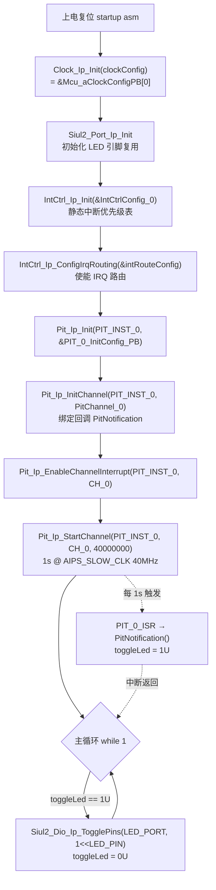
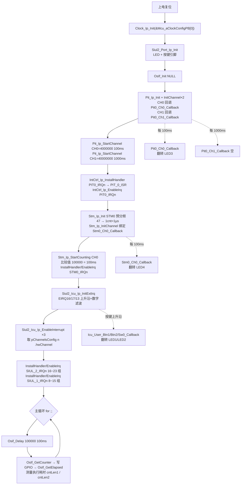
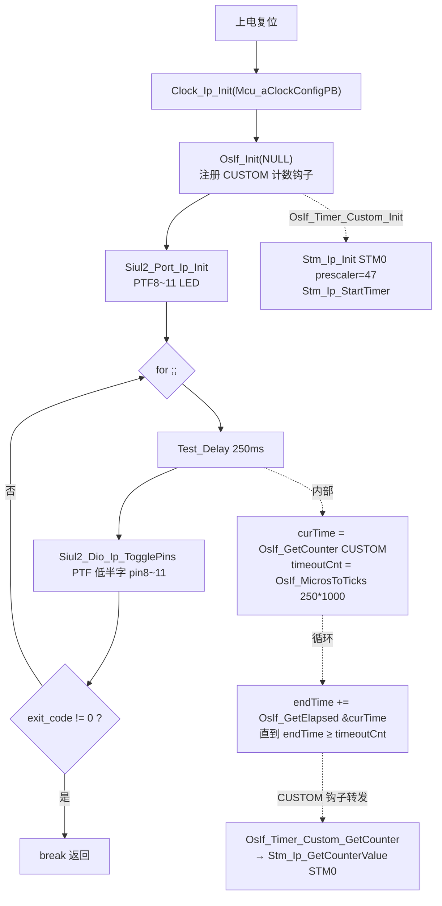

# 中断与定时 — S32K344 RTD 0.9.0 实战教学

> 源工程:
> - `D:\wnagjin\S32K3_mydetail\详细教学(1)\详细教学\S32K3 Training-RTD\S32DSv3p4_RTDv090\S32K344_INTCTRL_Example_090_34`
> - `D:\wnagjin\S32K3_mydetail\详细教学(1)\详细教学\S32K3 Training-RTD\S32DSv3p4_RTDv090\S32K344_SIUL2_ICU_PIT_STM_Example_090_34`
> - `D:\wnagjin\S32K3_mydetail\详细教学(1)\详细教学\S32K3 Training-RTD\S32DSv3p4_RTDv090\S32K344_OSIF_Example_090_34`
>
> 源文件（代码原样摘录，未经任何修改）:
> - `...\S32K344_INTCTRL_Example_090_34\src\main.c`（全文 139 行）
> - `...\S32K344_SIUL2_ICU_PIT_STM_Example_090_34\src\main.c`（全文 197 行）
> - `...\S32K344_OSIF_Example_090_34\src\main.c`（全文 159 行）

## 1. 概述

本篇合并 S32K344 RTD 0.9.0（S32DS v3.4 + S32_CT 生成）中"中断与定时"主题的 3 个官方示例：

| 工程 | 演示外设 | 现象 |
| --- | --- | --- |
| S32K344_INTCTRL_Example_090_34 | IntCtrl_Ip（中断控制器）+ PIT | PIT0_CH0 每 1s 中断，回调置标志，主循环翻转 LED（IntCtrl **静态配置**路径：`Init` + `ConfigIrqRouting`） |
| S32K344_SIUL2_ICU_PIT_STM_Example_090_34 | SIUL2 ICU（外部中断）+ PIT + STM + IntCtrl | PIT 两通道 100ms/1000ms、STM 比较中断 100ms 各自翻转 LED；按键（外部中断）翻转对应 LED；主循环用 OsIf 做 100ms 延时和代码耗时测量（IntCtrl **动态安装**路径：`InstallHandler` + `EnableIrq`） |
| S32K344_OSIF_Example_090_34 | OsIf（操作系统抽象层） | `OSIF_COUNTER_CUSTOM` 模式：用户实现 5 个 `OsIf_Timer_Custom_*` 钩子挂到 STM0，`Test_Delay(250)` 阻塞 250ms 后翻转 PTF8~11 LED |

三者关系一句话：**ICU 管外部引脚中断（EXTI），PIT/STM 管片上定时，OsIf 管延时与耗时测量；IntCtrl_Ip 是它们进入 NVIC 的公共管理层**（详见第 5 节实证）。

---

## 2. 工程一：S32K344_INTCTRL_Example_090_34（IntCtrl_Ip 中断控制器）

### 2.1 要点

- PIT0 通道 0 配 1s 周期（`PIT_PERIOD 40000000`，PIT 时钟 AIPS_SLOW_CLK 40MHz），中断回调 `PitNotification` 只置 `toggleLed = 1U`，LED 翻转放在主循环做。
- IntCtrl 走静态配置：`IntCtrl_Ip_Init(&IntCtrlConfig_0)` + `IntCtrl_Ip_ConfigIrqRouting(&intRouteConfig)`，两个结构体都由 S32_CT 生成在 `generate\src\IntCtrl_Ip_Cfg.c`（`IntCtrlConfig_0` 在 L198、`intRouteConfig` 在 L360）。
- PIT 通道配置 `PitChannel_0` 与回调 `PitNotification` 的绑定生成在 `generate\src\Pit_Ip_BOARD_InitPeripherals_PBcfg.c`（L112~L123）。

### 2.2 初始化与使用时序



### 2.3 main.c 原样代码

来源：`S32K344_INTCTRL_Example_090_34\src\main.c`，全文 139 行，按逻辑分块，块间行号连续无缝隙。

**[L1-L30] 文件头与头文件**

```c
/*
*   (c) Copyright 2020 NXP
*
*   NXP Confidential. This software is owned or controlled by NXP and may only be used strictly
*   in accordance with the applicable license terms.  By expressly accepting
*   such terms or by downloading, installing, activating and/or otherwise using
*   the software, you are agreeing that you have read, and that you agree to
*   comply with and are bound by, such license terms.  If you do not agree to
*   be bound by the applicable license terms, then you may not retain,
*   install, activate or otherwise use the software.
*
*   This file contains sample code only. It is not part of the production code deliverables.
*/

#ifdef __cplusplus
extern "C" {
#endif


/*==================================================================================================
*                                        INCLUDE FILES
* 1) system and project includes
* 2) needed interfaces from external units
* 3) internal and external interfaces from this unit
==================================================================================================*/
#include "Pit_Ip.h"
#include "Clock_Ip.h"
#include "IntCtrl_Ip.h"
#include "Siul2_Port_Ip.h"
#include "Siul2_Dio_Ip.h"
```

**[L32-L68] 宏定义与全局变量**

```c
/*==================================================================================================
*                          LOCAL TYPEDEFS (STRUCTURES, UNIONS, ENUMS)
==================================================================================================*/


/*==================================================================================================
*                                       LOCAL MACROS
==================================================================================================*/
/* PIT instance used - 0 */
#define PIT_INST_0 0U
/* PIT Channel used - 0 */
#define CH_0 0U
/* PIT time-out period - equivalent to 1s */
#define PIT_PERIOD 40000000

#define clockConfig &Mcu_aClockConfigPB[0]

/*==================================================================================================
*                                      LOCAL CONSTANTS
==================================================================================================*/


/*==================================================================================================
*                                      LOCAL VARIABLES
==================================================================================================*/


/*==================================================================================================
*                                      GLOBAL CONSTANTS
==================================================================================================*/


/*==================================================================================================
*                                      GLOBAL VARIABLES
==================================================================================================*/
/* Global flag updated in interrupt */
volatile uint8 toggleLed = 0U;
```

**[L70-L91] 中断回调**

```c
/*==================================================================================================
*                                   LOCAL FUNCTION PROTOTYPES
==================================================================================================*/


/*==================================================================================================
*                                       LOCAL FUNCTIONS
==================================================================================================*/


/*==================================================================================================
*                                       GLOBAL FUNCTIONS
==================================================================================================*/

/**
* @brief        Pit notification called by the configured channel periodically
* @details      Used to blink a led
*/
void PitNotification(void)
{
    toggleLed = 1U;
}
```

**[L93-L139] main 函数**

```c

/**
* @brief        Main function of the example
* @details      Initialize the used drivers and uses the Pit
*               and Dio drivers to toggle a LED periodically
*/
int main (void)
{
	/* Initial Clock */
	Clock_Ip_Init(clockConfig);
	/*Initial Pin */
	Siul2_Port_Ip_Init(NUM_OF_CONFIGURED_PINS0, g_pin_mux_InitConfigArr0);
	/*Initial ISR*/
	IntCtrl_Ip_Init(&IntCtrlConfig_0);

	IntCtrl_Ip_ConfigIrqRouting(&intRouteConfig);
	/*Initial PIT instance 0 - Channel 0*/
	Pit_Ip_Init(PIT_INST_0, &PIT_0_InitConfig_PB);
	/*Initial channel 0 */
	Pit_Ip_InitChannel(PIT_INST_0, PitChannel_0);
	/*Enable channel interrupt PIT_0 - CH_0*/
	Pit_Ip_EnableChannelInterrupt(PIT_INST_0, CH_0);
	/*Start channel CH_0*/
	Pit_Ip_StartChannel(PIT_INST_0, CH_0, PIT_PERIOD);
	/*Waiting for Interrupt occurred */
	while (1)
    {
        /* Toggle the LED when the Pit notification is called */
        if (toggleLed == 1U)
        {
        	/*Led toggle - blink a led*/
        	Siul2_Dio_Ip_TogglePins(LED_PORT, (1<<LED_PIN));

            toggleLed = 0U;
        }
    }
	return 0;
}


#ifdef __cplusplus
}
#endif

/** @} */
```

### 2.4 API 速查

| API | 作用 | 关键参数 |
| --- | --- | --- |
| `IntCtrl_Ip_Init(const IntCtrl_Ip_CtrlConfigType * ctrlConfigPtr)` | 按生成表初始化中断控制器（优先级等） | `&IntCtrlConfig_0`：`generate\src\IntCtrl_Ip_Cfg.c` L198 |
| `IntCtrl_Ip_ConfigIrqRouting(const IntCtrl_Ip_GlobalRouteConfigType * routeConfigPtr)` | 按生成表使能各 IRQ 的路由/目标核 | `&intRouteConfig`：`generate\src\IntCtrl_Ip_Cfg.c` L360 |
| `Pit_Ip_Init(uint8 instance, const Pit_Ip_InstanceConfigType * config)` | 初始化 PIT 实例 | `PIT_INST_0`=0；`&PIT_0_InitConfig_PB` |
| `Pit_Ip_InitChannel(uint8 instance, Pit_Ip_ChannelConfigType * config)` | 初始化并绑定通道回调 | `PitChannel_0`（回调 `PitNotification` 在 PBcfg L123） |
| `Pit_Ip_EnableChannelInterrupt(uint8 instance, uint8 channel)` | 使能通道中断 | `CH_0`=0 |
| `Pit_Ip_StartChannel(uint8 instance, uint8 channel, uint32 ticks)` | 启动周期计数 | `PIT_PERIOD`=40000000 tick = 1s @40MHz |
| `Siul2_Dio_Ip_TogglePins(GPIO_port_t port, uint32 pins)` | 翻转指定端口引脚 | `LED_PORT`/`LED_PIN` 来自 `Siul2_Dio_Ip_Cfg.h` |

---

## 3. 工程二：S32K344_SIUL2_ICU_PIT_STM_Example_090_34（ICU 外部中断 + PIT + STM）

### 3.1 要点

- **PIT**：两通道，CH0 100ms（4000000 tick）、CH1 1000ms（40000000 tick），时钟 AIPS_SLOW_CLK 40MHz（main.c L137/L140 注释实证）。
- **STM**：预分频 47（PBcfg 实证 `47U`），即 ÷48；STM 时钟默认 FIRC 48MHz → 1 计数 = 1µs（main.c L149 注释实证）。比较通道 0 装载 100000 → 100ms 中断。
- **ICU（EXTI）**：3 路外部中断 EIRQ16、EIRQ17、EIRQ13，全部上升沿 + 数字滤波（filter 值 3，预分频 2，PBcfg 实证）。EIRQ16~23 共用 `SIUL_2_IRQn`，EIRQ8~15 共用 `SIUL_1_IRQn`，须分别装组 ISR。
- **IntCtrl 动态路径**：`IntCtrl_Ip_InstallHandler(irqId, handler, param)` + `IntCtrl_Ip_EnableIrq(irqId)`，共 4 组（PIT0、STM0、SIUL_1、SIUL_2）。
- **主循环**：`Osif_Delay(100000)`（自实现，基于 `OsIf_MicrosToTicks`/`OsIf_GetCounter`/`OsIf_GetElapsed` 的 SYSTEM 计数源）100ms 延时，并用 `OsIf_GetCounter` + `OsIf_GetElapsed` 测量两条 GPIO 写操作的耗时。

### 3.2 初始化与使用时序



### 3.3 main.c 原样代码

来源：`S32K344_SIUL2_ICU_PIT_STM_Example_090_34\src\main.c`，全文 197 行，按逻辑分块，块间行号连续无缝隙。

**[L1-L45] 文件头与头文件**

```c
/*==================================================================================================
*   Project              : RTD AUTOSAR 4.4
*   Platform             : CORTEXM
*   Peripheral           : S32K3XX
*   Dependencies         : none
*
*   Autosar Version      : 4.4.0
*   Autosar Revision     : ASR_REL_4_4_REV_0000
*   Autosar Conf.Variant :
*   SW Version           : 0.9.0
*   Build Version        : S32K3_RTD_0_9_0__ASR_REL_4_4_REV_0000_20210326
*
*   (c) Copyright 2020 - 2021 NXP Semiconductors
*   All Rights Reserved.
*
*   NXP Confidential. This software is owned or controlled by NXP and may only be
*   used strictly in accordance with the applicable license terms. By expressly
*   accepting such terms or by downloading, installing, activating and/or otherwise
*   using the software, you are agreeing that you have read, and that you agree to
*   comply with and are bound by, such license terms. If you do not agree to be
*   bound by the applicable license terms, then you may not retain, install,
*   activate or otherwise use the software.
==================================================================================================*/

/**
*   @file main.c
*
*   @addtogroup main_module main module documentation
*   @{
*   Examples of using the following RTD SDK modules:
*   Siul2_Icu, Siul2_Dio, PIT, STM, Clock, OsIf timer;
*   This example runs on S32K344 White Board when using "XXXX_WB.mex".
*   This example runs on S32K344 EVB when using "XXXX_EVB.mex".
*/

/* Including necessary configuration files. */
#include "Mcal.h"
#include "Siul2_Port_Ip.h"
#include "Siul2_Dio_Ip.h"
#include "Clock_Ip.h"
#include "Intctrl_Ip.h"
#include "Siul2_Icu_Ip.h"
#include "Pit_Ip.h"
#include "Stm_Ip.h"
#include "OsIf.h"
```

**[L47-L98] 宏、ISR 声明、全局变量与回调**

```c
/*************************************************************************
 * Macro definitions
 *************************************************************************/
#define PIT0_INST	0
#define PIT0_CH0	0
#define PIT0_CH1	1

#define STM0_INST	0
#define STM0_CH0	0

/*************************************************************************
 * External Variables and Functions
 *************************************************************************/
ISR(STM_0_ISR);
ISR(PIT_0_ISR);
ISR(SIUL2_EXT_IRQ_16_23_ISR);
ISR(SIUL2_EXT_IRQ_8_15_ISR);

/*************************************************************************
 * Global Variables
 *************************************************************************/
uint32_t myCnt = 0;
uint32_t myTimeout = 0;
uint32_t cntStart1, cntLen1, cntStart2, cntLen2;
uint32_t cntLoop = 0;

/********************************************************************************
 * Callback function or Notification Function
 ********************************************************************************/
void Stm0_Ch0_Callback(uint8 channel){
	(void)channel;
	Siul2_Dio_Ip_TogglePins(LED4_PORT, (1<<LED4_PIN));
}

void Pit0_Ch0_Callback(uint8 channel){
	(void)channel;
	Siul2_Dio_Ip_TogglePins(LED3_PORT, (1<<LED3_PIN));
}

void Pit0_Ch1_Callback(uint8 channel){
	(void)channel;
}

void Icu_User_Btn1_Callback(void){
	Siul2_Dio_Ip_TogglePins(LED1_PORT, (1<<LED1_PIN));
	return;
}

void Icu_User_Btn2_Callback(void){
	Siul2_Dio_Ip_TogglePins(LED2_PORT, (1<<LED2_PIN));
	return;
}
```

**[L100-L114] 基于 OsIf 的微秒延时实现**

```c
/* EVB SIUL2 IRQ13 notification - PTB26 rising edge */
void Icu_User_Sw0_Callback(void){
	Siul2_Dio_Ip_TogglePins(LED1_PORT, (1<<LED1_PIN));
}

/* delay micro seconds using CPU systick counter */
void Osif_Delay(uint32_t microSec){
	uint32_t cntTicks;
	uint32_t cntRef, cntTimeout=0;
	cntTicks = OsIf_MicrosToTicks(microSec, OSIF_COUNTER_SYSTEM);
	cntRef = OsIf_GetCounter(OSIF_COUNTER_SYSTEM);
	while(cntTimeout < cntTicks){
		cntTimeout += OsIf_GetElapsed(&cntRef, OSIF_COUNTER_SYSTEM);
	}
}
```

**[L116-L197] main 函数**

```c
/*!
  \brief The main function for the project.
  \details The startup initialization sequence is the following:
 * - startup asm routine
 * - main()
*/
int main(void)
{
	/* Clock initialization */
	Clock_Ip_Init(&Mcu_aClockConfigPB[0]);

	/* SIUL2 pin configuration */
	Siul2_Port_Ip_Init(NUM_OF_CONFIGURED_PINS0, g_pin_mux_InitConfigArr0);

	/* OsIf initialization */
	OsIf_Init(NULL);

	/* PIT timer and interrupt configuration */
	Pit_Ip_Init(PIT0_INST, &PIT_0_InitConfig_PB);
	Pit_Ip_InitChannel(PIT0_INST, &PIT_0_ChannelConfig_PB[0]);
	Pit_Ip_InitChannel(PIT0_INST, &PIT_0_ChannelConfig_PB[1]);
	/* PIT0_CH0 period is 100mS since its clock is AIPS_SLOW_CLK 40MHz */
	Pit_Ip_StartChannel(PIT0_INST, PIT0_CH0, 4000000);
	Pit_Ip_EnableChannelInterrupt(PIT0_INST, PIT0_CH0);
	/* PIT0_CH1 period is 1000mS since its clock is AIPS_SLOW_CLK 40MHz */
	Pit_Ip_StartChannel(PIT0_INST, PIT0_CH1, 40000000);
	Pit_Ip_EnableChannelInterrupt(PIT0_INST, PIT0_CH1);
	/* Install IRQ handler for PIT0 */
	IntCtrl_Ip_InstallHandler(PIT0_IRQn, PIT_0_ISR, NULL_PTR);
	IntCtrl_Ip_EnableIrq(PIT0_IRQn);

	/* STM configuration, STM clock is determined by CGM settings - default is FIRC 48MHz */
	/* STM timer is enabled here */
	/* STM prescaler=48, so 1cnt=1uS */
	Stm_Ip_Init(STM0_INST, &STM_0_InitConfig_PB);
	/* initialize STM0 compare channel 0 - clear flag, disable this channel, clear compare value. */
	Stm_Ip_InitChannel(STM0_INST, &STM_0_ChannelConfig_PB[0]);
	/* start STM0 compare channel 0 - set compare value, enable this channel */
	Stm_Ip_StartCounting(STM0_INST, STM0_CH0, 100000);
	/* Install IRQ handler for STM0 */
	IntCtrl_Ip_InstallHandler(STM0_IRQn, STM_0_ISR, NULL_PTR);
	/* Enable STM0 interrupt in NVIC */
	IntCtrl_Ip_EnableIrq(STM0_IRQn);

	/* SIUL2 IRQ configuration */
	Siul2_Icu_Ip_InitExtIrq(SIUL2_ICU_IP_INSTANCE, &Siul2_Icu_Ip_Config_PB_BOARD_INITPERIPHERALS);
	/* Enable SIUL2_EIRQ16 */
	Siul2_Icu_Ip_EnableInterrupt (SIUL2_ICU_IP_INSTANCE, (*Siul2_Icu_Ip_Config_PB_BOARD_INITPERIPHERALS.pChannelsConfig)[0].hwChannel);
	/* Enable SIUL2_EIRQ17 */
	Siul2_Icu_Ip_EnableInterrupt (SIUL2_ICU_IP_INSTANCE, (*Siul2_Icu_Ip_Config_PB_BOARD_INITPERIPHERALS.pChannelsConfig)[1].hwChannel);
	/* Enable SIUL2_EIRQ13 */
	Siul2_Icu_Ip_EnableInterrupt (SIUL2_ICU_IP_INSTANCE, (*Siul2_Icu_Ip_Config_PB_BOARD_INITPERIPHERALS.pChannelsConfig)[2].hwChannel);
	/* Install IRQ handler for SIUL2 EIRQ16~23 */
	IntCtrl_Ip_InstallHandler(SIUL_2_IRQn, SIUL2_EXT_IRQ_16_23_ISR, NULL_PTR);
	/* Enable SIUL2 EIRQ16~23 in NVIC */
	IntCtrl_Ip_EnableIrq(SIUL_2_IRQn);
	/* Install IRQ handler for SIUL2 EIRQ8~15 */
	IntCtrl_Ip_InstallHandler(SIUL_1_IRQn, SIUL2_EXT_IRQ_8_15_ISR, NULL_PTR);
	/* Enable SIUL2 EIRQ8~15 in NVIC */
	IntCtrl_Ip_EnableIrq(SIUL_1_IRQn);

    for(;;)
    {
    	Osif_Delay(100000);		/* max duration is systicks=0x00FFFFFF=104857uS @160MHz */

    	cntLoop++;

    	/* OsIf_GetElapsed can be used to measure the time duration */
    	cntStart1 = OsIf_GetCounter(OSIF_COUNTER_SYSTEM);
    	Siul2_Dio_Ip_TogglePins(LED5_PORT, (1<<LED5_PIN));		/* toggle PTG0 */
    	cntLen1 = OsIf_GetElapsed(&cntStart1, OSIF_COUNTER_SYSTEM);

    	/* OsIf_GetElapsed can be used to measure the time duration */
    	cntStart2 = OsIf_GetCounter(OSIF_COUNTER_SYSTEM);
    	//Siul2_Dio_Ip_WriteChannel(0, 32*6+1, cntLoop&0x01);		/* toggle PTG1 */
    	Siul2_Dio_Ip_WriteChannel(0, ((uint32_t)(LED6_PORT)-(uint32_t)(PTA_H_HALF))/4*32+LED6_PIN, cntLoop&0x01);
    	cntLen2 = OsIf_GetElapsed(&cntStart2, OSIF_COUNTER_SYSTEM);
    }
    return 0;
}

/** @} */
```

### 3.4 API 速查

| API | 作用 | 关键参数 |
| --- | --- | --- |
| `OsIf_Init(const void * config)` | 初始化 OsIf 计时基准 | 本工程传 `NULL` |
| `Stm_Ip_Init(uint8 instance, const Stm_Ip_InstanceConfigType * config)` | 初始化 STM 实例并启动自由计数 | `STM_0_InitConfig_PB`（预分频 `47U`，PBcfg 实证） |
| `Stm_Ip_InitChannel(uint8 instance, const Stm_Ip_ChannelConfigType * config)` | 初始化比较通道、绑定回调 | `&STM_0_ChannelConfig_PB[0]`（回调 `Stm0_Ch0_Callback`，PBcfg L114） |
| `Stm_Ip_StartCounting(uint8 instance, uint8 channel, uint32 ticks)` | 设比较值并使能通道 | 100000 → 100ms（1cnt=1µs） |
| `Siul2_Icu_Ip_InitExtIrq(uint8 instance, const Siul2_Icu_Ip_ConfigType * config)` | 初始化外部中断（边沿/滤波/回调） | `Siul2_Icu_Ip_Config_PB_BOARD_INITPERIPHERALS`：EIRQ16/17/13，上升沿，滤波值 3 |
| `Siul2_Icu_Ip_EnableInterrupt(uint8 instance, uint8 hwChannel)` | 使能某路 EIRQ | 传 `(*cfg.pChannelsConfig)[n].hwChannel`，不是数组下标 |
| `IntCtrl_Ip_InstallHandler(IRQn_Type irqId, IntCtrl_Ip_HandlerType handler, void * parameter)` | 动态安装某 IRQ 的 ISR | `PIT0_IRQn`/`STM0_IRQn`/`SIUL_1_IRQn`/`SIUL_2_IRQn` |
| `IntCtrl_Ip_EnableIrq(IRQn_Type irqId)` | 在 NVIC 使能该 IRQ | 与 InstallHandler 配对使用 |
| `OsIf_GetCounter(OsIf_CounterType counterType)` | 取当前计数值 | `OSIF_COUNTER_SYSTEM`=SysTick |
| `OsIf_GetElapsed(OsIf_CounterRefType ref, OsIf_CounterType counterType)` | 取相对参考值的增量并刷新参考 | 传引用，返回自上次调用以来的 tick |
| `OsIf_MicrosToTicks(uint32 micros, OsIf_CounterType counterType)` | 微秒换算为 tick | SYSTEM 源按核频换算 |

---

## 4. 工程三：S32K344_OSIF_Example_090_34（OsIf 操作系统抽象层）

### 4.1 要点

- `TIME_TYPE` 定为 `OSIF_COUNTER_CUSTOM`（main.c L46），即自定义计数源模式；`OsIf_Cfg.h` 中 `OSIF_USE_CUSTOM_TIMER (STD_ON)`（L110）与其匹配。
- `STD_ON == OSIF_USE_CUSTOM_TIMER` 条件编译段实现 5 个钩子：`OsIf_Timer_Custom_Init` / `GetCounter` / `GetElapsed` / `SetTimerFrequency` / `MicrosToTicks`，内部用 STM0（`Stm_Ip_Init` + `Stm_Ip_StartTimer`，预分频 47 → 1µs=1tick，`MicrosToTicks` 直接返回原值）。
- `GetElapsed` 手工处理 32 位回绕：`currentCnt + (0xFFFFFFFFu - *CurrentRef)`。
- 主循环 `Test_Delay(250)`：`GetCounter` + `MicrosToTicks(250*1000)` + 循环累加 `GetElapsed`，到点翻转 PTF8~11 四个 LED。

### 4.2 初始化与使用时序



### 4.3 main.c 原样代码

来源：`S32K344_OSIF_Example_090_34\src\main.c`，全文 159 行，按逻辑分块，块间行号连续无缝隙。

**[L1-L44] 文件头、头文件、宏**

```c
/*==================================================================================================
*   Project              : RTD AUTOSAR 4.4
*   Platform             : CORTEXM
*   Peripheral           : S32K3XX
*   Dependencies         : none
*
*   Autosar Version      : 4.4.0
*   Autosar Revision     : ASR_REL_4_4_REV_0000
*   Autosar Conf.Variant :
*   SW Version           : 0.9.0
*   Build Version        : S32K3_RTD_0_9_0__ASR_REL_4_4_REV_0000_20210326
*
*   (c) Copyright 2020 - 2021 NXP Semiconductors
*   All Rights Reserved.
*
*   NXP Confidential. This software is owned or controlled by NXP and may only be
*   used strictly in accordance with the applicable license terms. By expressly
*   accepting such terms or by downloading, installing, activating and/or otherwise
*   using the software, you are agreeing that you have read, and that you agree to
*   comply with and are bound by, such license terms. If you do not agree to be
*   bound by the applicable license terms, then you may not retain, install,
*   activate or otherwise use the software.
==================================================================================================*/

/**
*   @file main.c
*
*   @addtogroup main_module main module documentation
*   @{
*/

/* Including necessary configuration files. */
#include "Mcal.h"
#include "OSIF.h"
#include "clock_IP.h"
#include "Siul2_Port_Ip.h"
#include "Siul2_Dio_Ip.h"
#include "Stm_Ip.h"

/* User includes */
#define LED_PORT (PTF_L_HALF)
#define LED_PIN ((1 << 8u) | (1u << 9u) | (1 << 10u) | (1 << 11u))

volatile int exit_code = 0;
```

**[L46-L65] Test_Delay（SYSTEM/CUSTOM 通用阻塞延时）**

```c
#define TIME_TYPE OSIF_COUNTER_CUSTOM//OSIF_COUNTER_SYSTEM //OSIF_COUNTER_SYSTEM)
void Test_Delay(uint32_t timeoutMs)
{
	uint32_t curTime = 0u;
	uint32_t endTime = 0u;
	uint32_t timeoutCnt = 0u;

	curTime = OsIf_GetCounter(TIME_TYPE);
	timeoutCnt = OsIf_MicrosToTicks(timeoutMs * 1000u, TIME_TYPE);

	while(1)
	{
		endTime += OsIf_GetElapsed(&curTime, TIME_TYPE);

		if(timeoutCnt <= endTime)
		{
			break;
		}
	}
}
```

**[L67-L128] CUSTOM 计数源 5 个钩子（挂 STM0）**

```c
#if STD_ON == OSIF_USE_CUSTOM_TIMER

#define STM0_INST    0u
#define STM0_CH0     0u
#define STM0_CH0_CMP_INTERVAL (0xFFFFFFFFu)

void OsIf_Timer_Custom_Init(void)
{
	Stm_Ip_Init(STM0_INST, &STM_0_InitConfig_PB);

	Stm_Ip_StartTimer(STM0_INST, 0u);
	/* initialize STM0 compare channel 0 */
	//Stm_Ip_InitChannel(STM0_INST, &STM_0_ChannelConfig_PB[0]);

	/* start STM0 compare channel 0 - set compare value, enable this channel */
	//Stm_Ip_StartCounting(STM0_INST, STM0_CH0, STM0_CH0_CMP_INTERVAL);
}

uint32 OsIf_Timer_Custom_GetCounter(void)
{
	uint32 counter = 0u;

	//counter = Stm_Ip_GetCompareValue(STM0_INST, STM0_CH0);
	counter = Stm_Ip_GetCounterValue(STM0_INST);

	return counter;
}

uint32 OsIf_Timer_Custom_GetElapsed(uint32 * const CurrentRef)
{
	uint32 deltaCnt = 0u;
	uint32 currentCnt = 0u;

	currentCnt = OsIf_Timer_Custom_GetCounter();

	if(currentCnt >= *CurrentRef)
	{
		deltaCnt = currentCnt - *CurrentRef;
	}
	else
	{
		deltaCnt = currentCnt + (0xFFFFFFFFu - *CurrentRef);
	}

	*CurrentRef = currentCnt;

	return deltaCnt;
}

void OsIf_Timer_Custom_SetTimerFrequency(uint32 Freq)
{}

uint32 OsIf_Timer_Custom_MicrosToTicks(uint32 Micros)
{
	/*due to STM0 channel0 is 1us = 1 tick*/
	return Micros;
}

ISR(STM_0_ISR);


#endif
```

**[L130-L159] main 函数**

```c
/*!
  \brief The main function for the project.
  \details The startup initialization sequence is the following:
 * - startup asm routine
 * - main()
*/
int main(void)
{
    /* Write your code here */
	Clock_Ip_Init(Mcu_aClockConfigPB);

	OsIf_Init(NULL);

	Siul2_Port_Ip_Init(NUM_OF_CONFIGURED_PINS0, g_pin_mux_InitConfigArr0);

    for(;;)
    {
		Test_Delay(250);

		Siul2_Dio_Ip_TogglePins(LED_PORT, LED_PIN);

        if(exit_code != 0)
        {
            break;
        }
    }
    return exit_code;
}

/** @} */
```

### 4.4 API 速查

| API | 作用 | 关键参数 |
| --- | --- | --- |
| `OsIf_Init(const void * config)` | 初始化 OsIf；CUSTOM 模式下会调用 `OsIf_Timer_Custom_Init` | `NULL` |
| `OsIf_GetCounter(OsIf_CounterType counterType)` | 取计数源当前值 | `OSIF_COUNTER_CUSTOM` / `OSIF_COUNTER_SYSTEM` |
| `OsIf_GetElapsed(OsIf_CounterRefType ref, OsIf_CounterType counterType)` | 累计自参考点以来的 tick 并刷新参考 | CUSTOM 模式转调 `OsIf_Timer_Custom_GetElapsed` |
| `OsIf_MicrosToTicks(uint32 micros, OsIf_CounterType counterType)` | 微秒→tick | CUSTOM 模式转调 `OsIf_Timer_Custom_MicrosToTicks`（1µs=1tick 直接返回） |
| `Stm_Ip_StartTimer(uint8 instance, uint8 prescaler)` | 启动 STM 自由计数 | 本工程 prescaler 传 `0u`，实际分频由 `STM_0_InitConfig_PB` 的 `47U` 决定 |
| `Stm_Ip_GetCounterValue(uint8 instance)` | 读 STM 32 位自由计数值 | CUSTOM 钩子用它取时基 |
| `OsIf_Timer_Custom_Init/GetCounter/GetElapsed/SetTimerFrequency/MicrosToTicks` | CUSTOM 模式必须实现的 5 个钩子 | 由 `OSIF_USE_CUSTOM_TIMER==STD_ON` 启用（`OsIf_Cfg.h` L110） |

---

## 5. 三者关系说明（实证）

```mermaid
flowchart LR
    subgraph 事件源
        BTN["按键引脚<br/>上升沿"]
        PIT["PIT<br/>AIPS_SLOW_CLK 40MHz<br/>周期超时中断"]
        STM["STM<br/>FIRC 48MHz ÷ (47+1) = 1MHz<br/>自由计数 + 比较中断"]
    end

    subgraph "ICU 管 EXTI（工程二）"
        ICU["Siul2_Icu_Ip<br/>边沿检测 + 数字滤波<br/>EIRQ16/17/13"]
    end

    subgraph "IntCtrl_Ip 公共中断管理层（工程一/二）"
        HANDLER["IntCtrl_Ip_InstallHandler<br/>IntCtrl_Ip_EnableIrq<br/>或 Init + ConfigIrqRouting"]
        NVIC["NVIC"]
    end

    subgraph "OsIf 管延时与耗时测量（工程二/三）"
        OSIF["OsIf_GetCounter / GetElapsed / MicrosToTicks<br/>阻塞延时 & 代码耗时测量"]
    end

    BTN --> ICU
    ICU -->|"SIUL_1_IRQn 8~15 / SIUL_2_IRQn 16~23 组中断"| HANDLER
    PIT -->|"PIT0_IRQn"| HANDLER
    STM -->|"STM0_IRQn"| HANDLER
    HANDLER --> NVIC
    NVIC --> CB["用户回调<br/>PitNotification / *_Callback"]
    STM -.|"CUSTOM 模式钩子<br/>OsIf_Timer_Custom_*（工程三）"| OSIF
    SYSTICK["Cortex-M SysTick<br/>OSIF_COUNTER_SYSTEM（工程二）"] -.-> OSIF
```

实证要点（均可在源码中对号入座）：

1. **ICU 管 EXTI**：工程二 `Siul2_Icu_Ip_InitExtIrq` 一次初始化 3 路引脚外部中断（上升沿、数字滤波值 3，见 `Siul2_Icu_Ip_SA_BOARD_InitPeripherals_PBcfg.c`），之后逐路 `Siul2_Icu_Ip_EnableInterrupt`。硬件上 EIRQ8~15 共用 `SIUL_1_IRQn`、EIRQ16~23 共用 `SIUL_2_IRQn`，工程二对两组各装一个组 ISR（`SIUL2_EXT_IRQ_8_15_ISR`/`SIUL2_EXT_IRQ_16_23_ISR`），组内再由 `Siul2_Icu_Ip_ReportEvents` 分发到各通道用户回调（PBcfg 中每通道 Callback Pointer 均为 `&Siul2_Icu_Ip_ReportEvents`，Notification 才是用户函数）。
2. **PIT/STM 管定时**：PIT 是"装多少 tick 到期一次"的周期定时器，时钟 AIPS_SLOW_CLK 40MHz（工程二 L137/L140 注释）；STM 是"自由跑的 32 位计数器 + 比较通道"，预分频 47 即 ÷48，FIRC 48MHz 下 1cnt=1µs（工程二 L149 注释 + PBcfg `47U`）。两者都经 IntCtrl 进 NVIC，在回调里做翻转 LED 这类动作。
3. **OsIf 管延时与耗时**：OsIf 本身不定时，它把"取计数、算增量、微秒换算"封装成与计数源无关的三件套。工程二用 `OSIF_COUNTER_SYSTEM`（SysTick）在主循环写了个 `Osif_Delay` 并顺带测量 GPIO 写耗时；工程三把 `OSIF_COUNTER_CUSTOM` 指到 STM0，实现 5 个 `OsIf_Timer_Custom_*` 钩子后 `Test_Delay(250)` 即 250ms 阻塞延时。
4. **IntCtrl 是公共 NVIC 层**：工程一走静态表（`Init`+`ConfigIrqRouting`，生成物里带优先级/路由），工程二走动态（`InstallHandler`+`EnableIrq`，逐 IRQ 安装）；工程三纯轮询延时、无中断，因此 main.c 里完全没出现 IntCtrl_Ip 调用。

---

## 6. 配置生成物（board/generate 下 Cfg/PBcfg）

### 6.1 S32K344_INTCTRL_Example_090_34

| 文件 | 关键内容（实证行号） |
| --- | --- |
| `generate\include\Pit_Ip_BOARD_InitPeripherals_PBcfg.h` | 通道配置 extern 声明 |
| `generate\src\Pit_Ip_BOARD_InitPeripherals_PBcfg.c` | `PIT_0_InitConfig_PB`(L99)；`PitChannel_0`(L112) 绑定回调 `PitNotification`(L123) |
| `generate\src\IntCtrl_Ip_Cfg.c` | `IntCtrlConfig_0`(L198) 静态优先级表；`intRouteConfig`(L360) IRQ 路由表 |
| `generate\include\IntCtrl_Ip_Cfg.h` / `IntCtrl_Ip_CfgDefines.h` | 上述结构体类型/宏 |
| `generate\src\OsIf_Cfg.c`、`generate\include\OsIf_Cfg.h` | OsIf 编译开关 |
| `board\Clock_Ip_Cfg.c/h`、`board\Clock_Ip_PBcfg.c/h`、`board\Clock_Ip_Cfg_Defines.h` | 时钟树（`Mcu_aClockConfigPB`） |
| `board\Siul2_Port_Ip_Cfg.c/h` | 引脚复用（`g_pin_mux_InitConfigArr0`、`NUM_OF_CONFIGURED_PINS0`） |

### 6.2 S32K344_SIUL2_ICU_PIT_STM_Example_090_34

| 文件 | 关键内容（实证行号） |
| --- | --- |
| `generate\src\Pit_Ip_BOARD_InitPeripherals_PBcfg.c` | `PIT_0_InitConfig_PB`(L100)；`PIT_0_ChannelConfig_PB[3U]`(L111)，CH0→`Pit0_Ch0_Callback`(L124)、CH1→`Pit0_Ch1_Callback`(L140) |
| `generate\src\Stm_Ip_BOARD_InitPeripherals_PBcfg.c` | `STM_0_InitConfig_PB`(L96)，预分频 `47U`；`STM_0_ChannelConfig_PB[2U]`(L107)，CH0→`Stm0_Ch0_Callback`(L114) |
| `generate\src\Siul2_Icu_Ip_SA_BOARD_InitPeripherals_PBcfg.c` | `Siul2_Icu_Ip_ChannelConfig_PB_BOARD_INITPERIPHERALS[3U]`：通道 16/17/13，全部 `SIUL2_ICU_RISING_EDGE`、滤波使能值 3；`Siul2_Icu_Ip_Config_PB_BOARD_INITPERIPHERALS` 汇总（通道数 3，滤波预分频 2） |
| `generate\src\IntCtrl_Ip_Cfg.c` | 静态表存在，但本工程 main.c 用的是动态 InstallHandler 路径 |
| `generate\include\Siul2_Icu_Ip_Cfg.h` 等 | 对应声明 |
| `board\Clock_Ip_Cfg.c/h`、`board\Clock_Ip_PBcfg.c/h` | 时钟树 |

### 6.3 S32K344_OSIF_Example_090_34

| 文件 | 关键内容（实证行号） |
| --- | --- |
| `generate\include\OsIf_Cfg.h` | `OSIF_USE_SYSTEM_TIMER (STD_ON)`(L108)、`OSIF_USE_CUSTOM_TIMER (STD_ON)`(L110)、`OSIF_USE_SYSTICK (STD_ON)`(L115) |
| `generate\src\Stm_Ip_BOARD_InitPeripherals_PBcfg.c` | `STM_0_InitConfig_PB`(L95)，预分频 `47U` → 1µs=1tick；`STM_0_ChannelConfig_PB[1U]` 回调为 `NULL_PTR`（只当时基，不产生中断） |
| `board\Clock_Ip_Cfg.c/h`、`board\Clock_Ip_PBcfg.c/h` | 时钟树（`Mcu_aClockConfigPB`） |

---

## 7. 常见坑（仅实证的）

1. **STM 预分频是"值+1"**：PBcfg 里写 `47U`，实际分频 48；FIRC 48MHz 时基下 1cnt=1µs（工程二 main.c L149 注释与 PBcfg 双重实证）。算比较值时别按 47 除。
2. **SysTick 源延时有上限**：`OSIF_COUNTER_SYSTEM` 走 24 位 SysTick，main.c L179 原注释给出 `max duration is systicks=0x00FFFFFF=104857uS @160MHz`——超长延时要分段，或改用 CUSTOM 源（32 位 STM）。
3. **ICU 使能要拿 hwChannel，不是数组下标**：`Siul2_Icu_Ip_EnableInterrupt` 第二参数必须取 `(*Config.pChannelsConfig)[n].hwChannel`（工程二 L163~L167 的写法），配置数组顺序 ≠ 硬件通道号。
4. **EIRQ 是分组进 NVIC 的**：8~15 一组（`SIUL_1_IRQn`）、16~23 一组（`SIUL_2_IRQn`），只使能了其中一路也要装对应组 ISR，否则同组其它路来了进不了回调（工程二对两组都装了 handler）。
5. **CUSTOM 模式 5 个钩子缺一不可**：`OSIF_USE_CUSTOM_TIMER (STD_ON)` 后 `Init/GetCounter/GetElapsed/SetTimerFrequency/MicrosToTicks` 都要有实现（工程三 L73~L123），链接期缺符号直接报错。
6. **回绕要自己处理**：CUSTOM 的 `OsIf_Timer_Custom_GetElapsed` 手写 `currentCnt + (0xFFFFFFFFu - *CurrentRef)` 处理 32 位回绕（工程三 L108）；SYSTEM 源由 OsIf 内部处理，但参考值必须传变量地址。
7. **IntCtrl 两条路径别混着理解**：静态路径（工程一：`Init`+`ConfigIrqRouting`，配置全在生成物）适合初始化期一次配好；动态路径（工程二：`InstallHandler`+`EnableIrq`）适合运行期按外设逐个挂 ISR。工程一先 `Init` 后 `ConfigIrqRouting`（L106~L108），工程二先配外设后装 handler，顺序上均为"外设配好、NVIC 最后开"。
8. **PIT 周期按 AIPS_SLOW_CLK 40MHz 算**：100ms=4000000、1000ms=40000000（工程二 L137/L140 注释），换时钟配置后这两个数要跟着改。
