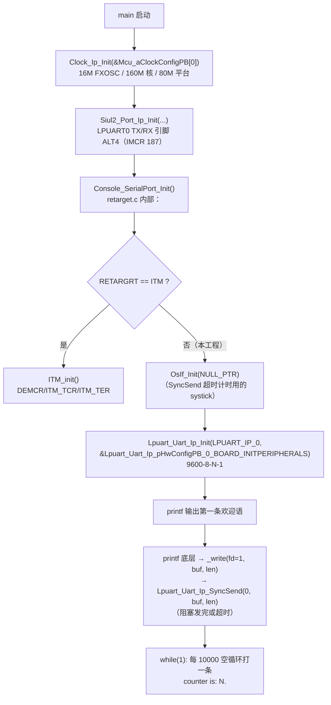

# UART（LPUART + printf 重定向）— S32K344 RTD 0.9.0 实战教学

> 源工程: `D:\wnagjin\S32K3_mydetail\详细教学(1)\详细教学\S32K3 Training-RTD\S32DSv3p4_RTDv090\S32K344_UART_Printf_Example_090_34\S32K344_UART_Printf_Example_090_34`（LPUART_IP_0 + retarget 实现 printf）
> 源文件（代码原样摘录，未经任何修改）:
> - `...\src\main.c`（共 72 行）
> - `...\src\retarget.c`（共 170 行，printf 重定向核心）
> - `...\include\retarget.h`（共 19 行）

> 注：ReadMe.txt 标注 RTD 0.8.1，代码与生成物实际为 `S32K3_RTD_0_9_0__ASR_REL_4_4_REV_0000_20210326`，以代码为准。

## 1. 外设概述

S32K344 的 LPUART 复用为通用异步串口。RTD 0.9.0 驱动层为 `Lpuart_Uart_Ip`。本工程的核心不是串口参数本身，而是 **把 C 库的 `printf` 底层输出重定向到 LPUART**：`retarget.c` 实现 Newlib 的 `_write()`（或 EWL 的 `__write_console()`），内部调 `Lpuart_Uart_Ip_SyncSend` 同步发送；`retarget.h` 用宏 `RETARGRT` 在 ITM（SWO 调试口）与 UART 两路间切换，本工程选 `UART`。

使用硬件：S32K3-WB 的 J16 microUSB 连 PC，PC 端串口助手按 `9600, 8, None, 1`（见第 6 节坑 2 的说明）连接即可看到 `counter is: N.` 滚动输出。

配置生成物 `Lpuart_Uart_Ip_pHwConfigPB_0_BOARD_INITPERIPHERALS`：Actual baudrate 9600、mantissa 641U、divisor 13U、无校验、1 停止位、8 数据位、`LPUART_UART_IP_USING_INTERRUPTS`。

## 2. 初始化与使用时序（mermaid flowchart 源码）



## 3. 原样代码（按逻辑段落分块，标注来源工程与行号范围）

### 3.1 main.c（共 72 行）

**文件头与 include（第 1–40 行，来源：S32K344_UART_Printf_Example_090_34\src\main.c）：**

```c
/*==================================================================================================
*   Project              : RTD AUTOSAR 4.4
*   Platform             : CORTEXM
*   Peripheral           : S32K3XX
*   Dependencies         : none
*
*   Autosar Version      : 4.4.0
*   Autosar Revision     : ASR_REL_4_4_REV_0000
*   Autosar Conf.Variant :
*   SW Version           : 0.9.0
*   Build Version        : S32K3_RTD_0_9_0__ASR_REL_4_4_REV_0000_20210326
*
*   (c) Copyright 2020 - 2021 NXP Semiconductors
*   All Rights Reserved.
*
*   NXP Confidential. This software is owned or controlled by NXP and may only be
*   used strictly in accordance with the applicable license terms. By expressly
*   accepting such terms or by downloading, installing, activating and/or otherwise
*   using the software, you are agreeing that you have read, and that you agree to
*   comply with and are bound by, such license terms. If you do not agree to be
*   bound by the applicable license terms, then you may not retain, install,
*   activate or otherwise use the software.
==================================================================================================*/

/**
*   @file main.c
*
*   @addtogroup main_module main module documentation
*   @{
*/

/* Including necessary configuration files. */
#include "Mcal.h"
#include "Clock_Ip.h"
#include "Siul2_Port_Ip.h"
#include "stdio.h"
#include "retarget.h"

volatile int exit_code = 0;
/* User includes */
```

**main 函数（第 42–72 行，来源：S32K344_UART_Printf_Example_090_34\src\main.c）：**

```c
/*!
  \brief The main function for the project.
  \details The startup initialization sequence is the following:
 * - startup asm routine
 * - main()
*/
int main(void)
{
    /* Write your code here */
	uint32_t i,counter = 0;
    /* Init clock  */
    Clock_Ip_Init(&Mcu_aClockConfigPB[0]);
    /* Initialize all pins */
    Siul2_Port_Ip_Init(NUM_OF_CONFIGURED_PINS0, g_pin_mux_InitConfigArr0);

	Console_SerialPort_Init();

	printf("This is a printf demo for S32K3.\n");
	while(1)
	{
    	printf("counter is: %d.\n",counter++);

    	for(i=0;i<10000;i++)
    	{
    		;
    	}
	}

}

/** @} */
```

### 3.2 retarget.h（共 19 行，重定向开关）

**全文（第 1–19 行，来源：S32K344_UART_Printf_Example_090_34\include\retarget.h）：**

```c
/*
 * retarget_uart.h
 */

#ifndef RETARGET__H_
#define RETARGET_H_

#define ITM   0
#define UART  1

#define RETARGRT   UART  /* select the re-target peripheral */
/*
 * select the UART PAL instance and configuration for the console re-target implementation
 */
#define CONSOLE_UART_INST  LPUART_IP_0
#define CONSOLE_UART_CONFIG   &Lpuart_Uart_Ip_pHwConfigPB_0_BOARD_INITPERIPHERALS

void Console_SerialPort_Init(void);

#endif /* RETARGET_H_ */
```

### 3.3 retarget.c（共 170 行）

**文件说明注释（第 1–41 行，来源：S32K344_UART_Printf_Example_090_34\src\retarget.c）：**

```c
//*****************************************************************************
// retarget_itm.c - Provides retargeting of C library printf/scanf
//                  functions via ITM / SWO Trace
//*****************************************************************************
// Copyright 2015, 2017-2019 NXP
// All rights reserved.
//
// Software that is described herein is for illustrative purposes only
// which provides customers with programming information regarding the
// LPC products.  This software is supplied "AS IS" without any warranties of
// any kind, and NXP Semiconductors and its licensor disclaim any and
// all warranties, express or implied, including all implied warranties of
// merchantability, fitness for a particular purpose and non-infringement of
// intellectual property rights.  NXP Semiconductors assumes no responsibility
// or liability for the use of the software, conveys no license or rights under
// any patent, copyright, mask work right, or any other intellectual property
// rights in or to any products. NXP Semiconductors reserves the right to make
// changes in the software without notification. NXP Semiconductors also makes
// no representation or warranty that such application will be suitable for the
// specified use without further testing or modification.
//
// Permission to use, copy, modify, and distribute this software and its
// documentation is hereby granted, under NXP Semiconductors' and its
// licensor's relevant copyrights in the software, without fee, provided that it
// is used in conjunction with NXP Semiconductors microcontrollers.  This
// copyright, permission, and disclaimer notice must appear in all copies of
// this code.
//*****************************************************************************

/************************************************************************************************
 * How to implement this file to achieve UART printf.
 * 1. call Console_SerialPort_Init() to initialize the UART. And include "retarget.h" where you call this function.
 * 2. Include "stdio.h" where you call printf.
 *
 * Note: Please choose Newlib for library.Float point is not support if you choose Newlib_Nano.
 *
 * Date: 2021/3/15
 * **********************************************************************************************/
#include <stdint.h>
#include <stdio.h>
#include "retarget.h"
```

**ITM 分支寄存器定义（第 44–102 行，RETARGRT == ITM 时才编译，来源：S32K344_UART_Printf_Example_090_34\src\retarget.c）：**

```c
#if(RETARGRT == ITM)

// ******************************************************************
// Cortex-M SWO Trace / Debug registers used for accessing ITM
// ******************************************************************

// CoreDebug - Debug Exception and Monitor Control Register
#define DEMCR           (*((volatile uint32_t *) (0xE000EDFC)))
// DEMCR Trace Enable Bit
#define TRCENA          (1UL << 24)

// ITM Stimulus Port Access Registers
#define ITM_Port8(n)    (*((volatile uint8_t *) (0xE0000000 + 4 * n)))
#define ITM_Port16(n)   (*((volatile uint16_t *) (0xE0000000 + 4 * n)))
#define ITM_Port32(n)   (*((volatile uint32_t *) (0xE0000000 + 4 * n)))

// ITM Trace Control Register
#define ITM_TCR (*((volatile  uint32_t *) (0xE0000000 + 0xE80)))
// ITM TCR: ITM Enable bit
#define ITM_TCR_ITMENA (1UL << 0)

// ITM Trace Enable Register
#define ITM_TER (*((volatile  uint32_t *) (0xE0000000 + 0xE00)))
// ITM Stimulus Port #0 Enable bit
#define ITM_TER_PORT0ENA (1UL << 0)

// ******************************************************************
// Buffer used for pseudo-ITM reads from the host debugger
// ******************************************************************

// Value identifying ITM_RxBuffer is ready for next character
#define ITM_RXBUFFER_EMPTY    0x5AA55AA5
// variable to receive ITM input characters
volatile int32_t ITM_RxBuffer = ITM_RXBUFFER_EMPTY;

// Privilege register: registers that can be accessed by unprivileged code
#define ITM_TPR   (*((unsigned long *) 0xe0000e40))

// Lock Access register
#define ITM_LAR   (*((unsigned long *) 0xe0000fb0))

// unlock value
#define ITM_LAR_ACCESS  0xc5acce55

void ITM_init(void)
{
    ITM_LAR = ITM_LAR_ACCESS; // unlock
    ITM_TCR = 0x1;            // global enable for ITM
    ITM_TPR = 0x1;            // first 8 stim registers have unpriv access
    ITM_TER = 0xf;            // enable 4 stim ports
    DEMCR = TRCENA;           // global enable DWT and ITM
}

#else

#include "retarget.h"
#include "Lpuart_Uart_Ip.h"

#endif
```

**控制台初始化函数（第 104–117 行，来源：S32K344_UART_Printf_Example_090_34\src\retarget.c）：**

```c
void Console_SerialPort_Init(void)
{
#if(RETARGRT == ITM)
	/* initialize the ITM as the console serial communication port */
	ITM_init();
#else
	/*init the systick to use in timeout counting in func Lpuart_Uart_Ip_SyncSend if you chose system timer.
	 * If dummy timer is chosen,not necessary to call OsIf_Init.*/
	OsIf_Init(NULL_PTR);
	/* initialize the UART as the console serial communication port */
	Lpuart_Uart_Ip_Init(CONSOLE_UART_INST,CONSOLE_UART_CONFIG);

#endif
}
```

**printf 底层 _write / __write_console（第 119–170 行，来源：S32K344_UART_Printf_Example_090_34\src\retarget.c）：**

```c
// ******************************************************************
// EWL C Library function : __write_console
// Newlib C library function : _write
//
// Function called by bottom level of printf routine within C library.
// With the default semihosting stub, this would write the
// character(s) to the debugger console window (which acts as
// stdout). But this version writes the character(s) from the Cortex
// M3/M4 SWO / ITM interface for display in the ITM Console.
// ******************************************************************
#if defined (__NEWLIB__)
int _write(int iFileHandle, char *pcBuffer, int iLength) {
#elif defined (__EWL__)
int	__write_console(__std(__file_handle) iFileHandle, unsigned char *pcBuffer, __std(size_t) *count) {
#endif

    int32_t num = 0;
#if defined (__EWL__)
    int iLength = *count;
#endif

    //check that iFileHandle == 1 to confirm that write is to stdout
    if (iFileHandle != 1) {
        return 0;
    }

#if(RETARGRT == ITM)
    // check if debugger connected and ITM channel enabled for tracing
    if ((DEMCR & TRCENA) &&
    // ITM enabled
            (ITM_TCR & ITM_TCR_ITMENA) &&
            // ITM Port #0 enabled
            (ITM_TER & ITM_TER_PORT0ENA)) {

        while (num < iLength) {
            while (ITM_Port32(0) == 0) {
            }
            ITM_Port8(0) = pcBuffer[num++];
        }
        return 0;
    } else
        // Function returns number of unwritten bytes if error
        return (iLength);
#else
   if(LPUART_UART_IP_STATUS_SUCCESS == Lpuart_Uart_Ip_SyncSend(CONSOLE_UART_INST,pcBuffer,iLength))
   {
	   return 0;
   }
   else
    return iLength;
#endif
}
```

## 4. API 速查

| API | 作用 | 关键参数 |
|---|---|---|
| `Console_SerialPort_Init()` | 初始化 printf 输出通道（retarget.c 提供） | 内部按 `RETARGRT` 宏走 ITM 或 UART 分支 |
| `OsIf_Init(NULL_PTR)` | 启动 systick，供 `SyncSend` 超时计数 | 系统定时器选 dummy 时可不调（retarget.c 注释） |
| `Lpuart_Uart_Ip_Init(inst, cfg)` | 初始化 LPUART 实例 | inst=`LPUART_IP_0`；cfg=`&Lpuart_Uart_Ip_pHwConfigPB_0_BOARD_INITPERIPHERALS` |
| `Lpuart_Uart_Ip_SyncSend(inst, buf, len)` | 同步阻塞发送（`_write` 的最终出口） | 返回 `LPUART_UART_IP_STATUS_SUCCESS` |
| `_write(fd, buf, len)` | Newlib printf 底层 | fd==1（stdout）才转发，否则返回 0 |
| `__write_console(handle, buf, count)` | EWL 库 printf 底层 | 由 `__EWL__` 宏切换 |
| `ITM_init()` | ITM/SWO 调试口输出初始化 | 解锁 ITM_LAR、使能 TER/TCR/DEMCR |

**移植到自有工程（ReadMe 官方步骤）**：① 拷 `retarget.c` + `retarget.h` 进工程；② 调 `Console_SerialPort_Init()` 并 include `retarget.h`；③ 调 printf 处 include `stdio.h`，C 库选 **Newlib**（Newlib_Nano 不支持浮点）。

## 5. 配置生成物（board/generate）

| 文件 | 内容要点 |
|---|---|
| `generate/src/Lpuart_Uart_Ip_BOARD_InitPeripherals_PBcfg.c` | `Lpuart_Uart_Ip_pHwConfigPB_0_BOARD_INITPERIPHERALS`：Actual baudrate 9600、mantissa 641U、divisor 13U、`LPUART_UART_IP_PARITY_DISABLED`、`ONE_STOP_BIT`、`8_BITS_PER_CHAR`、`LPUART_UART_IP_USING_INTERRUPTS`、收/发/错误回调均 NULL_PTR、DMA 通道 255/255（未用） |
| `generate/include/Lpuart_Uart_Ip_BOARD_InitPeripherals_PBcfg.h` | 配置声明（retarget.h 通过宏引用） |
| `board/Siul2_Port_Ip_Cfg.c` | LPUART 引脚：pinPortIdx 27（ALT4）、pinPortIdx 28（GPIO+inputMux IMCR 187 / `PORT_INPUT_MUX_ALT4`） |
| `board/Clock_Ip_Cfg.c|h`、`board/Clock_Ip_PBcfg.c|h` | 时钟树 |
| `generate/include/OsIf_Cfg.h`、`generate/src/OsIf_Cfg.c` | OsIf 系统定时器配置 |

## 6. 常见坑（仅实证的）

1. **C 库必须选 Newlib，Newlib_Nano 不支持浮点**。ReadMe.txt 与 retarget.c 头注释双重原文："Please choose Newlib for library. Float point is not support if you choose Newlib_Nano."。打印 `%f` 全空或死机先查这里。
2. **ReadMe 写 PC 串口 115200，生成配置实际是 9600**。ReadMe.txt 第 25 行让串口助手设 `115200,8,None,1`，但 `Lpuart_Uart_Ip_BOARD_InitPeripherals_PBcfg.c` 第 131–136 行明确 `Actual baudrate 9600 / mantissa 641 / divisor 13`。两者矛盾（ReadMe 为 RTD 0.8.1 时代文档），**以 PBcfg 生成为准：9600**；要 115200 就在 S32_CT 里改波特率重新生成。
3. **`_write` 只转发 stdout**：`iFileHandle != 1` 直接返回 0（retarget.c 第 141–143 行），`fprintf(stderr, …)`、`fwrite` 到其他 fd 不会上串口。
4. **`SyncSend` 依赖 OsIf 计时**：UART 分支里 `Console_SerialPort_Init` 先 `OsIf_Init(NULL_PTR)` 再 `Lpuart_Uart_Ip_Init`（retarget.c 第 112–114 行注释）。系统定时器选了 dummy timer 时可省；漏了 OsIf_Init 而超时计数依赖系统定时器时，超时逻辑失效。
5. **`Clock_Ip_Init` 两种写法并存**：本工程 `Clock_Ip_Init(&Mcu_aClockConfigPB[0])`，SPI 工程用 `Clock_Ip_Init(Mcu_aClockConfigPB)`——数组名与首元素地址等价，均可编译；照抄任一工程写法皆可。
6. **改用 ITM 输出只需改一个宏**：`retarget.h` 里 `#define RETARGRT UART` 改成 `ITM`，`retarget.c` 的 ITM 分支（DEMCR/ITM_TCR/ITM_TER 寄存器序列）自动生效，无需动 `_write` 之外的代码；前提是调试器连着且 SWO 已配置。
7. **printf 是阻塞发送**：底层 `Lpuart_Uart_Ip_SyncSend` 同步等发完，9600 波特下打长字符串实时性差；中断/printf 异步化需自行换 `Lpuart_Uart_Ip_AsyncSend` 方案（本工程未实现，属扩展项）。
