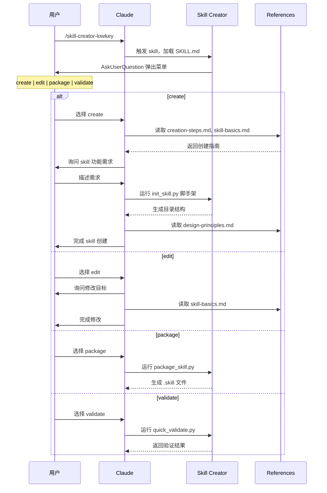

# Skill Creator Lowkey

基于 [Claude 官方 skill-creator](https://github.com/anthropics/claude-code) 改造的 Skill 创建工具。

## 交互流程



## 与官方版本的区别

| 项目 | 官方 skill-creator | 本版本 (lowkey) |
|------|-------------------|-----------------|
| 交互方式 | 无菜单，全量加载 | `argument-hint` 交互式菜单 |
| SKILL.md | 465行全部加载 | ~50行路由，按需加载 |
| 内容组织 | 单文件 | 拆分为 5 个 references |
| Token 消耗 | 高（每次全量） | 低（按需加载） |

## 目录结构

```
skill-creator-lowkey/
├── SKILL.md                    # 路由入口（~50行）
├── LICENSE.txt                 # Apache 2.0 许可证
├── README.md                   # 本文件
├── scripts/
│   ├── init_skill.py           # 初始化 skill 脚手架
│   ├── package_skill.py        # 打包为 .skill 文件
│   └── quick_validate.py       # 验证 skill 结构
└── references/
    ├── skill-basics.md         # Skill 概念、结构、资源类型
    ├── creation-steps.md       # 创建流程 Step 1-6
    ├── design-principles.md    # 交互模式、token 优化、安全
    ├── workflows.md            # 工作流设计模式
    └── output-patterns.md      # 输出格式模式
```

## 许可证

本项目基于 Apache License 2.0，继承自 Claude 官方 skill-creator。详见 [LICENSE.txt](LICENSE.txt)。
